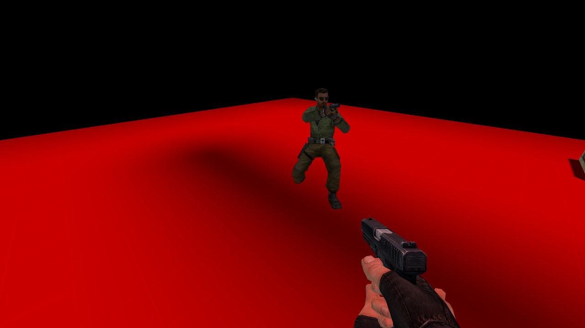
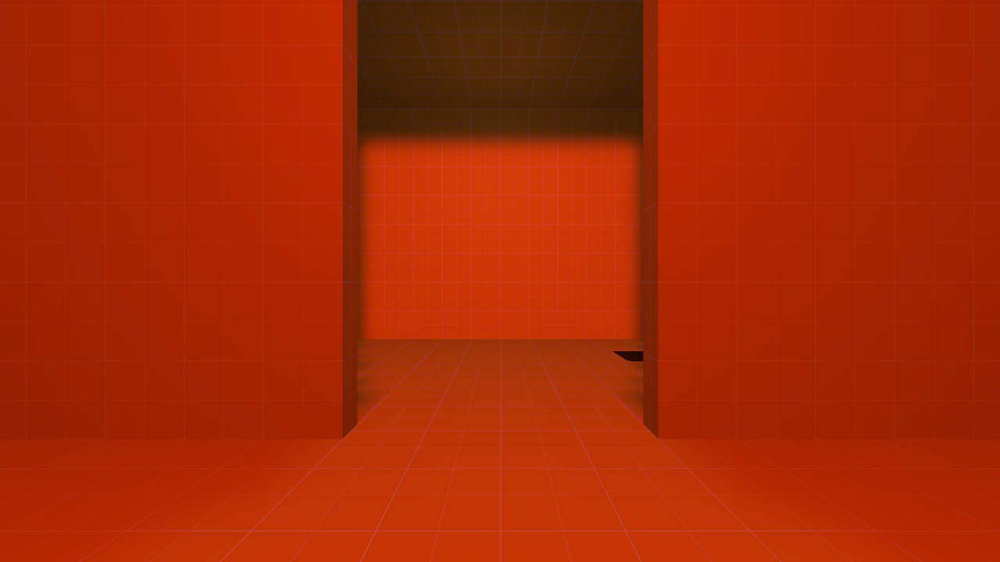
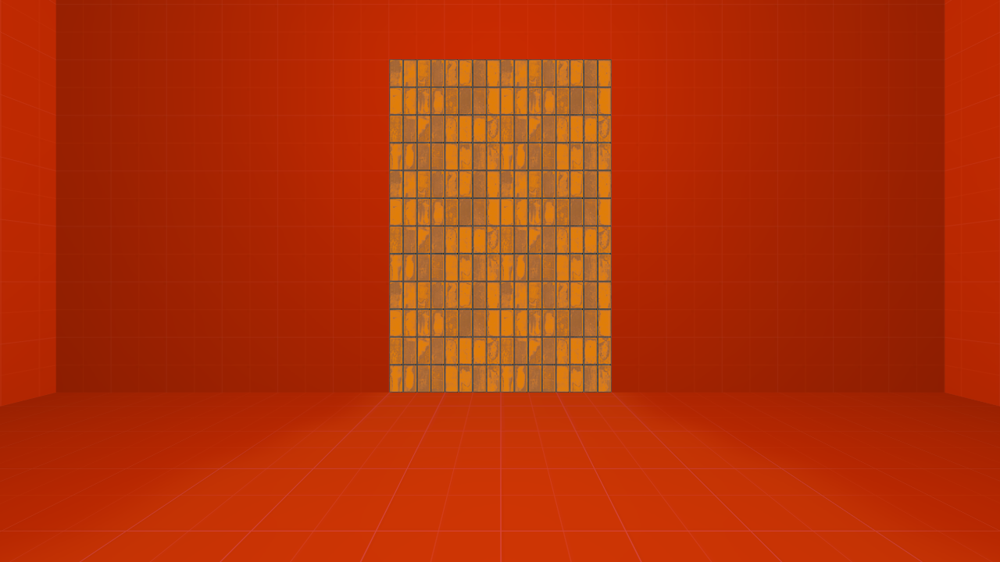
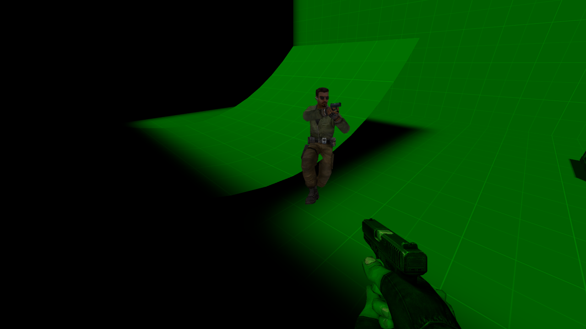
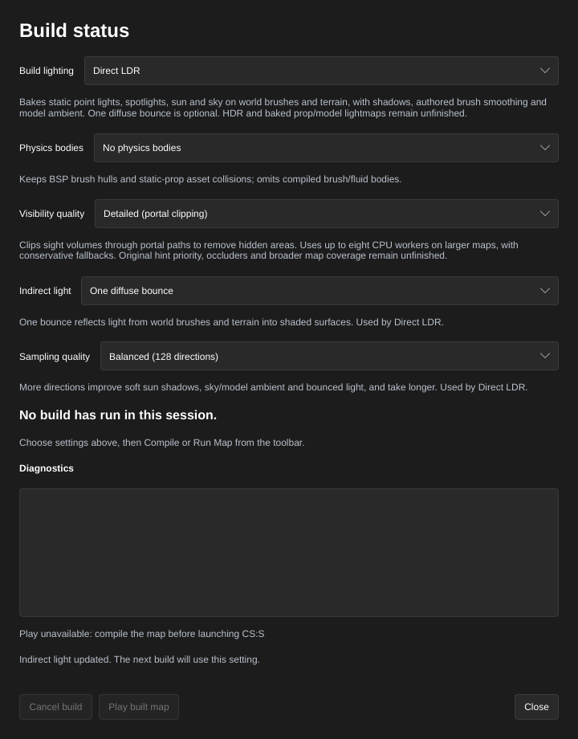
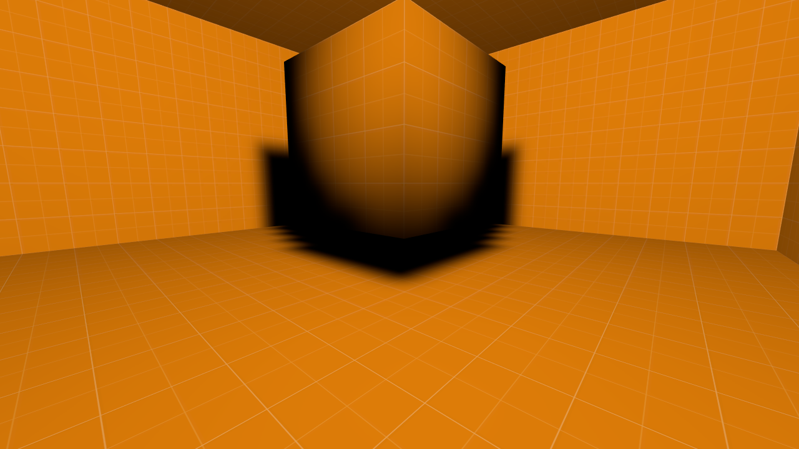
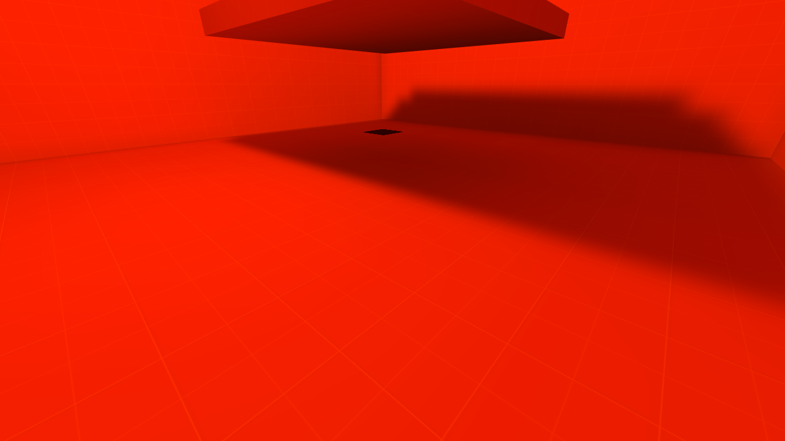
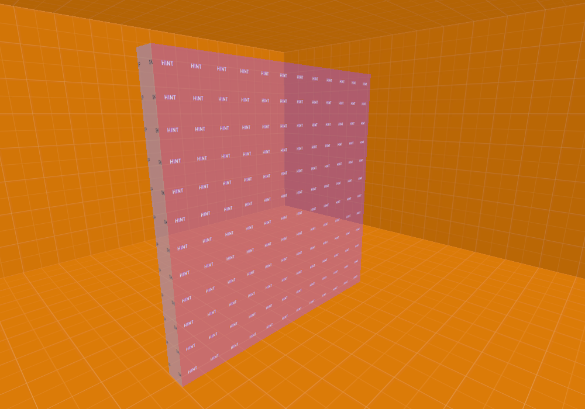
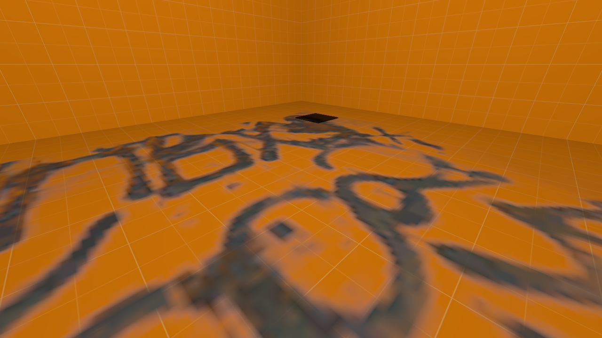
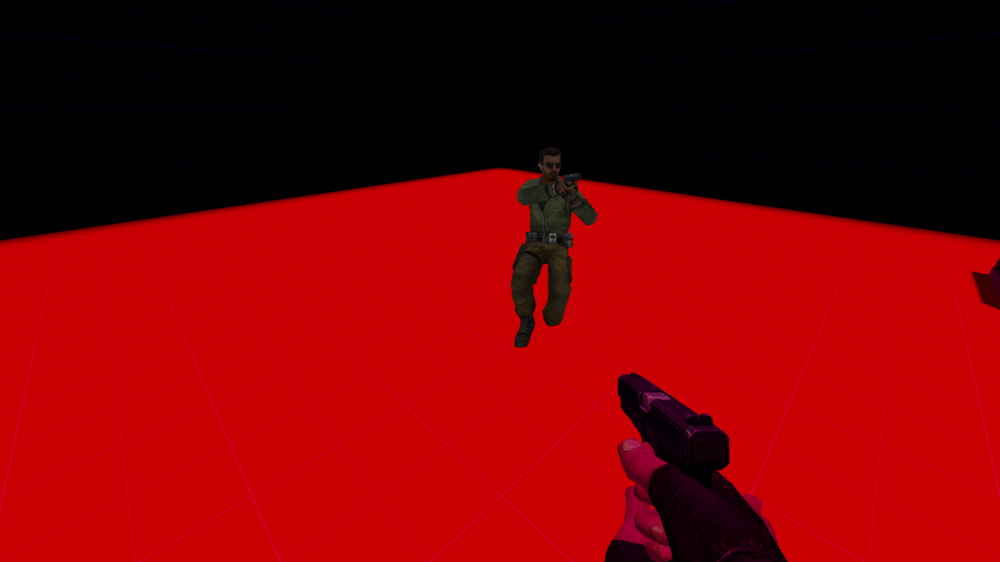

# HammeRR

**A modern, AI-first map editor for Counter-Strike: Source, native on Linux.**

HammeRR opens and saves Hammer's VMF files, renders your map with the game's own materials, and compiles it into a playable BSP with its own compiler. Every tool is also available to AI agents over MCP, and agents work in the same live session you're looking at.


> [!NOTE]
> HammeRR is in active development. The editor is ready for building, texturing and wiring up brush maps; the compiler is experimental. See [Status](docs/status.md).

**[Quick start](#quick-start) · [AI agents](#built-for-ai-agents) · [Feature tour](#feature-tour) · [Manual](docs/README.md) · [Status](docs/status.md)**

## Why HammeRR

- **Native on Linux.** Written in Rust and rendered with Vulkan. No Wine and no Windows compile tools.
- **AI-first.** Every feature has an MCP tool. Agents see what you see, edit what you edit and share your undo history.
- **Hammer-compatible.** Reads and writes VMF, retaining imported properties and extra blocks.
- **Preview before you commit.** Tools show their result before changing anything. Apply is one undo step; Cancel leaves the map untouched.
- **Build and play in one click.** A native BSP compiler with lighting, physics, water, props and terrain, and a direct launch into CS:S.

## Quick start

You need Linux, Rust 1.92 or newer, a Vulkan graphics driver, and Counter-Strike: Source installed through Steam.

```sh
cargo build --release -p editor -p compiler
./target/release/editor path/to/map.vmf
```

Leave out the filename to start a new map. HammeRR finds CS:S through Steam and loads its materials and entity definitions automatically. See [Getting started](docs/getting-started.md) for launch options and custom content.

## Built for AI agents

While the editor runs, it serves MCP at `http://127.0.0.1:7377/mcp`. Point your agent at it:

```json
{ "mcpServers": { "hammerr": { "url": "http://127.0.0.1:7377/mcp" } } }
```

The agent works in your session: its edits appear live and land in your undo history, and it can set up a preview for you to approve. It can render any view to check its own work, then compile the map and launch the game. To give an agent a private session without a window, run the editor with `--headless`.

| Built by an agent | Checked by the agent |
| --- | --- |
|  |  |

Setup details, conventions and the full tool list are in [AI agents and MCP](docs/mcp.md).

## Feature tour

### Build geometry

| Brush shapes | Hollow |
| --- | --- |
|  |  |
| Wedges, cylinders, cones, spheres and arches from exact dimensions. | Turn solids into rooms, with walls inside or outside, and any faces left open. |

| Carve | Clip |
| --- | --- |
|  |  |
| Subtract one or more shapes from other brushes. | Cut by drawing a line, typing a plane or picking three points, then fine-tune with handles. |

| Transforms and texture lock | Mirror and shear |
| --- | --- |
|  |  |
| Move, rotate and scale with handles or exact values. Textures follow, stretch or stay fixed. | Reflect across any axis or slant one coordinate by another, with textures attached. |

[Brushes and transforms →](docs/brushes.md) · [Hollow, carve and clip →](docs/brush-tools.md)

### Reshape vertices, edges and faces

| Move, scale and rotate | Weld |
| --- | --- |
|  |  |
| Edit faces, edges and corners directly. A rotated top face becomes a sloped roof. | Merge corners at their average, an existing corner or an exact position. |

| Split and raise | Roof ridge |
| --- | --- |
|  |  |
| Add a corner in the middle of a face or edge and push it outward. | Raise a four-sided face into two roof slopes. |

| Flat partitions | Any convex face |
| --- | --- |
|  |  |
| Divide a face, then raise, extrude or restyle each piece. | Faces with three to eight corners, with per-piece materials and texture placement. Keep the plan in the map for later. |

[Vertices, edges and faces →](docs/components.md) · [Flat partitions →](docs/partitions.md)

### Materials and textures

| Material browser | Texture painting |
| --- | --- |
|  |  |
| Thumbnails, search, categories, materials used in the map, recent materials and favorites. | Sample a face, then brush its material or its whole projection across other faces. |

| Texture wrapping | One texture across many faces |
| --- | --- |
|  |  |
| Continue a texture seamlessly across shared edges and around columns. | Fit a texture across a group of faces, or project it from the current view. |

| Material replacement | Face lighting |
| --- | --- |
|  |  |
| Find and replace a material across the map or the selection, with a preview. | Set lightmap scales and smoothing groups, and inspect them in dedicated views. |

[Materials and textures →](docs/textures.md)

### Select and view

| Paint selection | Volume selection |
| --- | --- |
|  |  |
| Brush over the objects or faces you want. | Select everything inside exact XYZ bounds. |

| Viewport modes | Saved camera views |
| --- | --- |
|  |  |
| Textured, flat, wireframe, lightmap density and smoothing groups, in every projection. | Name camera positions and jump back to them. They are saved in the map. |

[Editor basics →](docs/basics.md) · [Selecting →](docs/selection.md)

### Entities and logic

| Connections | Safe renaming |
| --- | --- |
|  |  |
| Wire outputs to inputs, with suggestions from the map and the game's entity definitions. | Rename an entity and update every reference to it in one step. |

| Edit many entities |
| --- |
|  |
| Change shared properties, flags and colors across a selection. |

Also: a typed inspector with color pickers, brightness sliders and spawn flags; light, spotlight and sun helpers; brush entities; and world settings.

[Entities and logic →](docs/entities.md)

### Organize and check

| Map checks | Design notes |
| --- | --- |
|  |  |
| Find problems, jump to them, and apply reviewed repairs. | Keep briefs, object notes and regions in the map. Agents read and write them too. |

| Object report | Autosave and recovery |
| --- | --- |
|  |  |
| Find, select, frame, hide and isolate objects. | Periodic snapshots, manual checkpoints and save backups, opened as safe copies. |

| Map statistics | Leak tracing |
| --- | --- |
|  |  |
| Counts and breakdowns of brushes, entities, materials, models and terrain. | Follow a leak's pointfile through the map, point by point. |

[Organizing and checking maps →](docs/map-tools.md)

### Compile and play

| Native compiler | Play in CS:S |
| --- | --- |
|  |  |
| Baked light from point lights, spotlights, sun and sky, with soft sun shadows, plus CS:S engine physics, water, cubemaps, static props and terrain. | **Run Map** compiles and launches the game. Builds run in the background and never overwrite good output with a failed one. |

[Compile and play →](docs/compile-and-play.md)

| Areaportals |
| --- |
|  |
| Control visibility between areas through named portals and door connections. |

| Distance-fading windows |
| --- |
|  |
| Fade rendered windows to opaque with distance and hide the area beyond. |

| Connected terrain lighting |
| --- |
|  |
| Matching full edges share smooth lighting normals in the viewport and compiled map. |

| Visibility quality |
| --- |
|  |
| Choose a quick conservative build or parallel portal clipping for tighter visibility. |

| Brush smoothing |
| --- |
|  |
| Blend baked lighting across selected brush faces with shared smoothing groups. |

| Bounced light |
| --- |
|  |
| Add one diffuse light bounce from world surfaces and terrain. |

| Hint planes |
| --- |
|  |
| Guide visibility partitions with invisible hint surfaces and skip bounds. |

| Imported overlays |
| --- |
|  |
| Compile surface markings with material, render order, distance fade and preserved face bindings. |

[Overlays →](docs/overlays.md)

| Model ambient lighting |
| --- |
|  |
| Models pick up reflected light from nearby world surfaces and visible sky. |

## Status

The editor covers most everyday brush work. Notable gaps:

- **Terrain**: imported terrain displays and compiles, but can't be created or edited yet.
- **Models**: static props compile but aren't drawn in the viewport yet.
- **Compiler**: Fast and Detailed visibility are available; lighting covers direct light, sky ambient and one optional diffuse bounce; HDR remains unfinished.

The full picture is in [Status and roadmap](docs/status.md).

## Documentation

The [manual](docs/README.md) covers every feature, step by step:

[Getting started](docs/getting-started.md) · [Editor basics](docs/basics.md) · [Selecting](docs/selection.md) · [Brushes and transforms](docs/brushes.md) · [Hollow, carve and clip](docs/brush-tools.md) · [Vertices, edges and faces](docs/components.md) · [Flat partitions](docs/partitions.md) · [Materials and textures](docs/textures.md) · [Entities and logic](docs/entities.md) · [Organizing and checking maps](docs/map-tools.md) · [Compile and play](docs/compile-and-play.md) · [AI agents and MCP](docs/mcp.md) · [Development](docs/development.md)

## Credits

- The point-light helper uses a [CC0 light bulb model by Josh Dean / Poly Haven](https://polyhaven.com/a/lightbulb_led) ([provenance](crates/render/assets/lightbulb/SOURCE.txt)).
- Counter-Strike: Source and its assets are not included.
