# HammeRR

**An AI-first Counter-Strike: Source map editor and compiler for Linux.**

Edit VMF maps with native game assets. Build playable BSPs with integrated visibility, lighting and engine physics.
Humans and AI agents share the same editing operations, previews and Undo history.


[Manual](docs/README.md) · [Status and limits](docs/status.md) · [MCP setup](docs/mcp.md)

## Quick start

Requires Linux, Rust 1.92+, a C++20 compiler, Vulkan and Counter-Strike: Source installed through Steam.

```sh
cargo build --release -j8 -p editor -p editor-core -p compiler -p native-runtime
./target/release/editor path/to/map.vmf
```

Omit the map path for a new map. Game content is found through Steam.
See [Getting started](docs/getting-started.md) for custom content and launch options.
The compiler is experimental; see [Status](docs/status.md).

## MCP

Connect to the live editor at `http://127.0.0.1:7377/mcp`:

```json
{"mcpServers":{"hammerr":{"url":"http://127.0.0.1:7377/mcp"}}}
```

Agents can edit, render, compile and launch maps. Use `hammerr-headless` for a private session without a window.
See the [tool index and setup](docs/mcp.md).

## Feature tour

| [Brush shapes](docs/brushes.md) | [Hollow rooms](docs/brush-tools.md) |
| --- | --- |
| 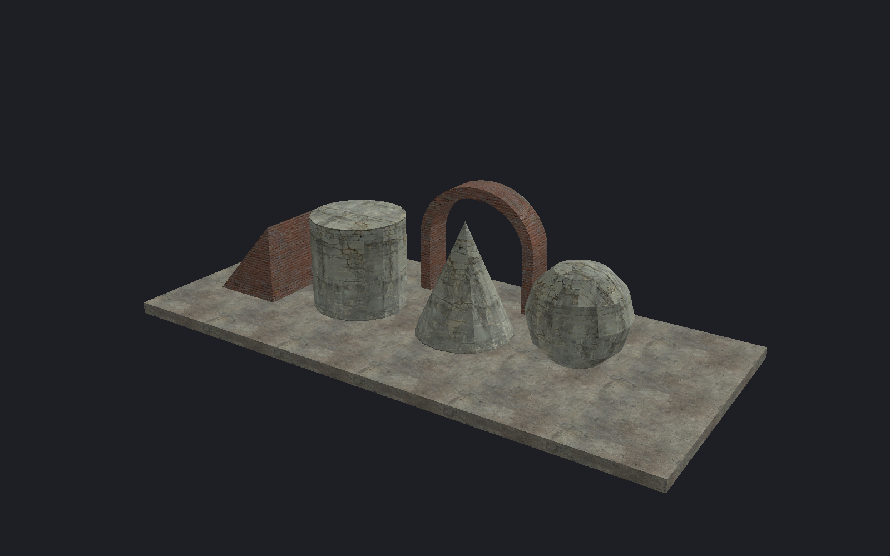 | 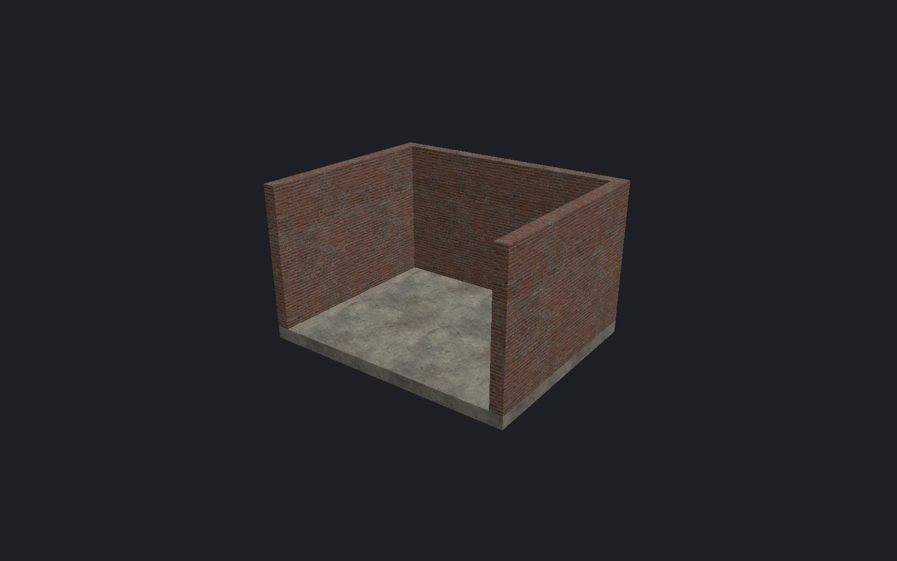 |
| Build editable geometry from exact dimensions. | Turn solids into rooms with selected openings. |

| [Carved openings](docs/brush-tools.md#carve) | [Clip planes](docs/brush-tools.md#clip) |
| --- | --- |
| 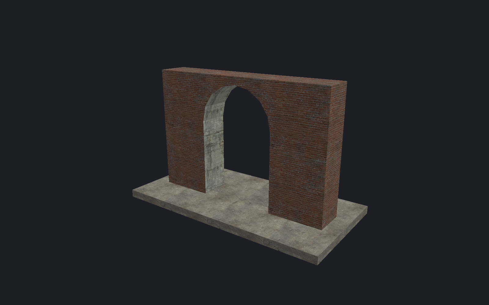 | 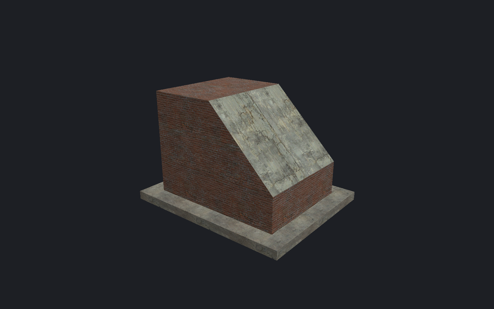 |
| Subtract shapes to form doors and passages. | Cut brushes with a line, plane or three points. |

| [Component editing](docs/components.md) | [Repeated placement](docs/repeated-placement.md) |
| --- | --- |
| 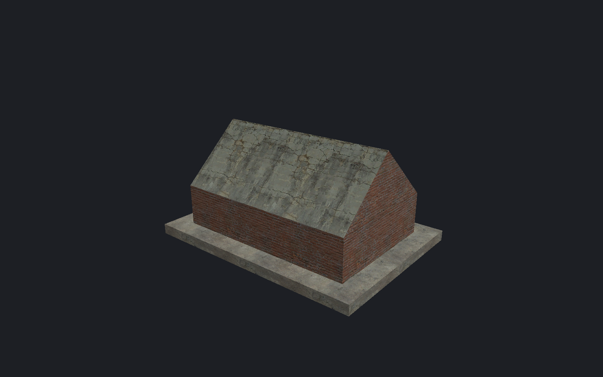 |  |
| Reshape corners, edges and faces. | Repeat assemblies with shared transforms and safe references. |

| [Materials](docs/textures.md) | [Normal maps](docs/normal-maps.md) |
| --- | --- |
| 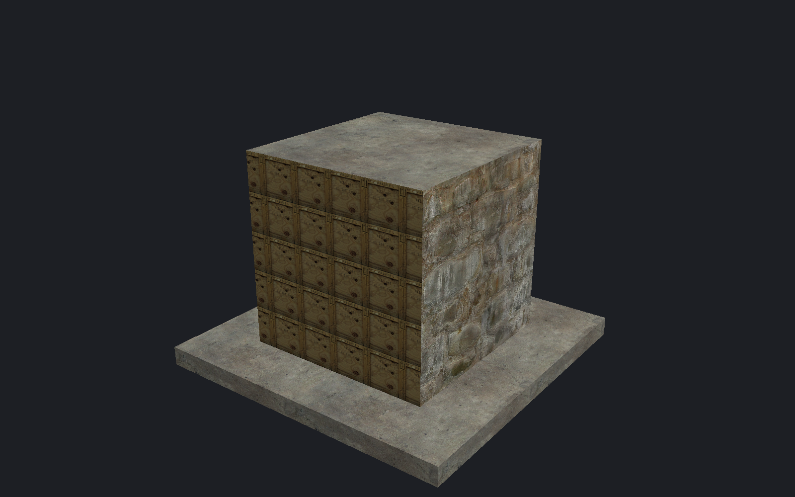 |  |
| Apply, paint, wrap and fit native materials. | Inspect supported surface detail before compiling. |

| [Terrain](docs/terrain.md) | [Compiled terrain](docs/terrain.md#compile-split-borders) |
| --- | --- |
| 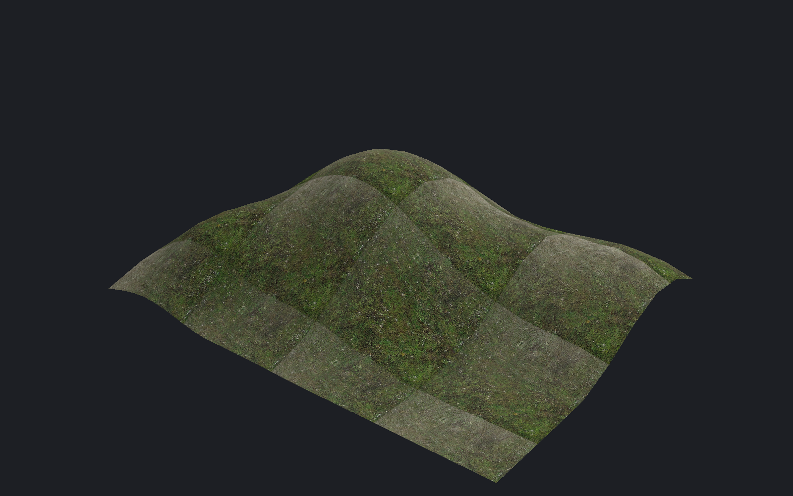 | 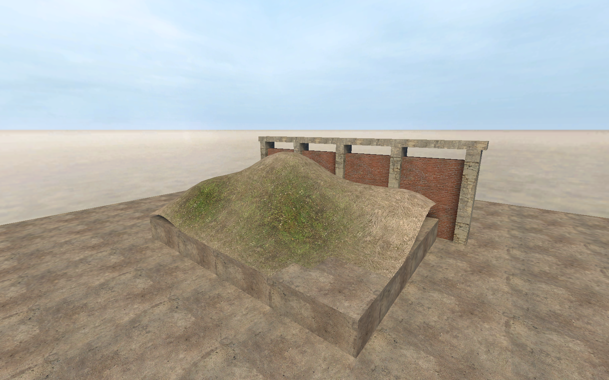 |
| Sculpt, paint, sew and move displacement samples. | Build mixed-grid terrain with lighting and collision. |

| [Lighting preview](docs/lighting-preview.md) | [Baked lighting](docs/compile-and-play.md#lighting) |
| --- | --- |
|  |  |
| Inspect unshadowed point, spot and sun lighting. | Compile LDR/HDR lighting, soft shadows and diffuse bounces. |

| [Models](docs/models.md) | [Surface placement](docs/placement.md) |
| --- | --- |
| 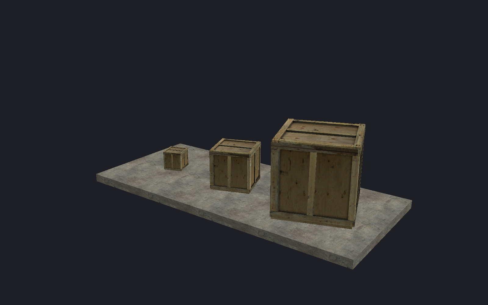 | 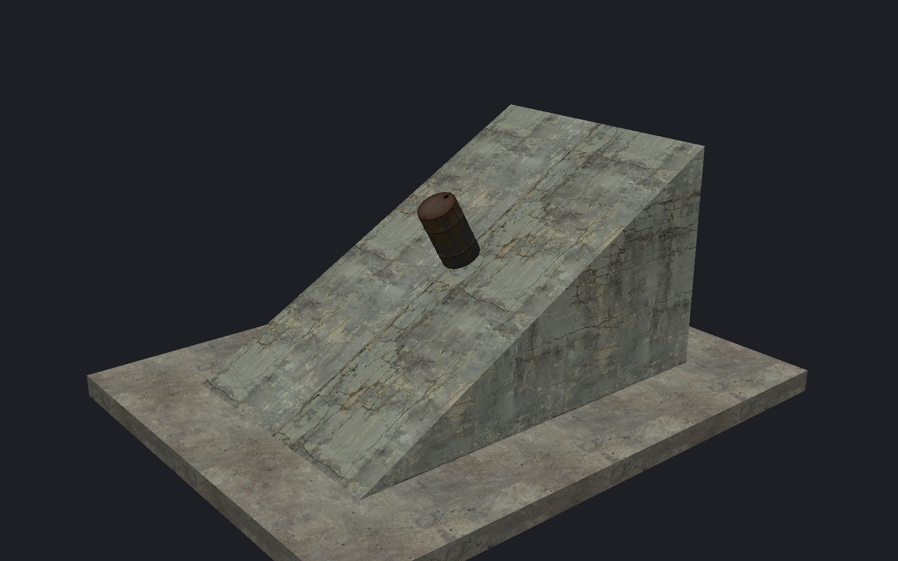 |
| Choose skins, bodygroups, scale, tint and opacity. | Place objects on floors, ceilings or picked surfaces. |

| [Water](docs/water.md) | [Ropes](docs/ropes.md) |
| --- | --- |
| 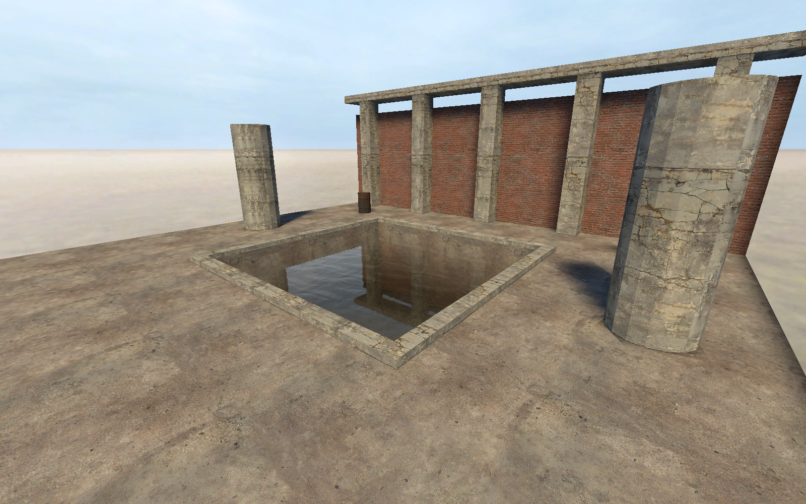 | 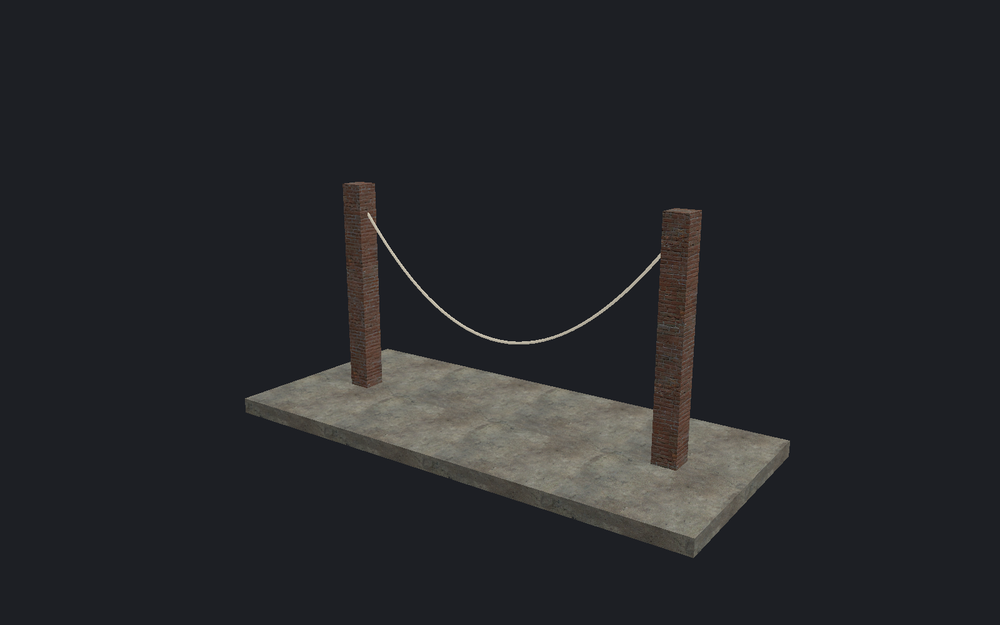 |
| Build pools with native surfaces and optional fluid physics. | Preview linked spans with authored slack and width. |

| [Fog](docs/fog.md) | [Measurement guides](docs/measurements.md) |
| --- | --- |
|  | 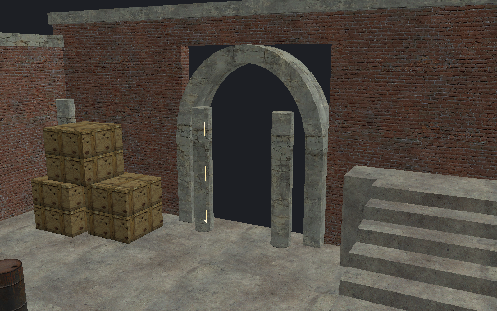 |
| Inspect an authored static fog controller. | Save rulers and attach endpoints to entity frames. |

| [Overlays](docs/overlays.md) | [Assemblies](docs/instance-contents.md) |
| --- | --- |
| 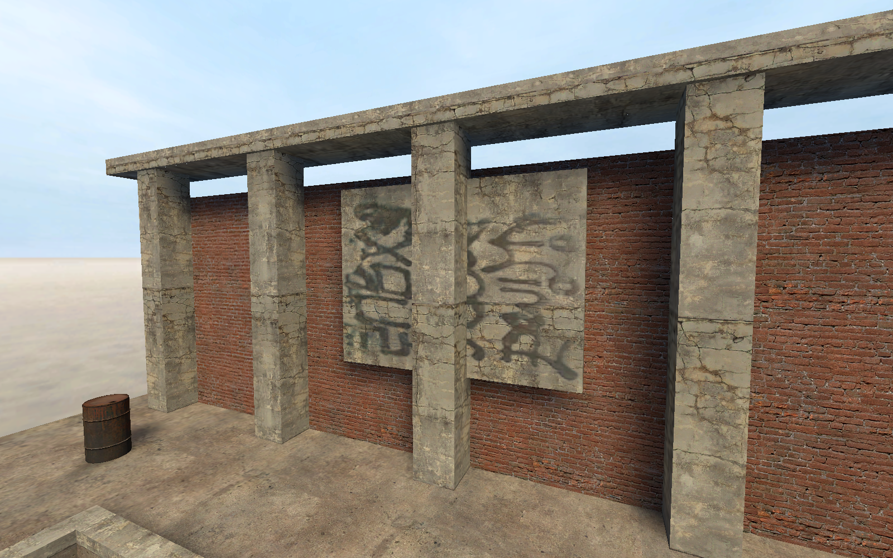 | 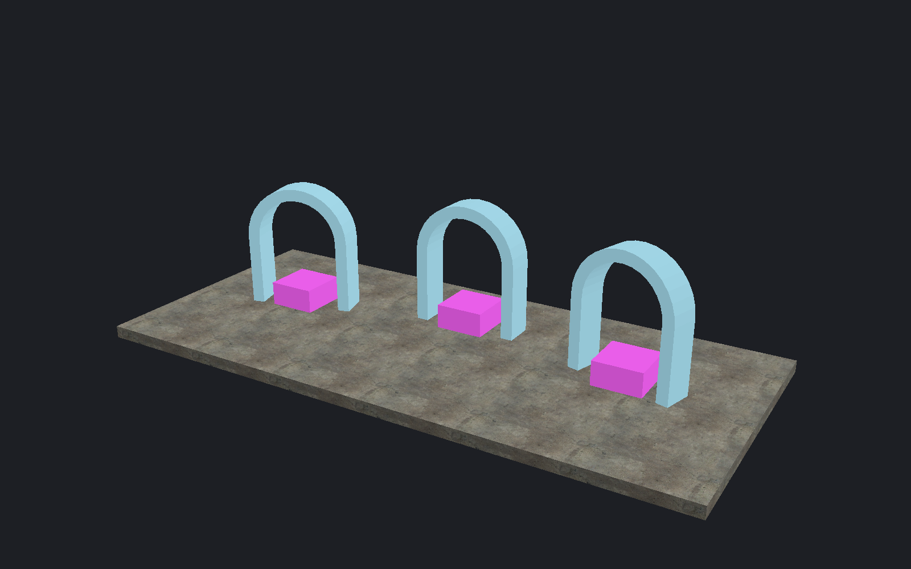 |
| Fit, rebind and adjust native material projections. | Reuse saved brush assemblies with checked transforms. |

Counter-Strike: Source and its assets are not included.
