# HammeRR manual

Build Counter-Strike: Source maps by hand or with an AI agent. Every page follows the same shape:
what the feature does, numbered steps with the exact UI labels, a screenshot, then its limits.

## Start here

<table>
<tr>
<td width="33%" valign="top"><a href="getting-started.md">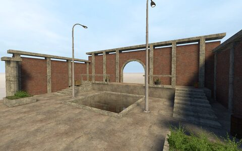</a> <a href="getting-started.md"><b>Getting started</b></a> Create, edit and compile Counter-Strike: Source maps on Linux or Windows.</td>
<td width="33%" valign="top"><a href="basics.md">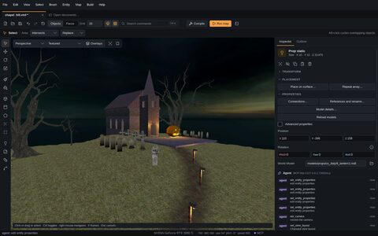</a> <a href="basics.md"><b>Editor basics and saved views</b></a> Use the viewport to inspect the map.</td>
<td width="33%" valign="top"><a href="mcp.md">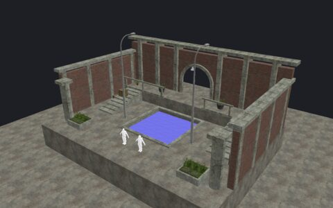</a> <a href="mcp.md"><b>MCP setup and tool index</b></a> Agents use the same map, operations, previews and Undo history as the editor.</td>
</tr>
</table>

See [Status and limits](status.md) for what is supported today, and the
[MCP tool index](mcp.md) for everything an agent can call.

## Maps and navigation

<table>
<tr>
<td width="33%" valign="top"><a href="selection.md">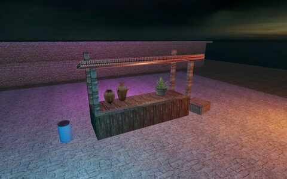</a> <a href="selection.md"><b>Selection</b></a> Choose objects, faces or bounded groups of visible geometry.</td>
<td width="33%" valign="top"><a href="selection-presentation.md">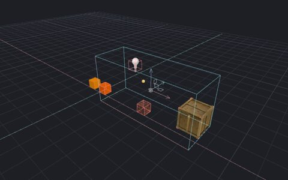</a> <a href="selection-presentation.md"><b>Helpers and selection presentation</b></a> Control resource display and inspect the complete selection without changing map data or picking.</td>
<td width="33%" valign="top"><a href="working-region.md">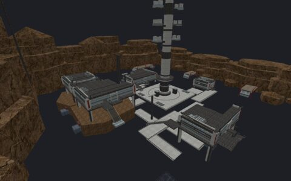</a> <a href="working-region.md"><b>Working region</b></a> Limit editor display and picking with a temporary box, camera draw distance, or object search criteria.</td>
</tr>
<tr>
<td width="33%" valign="top"><a href="measurements.md">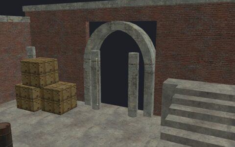</a> <a href="measurements.md"><b>Measurements</b></a> Save named rulers for clearances, heights and distances.</td>
<td width="33%" valign="top"><a href="recent-maps.md">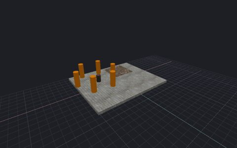</a> <a href="recent-maps.md"><b>Recent maps</b></a> Reopen a map with its remembered content, entity definitions, build settings and game paths.</td>
<td width="33%" valign="top"><a href="content-profiles.md">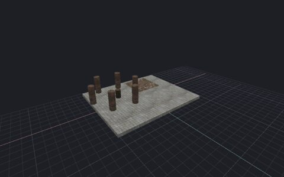</a> <a href="content-profiles.md"><b>Content profiles</b></a> Save named CS:S content, entity definitions, build settings and game paths.</td>
</tr>
<tr>
<td width="33%" valign="top"><a href="map-comparison.md">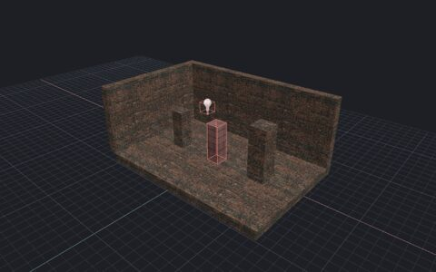</a> <a href="map-comparison.md"><b>Compare external maps</b></a> Compare authored world brushes and whole entities with another VMF.</td>
<td width="33%" valign="top"><a href="workspace-layout.md">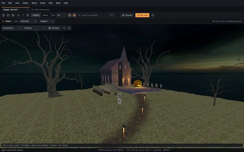</a> <a href="workspace-layout.md"><b>Workspace layout</b></a> Choose how much space the dock, Agent feed and tool rail use.</td>
<td width="33%" valign="top"><a href="open-documents.md">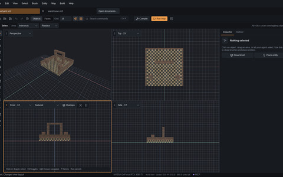</a> <a href="open-documents.md"><b>Document tabs and workspaces</b></a> Keep two independent maps open and restore their saved editing contexts.</td>
</tr>
</table>

More in this section:

- [History](history.md) — Inspect user, agent and system edits.
- [Keyboard shortcuts](keyboard-shortcuts.md) — Assign two binding slots to each of 36 editor commands.
- [Navigation defaults](navigation-defaults.md) — Set camera flight speed without changing the map.
- [Preview defaults](preview-defaults.md) — Choose the surface view, images and guides used at startup.

## Geometry

<table>
<tr>
<td width="33%" valign="top"><a href="brushes.md">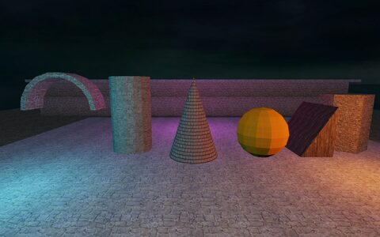</a> <a href="brushes.md"><b>Brushes and transforms</b></a> Create solids and change their position, orientation or shape.</td>
<td width="33%" valign="top"><a href="brush-tools.md">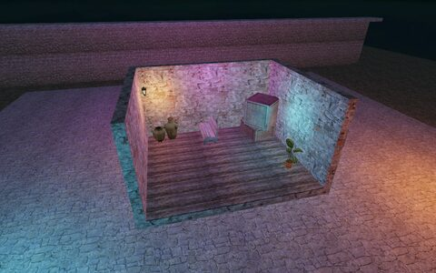</a> <a href="brush-tools.md"><b>Hollow, carve and clip</b></a> Turn solid geometry into rooms, openings and cut shapes.</td>
<td width="33%" valign="top"><a href="polygon-brushes.md">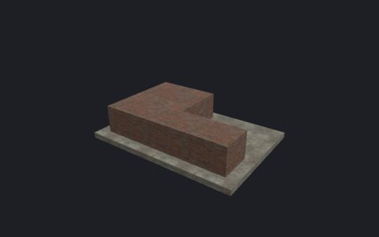</a> <a href="polygon-brushes.md"><b>Polygon brushes</b></a> Extrude a custom outline into ordinary editable brushes.</td>
</tr>
<tr>
<td width="33%" valign="top"><a href="components.md">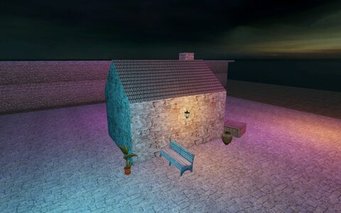</a> <a href="components.md"><b>Vertices, edges and faces</b></a> Reshape a brush through its corners, edges or faces.</td>
<td width="33%" valign="top"><a href="partitions.md">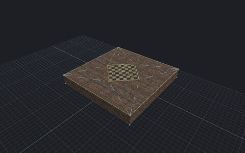</a> <a href="partitions.md"><b>Flat partitions</b></a> Divide a brush face before raising, extruding or texturing its pieces.</td>
<td width="33%" valign="top"><a href="placement.md">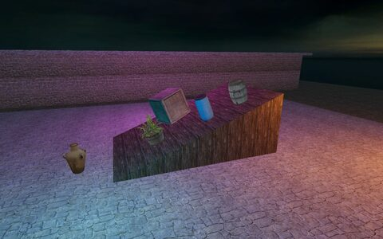</a> <a href="placement.md"><b>Surface placement</b></a> Align a selection with a floor, ceiling or picked surface.</td>
</tr>
<tr>
<td width="33%" valign="top"><a href="repeated-placement.md">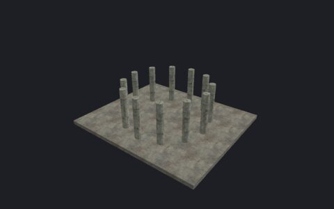</a> <a href="repeated-placement.md"><b>Repeated placement</b></a> Create regular arrays or scatter copies across selected brush and terrain surfaces.</td>
<td width="33%" valign="top"><a href="terrain.md">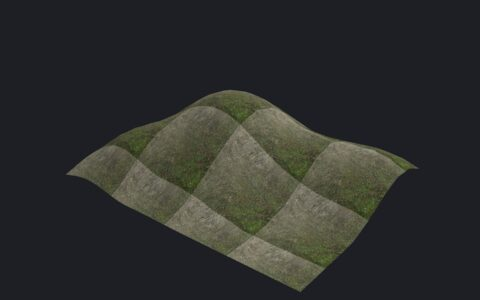</a> <a href="terrain.md"><b>Terrain</b></a> Create, sculpt and paint displacement surfaces.</td>
<td width="33%"></td>
</tr>
</table>

More in this section:

- [Merge brushes](merge.md) — Join adjacent or overlapping brushes into one convex solid.

## Materials and appearance

<table>
<tr>
<td width="33%" valign="top"><a href="textures.md">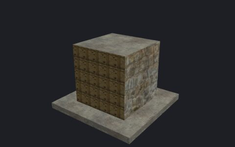</a> <a href="textures.md"><b>Materials and textures</b></a> Apply materials and control their placement on brush faces.</td>
<td width="33%" valign="top"><a href="atlas-texturing.md">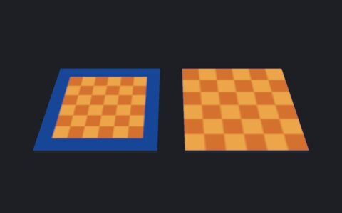</a> <a href="atlas-texturing.md"><b>Atlas-region texturing</b></a> Fit flat faces independently or together, or automatically pack separate face UV islands into a rectangular part of an existing material image.</td>
<td width="33%" valign="top"><a href="normal-maps.md">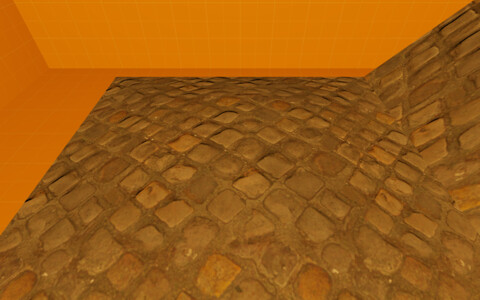</a> <a href="normal-maps.md"><b>Normal-map preview</b></a> Show small surface detail without adding geometry.</td>
</tr>
<tr>
<td width="33%" valign="top"><a href="lighting-preview.md">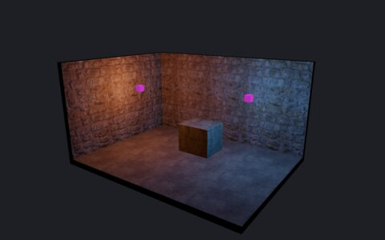</a> <a href="lighting-preview.md"><b>Authored lighting preview</b></a> Compare LDR and HDR point, spot and sun lighting before a build.</td>
<td width="33%" valign="top"><a href="fog.md">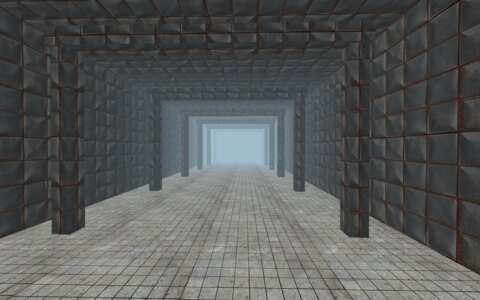</a> <a href="fog.md"><b>Fog preview</b></a> Inspect an authored fog controller in the editor.</td>
<td width="33%" valign="top"><a href="color-correction.md">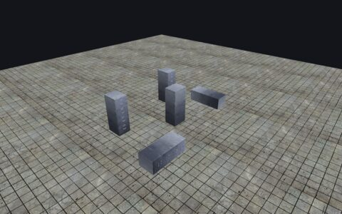</a> <a href="color-correction.md"><b>Color correction</b></a> Preview one Source color lookup table (LUT) across the complete editor viewport.</td>
</tr>
<tr>
<td width="33%" valign="top"><a href="reference-images.md">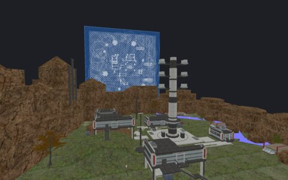</a> <a href="reference-images.md"><b>Reference images</b></a> Place external PNG images as editor-only tracing planes.</td>
<td width="33%" valign="top"><a href="sky.md">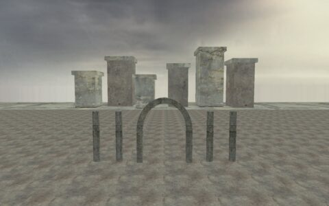</a> <a href="sky.md"><b>Sky previews and assets</b></a> Preview the map sky and inspect its mounted LDR and HDR assets.</td>
<td width="33%" valign="top"><a href="ropes.md">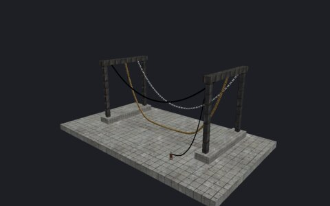</a> <a href="ropes.md"><b>Rope preview</b></a> Show the static shape of linked rope entities.</td>
</tr>
<tr>
<td width="33%" valign="top"><a href="models.md">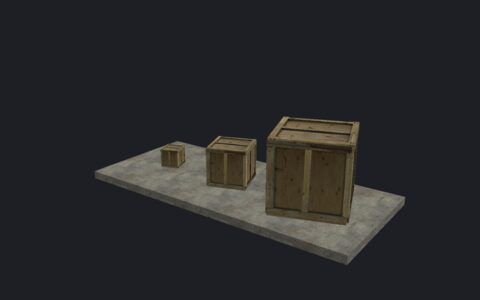</a> <a href="models.md"><b>Models</b></a> Place Source model meshes with their materials, skins and reference poses.</td>
<td width="33%" valign="top"><a href="sprite-guides.md">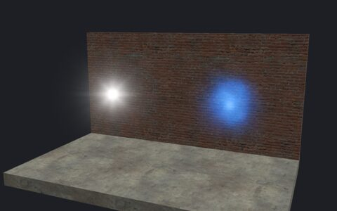</a> <a href="sprite-guides.md"><b>Sprite guides</b></a> Show a sprite image at its authored size while editing.</td>
<td width="33%"></td>
</tr>
</table>

More in this section:

- [Material source](material-source.md) — Read the material declaration and find its mounted files.
- [Particle effects](particles.md) — Find a named particle system and assign it to an entity.
- [Sounds](sounds.md) — Find a sound, listen to a short preview, and assign it to an entity.

## Entities and organization

<table>
<tr>
<td width="33%" valign="top"><a href="entities.md">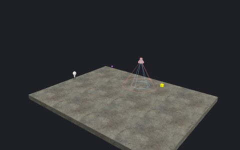</a> <a href="entities.md"><b>Entities and logic</b></a> Place game objects, edit their properties and connect outputs to inputs.</td>
<td width="33%" valign="top"><a href="bulk-entities.md">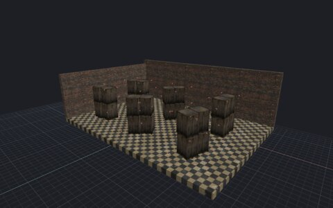</a> <a href="bulk-entities.md"><b>Bulk entity workflows</b></a> Change captured classes, models, sounds, effects, names and connections together, or return brush entities to world.</td>
<td width="33%" valign="top"><a href="entity-gallery.md">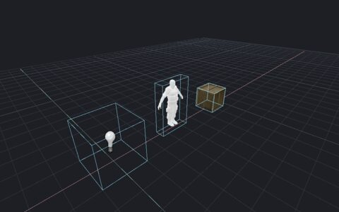</a> <a href="entity-gallery.md"><b>Point-entity gallery</b></a> Browse the loaded FGD point classes and inspect actual examples in the main viewport before adding a batch to your map.</td>
</tr>
<tr>
<td width="33%" valign="top"><a href="path-authoring.md">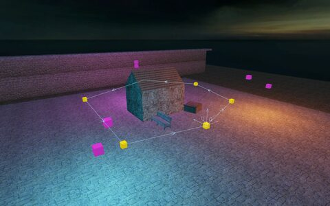</a> <a href="path-authoring.md"><b>Linked paths</b></a> Create linked nodes, configure a brush train and inspect its native motion.</td>
<td width="33%" valign="top"><a href="overlays.md">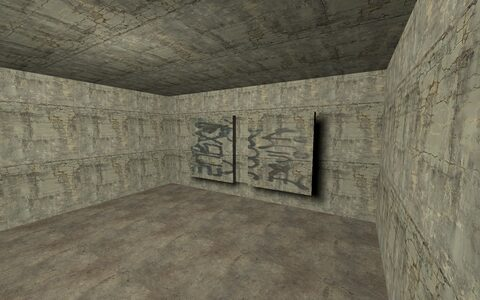</a> <a href="overlays.md"><b>Overlays</b></a> Project a material onto compiled surfaces.</td>
<td width="33%" valign="top"><a href="prefabs.md">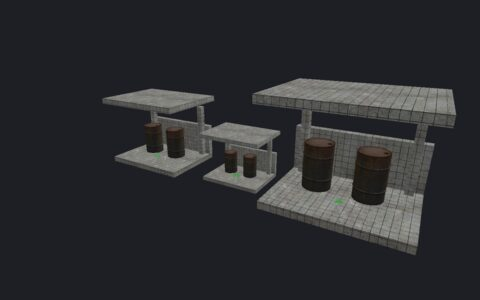</a> <a href="prefabs.md"><b>Prefab library</b></a> Save and reuse brush/entity assemblies as VMF files.</td>
</tr>
<tr>
<td width="33%" valign="top"><a href="clipboard.md">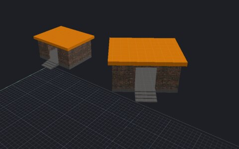</a> <a href="clipboard.md"><b>Cut, copy and paste</b></a> Transfer whole objects with rotation, scale and saved face partitions.</td>
<td width="33%"></td>
<td width="33%"></td>
</tr>
</table>

More in this section:

- [Groups](groups.md) — Select and edit an assembly as one group.
- [Layers](layers.md) — Organize whole brushes and entities into named layers.
- [Map checks, notes and recovery](map-tools.md) — Find objects, check map data and retain recovery copies.

## Assemblies

<table>
<tr>
<td width="33%" valign="top"><a href="instance-extraction.md">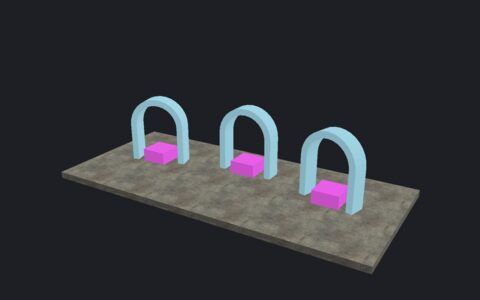</a> <a href="instance-extraction.md"><b>Extract an assembly</b></a> Export selected brushes to a child VMF and replace them with one reference while keeping their placement and textures in the parent.</td>
<td width="33%" valign="top"><a href="instance-contents.md">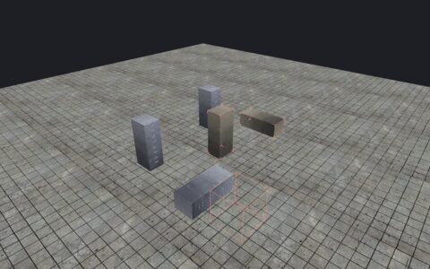</a> <a href="instance-contents.md"><b>Instance contents</b></a> Inspect resolved child geometry without opening each child map.</td>
<td width="33%" valign="top"><a href="instances.md">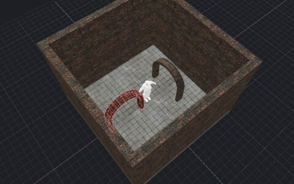</a> <a href="instances.md"><b>Compiled assemblies</b></a> Compile supported contents of saved child VMFs into a parent map.</td>
</tr>
</table>

More in this section:

- [Instance references](instance-authoring.md) — Place or edit a reference to a saved child VMF.

## Compile and play

<table>
<tr>
<td width="33%" valign="top"> <a href="compile-and-play.md"><b>Compile and play</b></a> Build a CS:S BSP with integrated geometry, visibility, lighting and optional engine physics.</td>
<td width="33%" valign="top"><a href="material-emission.md">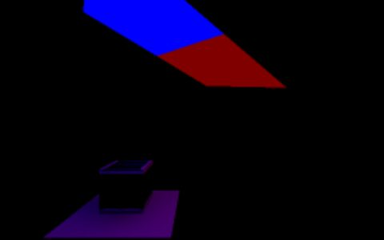</a> <a href="material-emission.md"><b>Material emission</b></a> Bake light from an opaque world, detail or stationary brush-model surface.</td>
<td width="33%" valign="top"><a href="physics.md">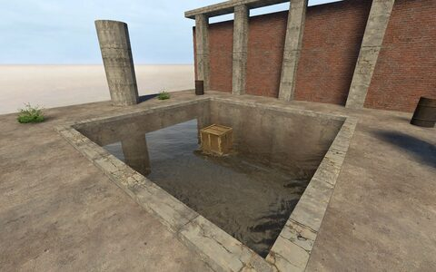</a> <a href="physics.md"><b>Physics</b></a> Build collision bodies with the installed CS:S physics library.</td>
</tr>
<tr>
<td width="33%" valign="top"><a href="water.md">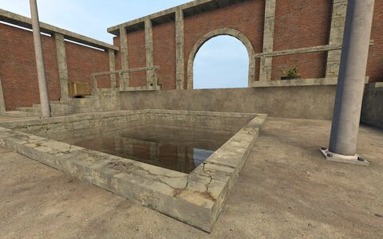</a> <a href="water.md"><b>Water and slime</b></a> Create horizontal world-liquid volumes with native depth, inward surfaces and optional fluid physics.</td>
<td width="33%" valign="top"><a href="static-props.md">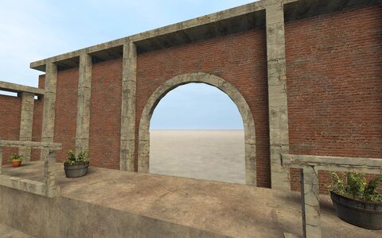</a> <a href="static-props.md"><b>Static props</b></a> Compile static scenery models with visibility, collision options and lighting.</td>
<td width="33%" valign="top"><a href="prop-shadows.md">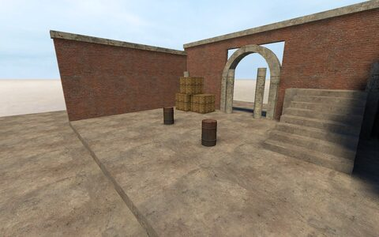</a> <a href="prop-shadows.md"><b>Static-prop shadows</b></a> Use static model triangles to block baked light.</td>
</tr>
<tr>
<td width="33%" valign="top"><a href="brush-texture-shadows.md">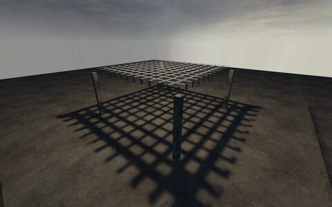</a> <a href="brush-texture-shadows.md"><b>Brush texture shadows</b></a> Use base-texture alpha to shape or soften baked shadows from brushes and terrain.</td>
<td width="33%" valign="top"><a href="hdr-exposure.md">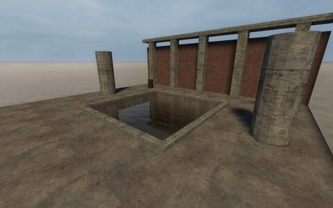</a> <a href="hdr-exposure.md"><b>HDR exposure</b></a> Use env_tonemap_controller to control the game&#x27;s HDR exposure.</td>
<td width="33%" valign="top"><a href="baked-surfaces.md">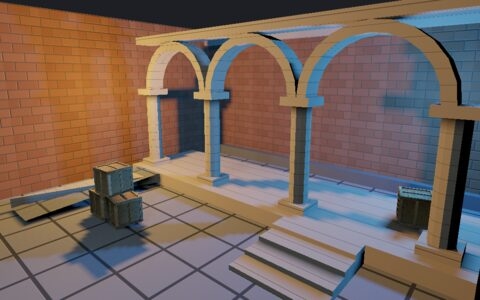</a> <a href="baked-surfaces.md"><b>Baked surfaces</b></a> Show final BSP surfaces with their stored lighting and compiled materials.</td>
</tr>
<tr>
<td width="33%" valign="top"><a href="baked-prop-vertices.md">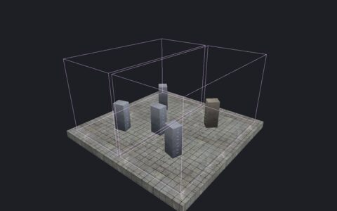</a> <a href="baked-prop-vertices.md"><b>Baked prop vertices</b></a> Inspect captured static-prop sources, native leaf membership and baked vertex colors.</td>
<td width="33%" valign="top"> <a href="visibility.md"><b>Visibility inspection</b></a> Inspect leaves, portals and visibility sets from the last successful build.</td>
<td width="33%" valign="top"> <a href="model-detail-props.md"><b>Model detail props</b></a> Compile decorative models without collision or runtime entities.</td>
</tr>
<tr>
<td width="33%" valign="top"> <a href="compiled-details.md"><b>Final compiled details</b></a> Show the final models, cards and cross/tri shapes from a successful build.</td>
<td width="33%"></td>
<td width="33%"></td>
</tr>
</table>

More in this section:

- [Build recipes](build-recipes.md) — Save build settings for later use.
- [Compile regions](compile-regions.md) — Build a sealed part of a map without deleting other source objects.
- [Generated reflections](reflections.md) — Capture scene cubemaps and pack them into the published BSP.
- [Cubemap faces](cubemap-faces.md) — Inspect reflection assignments for root-authored faces and author manual bindings to root `env_cubemap` samples.
- [Baked lightmaps](baked-lightmaps.md) — Inspect face-lighting samples from the last successful build.
- [Compiled lights](compiled-lights.md) — Read native light records and their captured authored sources from the last successful build.
- [Detail sprites](detail-sprites.md) — Compile decorative atlas cards or fixed cross/tri shapes without collision.
- [Material detail scattering](material-detail-scattering.md) — Generate noncolliding detail models and sprites from exposed ground materials.
- [Occluders](occluders.md) — Compile invisible blockers that can hide covered renderable objects in the game.
- [Visibility clusters](visclusters.md) — Group compatible open leaves into one visibility cluster.

## AI and project status

- [Status and limits](status.md) — HammeRR supports brush-map authoring through the editor and MCP.
