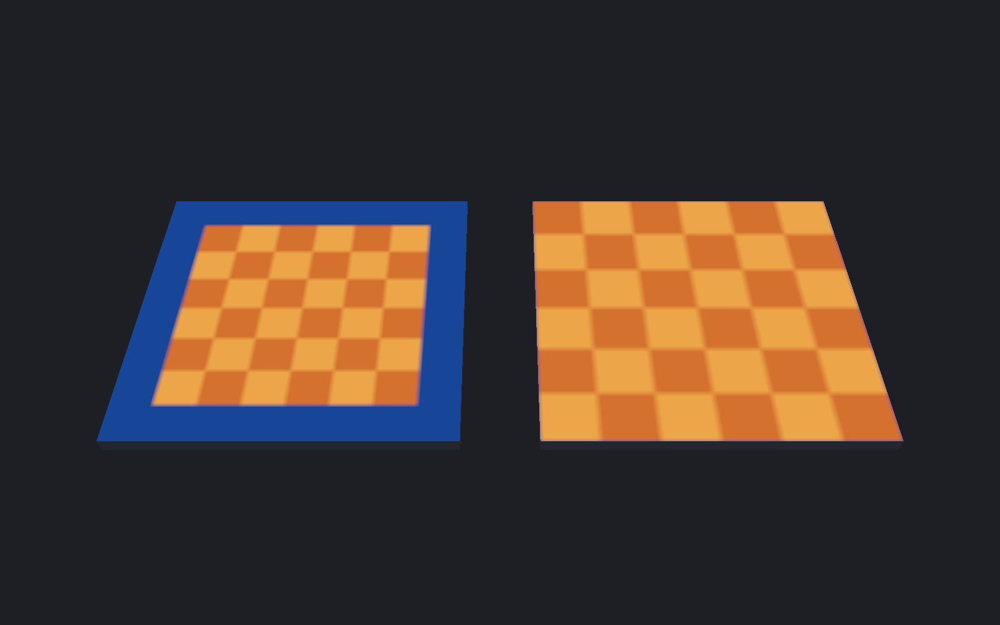
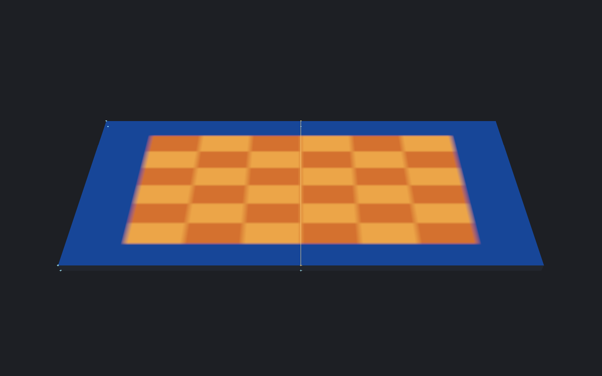

[← Manual](README.md)

# Atlas-region texturing

Fit flat faces independently or together into a rectangular part of a material image, with optional padding inside its edges.

1. Select faces under **Selection → Faces · materials & textures**.
2. Open **Edit face textures…**, then **Fit atlas region…**.
3. Enter **Material**, then click **Inspect material**.
4. Enter **X**, **Y**, **Width** and **Height** in source image pixels.
5. Set **Padding** in whole source image pixels. Use `0` for the full rectangle.
6. Check **Usable area**. Cyan outlines the rectangle; yellow outlines the padded usable area.
7. Click **Preview atlas fit**.
8. Inspect the faces, then click **Apply atlas fit**.

The top-left image edge is `0, 0`. The default **Each face independently** mode fits the usable area separately for every face. Its texture direction, skew, rotation and mirroring stay unchanged.
For example, a `32 × 16` rectangle at `16, 8` with padding `2` uses `28 × 12` pixels at `18, 10`.
**Cancel** discards the preview. Changed fields require another preview.

Left: no padding. Right: an eight-pixel inset excludes the blue image border.

## Fit faces together

1. Select coplanar faces facing the same direction. Open **Fit atlas region…**.
2. Under **Fit mode**, choose **Fit coplanar faces together**.
3. Choose **Reference face**. Its texture direction, skew, rotation and mirroring become the shared frame for every target face.
4. Inspect the material and set the rectangle and padding, then click **Preview atlas fit**.
5. Inspect the continuous mapping, then click **Apply atlas fit**.

The combined projected bounds fit the usable area once. Separated faces are allowed; gaps consume image space.
Other target projection frames are replaced. Geometry, lightmap settings, smoothing and other face data stay unchanged.
Changing **Fit mode** or **Reference face** requires another preview before applying.

## Limits

- Flat world, detail and brush-entity faces only; terrain and collapsed projections reject.
- One static base image with a supported `LightmappedGeneric` or `UnlitGeneric` declaration.
- No tool overrides, proxies, extra layers, packing, rectangle dragging or image editing.
- The rectangle must have positive size and stay inside the original image.
- Padding must leave a positive usable width and height; invalid updates preserve the existing preview.
- Together fitting requires a reference from the target selection and same-facing coplanar faces. It does not unfold across corners.
- Up to 256 faces. Padding changes the fit, not the image. Choose suitable image gutters and padding for the material's filtering and mipmaps.
