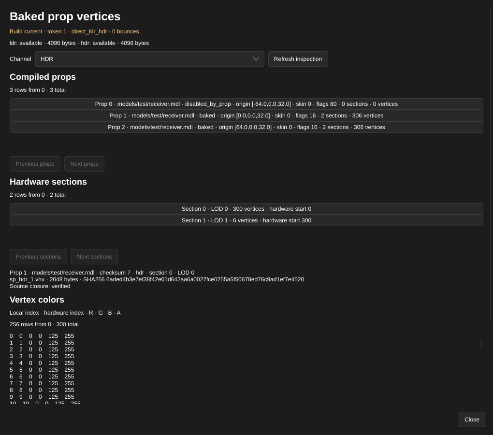

[← Manual](README.md)

# Baked prop vertices

Inspect the static-prop vertex colors packed into a successful build. Compare
independent LDR and HDR files, native prop ordinals, draw LOD sections and exact
stored color bytes without starting graphics or the game.

1. Open **Build settings…**. Set **Build lighting** to **Direct LDR** or
   **Direct LDR + HDR**, enable **Bake static-prop vertex lighting**, close the
   window, then click **Compile**.
2. Open **Build details…** in the build bar, then click **Inspect baked prop
   vertices…**. **Build settings…** opens the same build window before a first
   successful build; its inspector explains when no owned build is available.
3. Check the build status, token, captured bounce depth and available channels.
   Choose **Channel** as **LDR** or **HDR**.
4. Click a row under **Compiled props**. Rows identify the native ordinal,
   model, origin, skin, flags and hardware counts. **Previous props** and
   **Next props** page the list.
5. Click a row under **Hardware sections** to inspect its draw LOD and hardware
   range. Use **Previous sections** or **Next sections** for another page.
6. Read **Vertex colors**: local index, hardware index and stored R, G, B, A
   bytes. **Previous vertices** and **Next vertices** page those rows. The
   minimum, mean and maximum describe only the returned vertex page.
7. Read the selected packed filename, byte size, SHA256 and source-closure
   status. After changing source, assets or build settings, click **Refresh
   inspection** to read the explicitly historical build, or compile again for
   current output. **Close** or Escape closes the window.

Limits:

- Inspection reads only this Session's last successful owned BSP. It accepts
  no arbitrary path, does not load model geometry and changes no source,
  history, selection, camera, settings or pending review. Choosing inspection
  rows does not select authored entities.
- Native ordinals, section indices and hardware indices belong to that exact
  build. Explicit selections and subsequent pages carry its token. A replaced
  build requires a fresh observation; retained indices never silently transfer.
  Disabled props keep their native ordinal and have no baked color rows.
- Pages contain at most 32 props, 32 sections or 256 vertices. Sections retain
  native file order across all declared draw LODs, with at most 256 sections
  per receiver. Repeated or unused hardware-color rows remain distinct; these
  indices are not authored/root-model vertex IDs. No position, normal, authored
  entity association or viewport shading is provided.
- BGRA8 storage is reordered to RGBA8 for the table. RGB values are encoded
  0–255 vertex-color bytes, including gamma/overbright encoding, rather than
  linear irradiance or game screen brightness. HDR uses the same byte encoding
  independently. Stored alpha is shown; the current writer emits 255, which
  does not measure authored material opacity.
- Fullbright or feature-off builds have no baked prop file. An absent HDR
  channel, disabled prop or invalid selection reports a diagnostic without
  substituting another prop/channel or inventing black samples.
- Intact owned output can remain readable with **stale** provenance after map,
  source, asset or setting changes. Historical bytes do not describe displayed
  drafts. Asset lookup directories are guarded conservatively; unrelated changes
  in those directories can also mark the source closure stale.
  Missing, replaced, corrupt or unverifiable output clears every row,
  selected file, statistic and channel. Restoring file bytes alone does not
  restore ownership; compile again.
- BSP/source/archive reads and allocations are bounded. A report is at most
  256 KiB; diagnostics contain at most 64 messages across the report, each at
  most 512 UTF-8 bytes, with per-container truncation counts. Unsupported archives and exceeded budgets
  produce diagnostics or an error without partial colors.

The shared MCP operation is `inspect_baked_prop_vertices`. Start with `{}`,
then pass its `build.token` as `build_token` when selecting `prop`, `section`
or nonzero page offsets. See [MCP](mcp.md#baked-prop-vertex-inspection).
