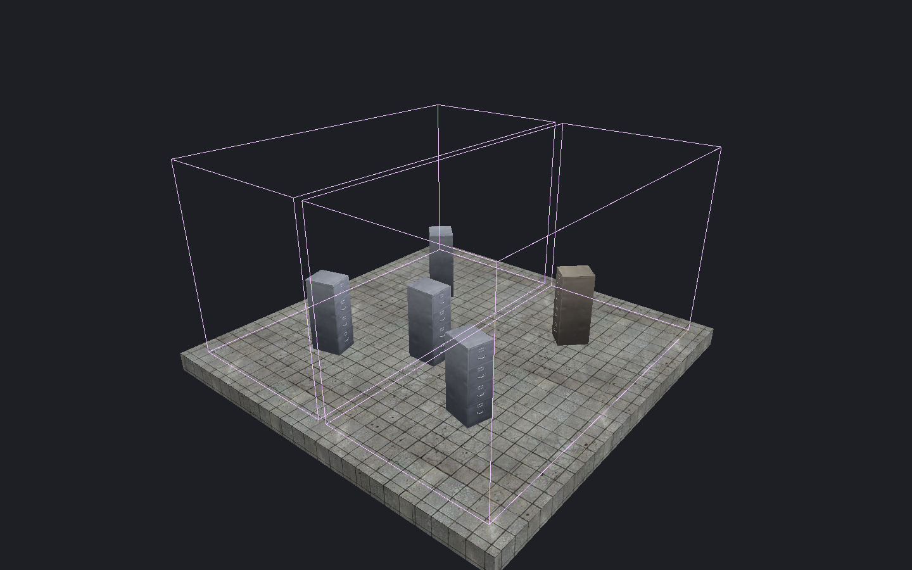

[← Manual](README.md)

# Baked prop vertices

Inspect captured static-prop sources, native leaf membership and baked vertex colors.

1. To read colors, enable **Bake static-prop vertex lighting** in **Build settings…**.
   Choose **Direct LDR** or **Direct LDR + HDR**.
2. Compile. Source addresses, framing and leaf bounds also work without baked colors.
3. Open **Build details… → Inspect baked prop vertices…**.
4. Choose a compiled prop. For colors, choose **Channel** and a hardware section.
5. Read the captured source and **Vertex colors**.
6. Click **Frame prop origin** to center its compiled position.
7. For an available current source, click **Select source** or **Select containing reference**.
8. Click **Show leaf bounds** to show every native leaf membership bound for the prop.
   Click **Clear leaf bounds** to remove the purple guide.

Use **Previous props**, **Next props**, section controls and vertex controls to page through results.
Use **Refresh inspection** after a new build or source change.
Reduce **Props per page** if long captured source paths exceed the page budget.

Root sources show their authored entity ID. Instance sources show the outer helper,
every nested helper/file occurrence, the original leaf entity ID and the expanded
ID used by that build. Repeated references to the same child remain distinct.
Disabled props retain their source address even when they have no stored colors.
**Historical source** describes the captured build after source changes.

**Frame prop origin** centers a 32-unit point box. It keeps projection,
selection, history and ordinary drafts. It works for disabled or unbaked props
and does not need source metadata. It does not fit model bounds or select an
authored object. Finish active viewport work first. Refresh or compile again
after source changes.

**Select source** selects one root entity. For an instanced prop,
**Select containing reference** selects its outer root helper. Both replace
selection in **Objects** mode and keep the camera, map, Undo history and property
drafts. Finish geometry drafts and viewport work first. Selection does not expand
groups, reveal hidden objects or open child files. Missing source metadata blocks
selection; native framing keeps its separate rules.

**Show leaf bounds** uses the compiled prop's native membership table. Purple boxes
show the complete set, regardless of the color channel or page size. The cyan
visibility guide has separate controls. Source changes suppress the prop guide
and show a status message. Refresh or compile again before showing current bounds.
Camera, selection, map, history and ordinary drafts stay unchanged.

## Limits

- Physical paths that cannot be reported show stale provenance and omitted path fields.
- Prop ordinals and hardware sections belong to one build. Source addresses identify captured authored entities; selection uses only a current verified capture.
- Missing or unverified source metadata is reported separately; valid native prop and color rows remain available.
- Captured prop metadata is limited to 8 MiB, including shared occurrence storage once. Source copies are admitted before allocation within 128 KiB per report; each report is limited to 256 KiB.
- Hardware vertices are not mapped to model vertex positions.
- Leaf boxes are conservative native bounds. They do not show exact convex cells, prop mesh clipping or runtime visibility.
- A complete guide must fit 512 leaves and 256 KiB of bounds and renderer storage. An invalid or larger request keeps the previous guide. The bounds are never truncated.
- Leaf guides require the original tracked directory metadata. A directory change can suppress a guide even when its BSP is intact.
- Showing bounds requires the exact current build token. Missing source-association metadata does not block valid native bounds. Finish active viewport work first.
- Packed values are not an editor appearance preview or a screen-brightness measurement.
- Missing channels remain unavailable; they do not substitute another channel.
- Intact stale output is marked historical. Missing, replaced or corrupt build output is unavailable.
- Inspection does not alter the map or build settings.
