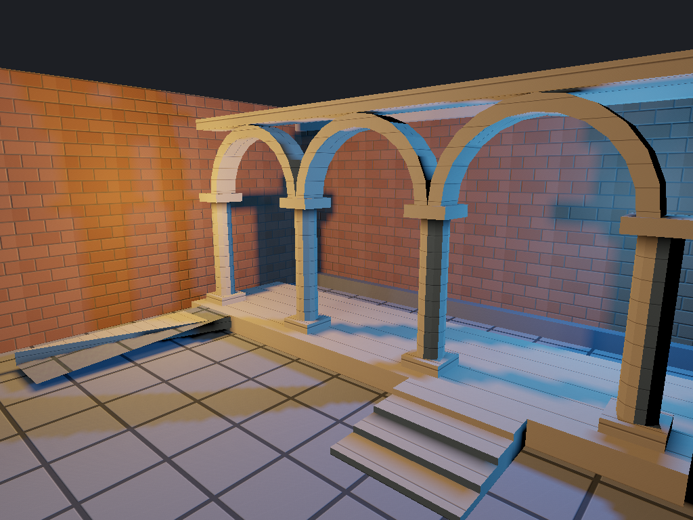

[← Manual](README.md)

# Baked surfaces

Show final BSP surfaces with their stored lighting and compiled materials.
The layer includes world/detail brushes, terrain and initial-pose brush models.

1. Open **Build settings…**. Set **Build lighting** to **Direct LDR** or **Direct LDR + HDR**.
2. Click **Compile**. Wait for a successful build.
3. Open **Build settings… → Baked surfaces…**. **Build details…** also has this button after a build.
4. Click **Prepare**, then **Show**. Use **Cancel preparation** to stop a pending read.
5. Choose **Channel** and **Exposure (EV)**. Select a **Style**, set **Gain**, then click **Apply lighting**.
6. Select a face row and click **Frame face** to move the camera to its final bounds.
7. Use **Hide** to retain the preparation and settings. Use **Clear** to release them.

Style 0 defaults to gain 1. Other stored styles default to 0.
Gains range from 0 to 2; exposure ranges from −8 to +8 EV.
A failed update keeps the previous settings. **Prepare** and **Clear** reset them.
**Previous**, **Next** and **Inspect** page the final face records.
The viewport surface modes show final geometry, including wireframe, lightmap
density and smoothing groups.

## Materials and view

The preview reads compiled diffuse textures, static tint and supported blend and
normal inputs. It uses the owned BSP's packed assets first, then the guarded
original sources. An editor image does not replace a compiled texture.

Lightmapped surfaces use face-local bilinear samples. Tangent normals use normalized squared projections onto the compiler's three-
vector basis. SSBump inputs supply direct coefficients. Native shader weighting
can differ, including `WorldTwoTextureBlend`.
Unlit materials keep their actual diffuse geometry without invented lightmaps.
Exposure precedes Reinhard tone mapping and one sRGB output conversion.

## Limits

- The layer needs the current session's successful lit build. Recompile and prepare after source, asset or build-setting changes.
- Missing selected channels, malformed inputs and unsupported material effects stop the complete preparation. Channels are never substituted.
- Supported static shaders are `LightmappedGeneric`, `WorldVertexTransition`, `WorldTwoTextureBlend` and `UnlitGeneric`. Proxies and animated effects are unavailable.
- Normal inputs include ordinary RGB/BGR, DXT, SSBump, signed vector formats and supported 16-bit float/UNORM formats. Undefined or uncertifiable filtered directional responses refuse explicitly.
- Editing tools, drafts and Faces mode suppress the layer. Working regions include whole final faces that intersect the region; they do not clip triangles.
- Authored hiding, selection, picking and Undo stay separate. Face ordinals identify this preparation and channel.
- The preview shows initial brush-model poses. Runtime motion, native adaptation, dynamic lights and exact game appearance are not simulated.
- Resource and GPU adapter limits can refuse preparation or display. An upload failure does not publish a successful frame.

Use `inspect_baked_surfaces` and `set_baked_surfaces` through MCP.
