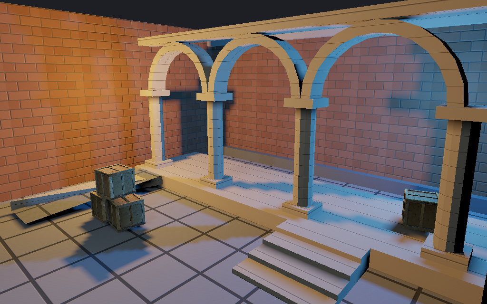
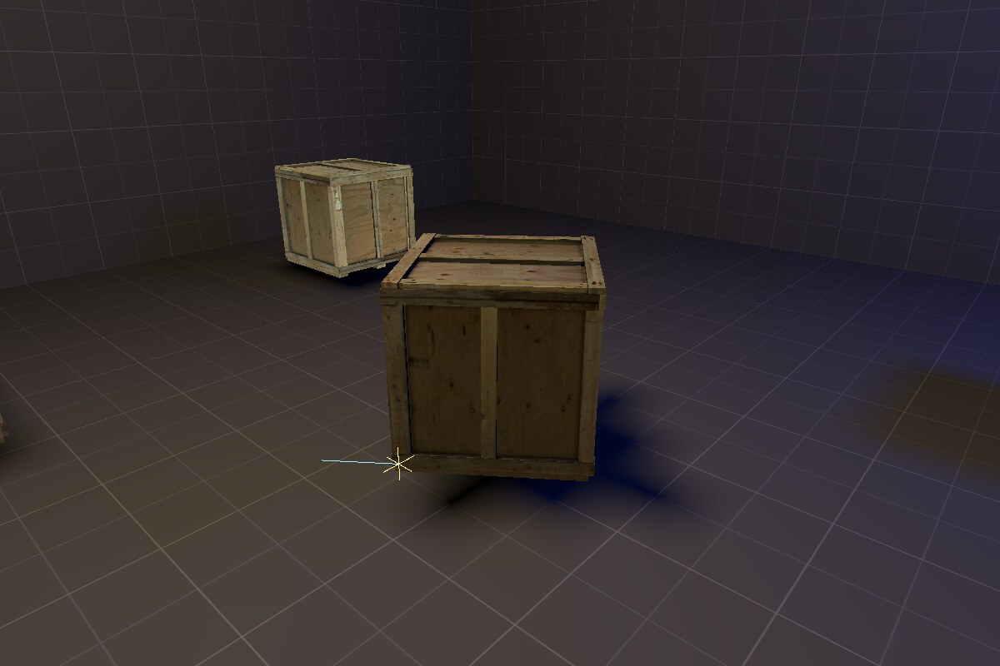

[← Manual](README.md)

# Baked surfaces

Show final BSP surfaces with their stored lighting and compiled materials.
The layer includes world/detail brushes, terrain, initial-pose brush models and optional baked static props.

1. Open **Build settings…**. Set **Build lighting** to **Direct LDR** or **Direct LDR + HDR**. For baked props, enable **Bake static-prop vertex lighting**.
2. Click **Compile**. Wait for a successful build.
3. Open **Build settings… → Baked surfaces…**. **Build details…** also has this button after a build.
4. To include baked props, select **Compiled static props** and choose **Draw LOD**. Click **Prepare**, then **Show**. Use **Cancel preparation** to stop a pending read.
5. Choose **Channel**. In Legacy display, set **Exposure (EV)**. Select a
   **Style**, set **Gain**, then click **Apply lighting**.
6. Choose **Record kind**. Select a row, then click **Frame face** or **Frame static prop** to move the camera to its final bounds.
7. Use **Hide** to retain the preparation and settings. Use **Clear** to release them.

Face style 0 defaults to gain 1. Other stored face styles default to 0.
Static props keep baked weight 1. Channel and exposure affect both.
Gains range from 0 to 2; exposure ranges from −8 to +8 EV.
A failed update keeps the previous settings. **Prepare** and **Clear** reset them.
**Previous**, **Next** and **Inspect** page the selected records. Change **Draw LOD** before **Prepare**; an unavailable LOD stops preparation.
The viewport surface modes show final geometry, including wireframe, lightmap
density and smoothing groups.

You can also prepare and show [final compiled details](compiled-details.md).
The two layers keep separate channel and style controls. In an active HDR pane,
use **Fog preview… → Scene display → Scene exposure EV**, then click
**Apply scene display**. One scene exposure controls both layers and the other
enabled scene contributors. Stored **Exposure (EV)** values remain in use in
Legacy, orthographic and diagnostic panes. In HDR panes, the disabled field is
labelled **Legacy EV (inactive)**; the note shows the active Scene exposure.

## Locate a baked prop sample

1. Prepare with **Compiled static props** and the required **Draw LOD**, then click **Show**.
2. Choose **Record kind → Static props**, select a prop row, then click **Prepared prop samples…**.
3. Select a sample in **Baked prop samples**. Use **Previous**, **Next** or **Refresh inspection** to browse its exact prepared positions, normals and colors.
4. Click **Frame sample** to center that hardware occurrence, or **Show sample guide** to mark its point and normal in the viewport.
5. Use **Clear guide** to remove the marker. **Cancel**, <kbd>Escape</kbd> or closing the inspector leaves an explicitly shown guide requested.

Expand **Technical details** for stored color bytes and hardware identities.

Repeated and unused hardware vertices remain separate samples. Section and
vertex identify the occurrence; matching positions do not merge rows. Samples
use the preparation's exact LOD and **Channel**. Exposed colors use the active
pane's scene exposure in HDR, or the layer's **Exposure (EV)** in Legacy. Missing or
stale data reports an error and keeps the camera unchanged. Reprepare after
source or asset changes; inspection and guides do not edit the map or selection.
The guide follows **Authored models**, layer visibility and whole-prop working
regions. **Hide** retains its request; preparation retirement removes it.

## Materials and view

The preview reads compiled diffuse textures, static tint and supported blend and
normal inputs. It uses the owned BSP's packed assets first, then the guarded
original sources. An editor image does not replace a compiled texture.
Terrain texture coordinates follow the base quad, including sideways deformation.
Supported plain `LightmappedGeneric` cutout and translucent materials use mip-0
nearest clamp/repeat sampling. Cutouts use the checked alpha-test reference;
translucent surfaces use base-texture alpha with depth-ordered blending.
Painted terrain blend values do not control opacity.

Lightmapped surfaces use face-local bilinear samples. Tangent normals use normalized squared projections onto the compiler's three-
vector basis. SSBump inputs supply direct coefficients. Native shader weighting
can differ, including `WorldTwoTextureBlend`.
Unlit materials keep their actual diffuse geometry without invented lightmaps.
In Legacy display, layer exposure precedes Reinhard tone mapping and one sRGB
output conversion. HDR scene display mixes surfaces, fog and translucency in
linear color before the shared exposure and display curve.

Static props use the final model pose, selected skin and exact hardware vertex
colours for each LOD. Colours decode before triangle interpolation.
Supported `VertexLitGeneric` materials include the compiler's cutout cases.
An absent optional base texture uses white; a declared missing texture fails.

Fine shadows need enough model vertices. To omit a prop's own vertex shadows,
set **Disable Self-Shadowing with vertex lighting** to **Yes**, then compile and
prepare again. Other objects still cast shadows on the prop.

## Limits

- The layer needs the current session's successful lit build. Recompile and prepare after source, asset or build-setting changes.
- Missing selected channels, malformed inputs and unsupported material effects stop the complete preparation. Channels are never substituted.
- Supported static shaders are `LightmappedGeneric`, `WorldVertexTransition`, `WorldTwoTextureBlend` and `UnlitGeneric`. Proxies and animated effects are unavailable.
- Face alpha requires the [supported plain material forms](brush-texture-shadows.md#material-opacity). Alpha modulation, combined cutout/translucent modes and alpha normal/blend effects reject. Translucent display sorts whole batches; intersecting surfaces can sort differently from the game.
- Normal inputs include ordinary RGB/BGR, DXT, SSBump, signed vector formats and supported 16-bit float/UNORM formats. Undefined or uncertifiable filtered directional responses refuse explicitly.
- Editing tools, drafts and Faces mode suppress the layer. Working boxes, camera-following and draw distance filter whole final faces and props by their bounds; they do not clip triangles.
- An authored query filter suppresses the layer because native faces and props have no authored object identity. Clear the filter to restore a requested layer.
- Authored hiding, selection, picking and Undo stay separate. Face ordinals identify this preparation and channel.
- The preview shows initial brush-model poses. Runtime motion, native adaptation, dynamic lights and exact game appearance are not simulated.
- Static props require generated vertex lighting. Prop inspection is double-sided. Face density and smoothing groups do not apply to props. Prop lightmaps remain unavailable.
- Resource and GPU adapter limits can refuse preparation or display. For prepared static props, **Show** checks the combined CPU working budget before enabling the layer. If compiled mesh generation fails, the layer is disabled and its diagnostic is retained. Authored geometry stays available. An upload failure does not publish a successful frame.

Use `inspect_baked_surfaces` and `set_baked_surfaces` through MCP.

<!-- page-nav -->

---

[← HDR exposure](hdr-exposure.md) · [Manual](README.md) · [Baked prop vertices →](baked-prop-vertices.md)
