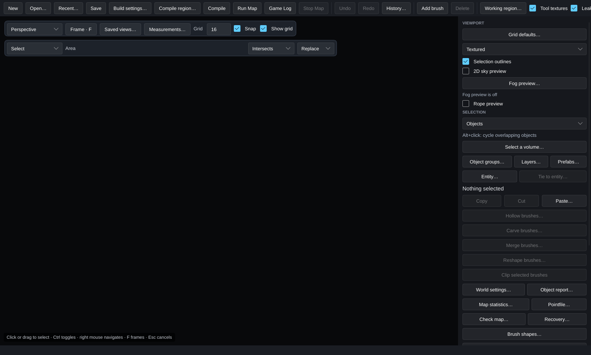

[← Manual](README.md)

# Editor basics

The window has four parts:

- **Toolbar** (top): file actions, Compile, Run Map, Game Log, Undo/Redo, brush creation, Delete, the **Tool textures** and **Leak path** toggles, and the MCP address.
- **Viewport toolbar**: projection, framing, saved views, grid and snapping, and the active viewport tool.
- **Inspector** (right): viewport mode, selection mode, and the tools and properties for whatever is selected.
- **Activity** (bottom right): recent edits, each labeled **you** or **agent**.

## Previews, Apply and Cancel

Almost every tool in HammeRR works the same way:

1. **Set up the operation.** The viewport shows a preview. The map doesn't change yet, and nothing goes into the undo history.
2. **Apply** commits the whole operation as **one undo step**.
3. **Cancel**, Escape, or closing the dialog throws the preview away.

If an input would produce invalid geometry, the last valid preview stays on screen and Apply waits until the input is fixed. If the map changes while a preview is open (for example, because an agent edited it), the preview is invalidated instead of being applied to the wrong objects.

Undo and redo are **Ctrl+Z** and **Ctrl+Y**.

These are factory bindings. Use **Viewport → Keyboard shortcuts…** to change
Undo, Redo, Frame selection, Delete selection or Duplicate selection; see
[Keyboard shortcuts](keyboard-shortcuts.md). Text fields keep their normal
editing keys, and the Frame hint follows the active binding.

## Working with an AI agent

You and any connected agent share one editing session: the map, the selection, the camera, open previews and the undo history. An agent's edits appear live and show up in Activity, and you can undo them like your own. An agent can set up a preview for you to apply, or the other way around. See [AI agents and MCP](mcp.md).

## Navigation

| Action | Control |
| --- | --- |
| Fly (perspective) | Hold the right mouse button; move with WASD and Q/E. |
| Switch projection | **Perspective**, **Top · XY**, **Front · XZ** or **Side · YZ** in the viewport toolbar. |
| Pan / zoom (Top, Front, Side) | Right-drag / mouse wheel. Zoom follows the cursor. |
| Frame the selection | **F** or **Frame · F**. Frames the whole map when nothing is selected. |
| Select / toggle | Click / Ctrl+click. |
| Select an area | Left-drag on empty space. Ctrl+drag toggles. |
| Nudge the selection | Arrow keys and PgUp/PgDn. Hold Shift to nudge by at most one unit. |
| Duplicate / delete | Ctrl+D / Del. |
| Undo / redo | Ctrl+Z / Ctrl+Y. |
| Cancel the active tool | Escape. |

In Top, Front and Side, the arrow keys move within the view's plane and PgUp/PgDn move along its depth.

Framing fits the viewport's width and height and keeps the camera's direction and field of view.

Set **Viewport → Fly speed** for perspective flight, or hold the right mouse
button and scroll to adjust it. Save startup speed in **Navigation defaults…**;
see [Fly speed and navigation defaults](navigation-defaults.md).

## Grid and snapping

**Grid** sets the spacing, from 0.125 to 4096 units. **Snap** and **Show grid** are independent. Values typed into numeric fields are always exact; they are never snapped.

Save your preferred startup grid separately from temporary changes:

1. Set **Grid**, **Snap** and **Show grid** in the toolbar.
2. Open **Grid defaults…** in the inspector's **Viewport** section.
3. Review **Current session**, then choose **Save current as defaults**. Future startups use these three values.
4. Use **Apply saved defaults** to restore them in the current session. **Reload defaults** retries reading storage without changing the current grid.

**Reset saved defaults** explicitly saves the factory values: 16 units, snapping on and grid visible. It leaves the current grid alone until **Apply saved defaults**. Grid defaults do not store workplane elevation, brush depth, preview toggles or active tools. These actions leave the map and Undo history unchanged. Temporary toolbar or MCP grid changes never save automatically. Save selected guide and image switches separately in [Preview defaults](preview-defaults.md).

Malformed, unsupported or unwritable preferences show **Grid defaults… · needs attention**. The dialog displays the storage path and error; **Save current as defaults** and **Apply saved defaults** stay unavailable until a successful **Reload defaults** or explicit **Reset saved defaults**. Changed storage rejects stale actions and requires another inspection. Failures before publication preserve the existing file; symlinks and nonregular files are rejected. Files are limited to 4096 bytes and use the same grid range as the toolbar. Save and Reset coordinate with other editors through a nonblocking lock. A busy lock preserves the file; Reload before retrying. Changed directories require explicit Reload. Programs that ignore the lock can still race with publication. Coordinated writes require Linux; other platforms reject publication. If a write completes but verification fails, the dialog reports the completed write and its error. The current grid stays unchanged; Reload to inspect storage before continuing.

To align an existing selection, enable **Transform selection** and click **Preview snap to grid**. The helper **Anchor: selection bounds minimum** identifies the corner being aligned. Review the anchor and offset, then **Apply transform** or **Cancel**. The selection moves rigidly by one offset; see [Snap selection to grid](brushes.md#snap-selection-to-grid).

## Viewport modes

Choose a mode in the **Viewport** section of the inspector. Every mode works in every projection.

| Mode | Shows |
| --- | --- |
| **Textured** | The game's materials. |
| **Flat shading** | Solid geometry without textures or transparency. |
| **Wireframe** | Brush edges, including terrain triangles. Use it to see through solids, or for the classic Hammer look in Top, Front and Side. |
| **Lightmap density** | The lighting grid set on each face. See [face lighting](textures.md#face-lighting). |
| **Smoothing groups** | Faces that belong to a chosen smoothing group. |

Light icons, selection highlights and editing guides stay visible in every mode. The density and smoothing modes show the settings you've authored, not baked lighting.

Uncheck **Tool textures** in the toolbar to hide brushes that use tool materials (clip, nodraw, and so on). Hidden tool brushes are also skipped by selection.

| Flat shading | Wireframe |
| --- | --- |
|  |  |

## Selection outlines

Choose whether selected objects and faces show edge lines and model corner brackets.

1. Select an object or face in the viewport.
2. Under **VIEWPORT**, clear **Selection outlines** to hide selected brush and terrain boundaries, point/light marker outlines, model brackets and selected rope centerlines. It starts enabled.
3. Check **Selection outlines** to restore those lines. Selected surface colors, selection IDs, picking, framing and map history stay unchanged in either state.

MCP uses the same shared Session view: `set_view` accepts `selection_outlines`, and `get_map_info.view.selection_outlines` reports it. `render_view` accepts a temporary override and reports the effective setting without changing the shared view. Pixel and ray picks use the same object surfaces with either setting.

The toggle leaves light direction/cone guides, terrain diagnostics, measurement/context guides, attachment guides, active tool handles, wireframe geometry and leak paths visible. It controls outline presentation; model, sprite and entity-helper visibility remain separate work. These view settings are session-local.

## Saved camera views

Save named camera positions and jump back to them.

1. Open **Saved views…** next to Frame.
2. Type a name and choose **Save current as new**.
3. Later, select the view and choose **Go to view**. This restores the projection, position, direction, field of view and planar zoom.

**Rename**, **Replace with current** and **Delete view** manage the list. Saved views are stored in the VMF, and changes to them are undoable. Going to a view moves only the camera.

- Up to 64 views per map, with names up to 80 characters.
- Camera records written by Hammer are kept separately and preserved.

