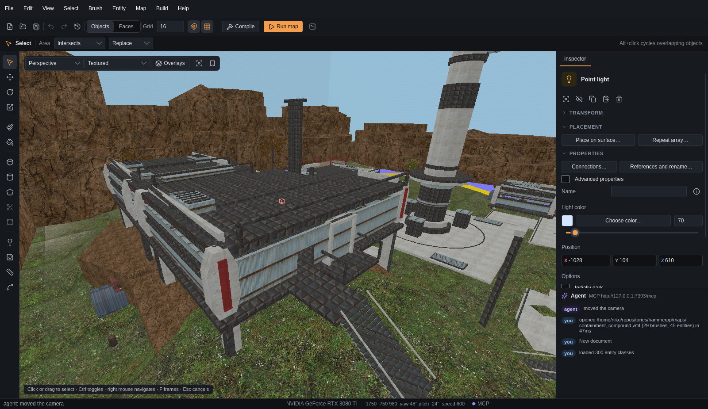
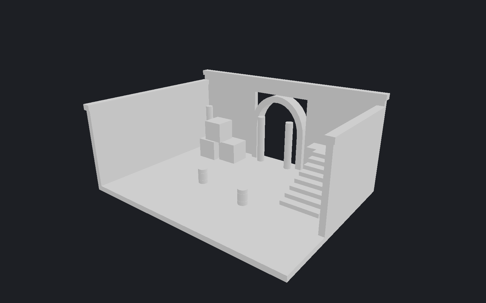
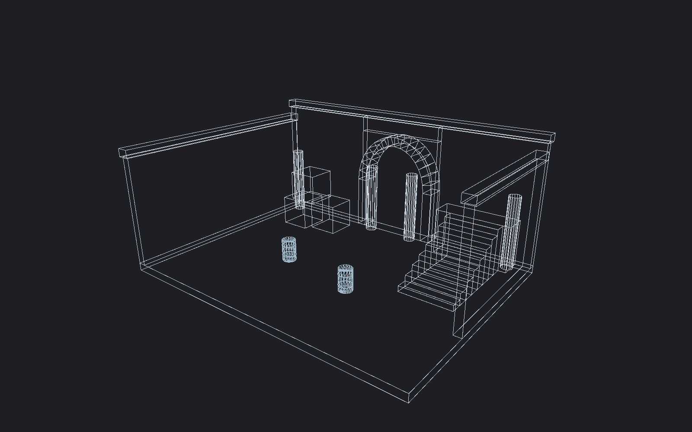

[← Manual](README.md)

# Editor basics

Use the viewport to inspect the map. Use the Inspector to change the selection.

## The window

| Area | Contents |
| --- | --- |
| Menu bar | Every command and dialog: **File**, **Edit**, **View**, **Select**, **Brush**, **Entity**, **Map**, **Build** and **Help**. |
| Toolbar | New, open, save, undo, redo and history; **Objects** or **Faces** selection; **Grid**, snapping and grid display; **Compile**, **Run map** and the game log. |
| Options bar | Settings for the active tool, such as handle axes, area rules or brush depth. |
| Tool rail | Select, move, rotate and scale handles; paint tools; brush, clip and reshape tools; entities, overlays, measurements and paths. |
| Viewport header | Projection, shading, **Overlays**, frame and saved views. |
| Inspector | The selection: transform, terrain, material, brush tools, placement and entity properties. |
| Agent | Recent activity from you and connected agents, and the MCP address. |
| Status bar | The latest message, map counts, camera position and MCP state. |

Commands that open a dialog end with "…". Hover a toolbar or rail icon to see its name.

## Navigate

| Action | Control |
| --- | --- |
| Fly | Hold the right mouse button; use WASD and Q/E. |
| Fly faster | Hold Shift while flying. |
| Planar pan / zoom | Right-drag / mouse wheel. |
| Change projection | Use the projection menu in the viewport header: **Perspective**, **Top · XY**, **Front · XZ**, **Side · YZ**. |
| Frame the selection | **F**, or **Frame selection** in the viewport header. With no selection, frame the map. |
| Select / toggle | Click / Ctrl+click. |
| Select an area | Drag on empty space; release to select. |
| Duplicate / delete | Ctrl+D / Del. |
| Undo / redo | Ctrl+Z / Ctrl+Y. |
| Cancel an active tool | Escape. |

These keys are factory bindings. See [Keyboard shortcuts](keyboard-shortcuts.md).
Set **Fly speed** under **Overlays → Camera**, or scroll while flying.

## Apply a preview

1. Select the objects.
2. Open the required tool.
3. Set its values.
4. Click **Preview**.
5. Inspect the result.
6. Click **Apply** to keep it, or **Cancel** to discard it.

Applied map edits create one Undo step. A conflicting edit invalidates the preview.
Users and agents share the selection, previews and Undo history.
Handle and area previews show their **Apply** and **Cancel** buttons at the bottom of the viewport.

## Grid and snapping

1. Set **Grid** in the toolbar to the required spacing.
2. Toggle **Snap to grid** (the magnet) for viewport placement and dragging.
3. Toggle **Show grid** to display the grid.

Grid spacing is 0.125–4096 units. Numeric fields retain the values you enter.
To align existing objects, use **Transform → Preview snap to grid** in the Inspector.
See [Brushes and transforms](brushes.md#snap-objects-to-grid).

## Viewport modes

Choose a mode in the viewport header, or under **View → Shading**.

| Mode | Result |
| --- | --- |
| **Textured** | Mounted game materials. |
| **Flat shading** | Solid geometry without textures. |
| **Wireframe** | Brush edges and terrain triangles. |
| **Lightmap density** | Authored lighting sample spacing. |
| **Smoothing groups** | Membership in the selected smoothing group. |

| Flat shading | Wireframe |
| --- | --- |
|  |  |

## Overlays

**Overlays** in the viewport header holds camera speed and display switches:
tool textures, leak path, grid, selection highlights, entity guides, surface
previews, authored lighting, sky, ropes and instance contents. The most common
switches are also in the **View** menu. Click outside the panel to close it.

Clear **Tool textures** to hide tool brushes from display and picking.
Enable **Directional surface shading** to make slopes easier to see.
This fixed editor light does not show baked lighting.

## Selection outlines

1. Select an object or face.
2. Clear **Selection outlines** in **Overlays** to hide its edge lines.
3. Enable **Selection outlines** to restore them.

The selection and its surface tint remain active. Tool guides remain visible.

## Saved camera views

1. Move the camera to the required view.
2. Click **Saved views** in the viewport header.
3. Enter a name.
4. Click **Save current as new**.
5. Select a saved view.
6. Click **Go to view**.

Saved views are stored in the map. Use **Replace with current**, **Rename** or **Delete view** to manage them.
Each map supports 64 views, with names up to 80 characters.

## Saved defaults

Grid, preview and navigation defaults have separate dialogs under **Edit → Preferences**.

1. Choose **Grid defaults…**, **Preview defaults…** or **Navigation defaults…**.
2. Click **Save current as defaults** to save the current settings.
3. Click **Apply saved defaults** to use saved settings now.
4. Click **Reload defaults** after an outside change or storage error.

**Reset saved defaults** saves factory settings. Apply them separately.
Ordinary viewport changes do not save defaults.
Unreadable or changed storage blocks writes until Reload succeeds or you explicitly Reset.
A write-verification error can mean the file was written. Reload before retrying.
A preferences entry that needs attention says so in its menu title.

## Closing the editor

1. Use the window close control.
2. Review **Unsaved changes and drafts** when it appears.
3. Choose **Yes** to discard them, or **No**/**Cancel** to continue editing.

Save or apply anything you need before Close.
Changed state requires another review. Busy work can require waiting or cancellation.
Closing stops game launches and sound previews started by the editor. Cleanup errors remain visible.
See [Open documents](open-documents.md) for multiple maps.

## Limits

- Preview modes do not reproduce all game rendering.
- Lightmap density shows authored spacing, not compiled samples.
- Ordinary camera movement and view settings belong to the session. Saved views belong to the map.
- Preference files are limited to 4 KiB. Symlinked or nonregular preference files reject.
