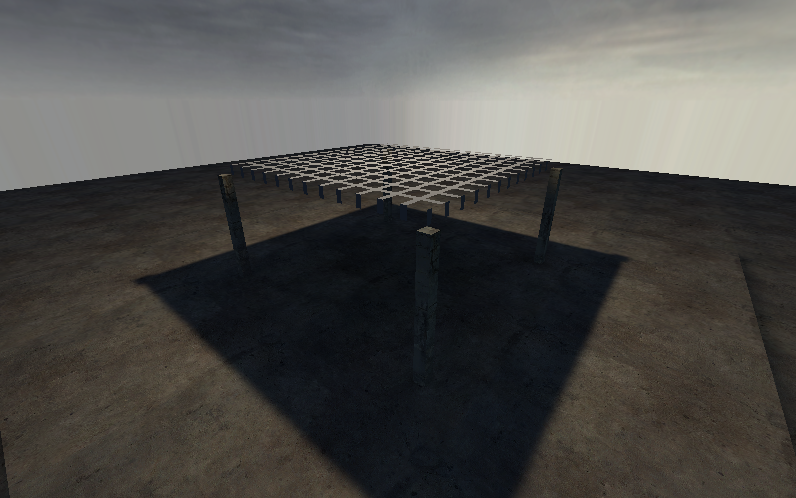
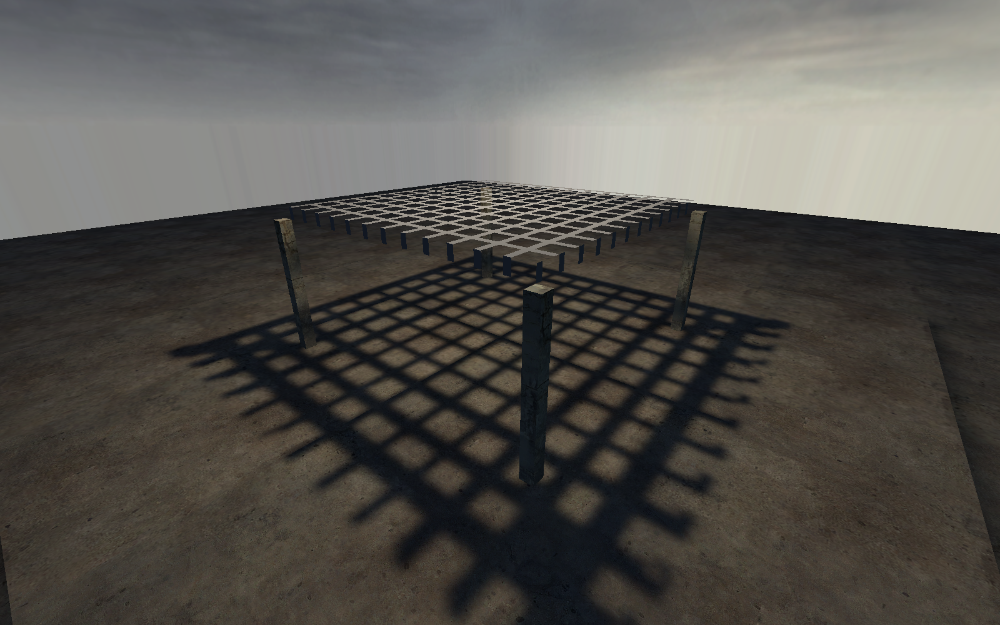

[← Manual](README.md)

# Brush texture shadows

Use a brush texture's cutouts to shape baked shadows.

1. Apply a supported alpha-tested `LightmappedGeneric` material to the brush.
2. Set receiving-face [lightmap spacing](textures.md#face-lighting) small enough to resolve the pattern.
3. Open **Build settings…** and choose **Direct LDR** or **Direct LDR + HDR**.
4. Enable **Brush texture shadows**.
5. Compile and inspect **Diagnostics** in **Build details…**.
6. Click **Play built map** to inspect the shadow.

| Setting off | Setting on |
| --- | --- |
|  |  |

Both views use the same brush geometry and texture.
The setting changes lighting. Geometry, sealing, visibility and collision stay unchanged.

## Cast from a stationary root brush model

1. Select an eligible unnamed, unparented `func_brush` in the current map.
2. Enable **Advanced properties** and set its finite **Origin (X Y Z)**.
3. Set **Shadows** to **Yes**.
4. Open **Build settings…**, choose **Direct LDR** or **Direct LDR + HDR**, and enable **Brush texture shadows**.
5. Compile and inspect **Diagnostics** in **Build details…**.

The compiler applies the same binary cutout sampler at the model's admitted stationary initial pose to world and other-model receivers. Model surfaces do not become reflected-light sources.

## Limits

- World and `func_detail` cutout surfaces are supported.
- Binary alpha tests only; partial transparency is unsupported.
- The bake samples mip 0 with nearest filtering. Game rendering can filter the texture differently.
- Without an explicit eligible **Shadows → Yes** request, brush-model texture shadows stay within that model's own lit receivers.
- Global cutout casting requires a root-map model. Child instance cutout models remain unsupported; ordinary opaque child global casters retain their existing support.
- Cutouts require the supported plain `LightmappedGeneric` material, `$alphatest 1`, a base texture and checked cutoff/transform values. Fractional translucency, additive/window effects and special compile contents are unsupported.
- Terrain alpha casters are unsupported.
- Unsupported materials, transforms or required assets stop the build.

See [static-prop mesh shadows](prop-shadows.md) for model casters.
