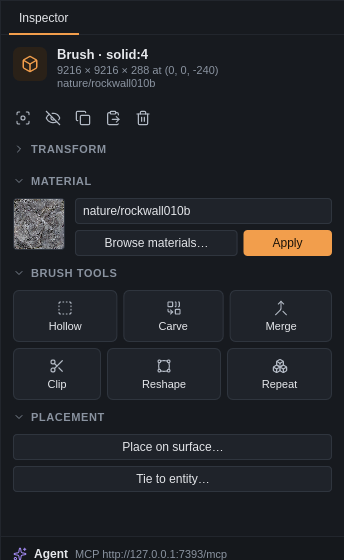
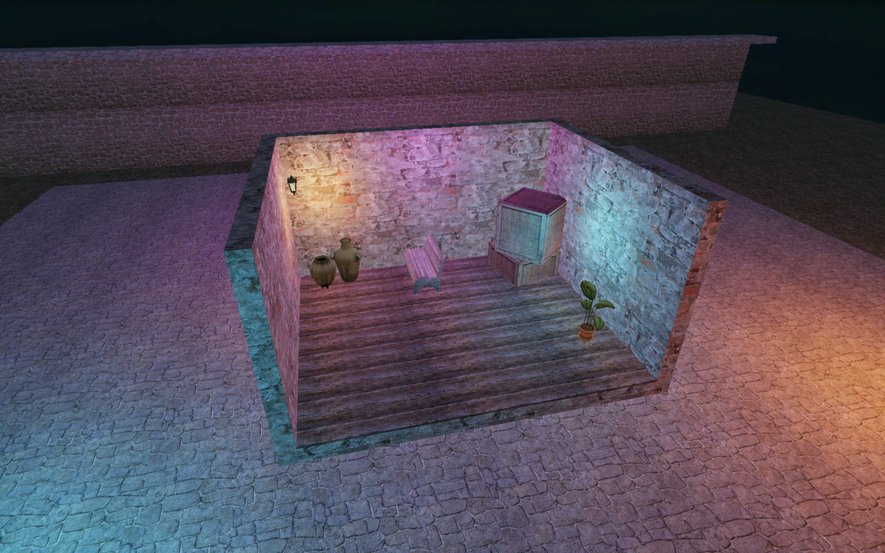
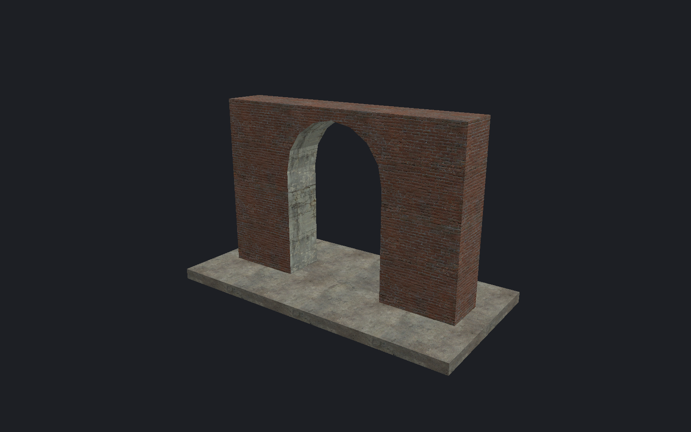
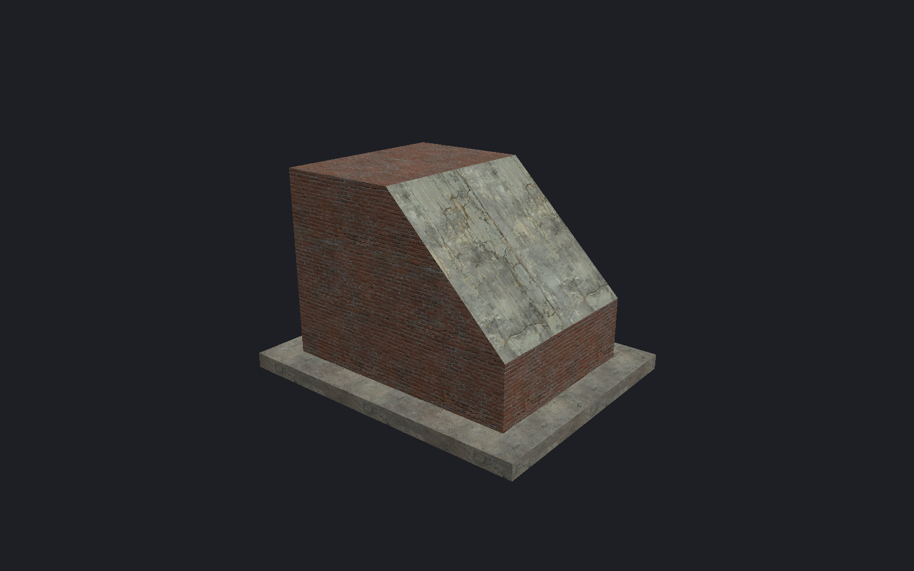
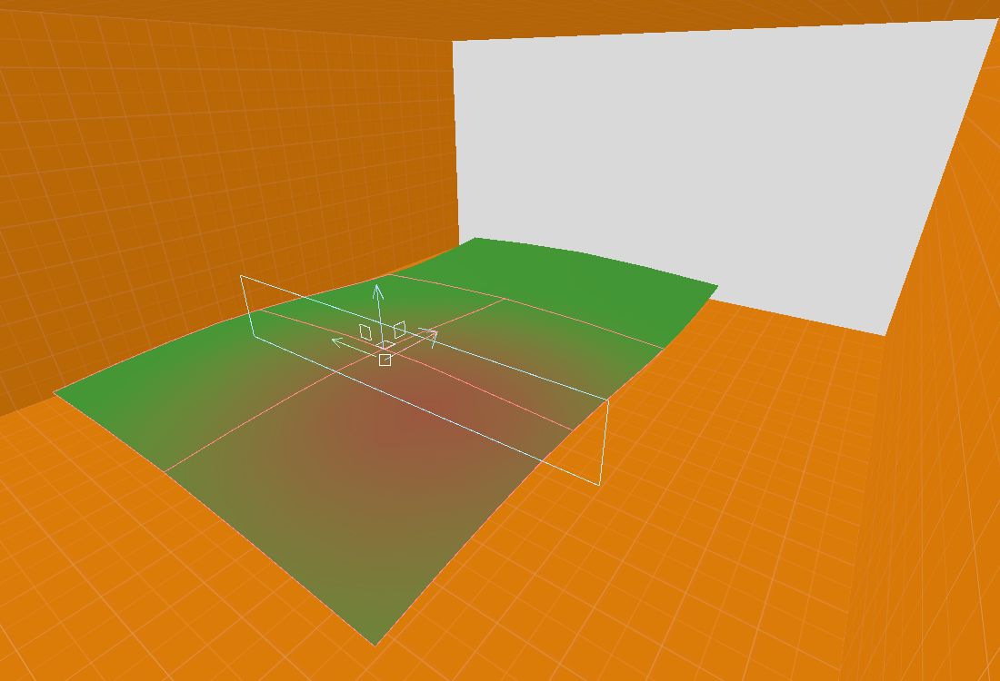
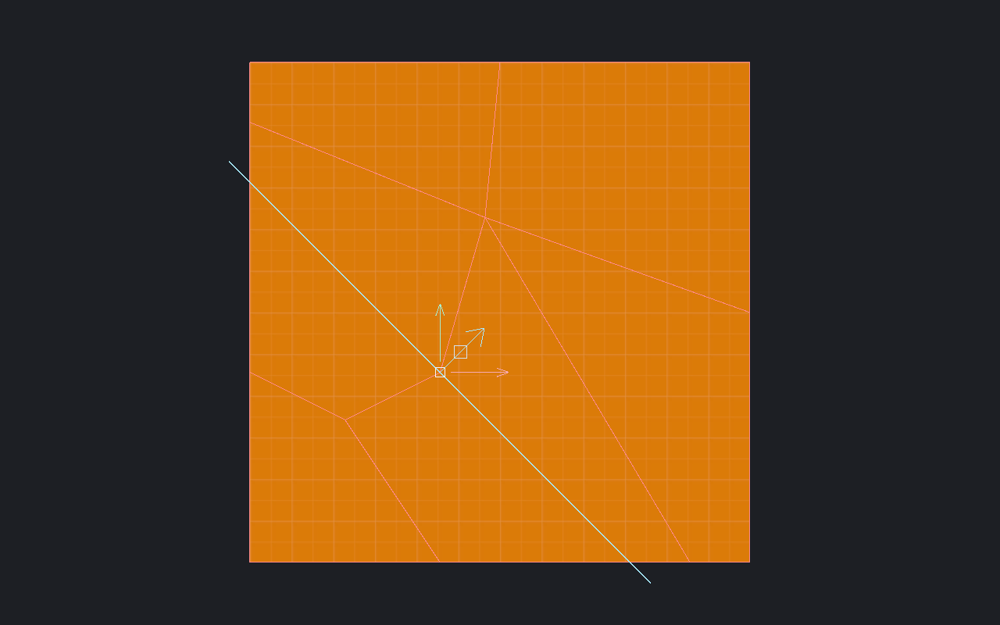
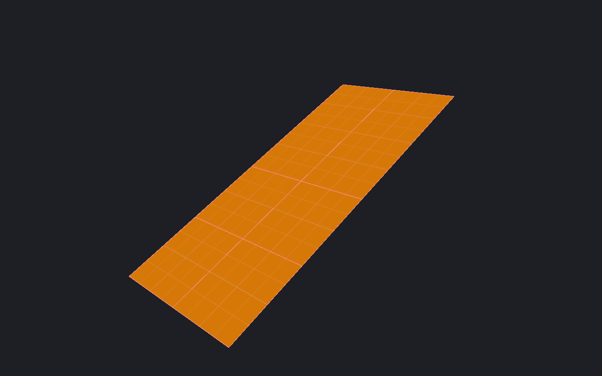
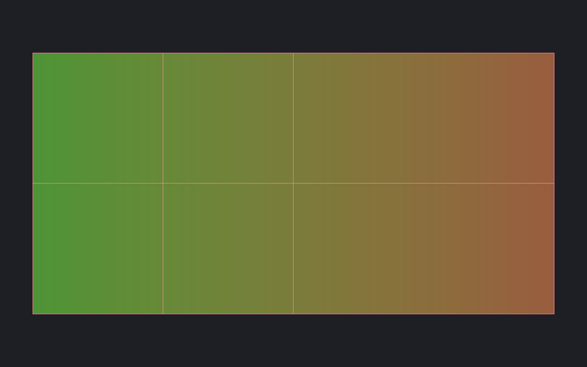
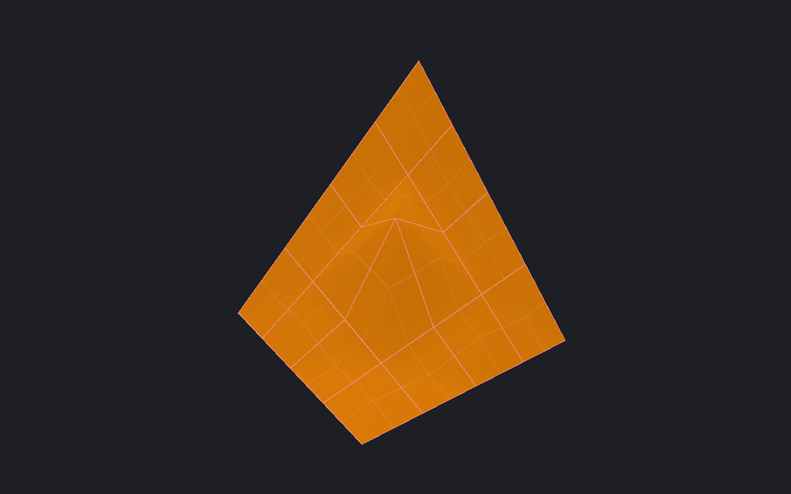
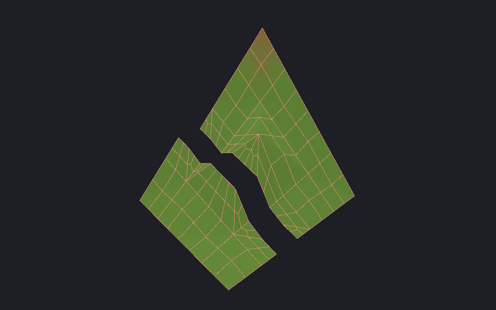

[← Manual](README.md)

# Hollow, carve and clip

Turn solid geometry into rooms, openings and cut shapes.

Select brushes to show **Brush tools** in the Inspector. The same commands are in the **Brush** menu.

## Hollow

1. Select the source brushes.
2. Open **Hollow brushes…**.
3. Set wall thickness.
4. Choose **Inside the original size** or **Outside the original size**.
5. Check the faces to remove under **Openings**.
6. Click **Preview walls**.
7. Inspect the cavity with **Look inside**.
8. Click **Create walls**.

Inside keeps the outer dimensions. Outside keeps the original interior dimensions.
Each source needs at least one wall. Open shells need other geometry to seal a playable map.

## Carve

1. Select cutters and targets.
2. Open **Carve brushes…**.
3. Choose **Cutter · shape to subtract** and **Target brushes**.
4. Enable **Use multiple cutter brushes** for more than one cutter.
5. Under **New cut faces**, choose cutter settings, corresponding target settings, or a named material.
6. For a named material, enter its name or click **Browse materials…**.
7. Click **Preview carve** and inspect the targets.
8. Click **Apply carve**.

Cutters remain in the map. Move or delete them afterward.
The default copies cutter surface settings. Target mode requires a unique
original target face parallel to each new face. Named material mode keeps the
cutter's texture placement and lighting settings. Unsupported matches reject
the complete preview; use cutter or named material mode for oblique cuts.
**Discard preview** keeps the source choices. **Cancel** closes the tool.

## Clip

1. Select brushes. Use **Select → Object selection → Solids** to choose a child
   brush inside an entity.
2. Click **Clip selected brushes**.
3. For terrain, choose a mode under **Terrain cut**.
4. Draw a line in a planar view, enter a plane, or choose **Pick three points**.
5. Choose **Arrow side**, **Opposite side** or **Both sides**.
6. Inspect the preview.
7. Click **Apply cut**.

Use **Move plane** or **Rotate plane** to adjust the cut with handles.
**Cancel cut** or <kbd>Escape</kbd> discards the preview.
Changing **Terrain cut** discards the current preview, picked points and plane
positioning without changing the map or Undo history.
A child-brush cut keeps its entity and unselected siblings. Apply selects the
resulting child brushes. Selecting a whole entity clips all crossing children.

### Cut terrain on its existing grid

1. Select power-3/4 world or `func_detail` terrain brushes.
2. Click **Clip selected brushes**.
3. Under **Terrain cut**, choose **Existing grid**.
4. Set a plane through a complete middle row or column. Power 4 also permits
   quarter-grid lines: row or column 4 or 12 of its 16 cells.
5. Choose **Arrow side**, **Opposite side** or **Both sides**.
6. Inspect the native terrain patches, then click **Apply cut**.

A middle cut produces two patches per retained half, at one lower power.
A quarter cut produces four power-2 patches on the short side and six power-2/3
patches on the long side. **Both sides** produces ten patches.
Grid spacing, paint samples and triangle flags stay the same.
The cut follows the displaced surface, not its backing brush.
It does not create a wall beneath the cut.
Matching neighbor borders are checked before Apply. Neighbor grids stay unchanged.
The preview also checks retained points at native game precision. A cut that
cannot keep those points and their side of the plane rejects.
Visible map instances use freshly resolved child terrain for these checks. Save
a new parent first. Child maps stay unchanged; prepare another preview after
child edits or a parent save.

### Retile flat terrain

Use this mode to cut an eligible planar surface across its existing grid.

1. Select planar power-2/3/4 world or `func_detail` terrain. Its base cage
   must lie on a world-axis plane; the visible surface can be sloped.
   Select all patches that the cut must split.
2. Click **Clip selected brushes**.
3. Under **Terrain cut**, choose **Retile flat terrain**.
4. Draw a line, enter a plane, or choose **Pick three points**.
5. Choose **Arrow side**, **Opposite side** or **Both sides**.
6. Inspect the new native patches, then click **Apply cut**.

Each retained three-to-five-corner region becomes power-2 quadrilateral patches.
Four-corner regions stay one patch when their joins permit. Select the results
to cut them again. Compatible joined patches are checked as one component.
Each surface must remain on one exact plane. Height can vary linearly along
the base normal. Paint must vary linearly across the surface, with exact integer
alpha from 0 to 255. Triangle flags and collision materials retain their original
regions. Retiling keeps
these fields, material, texture placement and smoothing. It does not flatten a
curved or nonlinearly painted surface. **Existing grid** never switches modes
after a failed cut.

### Retile grid cells

Cut curved terrain along a complete existing row or column.

1. Select the world or `func_detail` terrain to cut.
2. Click **Clip selected brushes**.
3. Under **Terrain cut**, choose **Retile grid cells**.
4. Set a plane through one complete internal row or column of the visible surface.
5. Choose **Arrow side**, **Opposite side** or **Both sides**.
6. Inspect the patches, then click **Apply cut**.

Each retained original cell becomes one power-2 patch. The original piecewise
surface, UVs, paint and triangle labels must stay exact. Nonlinear paint is
allowed when each new triangle retains its original raw and packed blend fields.
Normals and runtime LOD are regenerated. This mode does not cut through part of an original cell.

### Cut through curved cells

Cut the original terrain triangles with a free plane.

1. Select world or `func_detail` terrain brushes.
2. Click **Clip selected brushes**.
3. Under **Terrain cut**, choose **Retile surface triangles**.
4. Draw or enter the cut plane.
5. Choose **Arrow side**, **Opposite side** or **Both sides**.
6. Inspect the patches, then click **Apply cut**.

Cut cells become quad fans. Whole retained cells become quarter-cell patches.
The result must retain the original surface, blend fields, UVs and triangle labels.
This mode does not smooth a crease or round an inserted paint value.

## Limits

- Hollow: 16 brushes, 64 faces per brush, 256 walls; thickness 0.125–4096 units.
- Carve: 1–8 cutters, 16 targets, 256 pieces, 64 faces per piece.
- Carving away every child brush of an entity rejects.
- Terrain cannot be hollowed or carved. **Existing grid** requires a power-3/4
  world or `func_detail` patch and a complete middle grid line, or a power-4
  quarter line.
  Matching full/half borders must retain their sample spacing and LOD state.
  Coarsened source and output patches must retain their native masks, positions,
  collision triangles and maximal render triangles. Unselected neighbors must
  keep their complete native state.
- **Existing grid** rejects other cut lines, power-2 splitting, quarter-edge
  links, changed LOD geometry and overlapping or unmatched borders.
  Missing or unsupported child sources stop the preview. Saved-hidden references
  are omitted; display filters do not remove compiler neighbors.
- **Retile flat terrain** requires a common base plane, surface plane and
  orientation across its affected contact component. Curved neighbors, overlaps,
  unsupported partial joins and affected LOD coarsening reject. Paint must remain
  affine; restricted masks and opaque metadata reject.
  Native positions, shared samples and texture fields must remain exact.
  Normal inputs must pass the native arithmetic and conditioning checks.
  Normal bits and final pixels can differ after retiling.
- Paint samples must preserve the same native packed-alpha field under each
  rounding profile. Each output triangle must retain the original flags and, with `$surfaceprop2`,
  the original collision-material alpha class over its complete area. A triangle
  that crosses incompatible source regions rejects. Edge-only contacts do not
  transfer labels. Other paint fields reject.
- Retiling requires direct static `LightmappedGeneric` or plain
  `WorldVertexTransition` materials. Both transition layers use their original
  textures and the primary mapping size. Texture inputs must be untransformed,
  ordinary single-frame VTFs with positive power-of-two dimensions no larger than 32768. Material and texture references
  use case-insensitive lookup.
  Use relative names without extensions or a `materials/` prefix.
  For `LightmappedGeneric`, an optional static `$detail` layer supports blend modes 0–3 and a factor from
  zero to one. Its scale must be an exact native float, written without an
  exponent in at most 32 characters. Omitted scale uses the native value 4.
  Each scaled UV sample must stay exact; some otherwise valid scales reject.
  Patch materials, other blend shaders, base transforms, animated or runtime textures
  and unsupported resources reject. Changed source images or materials require
  another preview before Apply.
- **Retile grid cells** requires world-axis rectangular bases. Displacement
  can vary only along the base normal. Paint samples must stay integral and
  preserve each original triangle's raw and packed blend fields. Native texture
  rules match **Retile flat terrain**. Every touching original patch
  must also be cut in the operation; unchanged contacts reject. No affected LOD
  coarsening, tangential fields or uncertain native normal inputs.
  Each retained cell adds 32 native triangles. Powers 2–4 are subject to the
  shared output and work limits.
- **Retile surface triangles** uses the same height-field, texture, normal and
  selected-contact rules as **Retile grid cells**. Output must fit native edge
  and corner limits without LOD coarsening. Skew quarter grids, high-valence
  corners and fractional inserted paint can refuse. The error gives the paint
  value when it cannot be stored.
- Terrain cuts accept 16 sources and 128 output patches. Unsupported bindings,
  notes, masks and opaque payloads reject before the map changes.
- Numerically uncertain cuts reject. They do not move retained points to fit
  the new patch cages.
- Select one child in **Solids** mode, or the whole `func_detail` entity.
  Only targeted crossing brushes change. Runtime brush-model terrain rejects.
- A connected cut checks at most 128 neighboring faces. Terrain and resolved
  instance context share a 64 MiB snapshot budget.
- Invalid, collapsed or excessively thin results reject before the map changes.

<!-- page-nav -->

---

[← Brushes and transforms](brushes.md) · [Manual](README.md) · [Polygon brushes →](polygon-brushes.md)
