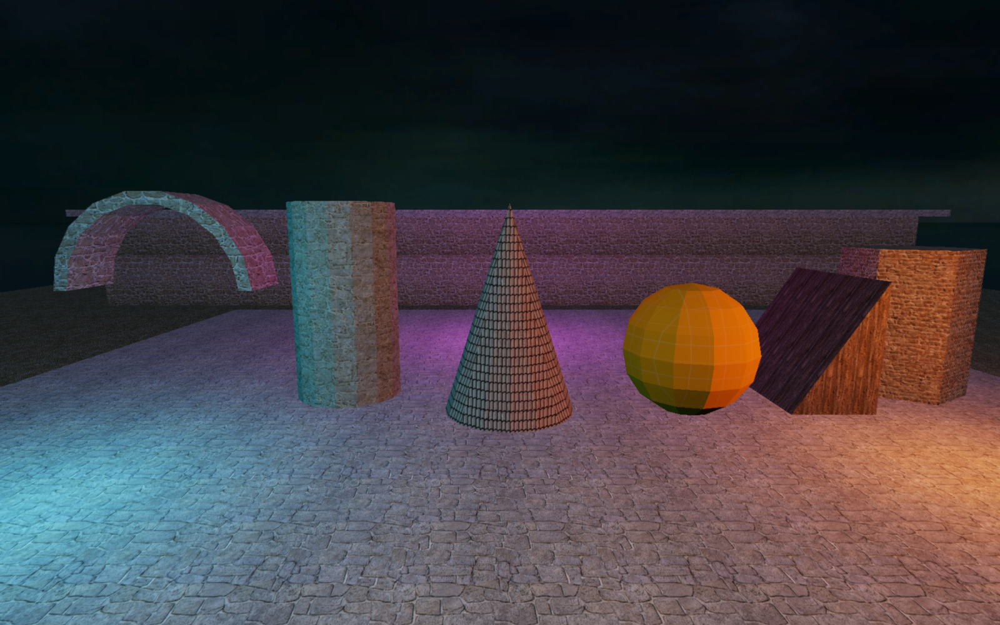
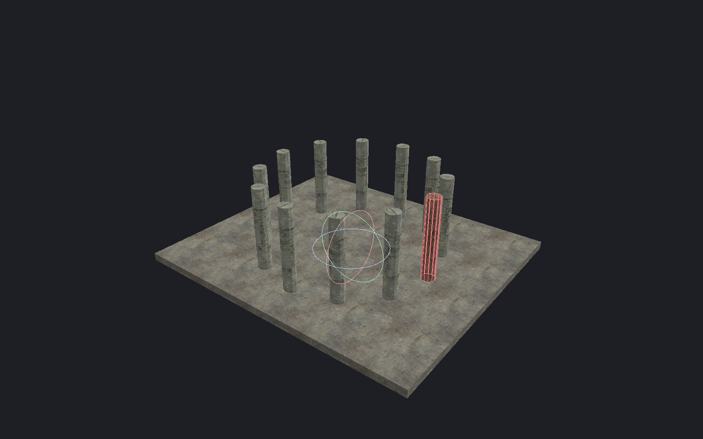
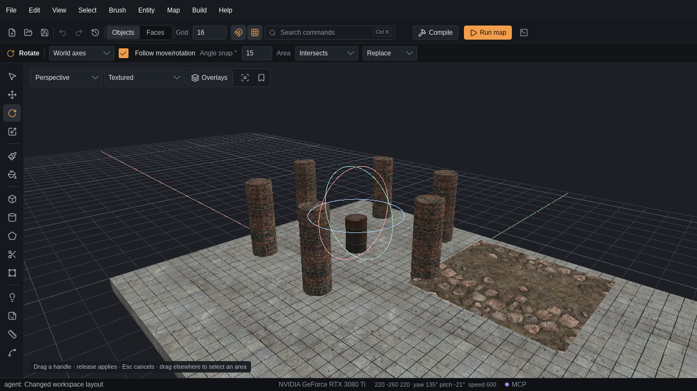
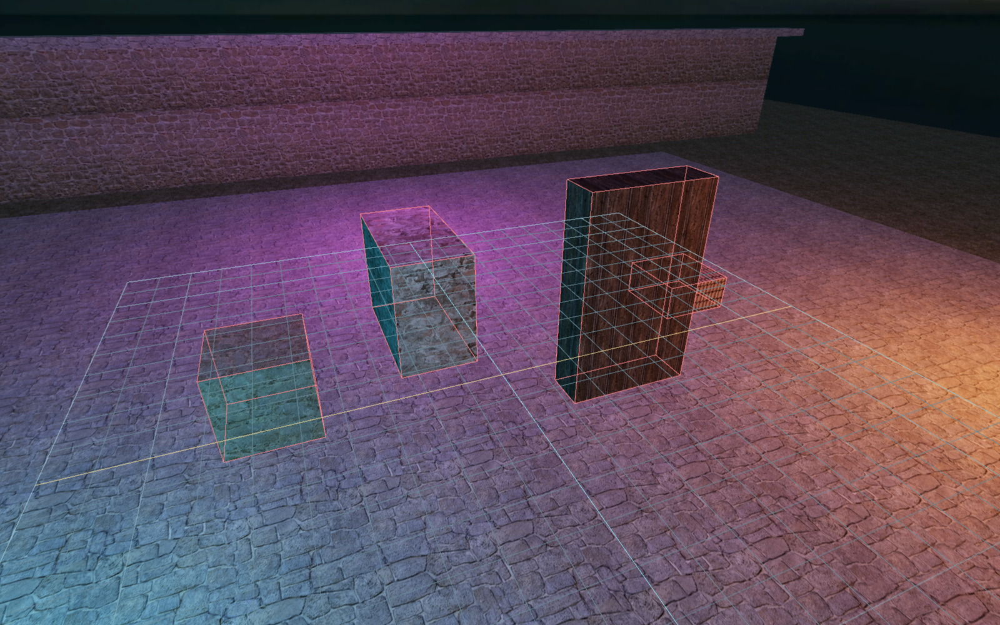

[← Manual](README.md)

# Brushes and transforms

Create solids and change their position, orientation or shape.

## Drawing brushes

1. Choose **Top**, **Front** or **Side**.
2. Click **Draw brush**.
3. Set **Start** and **Depth**.
4. Drag the footprint.
5. Release to create the brush.

Escape cancels. **Done** returns to selection.
In Perspective, **Add brush** places a default block.
Use [Polygon brushes](polygon-brushes.md) for custom outlines.

## Brush shapes

1. Open **Brush shapes…**.
2. Choose **Wedge / ramp**, **Cylinder**, **Cone**, **Faceted sphere** or **Arch / ring**.
3. Enter the bounds and height axis.
4. Choose the material.
5. Set the curved shape's segment count.
6. Click **Preview shape**.
7. Use **Focus preview** to inspect it.
8. Click **Add shape**.



Arches also have inset, start-angle and sweep controls.
Their bounds describe the complete ellipse; a 180° sweep creates half an ellipse.

## Import a block batch

1. Click **Import brush batch…** beside **Brush shapes…**.
2. Select a JSON file with a `blocks` array.
3. Inspect the selected brushes. **Undo** removes the complete batch.

```json
{"blocks":[
  {"mins":[0,0,0],"maxs":[128,64,16],"material":"brick/brickwall001a","texture_scale":[0.5,0.5],"lightmap_scale":32},
  {"center":[256,64,32],"size":[64,16,64],"rotation":[0,0,22.5]}
],"snap":false}
```

Each block uses either `mins`/`maxs` or `center`/`size`. Rotation uses world X,
then Y, then Z, about that block's center. Texture placement follows rotation.
Coordinates stay exact by default; `snap:true` also requires shared **Snap**.
An invalid block rejects the whole batch.

Limits: 256 blocks, 512 KiB per file, thickness at least 0.125 units, and final
bounds within ±65536 units. Texture scales must be finite and nonzero;
lightmap scales are 1–1024 units.

## Transform handles

1. Select the objects.
2. Choose **Move handles**, **Rotate handles** or **Scale handles**.
3. Drag an axis, plane or center handle.
4. Release to apply.

Escape cancels the drag.
Choose **World axes** or **Local axes** for handle orientation.
**Snap** uses the grid; **Angle snap** sets the rotation step.

## Exact transforms

1. Select the objects and expand **Transform** in the Inspector.
2. Choose **Move**, **Rotate**, **Scale**, **Mirror** or **Shear**.
3. Enter the values.
4. For rotation, scale, mirror or shear, choose **Selection center**, **World origin** or **Custom** under **Pivot**.
5. Click **Move selection**, **Rotate selection**, **Scale selection**, **Mirror selection** or **Shear selection**.

These buttons apply immediately. Use **Undo** to reverse the edit.

Numeric transforms do not round to the grid.
Scale factors must be positive. Whole-object scaling changes point-entity spacing, not model size.
Creation, moves and copies reject invalid geometry or nonfinite texture coordinates.
A refused edit preserves the source, selection and Undo history.
A failed batch changes no objects.

### Pick a custom pivot on a surface

1. Click **Pick pivot…**.
2. Click a visible brush, terrain or supported model surface.
3. Inspect the **Custom** coordinates.
4. Rotate or scale around that point.



The pivot stays at its world position. It does not follow the surface.
**Cancel pivot pick** or Escape stops an unfinished pick.

### Attach the pivot to a point entity

1. Expand **Transform** and choose **Rotate**, **Scale**, **Mirror** or **Shear**.
2. Select one point entity, or enter its `entity:<id>` in **Pivot entity**.
3. For a local offset, click **Detach pivot** if attached. Choose
   **Pivot → Custom** and enter the world point.
4. Click **Attach origin** for the origin, or **Attach local point** for the offset.
5. Inspect **Attached pivot** and its resolved coordinates before transforming.

A local point is stored in the entity’s orientation frame. Moving the anchor
moves the pivot. Rotating the anchor also rotates the local offset. The
attachment remains active when you select other objects to transform.
**Detach pivot** keeps the resolved point fixed in world space.

An unavailable anchor reports its error and blocks operations that need it.
Enter explicit coordinates under **World point replacement**, then click
**Use world point** to recover without resolving the old anchor. There is no
fallback to a cached point or selection center.
Resolved points and local offsets must be finite.
Local offsets use authored origin/orientation, without model scale, parenting
or FGD orientation adjustments. Undo can restore a deleted anchor. **New** or
**Open** clears the attachment, retaining a resolved point as a fixed world
point or returning to Selection center when the anchor is unavailable.

### Attach the pivot to a vertex

1. Expand **Transform** and choose **Rotate**, **Scale**, **Mirror** or **Shear**.
2. Click **Attach vertex…**.
3. Click a visible brush face, terrain triangle or supported model mesh.
4. Inspect **Attached pivot**, its source and resolved coordinates.
5. Select the objects to transform, then rotate, scale, mirror or shear.



The first visible hit determines the target: a brush uses its nearest face
corner; terrain and models use the nearest vertex of the hit triangle.
Selected objects remain valid targets. Picking uses editor query visibility,
not rendered-pixel occlusion.
**Cancel pivot pick** or Escape preserves the current pivot. **Detach pivot**
fixes the resolved point in world space; **World point replacement** and
**Use world point** recover an unavailable binding.

- Brush corners follow geometry while their side/corner topology remains valid.
- Terrain vertices use prepared displacement positions, including shared
  neighbor/LOD adjustments. Grid size and the captured base identity must stay
  valid.
- Model vertices follow the current pose and scale. Body/mesh identity and the
  captured editor-cache identity of the original MDL/VVD/VTX bytes must match.
  **Reload models** invalidates these bindings even when the bytes are identical;
  the resolver does not reread disk assets each frame. Content-context changes
  also require a new binding.
- Saved **Hide** makes a vertex owner unavailable. Editor display filters affect
  picking but do not invalidate an existing binding.

Unavailable topology, grids, model bodies or assets report errors without a
cached-point fallback. Startup defaults cannot store bindings. **New** or
**Open** clears them using the same rule as point-entity attachments.

### Snap the pivot to the grid

1. Set **Grid** to the required spacing.
2. Under **Pivot**, choose **Selection center**, **World origin** or **Custom**.
3. Click **Snap pivot to grid**.
4. Inspect the fixed pivot coordinates, then rotate, scale, mirror or shear around that point.

Each world coordinate rounds to the nearest grid multiple, even when **Snap** is off.
Half steps round away from zero. A selection-center pivot becomes a fixed world point;
changing the selection does not move it. A zero result appears as **World origin**.
Snapping a surface-picked pivot clears its old picked-surface label.
Snapping an attached pivot detaches it at the snapped world point, even when
the point was already aligned.

Finish or cancel active tools, previews, builds and launches first.
The pivot and snapped result must stay within ±65536 units.
This changes only the current pivot. It does not move geometry, create an Undo step
or save startup defaults.

### Save pivot defaults

1. Choose **Selection center**, **World origin** or a **Custom** point under **Pivot**.
2. Choose **Edit → Preferences → Transform pivot defaults…**.
3. Compare **Current document** with the saved defaults.
4. Click **Save current as defaults** to use this pivot in new document windows.
5. Click **Apply saved defaults** to use the saved pivot in this document.

**Reload defaults** reads storage without applying it.
**Reset saved defaults** saves Selection center; click **Apply saved defaults** to use it now.
**Close** or Escape closes the dialog.

Save stores only the pivot mode and fixed world coordinates. It does not attach a pivot to a surface.
Detach an attached pivot before saving defaults.
Other open documents keep their current pivots. **New** and **Open** in the same
document window retain an unattached pivot; attached bindings are cleared.
Finish active tools, previews, builds and launches before Apply.

### Snap objects to grid

1. Set **Grid** in the toolbar.
2. Expand **Transform** in the Inspector.
3. Under **Snap**, choose **Selection** or **Each object**.
4. Click **Preview snap to grid** and inspect the movement.
5. Click **Apply transform**, or **Cancel** to discard the preview.



**Selection** moves everything by one offset from the selection bounds minimum,
preserving internal spacing. **Each object** aligns each object's bounds minimum
separately. Group members move independently; every brush entity keeps all its
child brushes together, including hidden children. Brush shapes remain unchanged.
Both modes use the current grid even when automatic **Snap** is off.
Apply creates one Undo step; an already aligned selection adds none.

Each object requires whole visible roots with valid geometry inside ±65536 units.
Invalid requests retain the previous preview. Models and point entities align
their existing model or helper bounds. Reloading model assets cancels a snap preview.
For exact corner matching, use [Surface placement](placement.md#snap-a-real-corner).

### Textures during transforms

- **Follow move and rotation** attaches texture placement to the brush.
- **Stretch textures when scaling** stretches textures as the brush changes size.

Clear these options to retain the world texture projection.

### Mirror

Choose **Mirror X**, **Mirror Y** or **Mirror Z**, then click **Mirror selection**.
**Mirror textures with geometry** also reflects the texture.
Brushes and power-2/3/4 terrain support all mirror-axis combinations.
Terrain keeps the physical positions of its heights, blend weights and triangle tags.

### Shear

Choose different **Shift** and **by** axes.
Set **Factor** to the required proportional shift.
For example, X by Y at 0.5 shifts X by half the Y distance from the pivot.
Use **Keep textures attached while shearing** when required.
Click **Shear selection** to apply.

### Point placements

| Selected object | Mirror and shear behavior |
| --- | --- |
| Point lights, lighting origins, null helpers and cubemap samples | Move their origins. Light brightness, radius and helper sizes stay unchanged. |
| Untargeted spotlights and environment lights | Move their origins and map their light directions. Positive scale changes spacing, not light direction. |
| Player poses, targets, landmarks, supported MDL props and instances | Two-axis mirrors can encode a proper rotation. Odd mirrors and nonzero shear stop the edit. Model and instance sizes stay unchanged. |

Point placements require unparented objects with supported fields. Unknown classes,
ambiguous spatial keys and unsupported metadata stop the whole batch.
See the [MCP catalog](mcp.md#numeric-reflection-and-shear) for exact classes.

## Limits

- Geometry must stay within ±65536 units. Playable coordinates have stricter [compiler limits](compile-and-play.md#coordinate-limits).
- Shear factors are −64–64.
- The default sphere uses 12 sides and 5 latitude bands.
- Hollow, Carve and component editing accept at most 64 faces per brush.
- Invalid geometry rejects before Apply. Reloading model bounds invalidates pending snap previews.
- A malformed entity origin stops the whole move or copy operation.
- Invalid imported brushes stay in the map. Preview errors identify omitted geometry.

<!-- page-nav -->

---

[← Preview defaults](preview-defaults.md) · [Manual](README.md) · [Hollow, carve and clip →](brush-tools.md)
