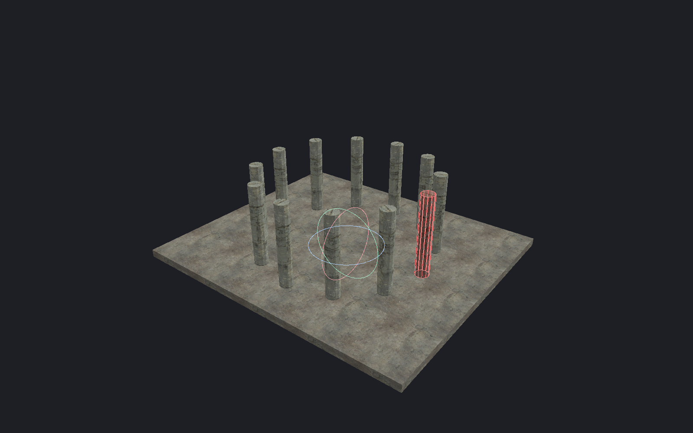

[← Manual](README.md)

# Brushes and transforms

Create solids and change their position, orientation or shape.

## Drawing brushes

1. Choose **Top**, **Front** or **Side**.
2. Click **Draw brush**.
3. Set **Start** and **Depth**.
4. Drag the footprint.
5. Release to create the brush.

Escape cancels. **Done** returns to selection.
In Perspective, **Add brush** places a default block.
Use [Polygon brushes](polygon-brushes.md) for custom outlines.

## Brush shapes

1. Open **Brush shapes…**.
2. Choose **Wedge / ramp**, **Cylinder**, **Cone**, **Faceted sphere** or **Arch / ring**.
3. Enter the bounds and height axis.
4. Choose the material.
5. Set the curved shape's segment count.
6. Click **Preview shape**.
7. Use **Focus preview** to inspect it.
8. Click **Add shape**.

Arches also have inset, start-angle and sweep controls.
Their bounds describe the complete ellipse; a 180° sweep creates half an ellipse.

## Transform handles

1. Select the objects.
2. Choose **Move handles**, **Rotate handles** or **Scale handles**.
3. Drag an axis, plane or center handle.
4. Release to apply.

Escape cancels the drag.
Choose **World axes** or **Local axes** for handle orientation.
**Snap** uses the grid; **Angle snap** sets the rotation step.

## Exact transforms

1. Enable **Transform selection**.
2. Choose **Move**, **Rotate**, **Scale**, **Mirror** or **Shear**.
3. Enter the values.
4. For rotation, scale, mirror or shear, choose **Selection center**, **World origin** or **Custom** under **Pivot**.
5. Click **Move selection**, **Rotate selection**, **Scale selection**, **Mirror selection** or **Shear selection**.

These buttons apply immediately. Use **Undo** to reverse the edit.

Numeric transforms do not round to the grid.
Scale factors must be positive. Whole-object scaling changes point-entity spacing, not model size.

### Pick a custom pivot on a surface

1. Click **Pick pivot…**.
2. Click a visible brush, terrain or supported model surface.
3. Inspect the **Custom** coordinates.
4. Rotate or scale around that point.

The pivot stays at its world position. It does not follow the surface.
**Cancel pivot pick** or Escape stops an unfinished pick.

### Snap the pivot to the grid

1. Set **Grid** to the required spacing.
2. Under **Pivot**, choose **Selection center**, **World origin** or **Custom**.
3. Click **Snap pivot to grid**.
4. Inspect the fixed pivot coordinates, then rotate, scale, mirror or shear around that point.

Each world coordinate rounds to the nearest grid multiple, even when **Snap** is off.
Half steps round away from zero. A selection-center pivot becomes a fixed world point;
changing the selection does not move it. A zero result appears as **World origin**.
Snapping a surface-picked pivot clears its old picked-surface label.

Finish or cancel active tools, previews, builds and launches first.
The pivot and snapped result must stay within ±65536 units.
This changes only the current pivot. It does not move geometry, create an Undo step
or save startup defaults.

### Save pivot defaults

1. Choose **Selection center**, **World origin** or a **Custom** point under **Pivot**.
2. Open **Transform pivot defaults…** under **VIEWPORT**.
3. Compare **Current document** with the saved defaults.
4. Click **Save current as defaults** to use this pivot in new document windows.
5. Click **Apply saved defaults** to use the saved pivot in this document.

**Reload defaults** reads storage without applying it.
**Reset saved defaults** saves Selection center; click **Apply saved defaults** to use it now.
**Close** or Escape closes the dialog.

Save stores only the pivot mode and fixed world coordinates. It does not attach a pivot to a surface.
Other open documents keep their current pivots. **New** and **Open** in the same document window also retain its current pivot.
Finish active tools, previews, builds and launches before Apply.

### Snap selection to grid

1. Set **Grid**.
2. Enable **Transform selection**.
3. Click **Preview snap to grid**.
4. Inspect **Anchor: selection bounds minimum** and the movement.
5. Click **Apply transform**.

The group moves by one offset. Its shape and internal spacing remain unchanged.
For exact corner matching, use [Surface placement](placement.md#snap-a-real-corner).

### Textures during transforms

- **Follow move and rotation** attaches texture placement to the brush.
- **Stretch textures when scaling** stretches textures as the brush changes size.

Clear these options to retain the world texture projection.

### Mirror

Choose **Mirror X**, **Mirror Y** or **Mirror Z**, then click **Mirror selection**.
**Mirror textures with geometry** also reflects the texture.
Point entities and terrain cannot be mirrored with this operation.

### Shear

Choose different **Shift coordinate** and **By coordinate** axes.
Set **Factor** to the required proportional shift.
For example, X by Y at 0.5 shifts X by half the Y distance from the pivot.
Use **Keep textures attached while shearing** when required.
Click **Shear selection** to apply.

## Limits

- Geometry must stay within ±65536 units. Playable coordinates have stricter [compiler limits](compile-and-play.md#coordinate-limits).
- Shear factors are −64–64.
- The default sphere uses 12 sides and 5 latitude bands.
- Hollow, Carve and component editing accept at most 64 faces per brush.
- Invalid geometry rejects before Apply. Reloading model bounds invalidates pending snap previews.
