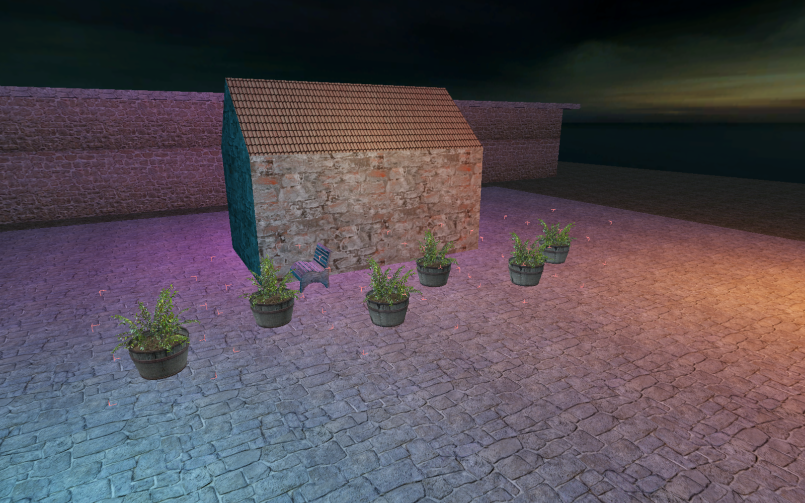
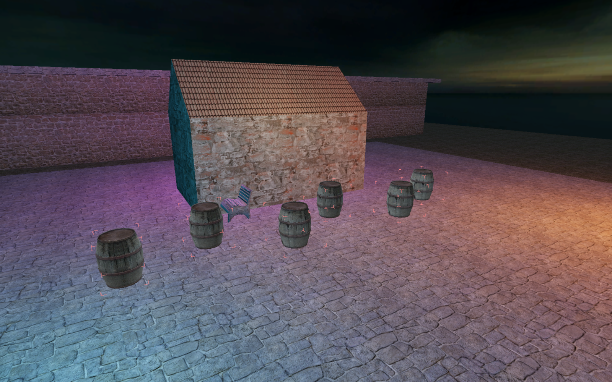

[← Manual](README.md)

# Bulk entity workflows

Change captured sets of entities with one reviewed, undoable edit.

## Change classes

1. Select whole entities.
2. Open **Entity → Change entity classes…**.
3. Enter a loaded **Class name**, then click **Preview class changes**.
4. Review each old and new class. Click **Apply**, or **Cancel**.

Every retained property must be valid for the new class. Brush and point classes
cannot be exchanged. The action keeps properties and connections; it adds no
class defaults.

## Choose models together

1. Select point entities with a **World Model** field.
2. Open **Entity → Choose models…**.
3. Search and select a model, or enter its path and click **Preview model**.
4. Choose **Skin** and bodygroups. Inspect every captured model in the viewport.
5. Click **Use model** to apply the choice to all captured entities, or **Cancel**.

Mixed source values remain unchanged until you choose a model. The preview
preserves each entity's position, rotation, scale, tint and hidden state.
A typed path needs **Preview model** before **Use model**.

## Choose sounds or particle effects

1. Select compatible whole entities.
2. Open **Entity → Choose sounds…** or **Entity → Choose particles…**.
3. For sounds, select a common **Sound field**. When several fields are
   available, choose one explicitly.
4. Search and select the asset. Inspect its source values and definition.
5. Click **Use sound** or **Apply**, or **Cancel** to discard the choice.

Mixed source values do not select an asset automatically. Sounds play only
when you click **Play**; this never changes game volume. Particle inspection
shows definition metadata, not a rendered effect.

## Edit connections across sources

1. Select whole source entities and open **Entity → Batch connections…**.
2. Click **Use selected sources** to capture them.
3. To add one connection per source, click **Add on selected sources**.
4. To edit or remove existing connections, highlight their exact rows and click
   **Edit highlighted rows** or **Remove highlighted rows**.
5. For an edit, enable **Replace** beside each field to change. Other fields keep
   their original values, including mixed values.
6. Review the affected rows and warnings. Click **Apply connections**, or
   **Cancel plan**. **Close** closes the window.

Rows belong to their displayed source entities. Equal row numbers on different
entities do not select the same connection. Custom or unresolved I/O produces
warnings; the action does not skip those rows.

## Rename several entities

1. Select whole entities and open **Entity → Rename selected entities…**.
2. Enter a distinct **New name** for every captured entity.
3. Click **Preview all names**.
4. Inspect **Reference updates**. Click **Apply renames**, or **Cancel**.

Swaps and chains use the original entity identities. Names and exact reference
updates change together. Unsupported dynamic, scripted or instance-scoped name
bindings block Apply.

## Move brush entities to world

1. Select complete brush entities.
2. Open **Entity → Move to world**.
3. Review **Entities and removed behavior**, including properties and outputs.
4. Click **Apply**, or **Cancel**.

Brushes keep their authored coordinates, IDs, materials, UVs and supported
visibility, group and layer metadata. Runtime poses are not baked.

> [!WARNING]
> Move to world removes the entity's behavior and outgoing connections.
> Incoming references are not rewritten and can become unresolved. Use **Undo**
> to restore the complete edit.

## Limits

- Class, model, connection and world batches capture up to 64 entities. Rename
  captures up to 256 entities in a map with at most 8,192 entities.
- Connection batches admit 256 rows, 64 KiB of text and 4,096 resolved targets.
  Malformed imported connection field counts require single-row repair before
  batch editing. Removal uses the original raw row identity.
- Class and world batches admit 256 brushes and 8,192 sides. Model previews and
  rename also enforce existing snapshot, geometry and work budgets.
- Every member must be valid. Missing targets, changed maps or definitions and
  replaced tokens refuse the complete action without partial edits.
- A selection change never retargets a captured batch. Model choices can become
  stale after scene changes; reopen the browser when requested.
- World conversion refuses entity-bound notes, measurements, retained instance
  origin custody and unknown metadata that cannot survive entity removal.
- Model choices check current MDL/VVD/VTX bytes and origins before Preview and
  Apply. Sound choices check captured script and wave sources; changed data
  requires inspection or **Reload sounds**. Particle Apply checks the current
  manifest and PCF definition. Failed checks leave the map unchanged.

<!-- page-nav -->

---

[← Entities and logic](entities.md) · [Manual](README.md) · [Point-entity gallery →](entity-gallery.md)
