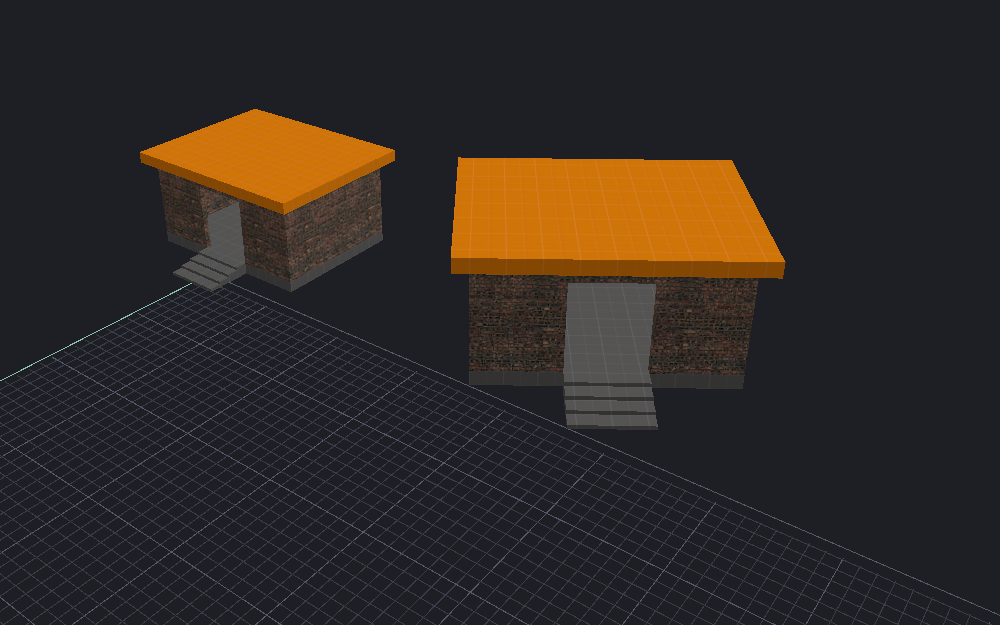

[← Manual](README.md)

# Cut, copy and paste

Transfer a detached set of objects within or between maps.

1. Choose **Objects** in the toolbar.
2. Select the objects.
3. Click **Copy** or **Cut**.
4. Open the destination map if required.
5. Click **Paste…**.
6. Check **Destination** and the object counts.
7. Choose **In place** or **Offset** under **Placement**.
8. If needed, expand **Transform placement** and set **Rotation (degrees)** and **Scale (1 = unchanged)** for X, Y and Z.
9. Leave **Source pivot** at **Bounds center**, or choose **Custom** and enter **Pivot (units)**.
10. Set **Keep textures attached** as required.
11. Review external links.
12. Click **Preview paste**.
13. Inspect the result.
14. Click **Apply paste**.

Scale and rotation use world XYZ axes around the source pivot, with positive scale first.
Custom pivot coordinates belong to the copied map.
**Offset (units)** adds the final world translation; **In place** adds none.
Saved face partitions transfer with their materials and texture plans.

Left: source. Right: a 35° rotation and 1.25× scale with textures attached.

Viewport shortcuts are <kbd>Ctrl</kbd>+<kbd>C</kbd>, <kbd>Ctrl</kbd>+<kbd>X</kbd> and <kbd>Ctrl</kbd>+<kbd>V</kbd>.
Text fields retain their normal text shortcuts.
Cancel discards the paste preview; a completed Cut remains a separate Undo step.

## References

Supported internal references follow the new unique names.
External references require **Keep external links by name**.
For an unchanged same-map Cut, **Restore cut names** can reconnect incoming references.
An intervening edit, Undo or definition reload invalidates that receipt.

## Between editors

**Read system clipboard** and **Publish to system clipboard** use UTF-8 VMF text for HammeRR.
Hammer/Hammer++ keeps copied map objects in process; ordinary VMF text is not its native object-paste format.
Use a VMF file to hand objects between these editors.

> [!NOTE]
> System clipboard access can be unavailable on a headless display. A failed read preserves the retained session payload. Wayland requires ext-data-control or wlr-data-control; an unavailable backend does not switch to another clipboard.

## Limits

- Text is limited to 8 MiB; native reads time out after 5 seconds.
- Ambiguous, scripted and unsupported numeric references reject.
- Stale or opaque partition plans and invalid transformed projections reject.
  Valid skewed projections retain explicit native axes.
- MDL model entities require uniform scale. Static/detail model resizing and unsupported spatial metadata reject.
- A source edit does not change an already copied payload.

<!-- page-nav -->

---

[← Prefab library](prefabs.md) · [Manual](README.md) · [Groups →](groups.md)
