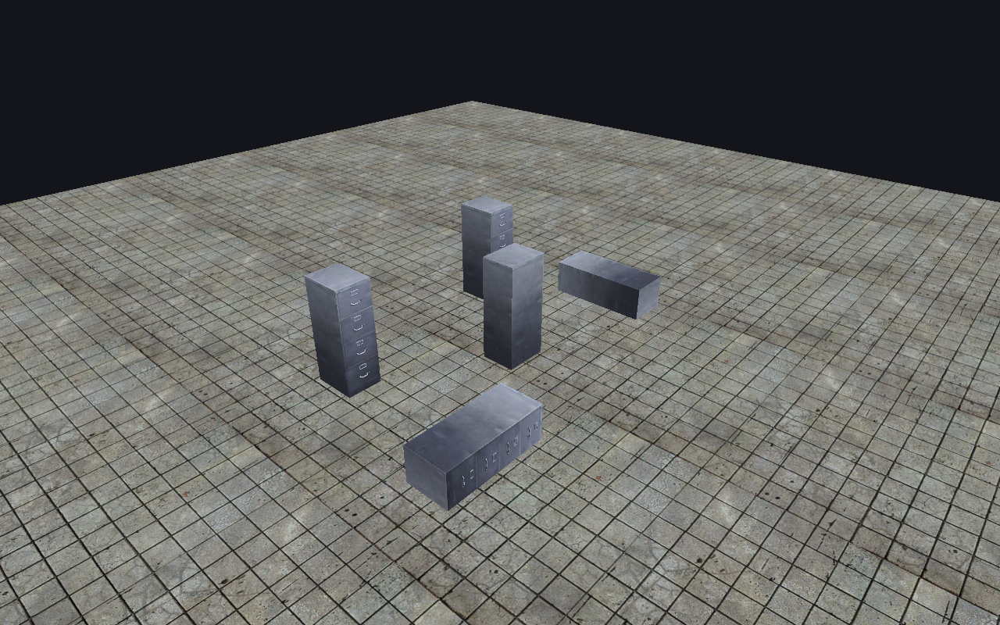

[← Manual](README.md)

# Color correction

Preview one Source color lookup table (LUT) across the complete editor viewport.

1. Open **Color correction…** in the viewport controls.
2. Enter an explicit file path in **Source .raw LUT path**.
3. Click **Load LUT**. Check the source status. Loading turns the preview off.
4. Select **Enable color correction**.
5. Set **Weight** from `0` to `1`. Use `0` for the original display colors and `1` for full correction.
6. Click **Apply preview**.

To disable the preview, clear **Enable color correction** and click **Apply preview**.
**Clear LUT** disables the preview and clears its source and error. **Close** closes
the window; it does not undo a completed load or applied settings.

## Limits

- The preview starts off. Settings are temporary. They do not change the VMF, undo history or compiled map.
- Use exactly 98,304 bytes: 32 × 32 × 32 RGB8 entries, red index fastest, then green, then blue. Headered images, `.cube` files and other sizes are unsupported. A raw file cannot identify incorrect channel order.
- Correction applies to display colors across the complete viewport, including the background, grid and selection. Native HDR, tone mapping, LUT entities, volumes, transitions and multiple LUTs are unavailable.
- Missing or changed input invalidates the LUT. Load it again. A failed load clears earlier data.
- Corrected views are limited to 4096 pixels per axis and 64 MiB of additional target storage. A GPU or size error shows an ungraded desktop frame with an error; `render_view` fails.
