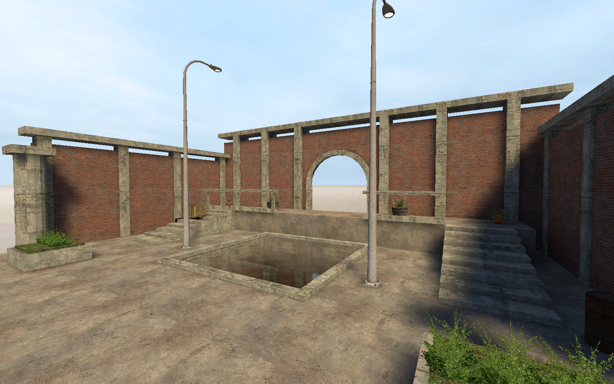
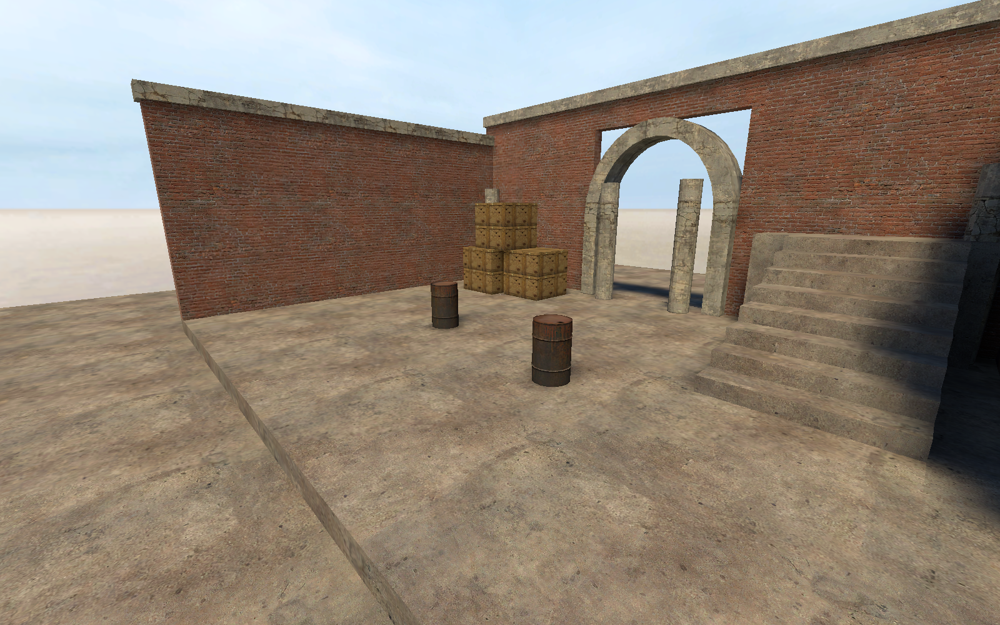

[← Manual](README.md)

# Compile and play

Build a CS:S BSP with integrated geometry, visibility, lighting and optional engine physics.
The compiler remains experimental. Check diagnostics before using a build.

## Build a playable map

1. Seal the playable area with ordinary world brushes.
2. Add a player spawn inside the sealed area.
3. Add lights, materials and any required entities.
4. Save the VMF.
5. Open **Build settings…**.
6. Choose **Build lighting → Direct LDR** or **Direct LDR + HDR**.
7. Choose **Physics bodies → CS:S engine physics** for physical collision.
8. Click **Close**, then **Compile**.
9. Open **Build details…** in the bar below the toolbar.
10. Read **Diagnostics** and repair errors.
11. Click **Play built map**.



**Run Map** builds, then launches the successful result.
Game launches use `-insecure` and LAN mode (`sv_lan 1`). Steam must be running.

## Controls

| Control | Location | Action |
| --- | --- | --- |
| **Build settings…** | Toolbar | Configure the next build, including before the first build. |
| **Compile** | Toolbar | Build without launching the game. |
| **Run Map** | Toolbar | Build and play. |
| **Build details…** | Build status bar | Read progress, captured settings and diagnostics. |
| **Play built map** | Build status bar | Launch the last successful compatible output. |
| **Cancel build** | Build status bar | Cancel the owned job and wait for cleanup. |
| **Stop Map** | Game controls | Stop the owned game process. |
| **Game Log** | Game controls | Read game output. |

Changing settings does not change a running build. Failed or cancelled builds preserve the previous published BSP.
Builds use a captured source and settings snapshot.

## Build settings

| Setting | Use |
| --- | --- |
| **Fullbright** | Geometry checks without baked lighting. |
| **Direct LDR** | LDR lightmaps and light records. |
| **Direct LDR + HDR** | Both lighting channels and required HDR map data. |
| **Fast (conservative)** visibility | Faster, conservative visibility. |
| **Detailed (portal clipping)** visibility | More precise portal visibility. |
| **Indirect light** | Direct only, or one to four diffuse bounces. |
| **Brush smoothing angle** | Smooth ungrouped brush corners from 0° to 90°. |
| **Sampling quality** | Fast (32 directions), Balanced (128 directions), or Detailed (512 directions). |
| **Brush texture shadows** | Use supported alpha-tested brush textures for light blocking. |
| **Bake static-prop vertex lighting** | Write supported per-vertex prop lighting. |
| **Generate reflections** | Capture and pack scene cubemaps with private CS:S clients. |
| **Pack sky assets**, **Pack water assets**, **Pack static prop assets** | Pack supported material and model dependencies. |

**Lighting work limit (millions)** bounds lighting work. Click **Apply work limit** after editing it.
Exceeding the allowance fails explicitly. Increase it only when the intended map and settings justify more work.
Use [build recipes](build-recipes.md) to retain settings.

## World geometry and visibility

Structural brushes divide space and seal the map. `func_detail` contributes surfaces without structural splits.
Supported hint planes, areaportals, fading portal windows and occluders control visibility.
Use [visibility clusters](visclusters.md) only where their grouping is appropriate.

For a basic areaportal:

1. Put a sealing brush across an opening.
2. Use **Tie to entity… → func_areaportal**.
3. Choose **Initial State**, and name it if logic must control it.
4. Compile and inspect **Visibility areas**, **Areaportals** and diagnostics.

`func_areaportalwindow` additionally uses a rendered window brush model and distance-fade settings.
Unsupported portal shapes or bindings stop the build.

## Lighting

Point and spot lights support color, brightness, falloff and checked directions.
Use **50 percent falloff distance** and **0 percent falloff distance** for controlled attenuation.
Named lights can use supported switching and built-in patterns. Custom or unsupported appearances reject.

For spotlights, set **Pitch Yaw Roll (Y Z X)** and cone angles.
For sun, place one `light_environment` and set **Pitch**, direction, **Brightness** and **Ambient**.
Set **SunSpreadAngle** for soft sun shadows. Only sky-visible rays admit the sky contribution.



### Bounced light

Choose one to four diffuse bounces under **Indirect light**.
World and terrain surfaces reflect light using their material properties.
Brush-model lightmaps can receive these bounces.
Enable **Bake static-prop vertex lighting** for static-prop receivers.
More bounces increase work. Unsupported material effects report diagnostics rather than fabricated reflectance.

### Normal-map lighting

Supported normal maps alter baked lighting. Material albedo and declared reflectivity also affect transport.
The compiler evaluates a checked material subset; it does not simulate every native shader.
Missing required texture metrics and malformed material declarations fail the build.

### HDR channels

**Direct LDR + HDR** writes separate LDR and HDR lighting data.
The game must enable full HDR to display the HDR channel.
See [exposure controllers](hdr-exposure.md), [sky assets](sky.md) and [reflections](reflections.md).

### Brush texture shadows

Enable **Brush texture shadows** for supported alpha-tested brush materials.
Unsupported transparency or texture declarations report an error.
See [prop mesh shadows](prop-shadows.md) for static models.

### Model ambient lighting

Ambient probes support model illumination. Probe refinement and sample quality increase build work.
Per-vertex static-prop lighting is a separate option; see [static props](static-props.md).

## Physics

Choose **CS:S engine physics** to generate supported world, terrain and brush-model collision.
**No physics bodies** omits those bodies explicitly.
See [physics](physics.md) for mass controls and [water](water.md) for fluid behavior.

## Brush entities and pivots

Supported brush entities retain runtime geometry and lightmaps.
Use an `origin` material brush to author a local pivot where supported.
The compiler consumes that helper instead of displaying or colliding with it.

Initial brush-model rotation uses the authored Source orientation and pivot.
Supported doors, rotating doors, platforms and removable restraints retain their checked runtime settings.
Use ordinary [connections](entities.md#connections) to drive inputs such as `StartForward`, `Stop`, `SetPosition` and `Kill`.
Unsupported model classes, parenting or initial poses fail explicitly.

## Terrain (displacements)

Supported powers 2–4 compile with baked lighting, native neighbors, LOD snapping and optional physics.
Full and exact half-edge links can connect mixed grid sizes.
Terrain sheets do not seal the map. Holes and runtime brush-model terrain remain unsupported.
See [terrain](terrain.md).

## Water

Horizontal structural-world water supports depth metadata, inward surfaces and optional fluid physics.
Currents and damping are map-wide physical controls.
See [water](water.md).

## Static props

Supported `prop_static` models produce static-prop records, leaf references, collision choices and ambient lighting.
Optional vertex lighting and asset packing have stricter material and model requirements.
See [static props](static-props.md).

## Cubemaps

`env_cubemap` helpers define reflection samples; records alone are not captured reflections.
Enable **Generate reflections** for packed LDR or LDR+HDR textures.
See [reflections](reflections.md) and [manual face binding](cubemap-faces.md).

## Overlays

Supported overlays bind to compiled world/detail and terrain surfaces.
The viewport shows authoring outlines; the game shows the material projection.
See [overlays](overlays.md).

## Referenced assemblies

Saved child VMFs compile through checked instance transforms.
Keep child sources available, then inspect dependency errors before building.
See [instances](instances.md) for supported entities and limitations.

## Compile regions

Use **Compile region…** for a bounded build without deleting source objects.
The region must retain complete required geometry and bindings.
See [compile regions](compile-regions.md).

## Coordinate limits

Keep compiled positions within **±16,384 units**.
The editor can retain larger coordinates, but that does not make them compilable.
Geometry, split, lightmap, visibility and lighting work budgets also apply.
Over-budget builds fail and preserve previous output.

## Leaks and pointfiles

A leak connects the playable interior to outside space.
Read the build diagnostic, then use **Leak path** to display the route.
For an external pointfile, open **Pointfile…**, click **Load**, then **Frame path**.
Use **Previous**, **Next** and **Go** to inspect points. **Unload path** removes the guide.

## Inspect baked output

Open **Build details…** after a lit build:

- [**Inspect baked lightmaps…**](baked-lightmaps.md) shows face samples and source contributors.
- [**Inspect baked prop vertices…**](baked-prop-vertices.md) shows prop vertex colors.
- [**Inspect compiled lights…**](compiled-lights.md) shows emitted light records.

Changed source or settings can make inspection stale. Build again before treating it as current.

## Standalone compiler

```sh
cargo run -j8 -p compiler --bin hammerr-compile -- \
  map.vmf --game /path/to/cstrike/gameinfo.txt
```

Use `--help` for available settings. CLI, editor and MCP builds use the same compiler.
