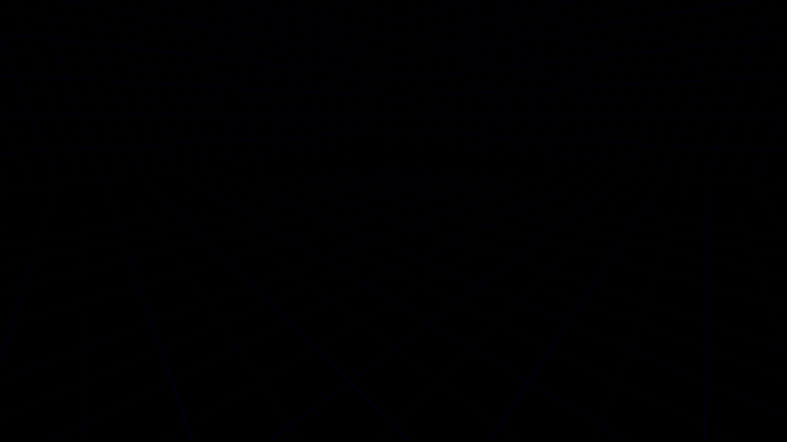

[← Manual](README.md)

# Compile and play

HammeRR includes its own native compiler, so it builds Counter-Strike: Source maps on Linux without the Windows tools. The compiler is **experimental**: compiled maps load and play in CS:S, but visibility and lighting aren't production quality yet. See [Status](status.md).

## Build a playable map

1. Open a sealed map with a player spawn and click **Build settings…** in the toolbar. Settings are available before your first build.
2. Choose the build settings:
   - **Build lighting**: **Fullbright** for a geometry check, or **Direct LDR** to bake lights.
   - **Physics bodies**: **CS:S engine physics** if the map needs physics bodies.
   - **Visibility quality**: **Fast (conservative)** for a quick build, or **Detailed (portal clipping)** to remove more hidden areas from visible sets.
   - **Indirect light**: **Direct only** (default) or **One diffuse bounce** to reflect light from world brushes and terrain.
   - **Brush smoothing angle**: **0°** keeps unassigned brush faces flat; higher angles blend eligible neighbors. Assigned face groups keep their rules.
   - **Sampling quality**, for Direct LDR sky, model ambient and bounced light: **Fast (32 directions)**, **Balanced (128 directions)** or **Detailed (512 directions)**.
3. Click **Close**, then **Compile** to build with the chosen settings, or **Run Map** to build and launch CS:S. Choose an output file if the map has not been saved.
4. The progress bar below the toolbar offers **Build details…** to inspect the build. **Play built map** in that window launches the last successful build again without compiling, as long as the map and settings haven't changed.

## Controls

| Control | Where | What it does |
| --- | --- | --- |
| **Compile** | Toolbar | Builds the current map, including unsaved edits, into a BSP next to the VMF. Unsaved maps ask for an output file. |
| **Run Map** | Toolbar | Compiles, then launches the map in the Linux CS:S client. |
| **Build settings…** | Toolbar | Opens lighting, physics, visibility and sampling settings before or after a build. |
| **Build details…** | Bar below the toolbar, after the first build | Lighting, physics, visibility and sampling settings, progress, timings, statistics and diagnostics. |
| **Play built map** | Build details | Launches the last successful build without compiling again. |
| **Cancel build** | Bar below the toolbar and Build details | Stops the build and keeps the previous output. |
| **Game Log** | Toolbar | Shows the game's console and launcher output. |
| **Stop Map** | Toolbar | Stops the game started by the editor. |
| **Leak path** | Toolbar | Shows or hides the red leak line after a failed build. |

Builds run in the background, and closing Build details leaves them running. Scroll the window to inspect settings, statistics and **Diagnostics**; **Close**, **Cancel build** and **Play built map** stay at the bottom. Output is written in one step at the end: a failed or cancelled build never replaces the previous BSP or pointfile.


## Build settings

Choose these with **Build settings…** in the toolbar, before or after compiling. **Build details…** in the progress bar opens the same window after a build job exists. Agents use `get_compile_settings` and `set_compile_settings` without needing a previous build. Settings apply to every build (Compile, Run Map and agent builds), aren't stored in the VMF, and can't change while a build is running.


**Build lighting**

- **Fullbright** (default): no lighting. Fastest, for checking geometry.
- **Direct LDR**: bakes direct light from static, switchable and animated point/spot lights and the sun, plus diffuse sky ambient, into world, terrain and brush-entity lightmaps with shadows. See [Lighting](#lighting).

**Physics bodies**

- **No physics bodies** (default).
- **CS:S engine physics**: builds collision bodies with the game's own Linux collision library, run inside the `hammerr-physics` helper. See [Physics](#physics).

**Visibility quality**

- **Fast (conservative)** (default): uses portal-facing bounds and keeps some occluded areas in visible sets.
- **Detailed (portal clipping)**: clips sight volumes through portal paths to remove more hidden areas. Larger jobs refine independent source rows on up to eight available CPU workers; small jobs and Fast stay serial. Complex or degenerate apertures use conservative fallbacks.

Visibility quality applies to both lighting modes. It is separate from the light sampling quality below.

**Indirect light** (Direct LDR only)

- **Direct only** (default): bake direct emitters and sky ambient.
- **One diffuse bounce**: reflect direct light from world/detail brushes and terrain into world, terrain and brush-entity receivers. It also reaches model ambient through the resulting lightmaps.

**Brush smoothing angle** (Direct LDR only)

- Whole degrees from **0** (default, flat unassigned faces) to **90**, using the input or slider. **45°** is a starting point for curved brushes.
- Automatic blending needs two unassigned neighboring world/detail faces. Assigned smoothing/hard groups retain their rules. See [Face lighting](textures.md#smooth-by-angle).

**Sampling quality** (Direct LDR only)

- **Fast (32 directions)** (default), **Balanced (128 directions)** or **Detailed (512 directions)**: how many directions are sampled for [sky ambient and soft sun](#sun-and-sky), [model ambient](#model-ambient-lighting) and [bounced light](#bounced-light). More directions improve visibility sampling near narrow openings and make sun shadows less stepped, and take longer. Set **SunSpreadAngle** above zero to soften the sun's shadows.

A previous build counts as out of date once its settings differ from the current ones.

## What gets compiled

### World geometry and visibility

- Brushes become BSP geometry. Out-of-range or invalid objects are reported before building starts.
- The world is split into visibility clusters, with visible and audible sets computed from portals. `func_detail` and brush entities don't split visibility.
- **Detailed** visibility refines the conservative sets with portal separator clipping. **Build details…** reports **Workers**, **cluster pairs removed** and **conservative fallbacks**. A removed pair counts one directed cluster-to-cluster entry; reciprocal entries are counted separately.
- Visibility work is bounded. Exceeded work or stack limits keep the previous BSP; choose **Fast (conservative)** or use `func_detail` for non-sealing decoration to simplify structural geometry. Hint priority during original plane selection, occluders and parallel base-facing work remain unfinished.

### Hint planes

Hint faces add intentional partitions in open world space. They can help visibility follow the map's layout. Skip faces bound the helper without requesting extra cuts.

1. Create a world brush where you want the partition. Use **Draw brush** in a planar view, or **Add brush** in Perspective and set its bounds with transforms.
2. Keep **Selection → Objects**, set its material to `tools/toolsskip`, and click **Apply**. **Browse materials…** offers a preview; choose **Use material**, or **Cancel** to keep the previous choice.
3. Set **Selection → Faces · materials & textures**, select the intended split face, set `tools/toolshint`, and click **Apply**. Leave the other faces as skip.
4. Click **Compile**. **Build details…** reports **Hint surfaces**, **Added splits** and any **Diagnostics**. A plane already present or outside open leaf interiors may need no extra split.
5. Choose **Detailed (portal clipping)** under **Visibility quality** when you want the refined visible sets, then **Run Map** to inspect the result.


Limits: hint helpers must be world brushes with only hint/skip materials. They do not seal the map, expand world bounds, render in game or add collision. Their finite polygons choose which existing open leaves are split; each cut extends to that leaf's bounds. Hidden helpers are omitted. Ordinary brushes with skip faces retain their solid volume. Budgets are 4,096 hint surfaces, 16,384 added splits, sixteen million work units and the shared source-side/node caps; exceeded limits keep the previous BSP. Hint priority during the original split-plane selection, occluders and parallel base-facing work remain unfinished.

### Areaportals

An areaportal controls visibility through a sealed opening between two areas.

1. Create a convex brush that fills the opening between rooms. Seal the rest of the boundary with world brushes; detail brushes do not divide areas.
2. Select the brush and click **Tie to entity…**. Choose **func_areaportal**, then **Tie selected brushes to entity**.
3. Give it a **Name** and choose **Initial State**: **Open** or **Closed**. **Name of Linked Door** can name a door that controls it; connections can also send **Open**, **Close** or **Toggle**.
4. Click **Compile** or **Run Map**. **Build details…** shows **Visibility areas**, **Areaportals** and **Clip vertices**.


Limits: one visible convex brush per portal, exactly two distinct areas, one planar interface, at most 511 portals and 255 open areas. Overlapping, touching or leaking portal boundaries fail without replacing the previous BSP. Hidden portals are omitted. A closed portal hides the other area; link it to a door or another opaque barrier when players could otherwise see through the opening.

### Distance-fading windows

A window portal fades a brush model to opaque as the player moves away, then hides the area behind it.

1. Fill a sealed opening with one convex portal brush. Click **Tie to entity…**, choose **func_areaportalwindow**, then **Tie selected brushes to entity**. Give it a **Name**.
2. Create a brush model with an opaque material covering the portal volume. Tie it to **func_brush**, give it a **Name**, and choose **Solidity → Never Solid** if it should allow passage.
3. Select the window portal. Set **Rendered Window** to that brush model's name. Choose **Fade Start Distance**, **Fade End Distance** and **Translucency limit**. For example, `64`, `128` and `0.2` begin with 20% opacity and become opaque at 128 units.
4. Optionally create another named brush model with an alpha-textured material. Set **Foreground bmodel** to its name. Its bounds must enclose the rendered window, and both models must use the same **Origin (X Y Z)**.
5. Click **Compile** or **Run Map**. **Build details…** includes **Window portals**. Move away from the window to see it close; connections can change the distances with **SetFadeStartDistance** and **SetFadeEndDistance**.


Limits: the same area-boundary limits as plain areaportals apply. Model references must name one visible rendered brush entity each; the rendered model's bounds must enclose the portal. Use fixed models with aligned pivots. Distances must be finite and satisfy `0 ≤ start ≤ end`; equal distances give a hard cutoff. **Translucency limit** must be between `0` and `1`. The foreground needs alpha in its material; an opaque foreground covers the view at every distance. Moving or independently rotated render targets have not been verified.

### Sky

- `tools/toolsskybox` marks 3D sky. Materials with `%compile2dsky` mark 2D sky.
- Sky visibility follows the visible sets, so enclosed or disconnected rooms don't inherit sky they can't see. Hidden and brush-entity sky faces are ignored.

### Material compile flags

- Flags accept `1` or `true` to enable and `0` or `false` to disable, in any letter case.
- Skip faces hide that surface but keep the rest of the brush.
- Non-solid materials stay visible but don't seal the map.
- Hint and empty-content brushes are left out. World areaportal materials need a **func_areaportal** entity. Unsupported flags are listed in the build diagnostics.

### Lighting

With **Direct LDR**:

- `light` and `light_spot` support static, switchable and animated appearances. `light_environment` remains static. All are baked in color.
- Opaque world brushes, detail brushes and terrain cast shadows.
- Rendered brush entities receive pivot-aware direct lightmaps that move with the model. Their own brushes can shadow one another; they do not cast permanent shadows into the world.
- Each face uses its [lightmap scale and assigned smoothing groups](textures.md#face-lighting). World/detail brush smoothing retains the same fan across lightmap subdivisions.
- Terrain is lit using its real raised surface, with smooth normals within patches and across matching equal-power full edges. The viewport uses the same normal construction.
- Point/spot lights outside a sample's conservative visibility or exact falloff range are skipped automatically. **Build details…** shows a **Light culling** row with **evaluated**, **hidden** and **beyond range** counts. Unknown or boundary sample clusters retain every light; approximate near-zero distances keep their soft tails.


#### Brush-entity lightmaps

1. Select the world brushes and click **Tie to entity…**. Choose a rendered class such as `func_brush`, `func_door` or `func_door_rotating`, then **Tie selected brushes to entity**.
2. Set **Origin (X Y Z)** or use an [origin brush](#brush-entities-and-pivots) for its pivot. Fractional pivots are supported.
3. Place lights around its authored position and choose its materials and face lightmap scales.
4. Open **Build settings…**, choose **Build lighting → Direct LDR**, then **Close** and **Compile** or **Run Map**. **Build details…** reports **Brush entity lightmaps**, models and faces.
5. Use [Connections](entities.md#connections-inputs-and-outputs) to move a door. Its baked lightmap stays attached while it moves.


Limits: direct point/spot styles and sun/sky lighting at the authored pose, with scoped authored/angle brush smoothing and isolated self-shadow hulls. Choose **Indirect light → One diffuse bounce** to receive reflected world/detail/terrain light. Moving models do not add permanent world shadows or supply reflected light. Independently rotated initial poses, dynamic relighting, bump/HDR and prop lightmaps remain unfinished. Local geometry, UVs, pivots and collision remain fixed during compilation; source properties and undo history are preserved. Models share the lighting allocation/work budgets.

#### Switchable lights and appearances

1. Use **Place entity** to add a `light` or `light_spot`. Set **Brightness**.
2. Give it a **Name**, such as `room_lights`, to control it in game. To make a group, duplicate the named light with Ctrl+D and move the copies. Lights sharing that name switch together and must share their initial pattern and **Initially dark** state; colors and brightness may differ.
3. Choose **Appearance**, for example **Normal** or **Fluorescent flicker**. Optionally set **Custom Appearance** to lowercase letters `a`–`z`: `a` is dark, `m` is normal brightness, and `z` is brighter. A custom pattern overrides the built-in appearance. A custom pattern needs a named light.
4. Enable **Initially dark** if the light should begin switched off.
5. Select an entity that will control it, such as a `logic_relay`, and open **Connections… → Add connection**. Choose its output, the light's name as the target, and **TurnOn**, **TurnOff** or **Toggle** as the input. Use **SetPattern** with a pattern parameter to change its appearance. Click **Apply connection**; **Cancel** leaves the connection unchanged.
6. Open **Build settings…**, choose **Build lighting → Direct LDR** and **Indirect light → Direct only**, then **Close** and **Run Map**. **Build details…** reports **Light styles**, styled faces, lightmaps and switched groups.

| Initially dark | Turned on |
| --- | --- |
|  |  |

Limits: at most 32 named light groups and four contributing styles per face, including the always-present Normal channel. Named style IDs are assigned only in compiled output; VMF properties and undo history stay fixed. Authored appearance values must be whole numbers from 0 to 31, and custom patterns use at most 64 letters. Unnamed lights can use built-in appearances; custom patterns and **Initially dark** need a name. Hidden lights are excluded. Styled lights receive direct world/detail/terrain and brush-model lightmaps; styled bounces, switching model-ambient cubes, sun/sky styles and baked prop lightmaps remain unfinished. A styled build with **One diffuse bounce** fails with a recovery instruction. The common lighting allocation/work limits apply.

#### Bounced light

1. Open **Build settings…** and choose **Build lighting → Direct LDR**.
2. Choose **Indirect light → One diffuse bounce**. Use **Direct only** to compare the direct lighting.
3. Choose **Sampling quality**: **Fast (32 directions)**, **Balanced (128 directions)** or **Detailed (512 directions)**. More directions reduce sampling variation and take longer.
4. Click **Close**, then **Compile** or **Run Map**. **Build details…** reports **Indirect light**, rays and samples that received reflected light, plus **Brush entity bounce** when the map has model receivers.

| World surface | Brush entity |
| --- | --- |
|  |  |

Limits: one diffuse bounce from static direct world/detail/terrain lightmaps, using average base-texture reflectivity. Source reflectivity must be between zero and one. Sky is handled by direct sky lighting and is excluded from the bounce gather. Translucent surfaces cast opaque shadows. Brush entities receive world bounce and block it with their own geometry; separate models do not cast permanent bounce shadows or supply reflected light. Props, more bounces, HDR, emissive materials and baked prop lightmaps remain unfinished. Baked model lighting moves with the model and does not relight as it moves. The shared 100-million lighting work and 16 MiB lightmap budgets apply; exceeded limits keep the previous BSP. Use lower sampling, larger lightmap scales or **Direct only** to reduce work. **Fullbright** retains this setting but performs no lighting work.

#### Falloff

Lights use the classic constant/linear/quadratic attenuation unless you set a positive **50 percent falloff distance**:

1. Select a `light` or `light_spot` and set its color and brightness under **Brightness**.
2. Set **50 percent falloff distance** to a positive distance in Hammer units: this is where the light reaches half brightness.
3. Set **0 percent falloff distance** to a larger distance, where the light is nearly black. Leave it at zero to use twice the 50 percent distance.
4. Set **hard falloff** to `1` to fade smoothly to black exactly at the 0 percent distance, or leave it at `0` to allow a dim tail beyond that distance.
5. Compile with **Build lighting** set to **Direct LDR**.

The percentage distances override constant, linear and quadratic attenuation. The zero-percent distance is an approximation without hard falloff; invalid distances fail the build with an object-specific diagnostic.

#### Spotlights

Spotlights aim with pitch/yaw or at a target entity, with inner and outer cones up to 90° and focus falloff. A 180° cone becomes a point light.

#### Sun and sky

A `light_environment` adds sunlight and soft sky light:

1. Give a world surface the `tools/toolsskybox` material so the light has sky to reach.
2. Click **Entity…**, search for `light_environment`, select it and click **Place entity**. Use one visible sun entity per map.
3. Set the sunlight color and intensity under **Brightness**. Aim it with **Pitch Yaw Roll (Y Z X)** and **Pitch**; `-90` for **Pitch** shines straight down.
4. Set the sky color and intensity under **Ambient**. Set its brightness to zero to turn sky ambient off. An absent or empty ambient property uses half the sun's brightness; a newly placed entity uses its FGD default.
5. Leave **SunSpreadAngle** at `0` for hard shadows, or enter an angle in degrees to soften them; try `5` as a starting point. Open **Build settings…**, choose **Direct LDR** and select a **Sampling quality**.
6. Click **Close**, then **Run Map** to inspect the baked result in CS:S.


Sunlight requires sky in the sampled sun directions, while ambient samples all visible sky directions. A closed room stays dark, and opaque brushes and terrain block both. Larger sun angles widen the transition from shadow to light; higher quality reduces stepping in that transition. The sun's central direction still determines surface brightness. Higher sky quality takes longer and can reach the compiler's lighting-work limit.

#### Limits and errors

- Up to 16 MiB of lighting data and 8,192 baked light records.
- One visible `light_environment` per map.
- **SunSpreadAngle** must be finite and between 0 and 90 degrees. Zero uses one sun ray, regardless of sky quality; positive spread uses the chosen 32, 128 or 512 directions per sun sample.
- Invalid styles, conflicting named-group states, invalid falloff values and invalid sun angles fail with actionable diagnostics.

Not yet: other light types, transparent shadows, bump maps, multiple or styled light bounces, HDR and baked prop lighting. Fixed sun samples can leave steps at low quality; adaptive sampling remains unfinished.

#### Model ambient lighting

Ambient probes let models pick up reflected light from world surfaces and the sky.

1. Set up point lights, spotlights or a sun and sky as above.
2. Open **Build settings…**, choose **Direct LDR**, and choose **Sampling quality**.
3. Click **Close**, then **Run Map**. Models receive the compiled ambient light; the editor viewport still does not render model assets.
4. Open **Build details…** to see **Model ambient** probe counts and diagnostics.


Fast keeps one probe per open world leaf. Balanced and Detailed select up to four and eight probes, more than 128 units apart. Small leaves can still need only one. Higher quality adds spatial coverage and preserves more local detail.

Probes avoid detail solids and space below terrain. They gather reflected world and terrain lightmap colors and visible sky radiance, without adding direct point/spot lights twice. Nearby rays interpolate local lightmap samples; distant rays blend toward face averages. Terrain follows its displaced surface, including rotated patch origins. Diagnostics report leaves without a safe probe.

Limits: adaptive refinement, static-prop occlusion and baked prop lightmaps remain unfinished. Probes below terrain sheets, including ceiling-like patches, can be omitted. The bake is capped at 65,536 probes and the shared lighting work limit; exceeding either preserves the previous build. These probes read the baked world lightmaps, including the optional diffuse bounce; they do not produce additional world bounces.

### Physics

With **CS:S engine physics**:

- Collision bodies are built for the world, player and NPC clips, brush entities (around their pivots), water and terrain. Static props use the collision that ships with their models.
- The helper checks the collision library's version and the generated geometry, limits its memory and work, and stops after 30 seconds or when the build is cancelled. A missing or unrecognized library fails the build clearly and keeps the previous output. Editing never needs the library.
- Bodies use default surface properties, and brush entities fall back to a one-kilogram mass.

Not yet: material friction and density, authored masses, liquids in detail brushes or brush entities, and broader collision with moving bodies.

### Brush entities and pivots

Brush entities keep their **origin** property. To set the pivot with geometry instead, put one visible `tools/toolsorigin` brush inside the entity: the center of that brush becomes the pivot. The compiler removes the origin brush and writes the rest of the entity relative to it, keeping texture and lightmap placement. The VMF itself is not changed.

These fail with a diagnostic: more than one origin brush in an entity, origin brushes in the world or `func_detail`, entities made only of an origin brush, and models larger than ±16,384 units around their pivot. Hidden origin brushes are ignored.

### Water

1. Create a world brush with `tools/toolsnodraw` on its sides.
2. Give its flat top face a water material, with the face inspector or an agent.

- Connected water with the same height and material forms one region.
- If the map has no `water_lod_control`, one is added to the BSP with distances of 1,000 and 2,000. Existing controls are kept.
- With engine physics, water also gets fluid bodies: objects float.
- Sloped or enclosed tops and conflicting overlapping liquids fail with a diagnostic. Hidden water is left out. Water inside detail brushes or brush entities is reported as unsupported.

Not yet: depth-specific and below-water materials, currents and custom damping.

### Cubemaps

- Visible `env_cubemap` entities become cubemap samples, up to 1,024.
- **Cubemap Size** can be the game default or 1–256 pixels.

Not yet: reflections are not baked. Material binding, face lists and capture are still missing, so samples alone give no reflections.

### Static props

- `prop_static` compiles its model, position and rotation (fractional values included), collision setting, skin, fading and lighting origin.
- Models must be MDL version 44 or 48 and marked `$staticprop`. **Use VPhysics** also needs the model's matching `.phy` file.
- Invalid assets, scaling, lightmap requests and ambiguous lighting origins fail with a diagnostic.

Not yet: baked prop lighting, prop shadows and exact placement in the BSP tree.

### Terrain (displacements)

Connected terrain can keep its lighting continuous across patch seams.

1. Click **Open…** and choose a VMF with adjacent terrain patches. Their powers and complete edge grids must match.
2. Open **Build settings…** and choose **Direct LDR**. Add a light or sun using **Place entity** if the map has none.
3. Click **Close**, then **Compile** or **Run Map**. Normal sewing happens automatically, and the viewport uses it too.
4. Open **Build details…** and check **Neighbor pairs**. Unmatched or ambiguous edges are listed in **Diagnostics**.


- Terrain from imported VMFs compiles, at power 2, 3 and 4, with blend alpha and its no-physics, no-hull and no-ray flags.
- Terrain doesn't seal the map, and its parent brush doesn't become a solid box.
- With engine physics, terrain gets collision meshes.
- Neighboring patches of the same power that share a full edge are linked to each other in the BSP. Build details and agents report the number of linked pairs. Ambiguous edges, different powers and mismatched surfaces stay unlinked, with a diagnostic.
- Direct LDR lights terrain of every size, with smooth normals sewn across matching equal-power full edges, and raised terrain shades the world beneath it. Terrain with unlit materials needs **Fullbright** for now.

Not yet: creating or editing terrain in HammeRR, subdivision, removed triangles, terrain on entities or detail brushes, authored smoothing angles, LOD between different powers or partial edges, and neighbors that touch only at a corner.

## Overlays

Imported `info_overlay` projections compile on world, detail and terrain surfaces. Set their material, render order and fades in the entity inspector, then inspect **Overlays** and **Surface references** in Build details. See [Overlays](overlays.md) for the workflow and limits.

## Coordinate limits

Brush geometry and entity origins must stay within **±16,384 units**. Objects outside that range are reported before building, and the existing output is kept. The editor itself allows larger coordinates for editing, but the playable Source world doesn't extend further.

## Leaks and pointfiles

A map needs sealed world geometry and at least one point entity in open space. When a build leaks, HammeRR writes a `.lin` pointfile, keeps any existing BSP and draws the leak path in red. Toggle it with **Leak path**. Editing hides the path until the next build.

To follow a leak, open **Pointfile…**:

1. After a leaking build, its path is already there. To open another `.lin` file, type its path or click **Browse…**, then **Load**.
2. **Frame path** shows all of it. Type a point number and click **Go**, or step with **Previous** and **Next**. Perspective views look along the path; planar views center on the point.
3. **Unload path** removes the overlay without deleting the file.

- Loading and navigating never change the map.
- Editing the map hides an external path until you reload it. A new build replaces it, and opening another map clears it.
- Files may hold 2–65,536 points and be up to 2 MiB.

| Pointfile controls | Leak path drawn through the map |
| --- | --- |
|  |  |

## Playing

**Run Map** and **Play built map** launch the Linux CS:S client with `-insecure`.

- Each run uses its own uniquely named copy of the BSP, which is removed when the game exits. Its logs stay until the next run or until the editor closes.
- Closing the editor stops the game it started. Your other maps and game processes are never touched.

**Play built map** shows which BSP it will launch. It is disabled, with an explanation, when the map changed since the build, the output is missing, the build settings changed, no Linux client is installed, or a build or game is already running. A failed rebuild keeps the previous successful build playable if the map hasn't changed since.

## Standalone compiler

```sh
./target/release/hammerr-compile map.vmf --game /path/to/cstrike/gameinfo.txt
```

| Option | Purpose |
| --- | --- |
| `-o <map.bsp>` | Output file. Defaults to the VMF's name with `.bsp`. |
| `--lighting fullbright\|direct_ldr` | Lighting mode. Defaults to `fullbright`. |
| `--physics none\|engine` | Physics bodies. Defaults to `none`. Needs `hammerr-physics` next to the compiler. |
| `--sky-quality fast\|balanced\|detailed` | Sky ambient sampling for `direct_ldr`. Defaults to `fast`. |

To try it on a generated test room with both teams' spawns:

```sh
cargo run -p compiler --example room -- room.vmf
./target/release/hammerr-compile room.vmf --game /path/to/cstrike/gameinfo.txt
```

Copy `room.bsp` to `cstrike/maps/` and run `map room` in the CS:S console.
