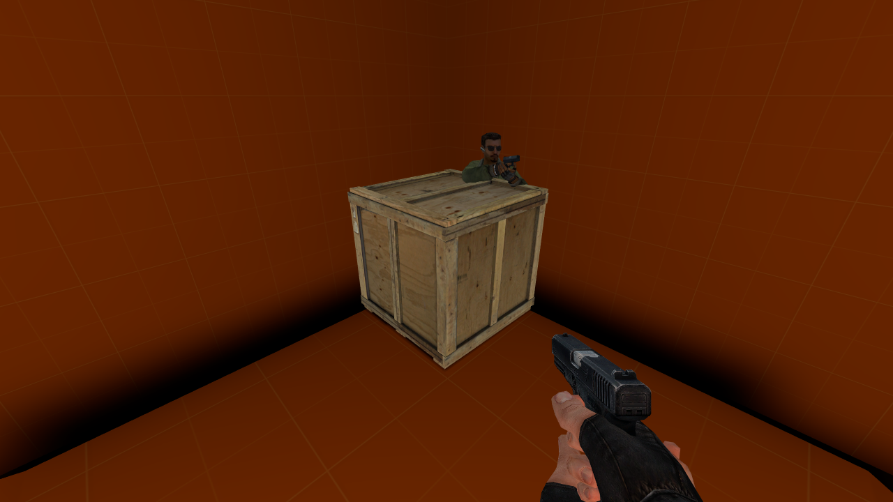
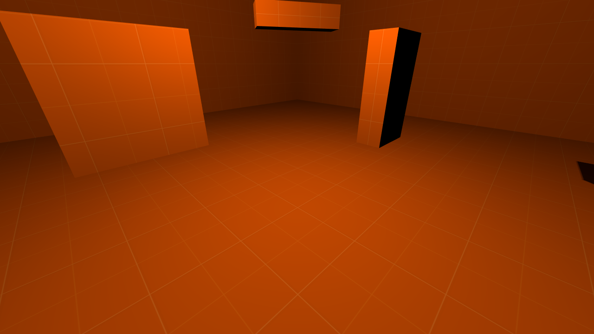
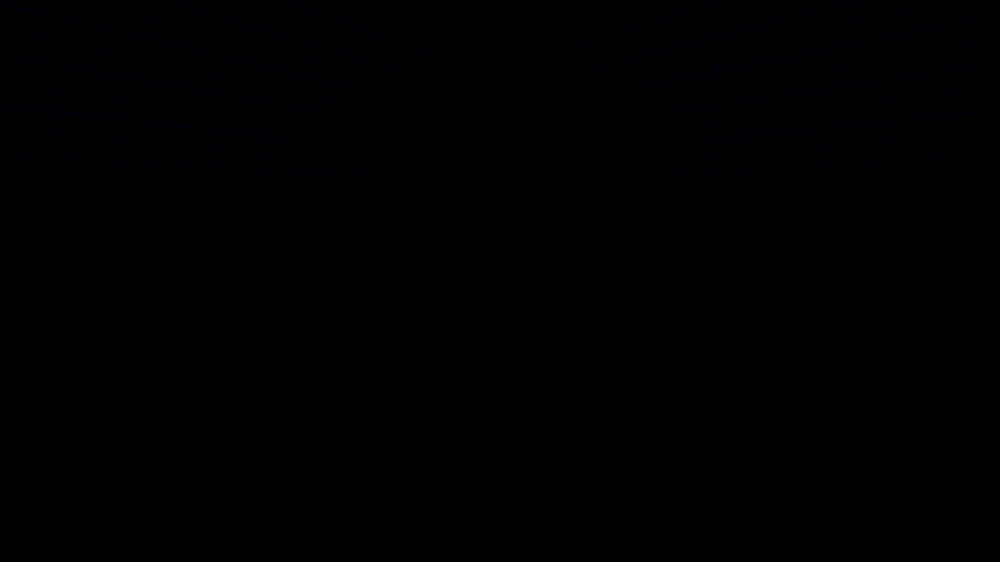
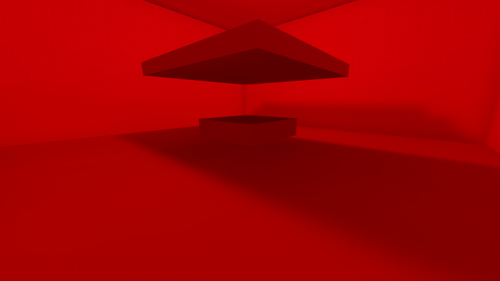

[← Manual](README.md)

# Compile and play

HammeRR includes its own native compiler, so it builds Counter-Strike: Source maps on Linux without the Windows tools. The compiler is **experimental**: compiled maps load and play in CS:S, but visibility and lighting aren't production quality yet. See [Status](status.md).

## Build a playable map

1. Open a sealed map with a player spawn and click **Build settings…** in the toolbar. Settings are available before your first build.
2. Choose the build settings:
   - **Build lighting**: **Fullbright** for a geometry check, **Direct LDR** to bake LDR lighting, or **Direct LDR + HDR** to build separate LDR and HDR channels.
   - **Physics bodies**: **CS:S engine physics** if the map needs physics bodies.
   - **Visibility quality**: **Fast (conservative)** for a quick build, or **Detailed (portal clipping)** to remove more hidden areas from visible sets.
   - **Indirect light**: **Direct only** (default), or **One diffuse bounce**, **Two diffuse bounces**, **Three diffuse bounces** or **Four diffuse bounces** to reflect light from world brushes and terrain.
   - **Brush smoothing angle**: **0°** keeps unassigned brush faces flat; higher angles blend eligible neighbors. Assigned face groups keep their rules.
   - **Sampling quality**, for either lit mode’s sky, model ambient and bounced light: **Fast (32 directions)**, **Balanced (128 directions)** or **Detailed (512 directions)**.
   - **Pack sky assets**: include the applied sky family's supported materials and textures in the BSP. This is off by default and works with every lighting mode.
3. Click **Close**, then **Compile** to build with the chosen settings, or **Run Map** to build and launch CS:S. Choose an output file if the map has not been saved.
4. The progress bar below the toolbar offers **Build details…** to inspect the build. **Play built map** in that window launches the last successful build again without compiling, as long as the map and settings haven't changed.

## Controls

| Control | Where | What it does |
| --- | --- | --- |
| **Compile** | Toolbar | Builds the current map, including unsaved edits, into a BSP next to the VMF. Unsaved maps ask for an output file. |
| **Run Map** | Toolbar | Compiles, then launches the map in the Linux CS:S client. |
| **Build settings…** | Toolbar | Opens lighting, physics, visibility and sampling settings before or after a build. |
| **Compile region…** / **Region build…** | Toolbar | Opens saved partial-map bounds, enable/disable and owned preview controls. |
| **Build details…** | Bar below the toolbar, after the first build | Lighting, physics, visibility and sampling settings, progress, timings, statistics and diagnostics. |
| **Play built map** | Build details | Launches the last successful build without compiling again. |
| **Cancel build** | Bar below the toolbar and Build details | Stops the build and keeps the previous output. |
| **Game Log** | Toolbar | Shows the game's console and launcher output. |
| **Stop Map** | Toolbar | Stops the game started by the editor. |
| **Leak path** | Toolbar | Shows or hides the red leak line after a failed build. |

Builds run in the background, and closing Build details leaves them running. Scroll the window to inspect settings, statistics and **Diagnostics**; **Close**, **Cancel build** and **Play built map** stay at the bottom. Output is written in one step at the end: a failed or cancelled build never replaces the previous BSP or pointfile.


## Build settings

Choose these with **Build settings…** in the toolbar, before or after compiling. **Build details…** in the progress bar opens the same window after a build job exists. Agents use `get_compile_settings` and `set_compile_settings` without needing a previous build. Settings apply to every build (Compile, Run Map and agent builds), aren't stored in the VMF, and can't change while a build is running.


**Build lighting**

- **Fullbright** (default): no lighting. Fastest, for checking geometry.
- **Direct LDR**: bakes direct light from static, switchable and animated point/spot lights and the sun, plus diffuse sky ambient, into world, terrain and brush-entity lightmaps with shadows. See [Lighting](#lighting).
- **Direct LDR + HDR**: builds independent LDR and HDR channels with the same lighting features and separate authored inputs. See [HDR channels](#hdr-channels) for map-data eligibility and runtime limits.

**Generate reflections** (Direct LDR and Direct LDR + HDR)

Off by default. Enable it to capture one native reflection bounce during
**Compile** or **Run Map**. **Direct LDR** captures LDR; **Direct LDR + HDR**
captures both channels before a single publication. Read the capture runtime
status and use **Configure capture…** when needed. **Fullbright** requires this
setting off. See [Generated reflections](reflections.md).

**Pack sky assets** (all lighting modes)

Off by default. Embed the exact authored sky family's supported material and texture dependencies in the BSP. This works with **Fullbright**, **Direct LDR** and **Direct LDR + HDR**, independently of **Generate reflections**. See [Pack portable sky assets](#pack-portable-sky-assets) for steps and limits.

**Physics bodies**

- **No physics bodies** (default).
- **CS:S engine physics**: builds collision bodies with the game's own Linux collision library, run inside the `hammerr-physics` helper. See [Physics](#physics).

**Visibility quality**

- **Fast (conservative)** (default): uses portal-facing bounds and keeps some occluded areas in visible sets.
- **Detailed (portal clipping)**: clips sight volumes through portal paths to remove more hidden areas. Larger jobs refine independent source rows on up to eight available CPU workers; small jobs stay serial. Invalid apertures and exceeded work/allocation limits stop the build.

Visibility quality applies to every lighting mode. It is separate from the light sampling quality below.

**Indirect light** (Direct LDR and Direct LDR + HDR)

- **Direct only** (default): bake direct emitters and sky ambient.
- **One diffuse bounce**, **Two diffuse bounces**, **Three diffuse bounces** or **Four diffuse bounces**: reflect light from world/detail brushes and terrain into world, terrain and brush-entity receivers. It also reaches model ambient through the resulting lightmaps.

**Brush smoothing angle** (Direct LDR and Direct LDR + HDR)

- Whole degrees from **0** (default, flat unassigned faces) to **90**, using the input or slider. **45°** is a starting point for curved brushes.
- Automatic blending needs two unassigned neighboring world/detail faces. Assigned smoothing/hard groups retain their rules. See [Face lighting](textures.md#smooth-by-angle).

**Sampling quality** (Direct LDR and Direct LDR + HDR)

- **Fast (32 directions)** (default), **Balanced (128 directions)** or **Detailed (512 directions)**: how many directions are sampled for [sky ambient and soft sun](#sun-and-sky), [model ambient](#model-ambient-lighting) and [bounced light](#bounced-light). More directions improve visibility sampling near narrow openings and make sun shadows less stepped, and take longer. Set **SunSpreadAngle** above zero to soften the sun's shadows.

A previous build counts as out of date once its settings differ from the current ones.

## Pack portable sky assets

Include a custom sky with the map so playback can resolve its supported sky materials and textures from the BSP after the original custom content mount is removed.

1. Open **World settings…**, set **SkyBox Texture Name** (`skyname`) to the exact mounted family, and click **Apply properties**. Custom definitions may label the field differently. **Inspect applied sky…** helps diagnose the six material and texture sources; packing applies stricter admission checks than read-only inspection.
2. Open **Build settings…** and enable **Pack sky assets**. Keep **Generate reflections** off for packing alone; packing needs no native capture runtime and works with **Fullbright**. Enable reflections separately when the map also needs captured cubemaps.
3. Click **Close**, then **Compile** or **Run Map**. Keep the original assets available until publication finishes. Missing, malformed, unsupported or changed dependencies stop publication and preserve the previous output; no alternate family or `_hdr` suffix is selected.
4. Open **Build details…**. A completed, published build reports **Packed sky assets** with its family, **LDR** or **LDR + HDR**, file count and raw asset bytes. Counts exclude the manifest. Changing the current checkbox leaves this completed-build record unchanged and makes that build stale until its captured settings match again.
5. Distribute the resulting BSP with the map. For a packing-only build, **Play built map** can still stage the packed sky after its original custom mount is removed and material assets are reloaded, provided the map and build settings still match. Other map dependencies must remain available normally; this setting packs the sky closure only.


Supported families contain six static `UnlitGeneric` LDR faces, or six `Sky` faces with both LDR and RGBA16F/RGBA16 HDR base textures. A declared HDR channel must be complete on all six faces, including with **Direct LDR** or **Fullbright**. Original VMTs, Patch dependencies and declared runtime textures keep their names, file bytes and mip data; editor-only `%tooltexture` images are excluded.

Run verifies the embedded sky from BSP bytes and preserves it while rebasing generated reflection names. Packing happens before optional reflection capture; combined builds retain their native runtime and content-freshness requirements. Packing does not choose the game's LDR/HDR channel, bake lighting from the image or add an HDR editor preview.

Limits: static textures with one frame, one face, depth one and at most 4096 pixels per axis; 128 assets, 1 MiB per VMT, 16 MiB per packed file and 259 bytes per full relative name. The combined archive, including reflections, is bounded to 64 MiB each encoded and decoded. Compressed HDR skies, animation, conditional/proxy/ambiguous material declarations and existing name collisions reject. Reduce the assets or fix the reported source, then compile again; see [packing admission rules](mcp.md#portable-sky-assets) for the exact material and manifest limits.

## What gets compiled

### World geometry and visibility

- Brushes become BSP geometry. Out-of-range or invalid objects are reported before building starts.
- The world is split into visibility clusters, with visible and audible sets computed from portals. `func_detail` and brush entities don't split visibility.
- **Detailed** visibility refines the conservative sets with portal separator clipping. **Build details…** reports **Workers** and **cluster pairs removed**. A removed pair counts one directed cluster-to-cluster entry; reciprocal entries are counted separately.
- Larger Fast and Detailed builds compute independent portal-facing rows on up to eight available CPUs; Detailed also parallelizes separator flow. Small jobs stay serial.
- Visibility work is bounded. Exceeded work or stack limits keep the previous BSP; choose **Fast (conservative)** or use `func_detail` for non-sealing decoration to simplify structural geometry. [Occluders](occluders.md) compile separately and provide runtime prop culling with activation inputs.

Unreadable or malformed material definitions, broken patch includes and malformed
base textures needed for compilation stop the build and retain the previous
BSP. Nonfinite texture reflectivity is also rejected. Absent material or base
texture files produce explicit missing-content warnings; mount the required
content before relying on its flags, dimensions or lighting.

### Hint planes

Hint faces guide initial structural plane selection and add remaining partitions in open world space. Ordinary planes that cut a hint polygon are deferred when a hint or non-cutting alternative is available. They can help visibility follow the map's layout. Skip faces bound the helper without requesting extra cuts.

1. Create a world brush where you want the partition. Use **Draw brush** in a planar view, or **Add brush** in Perspective and set its bounds with transforms.
2. Keep **Selection → Objects**, set its material to `tools/toolsskip`, and click **Apply**. **Browse materials…** offers a preview; choose **Use material**, or **Cancel** to keep the previous choice.
3. Set **Selection → Faces · materials & textures**, select the intended split face, set `tools/toolshint`, and click **Apply**. Leave the other faces as skip.
4. Click **Compile**. **Build details…** reports **Hint surfaces**, **Added splits**, **Initial priority** and any **Diagnostics**. **Initial priority** counts added hint planes retained from structural splitting and is included in **Added splits**. A plane already present or outside open leaf interiors may need no extra split.
5. Choose **Detailed (portal clipping)** under **Visibility quality** when you want the refined visible sets, then **Run Map** to inspect the result.


Limits: hint helpers must be world brushes with only hint/skip materials. They do not seal the map, expand world bounds, render in game or add collision. Their finite polygons choose which tree volumes participate; each chosen cut extends to that volume's bounds. Remaining cuts apply to filled open leaves. Hidden helpers are omitted. Ordinary brushes with skip faces retain their solid volume. Budgets are 4,096 hint surfaces, 16,384 added splits, sixteen million work units and the shared source-side/node caps; exceeded limits keep the previous BSP. [Occluders](occluders.md) have a separate authoring and validation boundary.

### Areaportals

An areaportal controls visibility through a sealed opening between two areas.

1. Create a convex brush that fills the opening between rooms. Seal the rest of the boundary with world brushes; detail brushes do not divide areas.
2. Select the brush and click **Tie to entity…**. Choose **func_areaportal**, then **Tie selected brushes to entity**.
3. Give it a **Name** and choose **Initial State**: **Open** or **Closed**. **Name of Linked Door** can name a door that controls it; connections can also send **Open**, **Close** or **Toggle**.
4. Click **Compile** or **Run Map**. **Build details…** shows **Visibility areas**, **Areaportals** and **Clip vertices**.


Limits: one visible convex brush per portal, exactly two distinct areas, one planar interface, at most 511 portals and 255 open areas. Overlapping, touching or leaking portal boundaries fail without replacing the previous BSP. Hidden portals are omitted. A closed portal hides the other area; link it to a door or another opaque barrier when players could otherwise see through the opening.

[Compile regions](compile-regions.md#include-overlays-and-visibility-helpers)
retain whole contained portal/window brush bounds independently of editor origins.
Disjoint helpers are omitted; crossing bounds stop the build. The retained opening
must still separate two areas, and window render models must remain available.

### Distance-fading windows

A window portal fades a brush model to opaque as the player moves away, then hides the area behind it.

1. Fill a sealed opening with one convex portal brush. Click **Tie to entity…**, choose **func_areaportalwindow**, then **Tie selected brushes to entity**. Give it a **Name**.
2. Create a brush model with an opaque material covering the portal volume. Tie it to **func_brush**, give it a **Name**, and choose **Solidity → Never Solid** if it should allow passage.
3. Select the window portal. Set **Rendered Window** to that brush model's name. Choose **Fade Start Distance**, **Fade End Distance** and **Translucency limit**. For example, `64`, `128` and `0.2` begin with 20% opacity and become opaque at 128 units.
4. Optionally create another named brush model with an alpha-textured material. Set **Foreground bmodel** to its name. Its bounds must enclose the rendered window, and both models must use the same **Origin (X Y Z)**.
5. Click **Compile** or **Run Map**. **Build details…** includes **Window portals**. Move away from the window to see it close; connections can change the distances with **SetFadeStartDistance** and **SetFadeEndDistance**.


Limits: the same area-boundary limits as plain areaportals apply. Model references must name one visible rendered brush entity each; the rendered model's bounds must enclose the portal. Use fixed models with aligned pivots. Distances must be finite and satisfy `0 ≤ start ≤ end`; equal distances give a hard cutoff. **Translucency limit** must be between `0` and `1`. The foreground needs alpha in its material; an opaque foreground covers the view at every distance. Moving or independently rotated render targets have not been verified.

### Sky

- `tools/toolsskybox` marks 3D sky. Materials with `%compile2dsky` mark 2D sky.
- Sky visibility follows the visible sets, so enclosed or disconnected rooms don't inherit sky they can't see. Hidden and brush-entity sky faces are ignored.

### Material compile flags

- Flags accept `1` or `true` to enable and `0` or `false` to disable, in any letter case.
- Skip faces hide that surface but keep the rest of the brush.
- Non-solid materials stay visible but don't seal the map.
- Hint and empty-content brushes are left out. World areaportal materials need a **func_areaportal** entity. Unsupported flags are listed in the build diagnostics.

### Lighting

With **Direct LDR** or **Direct LDR + HDR**:

- `light` and `light_spot` support static, switchable and animated appearances. `light_environment` remains static. All are baked in color.
- Opaque world brushes, detail brushes, terrain and [static-prop meshes](prop-shadows.md) cast shadows. Models authored with `$casttextureshadows` also support the bounded alpha-test cutouts described under **Static props** below.
- Rendered brush entities receive pivot-aware direct lightmaps that move with the model. Their own brushes can shadow one another; they do not cast permanent shadows into the world.
- Each face uses its [lightmap scale and assigned smoothing groups](textures.md#face-lighting). World/detail brush smoothing retains the same fan across lightmap subdivisions.
- Terrain is lit using its real raised surface, with smooth normals within patches and across matching equal-power full edges. The viewport uses the same normal construction.
- Point/spot lights outside a sample's conservative visibility or exact falloff range are skipped automatically. **Build details…** shows a **Light culling** row with **evaluated**, **hidden** and **beyond range** counts. Unknown or boundary sample clusters retain every light; approximate near-zero distances keep their soft tails.



[Explicit detail models](model-detail-props.md) and [material-generated models and
sprites](material-detail-scattering.md) receive direct light plus filtered
world/terrain/sky ambient, including configured bounces through the lightmaps.
Styles 1–63 are stored as extras alongside the static base and follow the same
named-light switches and appearances. SDK encoding halves each extra's color;
the client applies its current style value without a restoring factor of two,
so switched detail lighting need not match static-base intensity. Each receiver
allows 63 extras; LDR and HDR arrays together allow 65,536 records.
**Fullbright** retains white unbaked base colors without extras. Detail objects
do not add baked shadows or collision.

#### HDR channels

**Direct LDR + HDR** keeps face lightmaps, light styles, world lights, reflected light and model-ambient probes separate for the two channels. CS:S selects the baked channel according to its HDR setting and hardware support. The editor viewport continues to show its existing preview lighting. Detail model and sprite base colors use one shared native field; in a dual-channel build it retains the final HDR pass's color rather than separate LDR/HDR detail values. Their style extras remain separate LDR/HDR arrays with a shared sorted style layout; a style absent from one channel receives zero color there. The combined record limit allows at most 32,768 entries per channel.

1. Open **Build settings…** and choose **Build lighting → Direct LDR + HDR**.
2. Set **Indirect light**, **Brush smoothing angle** and **Sampling quality**. These settings apply to both channels. Existing **Fast preview** and **Final lighting** recipes keep their original settings; use **Save current as new** to retain a custom HDR recipe.
3. Author **Brightness** and **Ambient** as usual. HDR uses **BrightnessHDR** (`_lightHDR`) and **AmbientHDR** (`_ambientHDR`) overrides, or the HDR tuple from an eight-number fallback value. **BrightnessScaleHDR** (`_lightscaleHDR`) and **AmbientScaleHDR** (`_AmbientScaleHDR`) scale their respective HDR inputs; a negative RGB sentinel keeps the fallback, and an explicit zero disables that contribution. LDR retains its original inputs.
4. Click **Close**, then **Compile**. Open **Build details…** to compare the **LDR Baked lighting**, **HDR baked lighting**, style, brush-model, directional-map, bounce and ambient rows. **Lighting work** shows **LDR**, **HDR** and **Shared total**; authored prop/model geometry is counted once.
5. Inspect **HDR native map data** and **Diagnostics**. **HDR data ready** reports eligible nonempty map data. **HDR unavailable: incomplete map data** means the map cannot activate native HDR. Changing the lighting mode makes a previous build stale; compile again before **Play built map**.


Limits: this is an experimental compiler mode. A successful compile or an **HDR data ready** result does not establish that the game selected HDR. Native HDR requires nonempty HDR light samples, world lights and ambient samples, plus game and hardware support. Empty scenes do not receive dummy records. The game’s HDR setting must be selected before a fresh map load; live changes may trigger save/reload. Enable **Generate reflections** to capture paired LDR/HDR cubemaps after baking; complete HDR arrays and a supported capture runtime are required. Mounted HDR sky families use the [authored sky name and native material path](sky.md#compiled-hdr-skies); [Pack sky assets](#pack-portable-sky-assets) admits and embeds the supported complete material/VTF closure. HDR sky radiance validation, exposure authoring, editor HDR previews and baked prop lightmaps remain unfinished. Each channel shares the existing geometry and lighting limits; the 100-million-work cap covers the complete build’s lighting preparation and both passes.

#### Brush-entity lightmaps

1. Select the world brushes and click **Tie to entity…**. Choose a rendered class such as `func_brush`, `func_door` or `func_door_rotating`, then **Tie selected brushes to entity**.
2. Set **Origin (X Y Z)** or use an [origin brush](#brush-entities-and-pivots) for its pivot. Fractional pivots are supported.
3. Place lights around its authored position and choose its materials and face lightmap scales.
4. Open **Build settings…**, choose **Build lighting → Direct LDR**, then **Close** and **Compile** or **Run Map**. **Build details…** reports **Brush entity lightmaps**, models and faces.
5. Use [Connections](entities.md#connections-inputs-and-outputs) to move a door. Its baked lightmap stays attached while it moves.



Limits: direct point/spot styles and sun/sky lighting at the authored pose, with scoped authored/angle brush smoothing and isolated self-shadow hulls. Choose **Indirect light → One diffuse bounce** to receive reflected world/detail/terrain light. Moving models do not add permanent world shadows or supply reflected light. Independently rotated initial poses, dynamic relighting and prop lightmaps remain unfinished. Local geometry, UVs, pivots and collision remain fixed during compilation; source properties and undo history are preserved. Models share the lighting allocation/work budgets.

#### Switchable lights and appearances

1. Use **Place entity** to add a `light` or `light_spot`. Set **Brightness**.
2. Give it a **Name**, such as `room_lights`, to control it in game. To make a group, duplicate the named light with Ctrl+D and move the copies. Lights sharing that name switch together and must share their initial pattern and **Initially dark** state; colors and brightness may differ.
3. Choose **Light pattern**, for example **Normal** or **Fluorescent flicker**. For a custom pattern, enable **Advanced properties** and set **Custom Appearance** to lowercase letters `a`–`z`: `a` is dark, `m` is normal brightness, and `z` is brighter. A custom pattern overrides the built-in appearance. A custom pattern needs a named light.
4. Enable **Initially dark** if the light should begin switched off.
5. Select an entity that will control it, such as a `logic_relay`, and open **Connections… → Add connection**. Choose its output, the light's name as the target, and **TurnOn**, **TurnOff** or **Toggle** as the input. Use **SetPattern** with a pattern parameter to change its appearance. Click **Apply connection**; **Cancel** leaves the connection unchanged.
6. Open **Build settings…**, choose **Build lighting → Direct LDR**. Choose **Indirect light → One diffuse bounce** for reflections that follow the same switches and patterns, then **Close** and **Run Map**. **Build details…** reports **Light styles**, styled faces, lightmaps and switched groups.

| Initially dark | Turned on, with reflected light |
| --- | --- |
|  |  |

Limits: at most 32 named light groups and four contributing styles per face, including the always-present Normal channel. Named style IDs are assigned only in compiled output; VMF properties and undo history stay fixed. Authored appearance values must be whole numbers from 0 to 31, and custom patterns use at most 64 letters. Unnamed lights can use built-in appearances; custom patterns and **Initially dark** need a name. Hidden lights are excluded. Styled lights receive direct and reflected world/detail/terrain and brush-model lightmaps, plus detail model/sprite extras within their separate receiver and record limits above. Reflections can introduce a style on a face beyond its direct reach, and still count toward the four-style limit. Switching model-ambient cubes, sun/sky styles and baked prop lightmaps remain unfinished. The common lighting allocation/work limits apply.

#### Bounced light

1. Open **Build settings…** and choose **Build lighting → Direct LDR**.
2. Choose **Indirect light → One diffuse bounce**, **Two diffuse bounces**, **Three diffuse bounces** or **Four diffuse bounces**. More bounces carry light farther through shaded spaces and take longer. Use **Direct only** to compare.
3. Choose **Sampling quality**: **Fast (32 directions)**, **Balanced (128 directions)** or **Detailed (512 directions)**. More directions reduce sampling variation and take longer.
4. Click **Close**, then **Compile** or **Run Map**. **Build details…** reports the chosen **Indirect light** count, total rays and samples receiving reflected light in the final pass, plus **Brush entity bounce** when the map has model receivers.

| World surface | Brush entity |
| --- | --- |
|  |  |

| One bounce | Four bounces |
| --- | --- |
|  |  |

Limits: up to four diffuse bounces from world/detail/terrain lightmaps, preserving each static, switchable or animated light style, using average base-texture reflectivity. Source reflectivity must be between zero and one. Sky is handled by direct sky lighting and is excluded from the bounce gather. Translucent world surfaces cast opaque shadows. Brush entities receive world bounce and block it with their own geometry; separate brush models do not cast permanent bounce shadows or supply reflected light. Static-prop meshes use the same opaque or supported alpha-test blockers for reflected rays but do not supply reflected light. More than four bounces, emissive materials and baked prop lightmaps remain unfinished. Baked model lighting moves with the model and does not relight as it moves. The shared 100-million lighting work budget and 16 MiB lightmap budget per channel apply; exceeded limits keep the previous BSP. Use fewer bounces, lower sampling, larger lightmap scales or **Direct only** to reduce work. **Fullbright** retains this setting but performs no lighting work.

#### Normal-map lighting

1. Set **Selection** to **Faces · materials & textures** and select the target faces.
2. Click **Browse materials…**, choose a lit material whose VMT declares `$bumpmap`, then **Use material** and **Apply**. Its normal texture must be available to the game.
3. Open **Build settings…** and choose **Build lighting → Direct LDR**. Choose **Indirect light → One diffuse bounce** if you want reflected world light too.
4. Click **Close**, then **Compile** or **Run Map**. **Build details…** reports **Normal-map lighting**, faces and directional maps.


Each lit face gets its base map and three directional maps per light style. Texture axes, mirrored mappings and world/model smooth normals orient those directions; terrain uses its shared smooth surface normals. Native style averages keep the base lighting. Brush models keep their own coordinate scope and self shadows.

Limits: the engine can clamp bright ordinary and bumped LDR lighting differently; compare modest brightness when tuning normal details. This changes compiled game lighting; the editor's material thumbnails and viewport use diffuse previews. Materials that only declare `$bumpmap2`, independently rotated initial model poses, transparent world shadows, fractional transmission and baked prop lightmaps remain unfinished. Auxiliary directions share the 16 MiB lightmap limit per channel and 100-million work limit per build; larger scales or lower sampling can reduce work.

#### Falloff

Lights use the classic constant/linear/quadratic attenuation unless you set a positive **50 percent falloff distance**:

1. Select a `light` or `light_spot` and set its color and brightness under **Brightness**.
2. Set **50 percent falloff distance** to a positive distance in Hammer units: this is where the light reaches half brightness.
3. Set **0 percent falloff distance** to a larger distance, where the light is nearly black. Leave it at zero to use twice the 50 percent distance.
4. Set **hard falloff** to `1` to fade smoothly to black exactly at the 0 percent distance, or leave it at `0` to allow a dim tail beyond that distance.
5. Compile with **Build lighting** set to **Direct LDR**.

The percentage distances override constant, linear and quadratic attenuation. The zero-percent distance is an approximation without hard falloff; invalid distances fail the build with an object-specific diagnostic.

#### Spotlights

Spotlights aim with pitch/yaw or at a target entity, with inner and outer cones up to 90° and focus falloff. A 180° cone becomes a point light.

#### Sun and sky

A `light_environment` adds sunlight and soft sky light:

1. Give a world surface the `tools/toolsskybox` material so the light has sky to reach.
2. Click **Entity…**, search for `light_environment`, select it and click **Place entity**. Use one visible sun entity per map.
3. Set the sunlight color and intensity under **Brightness**. Aim it with **Pitch Yaw Roll (Y Z X)** and **Pitch**; `-90` for **Pitch** shines straight down.
4. Set the sky color and intensity under **Ambient**. Set its brightness to zero to turn sky ambient off. An absent or empty ambient property uses half the sun's brightness; a newly placed entity uses its FGD default.
5. Leave **SunSpreadAngle** at `0` for hard shadows, or enter an angle in degrees to soften them; try `5` as a starting point. Open **Build settings…**, choose **Direct LDR** and select a **Sampling quality**.
6. Click **Close**, then **Run Map** to inspect the baked result in CS:S.


Sunlight requires sky in the sampled sun directions, while ambient samples all visible sky directions. A closed room stays dark, and opaque brushes, terrain and opaque or supported alpha-test static-prop meshes block both. Larger sun angles widen the transition from shadow to light; higher quality reduces stepping in that transition. The sun's central direction still determines surface brightness. Higher sky quality takes longer and can reach the compiler's lighting-work limit.

#### Limits and errors

- Up to 16 MiB of lighting data and 8,192 baked light records per channel; dual-channel builds allow 32 MiB total lighting data. One cancellable 100-million-work budget covers shared preparation and both channels.
- One visible `light_environment` per map.
- **SunSpreadAngle** must be finite and between 0 and 90 degrees. Zero uses one sun ray, regardless of sky quality; positive spread uses the chosen 32, 128 or 512 directions per sun sample.
- Invalid styles, conflicting named-group states, invalid falloff values and invalid sun angles fail with actionable diagnostics.

Not yet: other light types, transparent world shadows, fractional transmission, second-normal-map-only materials and baked prop lighting. Fixed sun samples can leave steps at low quality; adaptive sampling remains unfinished.

#### Model ambient lighting

Ambient probes let models pick up reflected light from world surfaces and the sky.

1. Set up point lights, spotlights or a sun and sky as above.
2. Open **Build settings…**, choose **Direct LDR**, and choose **Sampling quality**.
3. Click **Close**, then **Run Map**. Models receive the compiled ambient light; the editor's model previews do not display this baked ambient lighting.
4. Open **Build details…** to see **Model ambient** probe counts and diagnostics.


Fast keeps one probe per open world leaf. Balanced and Detailed select up to four and eight probes, more than 128 units apart. Small leaves can still need only one. Higher quality adds spatial coverage and preserves more local detail.

Probes avoid detail solids and space below terrain. They gather reflected world and terrain lightmap colors and visible sky radiance, without adding direct point/spot lights twice. Nearby rays interpolate local lightmap samples; distant rays blend toward face averages. Terrain follows its displaced surface, including rotated patch origins. Static-prop meshes use the same opaque or supported alpha-test blockers for probe rays to lightmaps and sky. Probe positions still avoid each prop's mesh bounds conservatively. Diagnostics report leaves without a safe probe.

Limits: adaptive refinement, switching ambient cubes, reflected prop sources and baked prop lightmaps remain unfinished. Probes below terrain sheets, including ceiling-like patches, can be omitted. Each channel is capped at 65,536 probes and uses the shared lighting work limit; exceeding either preserves the previous build. These probes read the baked world lightmaps, including the optional diffuse bounce; they do not produce additional world bounces.

### Physics

With **CS:S engine physics**:

- Collision bodies are built for the world, player and NPC clips, brush entities (around their pivots), water and terrain. Static props use the collision that ships with their models.
- The helper checks the collision library's version and the generated geometry, limits its memory and work, and stops after 30 seconds or when the build is cancelled. A missing or unrecognized library fails the build clearly and keeps the previous output. Editing never needs the library.
- World brush faces keep the material's `$surfaceprop` for physics contact. Terrain can choose `$surfaceprop2` from its painted blend weights; see [Terrain contact surfaces](physics.md#terrain-contact-surfaces). Materials without `$surfaceprop` use **default**. Brush entities retain per-face contact properties through their native collision triangles; base masses use material surface definitions and compiled geometry.

1. Select the world or terrain faces under **Selection → Faces · materials & textures**.
2. Click **Browse materials…**, choose a material with the desired surface property, then **Use material** and **Apply**. **Cancel** keeps the previous material.
3. Open **Build settings…**, choose **Physics bodies → CS:S engine physics**, then **Close** and **Compile** or **Run Map**.
4. Open **Build details…** and read **Surface properties** in the **Physics** row. The game uses its definitions of properties such as ice, rubber, wood or metal.


For brush entities, use **Faces · materials & textures** to assign different physical surfaces to individual faces, or switch **Selection** to **Objects** and apply one material across the entity. A model with a single property also records that property on its native body. The property covering the greatest emitted face area determines the base mass: solid materials use collision volume and density; shell materials use emitted area, thickness and density. Per-face contact properties stay independent. **Build details…** reports the base mass and chosen property in the entity diagnostic. See [Physics and brush-model mass](physics.md) for the 50,000 kg cap, runtime mass controls and asset limits.

Limits: at most 127 shared world, terrain and brush-model surface properties including default. Names must use 1–127 ASCII letters, digits, underscores, dots or dashes, and custom property definitions must be available to the game. Collision triangle mappings preserve the primary or selected terrain secondary property and are checked before and after native serialization. Custom density controls and liquids in detail brushes or brush entities remain unfinished. Rotating contact has the bounded support described below.

### Brush entities and pivots

Brush entities keep their **origin** property. To set the pivot with geometry instead, put one visible `tools/toolsorigin` brush inside the entity: the center of that brush becomes the pivot. The compiler removes the origin brush and writes the rest of the entity relative to it, keeping texture and lightmap placement. The VMF itself is not changed.

These fail with a diagnostic: more than one origin brush in an entity, origin brushes in the world or `func_detail`, entities made only of an origin brush, and models larger than ±16,384 units around their pivot. Hidden origin brushes are ignored.

### Rotating doors and removable restraints

A rotating door can push a movable physics prop and reverse when solid brushes
restrain it. Permanently removing those restraints allows the door to push the
same prop aside, open fully and close again.

1. Select a door brush and click **Tie to entity…**. Choose
   `func_door_rotating`, then **Tie selected brushes to entity**. Set **Name**
   and its pivot as described above.
2. In **Advanced properties**, set `distance` to `90`, `speed` to `30`, `wait`
   to `4`, `forceclosed` and `dmg` to `0`, `spawnflags` to `48` and `solidbsp`
   to `0`. These settings keep the door open until another input closes it
   and allow reversal when obstructed.
3. Place a `prop_physics` in its swing path. Choose **World Model** with
   **Browse…**; `models/props_junk/wood_crate001a.mdl` is a supported example.
   Keep its `spawnflags` at `0` so the crate remains movable.
   Use two perpendicular `func_brush` restraints to hold it in that path. Give
   each restraint a distinct **Name**, with `StartDisabled`, `Solidity` and
   `solidbsp` set to `0` in **Advanced properties**.
4. To protect the crate from damage, place a `filter_activator_class` named
   `contact_no_damage`. In **Advanced properties**, set `filterclass` to `*`
   and `Negated` to `1`. Set the crate's `damagefilter` to `contact_no_damage`.
5. Place a named `logic_relay`. Open its **Connections…**, click
   **Add connection**, and connect **OnTrigger** to each restraint's **Kill**
   input. Leave the parameter empty, set delay to `0`, choose **Once**, then
   **Apply connection** for each restraint. See [Connections](entities.md#connections-inputs-and-outputs).
6. Connect a button or trigger to the door's **Open** input. After obstruction
   returns the door to **OnFullyClosed**, trigger the relay. Allow the released
   prop to settle, then send **Open** again; use **Close** for the return trip.
7. Choose **Physics bodies → CS:S engine physics** in **Build settings…**, then
   **Close** and **Run Map**.


Limits: this covers a 90° door at 30°/s, a movable wooden crate protected by a
damage filter and complete removal of both perpendicular restraints. **Kill**
permanently removes the restraints for that play session. Contact recovery after **Disable** on resting
restraints remains unresolved; re-enabling restraints, crushing damage and
broader moving-body interactions remain unverified. Solid `func_rotating`
brushes can push dynamic props with **StartForward** and stop with **Stop**;
their nonsolid counterparts do not provide that contact. In this physics path,
door reversal does not fire **OnBlockedOpening**, **OnBlockedClosing** or the
matching **OnUnblocked** outputs. Use actual completion outputs for endpoint
logic.

### Moving platforms

1. Create a platform brush, select it and click **Tie to entity…**. Choose
   `func_movelinear`, then **Tie selected brushes to entity**.
2. Set **Name** to `lift`, **Move Direction (Pitch Yaw Roll)** to `-90 0 0`
   for upward movement, **Move Distance** to `64`, **Speed** to `32` and
   **Start Position** to `0`.
3. Use **Connections…** on a button or trigger to target `lift` with **Open**
   and **Close** inputs. **SetPosition** accepts 0–1, and **SetSpeed** changes
   speed. The platform's **OnFullyOpen** and **OnFullyClosed** outputs can
   drive other entities.
4. Choose **CS:S engine physics** under **Physics bodies** in **Build settings…**, compile, then run the map.
   A `prop_physics` placed above the platform can ride it up and down. Choose
   its **World Model** with **Browse…**.


Limits: vertical kinematic platform support is available. Broader
crushing/blocking behavior, horizontal friction carry and dynamic bodies remain
unfinished. See the bounded rotating-contact case above. Ordinary brush-entity
pivot and compiler physics limits apply.

### Water

1. Create a world brush with `tools/toolsnodraw` on its sides.
2. Give its flat top face a water material, with the face inspector or an agent.

- Connected water with the same height and material forms one region.
- If the map has no `water_lod_control`, one is added to the BSP with distances of 1,000 and 2,000. Existing controls are kept.
- With engine physics, water also gets fluid bodies: objects float.
- [Compile regions](compile-regions.md#include-a-water-volume) support fully contained structural world water; crossing volumes stop the build and preserve previous output.
- Sloped or enclosed tops and conflicting overlapping liquids fail with a diagnostic. Hidden water is left out. Water inside detail brushes or brush entities is reported as unsupported.

Horizontal world-water pools compile exposed top undersides and vertical side
faces using each face material's `$bottommaterial`. See [Water](water.md) for
material setup and limits.
Depth-specific material packing, currents and custom damping remain unfinished.

### Cubemaps

1. Use **Place entity** to add visible `env_cubemap` samples. Set **Cubemap Size**
   to choose their resolution.
2. Select a helper and open **Cubemap faces…** to inspect automatic choices or
   preview manual face bindings. Review them before **Apply**; **Cancel** keeps
   the previous bindings.
3. Open **Build settings…**, choose **Build lighting → Direct LDR** or
   **Direct LDR + HDR**, enable **Generate reflections**, then **Close** and
   **Compile** or **Run Map**.

See [Generated reflections](reflections.md) for runtime setup, cancellation and
limits, and [Cubemap faces](cubemap-faces.md) for binding controls. Generation
supports up to 32 samples and 128-pixel cube edges. With generation disabled,
the compiler retains the legacy sample-only limit of 1,024 and sizes up to
256 pixels; these records alone do not produce reflections.

### Static props

- `prop_static` compiles its model, position and rotation (fractional values included), collision setting, skin, fading and lighting origin. Rotated props use conservative clipping of the transformed render/hull header box to determine open-leaf membership; unrotated membership is unchanged. Inspect **Static props**, **Model assets** and **Leaf references** in **Build details…**. See [Static props](static-props.md) for clipping budgets and limits.
- Models must be MDL version 44 or 48 and marked `$staticprop`. **Use VPhysics** also needs the model's matching `.phy` file.
- **Direct LDR** and **Direct LDR + HDR** trace actual LOD0 model triangles for direct, sun/sky, bounced-light and model-ambient shadows. Shadow casting is independent of collision mode; native `disableshadows` turns it off, and hidden props are omitted. See [Static-prop mesh shadows](prop-shadows.md).
- Shadow meshes need the model's matching `.vvd` and `.dx90.vtx` companions. Missing or malformed geometry fails with a prop-specific diagnostic and preserves the previous BSP; bounds are never substituted for the mesh. Fullbright and disabled-shadow props do not load these companions.
- Shadows are two-sided. Models with the native `$casttextureshadows` flag support selected-skin `$alphatest` materials using **VertexLitGeneric** or **UnlitGeneric**. Each ray interpolates triangle UVs and samples the base texture's mip 0 with nearest texels, honoring VTF clamp S/T or repeat. `$alphatestreference` accepts 0–1; absent values use 0.5 for VertexLitGeneric and 0.7 for UnlitGeneric, while explicit zero uses 0.5. Alpha equal to the reference blocks light. This is binary cutout sampling, without filtered edges or fractional transmission.
- Supported `$basetexturetransform` operations are finite **center**, **scale**, **translate** and **rotate 0**, with each value within ±1024. Requested texture shadows reject rotated transforms, unsupported shaders, translucency/additive or alpha modulation, material animation/conditional blocks, additional opacity effects, nonzero frames, animated/cubemap/volume textures and missing or corrupt assets. The entity diagnostic explains the failure, and the previous BSP is preserved.
- Models without `$casttextureshadows` keep opaque shadows and existing approximation warnings for alpha/translucent/additive materials, nonstandard shaders, animation/conditional blocks and missing materials. Fullbright and `disableshadows` skip texture-shadow decoding.
- Texture dimensions are limited to 4096 pixels per axis and decoded alpha to 64 MiB per build. Texture input shares the 256 MiB shadow-asset budget; each asset file is limited to 64 MiB. Invalid assets, scaling, lightmap requests and ambiguous lighting origins fail with a diagnostic. **Build details…** reports participating props, triangles, disabled props, alpha-test triangles and alpha textures under **Prop mesh shadows**.

Not yet: fractional/translucent transmission, filtered cutout edges, per-vertex/per-texel prop lighting, reflected prop sources, animated-prop shadows and exact mesh/hull leaf placement. Mesh preparation, alpha decoding and ray traversal share the bounded, cancellable lighting work budget; the [mesh-shadow limits](prop-shadows.md#limits) also bound geometry and asset reads. Binary cutouts do not reproduce native VRAD's fractional texture coverage.

### Terrain (displacements)

Create flat terrain with [Terrain grid and Create terrain](terrain.md), or open imported patches. Connected terrain can keep its lighting continuous across patch seams.

1. Click **Open…** and choose a VMF with adjacent terrain patches. Their complete edges or whole-to-half borders must match at common samples.
2. Open **Build settings…** and choose **Direct LDR**. Add a light or sun using **Place entity** if the map has none.
3. Click **Close**, then **Compile** or **Run Map**. Border normal blending follows each terrain surface's **Automatic**, **Hard borders** or **Angle limit** choice, and the viewport uses the same rules.
4. Open **Build details…** and check **Neighbor pairs**. Unmatched or ambiguous edges are listed in **Diagnostics**.


- World and `func_detail` terrain from imported VMFs compile at power 2, 3 and 4, with blend alpha and its no-physics, no-hull and no-ray flags.
- Terrain doesn't seal the map, and its parent brush doesn't become a solid box.
- With engine physics, terrain gets collision meshes.
- [Compile regions](compile-regions.md#include-terrain) retain whole world/detail patches when both cage and displaced grid fit the bounds; crossing patches stop the build.
- Neighboring patches that share a full edge or exact whole-to-half spans and matching coarse samples are linked in the BSP, including different powers. Compilation disables unsupported fine vertices and snaps them onto the compatible surface; lighting and physics use that geometry. Ambiguous edges and mismatched coarse heights stay unlinked, with a diagnostic.
- Direct LDR lights terrain of every size, with border normals blended across matching full/half edges according to each terrain surface’s smoothing choice, and raised terrain shades the world beneath it. Terrain with unlit materials needs **Fullbright** for now.

Corner-only contacts receive reciprocal native lists when base and displaced corners match, including different powers. **Build details…** reports **Corner pairs** separately from full-edge **Neighbor pairs**.

**Build details…** also reports **Mixed-power pairs**, **Half-edge pairs**, **LOD disabled vertices** and **Snapped vertices**. Snapping can reduce detail near a coarse neighbor. Compilation, viewport rendering and surface picking use the same derived geometry; raw grid inspection and editing retain authored samples.

Use **Edit terrain… → Operation → Subdivide base cage** to generate rounded grids from compatible connected full and whole-to-half cages. Imported grids marked as already subdivided compile their saved vertex rows; building does not regenerate them.

Not yet: deeper cage-density chains, removed triangles, runtime brush-model terrain and other fractional edge spans. Create, sculpt and blend surfaces with the [terrain tools](terrain.md).

## Overlays

Imported `info_overlay` projections compile on world, detail and terrain surfaces. Set their material, render order and fades in the entity inspector, then inspect **Overlays** and **Surface references** in Build details. These counts also include imported `info_overlay_transition` projections from nested VMF blocks. Transition bindings follow face splitting, omit generated water undersides and remain complete in compile regions; missing targets stop the build. Transition authoring, fades and runtime accessors are unavailable. See [Overlays](overlays.md) for the workflow and limits.

## Compile regions

Use **Compile region…** on the toolbar to preview, enable and save a sealed
partial-map build. **Compile** and **Run Map** use committed bounds; drafts
leave build scope unchanged. **Build details…** shows the scope captured at
build start. See [Compile regions](compile-regions.md) for inclusion rules,
Undo, imported cordons and unsupported content. Disable the region for full-map
leak checks.

## Coordinate limits

Brush geometry and entity origins must stay within **±16,384 units**. Objects outside that range are reported before building, and the existing output is kept. The editor itself allows larger coordinates for editing, but the playable Source world doesn't extend further.

## Leaks and pointfiles

A map needs sealed world geometry and at least one point entity in open space. When a build leaks, HammeRR writes a `.lin` pointfile, keeps any existing BSP and draws the leak path in red. Toggle it with **Leak path**. Editing hides the path until the next build.

To follow a leak, open **Pointfile…**:

1. After a leaking build, its path is already there. To open another `.lin` file, type its path or click **Browse…**, then **Load**.
2. **Frame path** shows all of it. Type a point number and click **Go**, or step with **Previous** and **Next**. Perspective views look along the path; planar views center on the point.
3. **Unload path** removes the overlay without deleting the file.

- Loading and navigating never change the map.
- Editing the map hides an external path until you reload it. A new build replaces it, and opening another map clears it.
- Files may hold 2–65,536 points and be up to 2 MiB.

| Pointfile controls | Leak path drawn through the map |
| --- | --- |
|  |  |

## Playing

**Run Map** and **Play built map** launch the Linux CS:S client with `-insecure`.

- Each run uses its own uniquely named copy of the BSP, which is removed when the game exits. Its logs stay until the next run or until the editor closes.
- Closing the editor stops the game it started. Your other maps and game processes are never touched.

**Play built map** shows which BSP it will launch. It is disabled, with an explanation, when the map changed since the build, the output is missing, the build settings changed, no Linux client is installed, or a build or game is already running. A failed rebuild keeps the previous successful build playable if the map hasn't changed since.

## Standalone compiler

```sh
./target/release/hammerr-compile map.vmf --game /path/to/cstrike/gameinfo.txt
```

| Option | Purpose |
| --- | --- |
| `-o <map.bsp>` | Output file. Defaults to the VMF's name with `.bsp`. |
| `--lighting fullbright\|direct_ldr\|direct_ldr_hdr` | Lighting mode. Defaults to `fullbright`. |
| `--physics none\|engine` | Physics bodies. Defaults to `none`. Needs `hammerr-physics` next to the compiler. |
| `--sky-quality fast\|balanced\|detailed` | Sky, model-ambient and bounce sampling for both lit modes. Defaults to `fast`. |

To try it on a generated test room with both teams' spawns:

```sh
cargo run -p compiler --example room -- room.vmf
./target/release/hammerr-compile room.vmf --game /path/to/cstrike/gameinfo.txt
```

Copy `room.bsp` to `cstrike/maps/` and run `map room` in the CS:S console.
