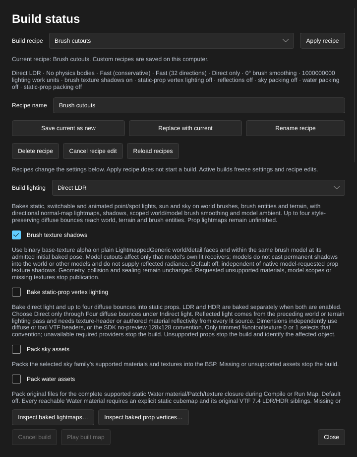
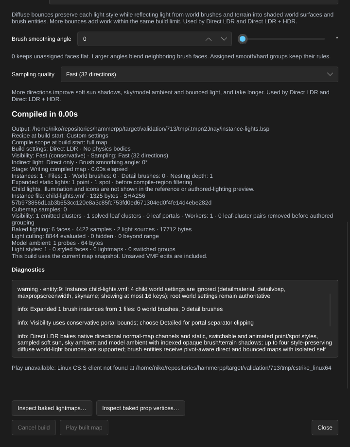
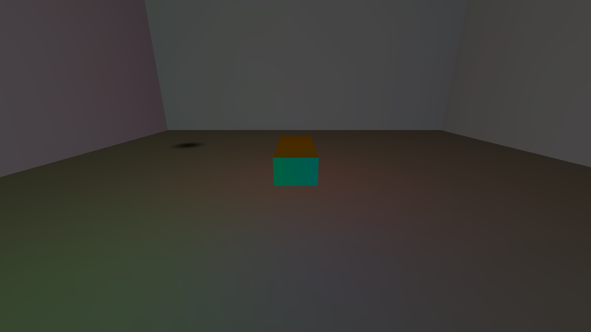

[← Manual](README.md)

# Compile and play

HammeRR includes its own native compiler, so it builds Counter-Strike: Source maps on Linux without the Windows tools. The compiler is **experimental**: compiled maps load and play in CS:S, but visibility and lighting aren't production quality yet. See [Status](status.md).

## Build a playable map

1. Open a sealed map with a player spawn and click **Build settings…** in the toolbar. Settings are available before your first build.
2. Choose the build settings:
   - **Build lighting**: **Fullbright** for a geometry check, **Direct LDR** to bake LDR lighting, or **Direct LDR + HDR** to build separate LDR and HDR channels.
   - **Physics bodies**: **CS:S engine physics** if the map needs physics bodies.
   - **Visibility quality**: **Fast (conservative)** for a quick build, or **Detailed (portal clipping)** to remove more hidden areas from visible sets.
   - **Indirect light**: **Direct only** (default), or **One diffuse bounce**, **Two diffuse bounces**, **Three diffuse bounces** or **Four diffuse bounces** to reflect light from world brushes and terrain.
   - **Brush smoothing angle**: **0°** keeps unassigned brush faces flat; higher angles blend eligible neighbors. Assigned face groups keep their rules.
   - **Sampling quality**, for either lit mode’s sky, model ambient and bounced light: **Fast (32 directions)**, **Balanced (128 directions)** or **Detailed (512 directions)**.
   - **Lighting work limit (millions)**: **1000** by default. Enter a different allowance and click **Apply work limit** when a larger bake needs more headroom.
   - **Brush texture shadows**: bake binary cutouts from supported world/detail materials. See [Brush texture shadows](#brush-texture-shadows).
   - **Bake static-prop vertex lighting**: opt in to direct vertex lighting and up to four diffuse world/terrain bounces for admitted opaque or default-alpha-test models. Choose a lit **Build lighting** mode and the desired **Indirect light** depth first.
   - **Pack sky assets**: include the applied sky family's supported materials and textures in the BSP. This is off by default and works with every lighting mode.
   - **Pack water assets**: include original files for supported static Water materials and their dependencies. This is off by default, works with every lighting mode and requires explicit static LDR/HDR cubemap pairs throughout the graph.
   - **Pack static prop assets**: include original files for admitted static models, every declared admitted opaque or default-alpha-test material and its basetexture, plus PHY when VPhysics is needed. This is off by default and works independently of vertex lighting in every lighting mode. See [Static props](static-props.md#pack-static-prop-assets).
3. Click **Close**, then **Compile** to build with the chosen settings, or **Run Map** to build and launch CS:S. Choose an output file if the map has not been saved.
4. The progress bar below the toolbar offers **Build details…** to inspect the build. **Play built map** in that window launches the last successful build again without compiling, as long as the map and settings haven't changed.

## Controls

| Control | Where | What it does |
| --- | --- | --- |
| **Compile** | Toolbar | Builds the current map, including unsaved edits, into a BSP next to the VMF. Unsaved maps ask for an output file. |
| **Run Map** | Toolbar | Compiles, then launches the map in the Linux CS:S client. |
| **Build settings…** | Toolbar | Opens lighting, physics, visibility and sampling settings before or after a build. |
| **Compile region…** / **Region build…** | Toolbar | Opens saved partial-map bounds, enable/disable and owned preview controls. |
| **Build details…** | Bar below the toolbar, after the first build | Lighting, physics, visibility and sampling settings, progress, timings, statistics and diagnostics. |
| **Play built map** | Build details | Launches the last successful build without compiling again. |
| **Cancel build** | Bar below the toolbar and Build details | Stops the build and keeps the previous output. |
| **Inspect baked lightmaps…** | Build settings / Build details | Opens read-only compiled face samples, channels, styles and intensity statistics from a successful build. |
| **Game Log** | Toolbar | Shows the game's console and launcher output. |
| **Stop Map** | Toolbar | Stops the game started by the editor. |
| **Leak path** | Toolbar | Shows or hides the red leak line after a failed build. |

Builds run in the background, and closing Build details leaves them running. Scroll the window to inspect settings, statistics and **Diagnostics**; the build controls and **Close** stay at the bottom. A successful build publishes its BSP atomically; a detected leak publishes its `.lin` pointfile and preserves the previous BSP. Cancellation or a rejected publication preserves previous outputs. Use [Baked lightmaps](baked-lightmaps.md) to inspect actual samples after a lit build.

The BSP and its matching `.lin` pointfile are reserved before a build starts.
Either destination conflicting with an owned source map or another output is
rejected before replacing the current build status. A directory or special-file
entry at either path blocks admission, including the matching `.lin` path.
Publication requires Linux
and keeps the chosen physical directory bound through the final rename. The
writer rechecks the destination before publication; a warning after a completed rename means
the output was written but its path needs inspection. Reservations coordinate
writes within this application; separate processes and manual writers remain
outside that coordination.

Builds share one compiler worker. **Queued · Waiting to compile** means the
captured build has not started; **Cancel build** can retire it immediately.
Running builds stop at their existing cancellation checkpoints and keep their
output reservations until cleanup completes. Closing Build details keeps the
build owned by the editor.

**Play built map** captures its current map/build before scheduling the launch.
Switching maps while it starts cannot attach that late process to the replacement
map. Launch stays busy until owned process cleanup completes.

Game launches and reflection captures share one native activity in this editor
process. A conflict reports the current owner and installation; it starts no
waiting game. An ordinary **Compile** can continue while a managed game runs.
**Run Map** keeps a successful build if its optional game launch fails or finds
the native activity busy. Optional game startup releases the compiler worker
before starting the client.

Accepted launches bind their installation and executable. Reflection builds
also bind their capture installation, Steam root and content mounts. Replacing
those bindings fails the accepted request. Normal game exit releases native
capacity after checked cleanup while **Game Log** remains readable. Unconfirmed
cleanup remains visibly occupied and makes editor shutdown report the failure.
**Configure capture…** shows the current activity beside runtime configuration
readiness; **Game Log** shows the same concise status. A valid installation can
still be busy. Activity conflicts leave ordinary compilation available.
Manually launched games and other editor processes are outside this launch
coordination. Reflection capture retains its separate capture lock and existing
same-installation running-client preflight; it never stops those clients.

Saved maps can compile bounded world/detail [referenced brush assemblies](instances.md).
Unsupported or missing instance contents fail before publication; prior BSP and
pointfile remain intact, and **Run Map** does not launch. Hidden helpers remain
excluded. **Map checks** checks helper fields without opening child files; a
supported-looking helper still needs compilation to validate its contents.
**Generate reflections** also captures these assembled scenes using visible
root-map `env_cubemap` helpers. Keep cubemap helpers in the parent VMF; child
helpers are unsupported. See [Generated reflections](reflections.md) for binding
and capture limits.


## Build settings

Choose these with **Build settings…** in the toolbar, before or after compiling. **Build details…** in the progress bar opens the same window after a build job exists. Agents use `get_compile_settings` and `set_compile_settings` without needing a previous build. Settings apply to every build (Compile, Run Map and agent builds), aren't stored in the VMF, and can't change while a build is running.


**Lighting work allowance**

1. Open **Build settings…** and find **Lighting work limit (millions)**.
2. Enter the allowance: **1000** means one billion work units. Values from
   **0.000001** to **10000** are supported, with up to six decimal places.
3. Click **Apply work limit**, then compile. Increasing the allowance keeps the
   selected sampling quality and all sample, allocation and geometry limits.
4. In **Build details…**, inspect **Lighting work charged**, completed/planned
   samples, channel/phase totals and source-linked light contributors. These
   counters remain available when lighting fails. An incomplete sample plan is
   labeled; charged work includes a budget request rejected before execution.

The allowance covers shared preparation and both LDR/HDR channels together.
Work units bound compiler operations; they are not milliseconds. Large outdoor
maps can spend most work tracing sky ambient. Setting a point or spot light's
`_distance` reduces work outside its range. Resource failures retain
the previous BSP; increasing work allowance does not bypass other failures.

**Build lighting**

- **Fullbright** (default): no lighting. Fastest, for checking geometry.
- **Direct LDR**: bakes direct light from static, switchable and animated point/spot lights and the sun, plus diffuse sky ambient, into world, terrain and brush-entity lightmaps with shadows. See [Lighting](#lighting).
- **Direct LDR + HDR**: builds independent LDR and HDR channels with the same lighting features and separate authored inputs. See [HDR channels](#hdr-channels) for map-data eligibility and runtime limits.

**Generate reflections** (Direct LDR and Direct LDR + HDR)

Off by default. Enable it to capture one native reflection bounce during
**Compile** or **Run Map**. **Direct LDR** captures LDR; **Direct LDR + HDR**
captures both channels before a single publication. Read the capture runtime
status and use **Configure capture…** when needed. **Fullbright** requires this
setting off. See [Generated reflections](reflections.md).

**Pack sky assets** (all lighting modes)

Off by default. Embed the exact authored sky family's supported material and texture dependencies in the BSP. This works with **Fullbright**, **Direct LDR** and **Direct LDR + HDR**, independently of **Generate reflections**. See [Pack portable sky assets](#pack-portable-sky-assets) for steps and limits.

**Pack water assets** (all lighting modes)

Off by default. Embed original VMT/Patch/VTF files for the supported static Water
closure. Every reachable effective Water material needs an explicit static
cubemap with both original LDR and HDR files, including with **Fullbright** or
**Direct LDR**. Runtime/default `env_cubemap`, missing assets and unsupported
graphs stop publication. Packing alone needs no native capture or physics.
**Build details…** shows **Water assets** only for a current, completed,
published result. See [Pack static Water assets](water.md#pack-static-water-assets)
for steps and limits.

**Pack static prop assets** (all lighting modes)

Off by default. Embed the admitted original static MDL/VVD/DX90 VTX files,
every declared admitted opaque or default-alpha-test **VertexLitGeneric** material and basetexture VTF,
and the matching PHY only for emitted VPhysics uses. It is independent of
**Bake static-prop vertex lighting**. Missing or unsupported inputs stop
publication; dynamic/detail models are excluded. See [Static props](static-props.md#pack-static-prop-assets)
for steps, source checks and runtime requirements.

**Physics bodies**

- **No physics bodies** (default).
- **CS:S engine physics**: builds collision bodies with the game's own Linux collision library, run inside the `hammerr-physics` helper. See [Physics](#physics).

**Visibility quality**

- **Fast (conservative)** (default): uses portal-facing bounds and keeps some occluded areas in visible sets.
- **Detailed (portal clipping)**: clips sight volumes through portal paths to remove more hidden areas. Larger jobs refine independent source rows on up to eight available CPU workers; small jobs stay serial. Invalid apertures and exceeded work/allocation limits stop the build.

Visibility quality applies to every lighting mode. It is separate from the light sampling quality below.

**Indirect light** (Direct LDR and Direct LDR + HDR)

- **Direct only** (default): bake direct emitters and sky ambient.
- **One diffuse bounce**, **Two diffuse bounces**, **Three diffuse bounces** or **Four diffuse bounces**: reflect light from world/detail brushes and terrain into world, terrain and brush-entity receivers. It also reaches model ambient through the resulting lightmaps.

**Brush smoothing angle** (Direct LDR and Direct LDR + HDR)

- Whole degrees from **0** (default, flat unassigned faces) to **90**, using the input or slider. **45°** is a starting point for curved brushes.
- Automatic blending needs two unassigned neighboring world/detail faces. Assigned smoothing/hard groups retain their rules. See [Face lighting](textures.md#smooth-by-angle).

**Sampling quality** (Direct LDR and Direct LDR + HDR)

- **Fast (32 directions)** (default), **Balanced (128 directions)** or **Detailed (512 directions)**: how many directions are sampled for [sky ambient and soft sun](#sun-and-sky), [model ambient](#model-ambient-lighting) and [bounced light](#bounced-light). More directions improve visibility sampling near narrow openings and make sun shadows less stepped, and take longer. Set **SunSpreadAngle** above zero to soften the sun's shadows.

**Refine ambient probes** (default off)

- Available with either lit mode and **Balanced** or **Detailed** sampling.
  It can replace one final probe per leaf after evaluating up to twice the
  candidate gathers. Earlier anchors, emitted probe counts and spacing stay
  unchanged; additional gathers and scoring consume the shared work budget.
- Disable it before choosing **Fullbright** or **Fast** sampling. Invalid
  combinations retain all current settings. Build recipes preserve the option.

A previous build counts as out of date once its settings differ from the current ones.

## Pack portable sky assets

Include a custom sky with the map so playback can resolve its supported sky materials and textures from the BSP after the original custom content mount is removed.

1. Open **World settings…**, set **SkyBox Texture Name** (`skyname`) to the exact mounted family, and click **Apply properties**. Custom definitions may label the field differently. **Inspect applied sky…** helps diagnose the six material and texture sources; packing applies stricter admission checks than read-only inspection.
2. Open **Build settings…** and enable **Pack sky assets**. Keep **Generate reflections** off for packing alone; packing needs no native capture runtime and works with **Fullbright**. Enable reflections separately when the map also needs captured cubemaps.
3. Click **Close**, then **Compile** or **Run Map**. Keep the original assets available until publication finishes. Missing, malformed, unsupported or changed dependencies stop publication and preserve the previous output; no alternate family or `_hdr` suffix is selected.
4. Open **Build details…**. A completed, published build reports **Packed sky assets** with its family, **LDR** or **LDR + HDR**, file count and raw asset bytes. Counts exclude the manifest. Changing the current checkbox leaves this completed-build record unchanged and makes that build stale until its captured settings match again.
5. Distribute the resulting BSP with the map. For a packing-only build, **Play built map** can still stage the packed sky after its original custom mount is removed and material assets are reloaded, provided the map and build settings still match. Other map dependencies must remain available normally; this setting packs the sky closure only.


Supported families contain six static `UnlitGeneric` LDR faces, or six `Sky` faces with both LDR and RGBA16F/RGBA16 HDR base textures. A declared HDR channel must be complete on all six faces, including with **Direct LDR** or **Fullbright**. Original VMTs, Patch dependencies and declared runtime textures keep their names, file bytes and mip data; editor-only `%tooltexture` images are excluded.

Run verifies the embedded sky from BSP bytes and preserves it while rebasing generated reflection names. Packing happens before optional reflection capture; combined builds retain their native runtime and content-freshness requirements. Packing does not choose the game's LDR/HDR channel, bake lighting from the image or add an HDR editor preview.

Limits: static textures with one frame, one face, depth one and at most 4096 pixels per axis; 128 assets, 1 MiB per VMT, 16 MiB per packed file and 259 bytes per full relative name. The combined archive, including reflections, is bounded to 64 MiB each encoded and decoded. Compressed HDR skies, animation, conditional/proxy/ambiguous material declarations and existing name collisions reject. Reduce the assets or fix the reported source, then compile again; see [packing admission rules](mcp.md#portable-sky-assets) for the exact material and manifest limits.

## What gets compiled

### World geometry and visibility

- Brushes become BSP geometry. Out-of-range or invalid objects are reported before building starts.
- The world is split into visibility clusters, with visible and audible sets computed from portals. `func_detail` and brush entities don't split visibility.
- **Detailed** visibility refines the conservative sets with portal separator clipping. **Build details…** reports **Workers** and **cluster pairs removed**. A removed pair counts one directed cluster-to-cluster entry; reciprocal entries are counted separately.
- Larger Fast and Detailed builds compute independent portal-facing rows on up to eight available CPUs; Detailed also parallelizes separator flow. Small jobs stay serial.
- Visibility work is bounded. Exceeded work or stack limits keep the previous BSP; choose **Fast (conservative)** or use `func_detail` for non-sealing decoration to simplify structural geometry. [Occluders](occluders.md) compile separately and provide runtime prop culling with activation inputs.

Unreadable or malformed material definitions, broken patch includes and missing
or malformed declared textures needed for compilation stop the build and retain
the previous BSP. Nonfinite texture reflectivity is also rejected. Missing
material definitions produce explicit warnings; absent optional texture
declarations retain the documented compile defaults.

Flat lit faces are subdivided to a maximum lightmap extent of 32 luxels per
axis, including in **Fullbright** builds. If an imported projection prevents a
valid smaller split, the build reports the source side and preserves the
previous BSP and pointfile. Adjust that face's [Lightmap scale or texture
axes](textures.md#face-lighting), then compile again. Unlit/sky faces and
terrain retain their separate rules.

### Hint planes

Hint faces guide initial structural plane selection and add remaining partitions in open world space. Ordinary planes that cut a hint polygon are deferred when a hint or non-cutting alternative is available. They can help visibility follow the map's layout. Skip faces bound the helper without requesting extra cuts.

1. Create a world brush where you want the partition. Use **Draw brush** in a planar view, or **Add brush** in Perspective and set its bounds with transforms.
2. Keep **Selection → Objects**, set its material to `tools/toolsskip`, and click **Apply**. **Browse materials…** offers a preview; choose **Use material**, or **Cancel** to keep the previous choice.
3. Set **Selection → Faces · materials & textures**, select the intended split face, set `tools/toolshint`, and click **Apply**. Leave the other faces as skip.
4. Click **Compile**. **Build details…** reports **Hint surfaces**, **Added splits**, **Initial priority** and any **Diagnostics**. **Initial priority** counts added hint planes retained from structural splitting and is included in **Added splits**. A plane already present or outside open leaf interiors may need no extra split.
5. Choose **Detailed (portal clipping)** under **Visibility quality** when you want the refined visible sets, then **Run Map** to inspect the result.


Limits: hint helpers must be world brushes with only hint/skip materials. They do not seal the map, expand world bounds, render in game or add collision. Their finite polygons choose which tree volumes participate; each chosen cut extends to that volume's bounds. Remaining cuts apply to filled open leaves. Hidden helpers are omitted. Ordinary brushes with skip faces retain their solid volume. Budgets are 4,096 hint surfaces, 16,384 added splits, sixteen million work units and the shared source-side/node caps; exceeded limits keep the previous BSP. [Occluders](occluders.md) have a separate authoring and validation boundary.

### Areaportals

An areaportal controls visibility through a sealed opening between two areas.

1. Create a convex brush that fills the opening between rooms. Seal the rest of the boundary with world brushes; detail brushes do not divide areas.
2. Select the brush and click **Tie to entity…**. Choose **func_areaportal**, then **Tie selected brushes to entity**.
3. Give it a **Name** and choose **Initial State**: **Open** or **Closed**. **Name of Linked Door** can name a door that controls it; connections can also send **Open**, **Close** or **Toggle**.
4. Click **Compile** or **Run Map**. **Build details…** shows **Visibility areas**, **Areaportals** and **Clip vertices**.


Limits: one visible convex brush per portal, exactly two distinct areas, one planar interface, at most 511 portals and 255 open areas. Overlapping, touching or leaking portal boundaries fail without replacing the previous BSP. Hidden portals are omitted. A closed portal hides the other area; link it to a door or another opaque barrier when players could otherwise see through the opening.

[Compile regions](compile-regions.md#include-overlays-and-visibility-helpers)
retain whole contained portal/window brush bounds independently of editor origins.
Disjoint helpers are omitted; crossing bounds stop the build. The retained opening
must still separate two areas, and window render models must remain available.

### Distance-fading windows

A window portal fades a brush model to opaque as the player moves away, then hides the area behind it.

1. Fill a sealed opening with one convex portal brush. Click **Tie to entity…**, choose **func_areaportalwindow**, then **Tie selected brushes to entity**. Give it a **Name**.
2. Create a brush model with an opaque material covering the portal volume. Tie it to **func_brush**, give it a **Name**, and choose **Solidity → Never Solid** if it should allow passage.
3. Select the window portal. Set **Rendered Window** to that brush model's name. Choose **Fade Start Distance**, **Fade End Distance** and **Translucency limit**. For example, `64`, `128` and `0.2` begin with 20% opacity and become opaque at 128 units.
4. Optionally create another named brush model with an alpha-textured material. Set **Foreground bmodel** to its name. Its bounds must enclose the rendered window, and both models must use the same **Origin (X Y Z)**.
5. Click **Compile** or **Run Map**. **Build details…** includes **Window portals**. Move away from the window to see it close; connections can change the distances with **SetFadeStartDistance** and **SetFadeEndDistance**.


Limits: the same area-boundary limits as plain areaportals apply. Model references must name one visible rendered brush entity each; the rendered model's bounds must enclose the portal. Use fixed models with aligned pivots. Distances must be finite and satisfy `0 ≤ start ≤ end`; equal distances give a hard cutoff. **Translucency limit** must be between `0` and `1`. The foreground needs alpha in its material; an opaque foreground covers the view at every distance. The window controller and both referenced models require absent or exact-zero initial `angle`/`angles` fields. Nonzero, malformed, duplicate or aliased angle fields fail before publication in every lighting mode, including **Fullbright** and unlit models. Edit imported raw keys through **Advanced properties**; do not use an entity-angle override to orient this fixed window setup. Moving targets and rotated-window rendering/fade behavior remain unavailable.

### Sky

- `tools/toolsskybox` marks 3D sky. Materials with `%compile2dsky` mark 2D sky.
- Sky visibility follows the visible sets, so enclosed or disconnected rooms don't inherit sky they can't see. Hidden and brush-entity sky faces are ignored.

### Material compile flags

- Flags accept `1` or `true` to enable and `0` or `false` to disable, in any letter case.
- Skip faces hide that surface but keep the rest of the brush.
- Non-solid materials stay visible but don't seal the map.
- Hint and empty-content brushes are left out. World areaportal materials need a **func_areaportal** entity. Unsupported flags are listed in the build diagnostics.

### Lighting

With **Direct LDR** or **Direct LDR + HDR**:

- `light` and `light_spot` support static, switchable and animated appearances. `light_environment` remains static. All are baked in color.
- Opaque world brushes, detail brushes, terrain and [static-prop meshes](prop-shadows.md) cast shadows. **Brush texture shadows** adds binary cutouts for supported world/detail materials. Models authored with `$casttextureshadows` independently support cutout and translucent texture shadows.
- Rendered brush entities receive pivot-aware direct lightmaps that move with the model. Their own brushes can shadow one another. Stationary opaque **func_brush** models can explicitly request global shadows with **Advanced properties → Shadows → Yes**.
- Each face uses its [lightmap scale and assigned smoothing groups](textures.md#face-lighting). World/detail brush smoothing retains the same fan across lightmap subdivisions.
- Terrain is lit using its real raised surface, with smooth normals within patches and across matching equal-power full edges. The viewport uses the same normal construction.
- Point/spot lights outside a sample's conservative visibility or exact falloff range are skipped automatically. **Build details…** shows a **Light culling** row with **evaluated**, **hidden** and **beyond range** counts. Unknown or boundary sample clusters retain every light; approximate near-zero distances keep their soft tails.


[Explicit detail models](model-detail-props.md) and [material-generated models and
sprites](material-detail-scattering.md) receive direct light plus filtered
world/terrain/sky ambient, including configured bounces through the lightmaps.
Styles 1–63 are stored as extras alongside the static base and follow the same
named-light switches and appearances. SDK encoding halves each extra's color;
the client applies its current style value without a restoring factor of two,
so switched detail lighting need not match static-base intensity. Each receiver
allows 63 extras; LDR and HDR arrays together allow 65,536 records.
**Fullbright** retains white unbaked base colors without extras. Detail objects
do not add baked shadows or collision.

#### Brush texture shadows

Use binary texture alpha to let baked light pass through cutout world and
**func_detail** brush faces, or through a grille onto another solid in the same
brush model at its admitted initial pose. The option defaults off and preserves
the existing model-requested [static-prop texture shadows](prop-shadows.md).

1. Open **Build settings…** and choose **Build lighting → Direct LDR** or
   **Direct LDR + HDR**.
2. Enable **Brush texture shadows**. Caster faces need a plain
   **LightmappedGeneric** material with `$alphatest 1` and `$basetexture`.
   For model self shadows, tie the grille and receiving solids to the same
   **func_brush**, using its existing supported initial lighting pose.
3. Click **Close**, then **Compile**. Inspect **Diagnostics** in **Build details…**
   if a requested material is unsupported or its texture is missing or corrupt.
   Failed builds retain the previous BSP and pointfile.
4. Use **Save current as new** to retain the option in a build recipe. Disable
   it before selecting **Fullbright**.



Each crossed brush boundary samples the face's authored UVs, then the material's
finite center/scale/rotation/translation transform. Sampling uses nearest mip-0
texels with VTF clamp/repeat. Alpha at or above `$alphatestreference` blocks light;
the default is 0.5, values from 0 to 1 are supported, and explicit zero uses 0.5.
Direct, sky, reflected and ambient rays share this cutout behavior. Brush
geometry, collision, sealing and visibility remain unchanged.

Model cutouts affect only that model's own lit receivers. Global casting uses
the separate **Shadows → Yes** property on strictly admitted opaque
**func_brush** models; requested global cutout casters reject. Model surfaces
do not supply reflected radiance. Nonzero rotations retain the
existing unparented **func_brush** admission rules; the other supported
zero-rotation receiver scopes are unchanged. A requested model cutout without
an admitted lit receiver scope fails explicitly. This does not provide runtime
relighting or extend moving/parented pose support.

Limits: plain static materials only, one texture frame/face/depth, frame zero,
4096 pixels per axis, 64 MiB decoded alpha, 256 MiB asset reads, 64 KiB per VMT,
65,536 material/include lookups and 65,536 original brush boundary sides inspected.
Authored transform values must be within ±1024. The existing aggregate lighting
allocation and **Lighting work limit (millions)** also apply. Fractional brush
translucency, terrain alpha casters, unadmitted model scopes, conditional/animated
materials, bump/envmap caster effects and other unsupported opacity parameters
stop an enabled build explicitly. Opaque bumped receivers remain supported.

#### HDR channels

**Direct LDR + HDR** keeps face lightmaps, light styles, world lights, reflected light and model-ambient probes separate for the two channels. CS:S selects the baked channel according to its HDR setting and hardware support. The editor viewport continues to show its existing preview lighting. Detail model and sprite base colors use one shared native field; in a dual-channel build it retains the final HDR pass's color rather than separate LDR/HDR detail values. Their style extras remain separate LDR/HDR arrays with a shared sorted style layout; a style absent from one channel receives zero color there. The combined record limit allows at most 32,768 entries per channel.

1. Open **Build settings…** and choose **Build lighting → Direct LDR + HDR**.
2. Set **Indirect light**, **Brush smoothing angle** and **Sampling quality**. These settings apply to both channels. Existing **Fast preview** and **Final lighting** recipes keep their original settings; use **Save current as new** to retain a custom HDR recipe.
3. Author **Brightness** and **Ambient** as usual. HDR uses **BrightnessHDR** (`_lightHDR`) and **AmbientHDR** (`_ambientHDR`) overrides, or the HDR tuple from an eight-number fallback value. **BrightnessScaleHDR** (`_lightscaleHDR`) and **AmbientScaleHDR** (`_AmbientScaleHDR`) scale their respective HDR inputs; a negative RGB sentinel keeps the fallback, and an explicit zero disables that contribution. LDR retains its original inputs.
4. Click **Close**, then **Compile**. Open **Build details…** to compare the **LDR Baked lighting**, **HDR baked lighting**, style, brush-model, directional-map, bounce and ambient rows. **Lighting work** shows **LDR**, **HDR** and **Shared total**; authored prop/model geometry is counted once.
5. Inspect **HDR native map data** and **Diagnostics**. **HDR data ready** reports eligible nonempty map data. **HDR unavailable: incomplete map data** means the map cannot activate native HDR. Changing the lighting mode makes a previous build stale; compile again before **Play built map**.


Reflective prop materials add cubemap reflections to their diffuse lighting.
Place samples and use [Generate reflections](reflections.md) for map-specific
reflections; tune [exposure](hdr-exposure.md) separately from light brightness.

Limits: this is an experimental compiler mode. A successful compile or an **HDR data ready** result does not establish that the game selected HDR. Native HDR requires nonempty HDR light samples, world lights and ambient samples, plus game and hardware support. Empty scenes do not receive dummy records. The game’s HDR setting must be selected before a fresh map load; live changes may trigger save/reload. Enable **Generate reflections** to capture paired LDR/HDR cubemaps after baking; complete HDR arrays and a supported capture runtime are required. Mounted HDR sky families use the [authored sky name and native material path](sky.md#compiled-hdr-skies); [Pack sky assets](#pack-portable-sky-assets) admits and embeds the supported complete material/VTF closure. For fixed native exposure, follow [HDR exposure controllers](hdr-exposure.md). Broader HDR sky radiance, adaptation, editor HDR previews and per-texel prop lightmaps remain unfinished. Each channel shares the existing geometry and lighting limits; the configured lighting-work allowance covers shared preparation and both passes.

#### Brush-entity lightmaps

1. Select the world brushes and click **Tie to entity…**. Choose a rendered class such as `func_brush`, `func_door` or `func_door_rotating`, then **Tie selected brushes to entity**.
2. Set **Origin (X Y Z)** or use an [origin brush](#brush-entities-and-pivots) for its pivot. Fractional pivots are supported.
3. Place lights around its authored position and choose its materials and face lightmap scales.
4. Open **Build settings…**, choose **Build lighting → Direct LDR**, then **Close** and **Compile** or **Run Map**. **Build details…** reports **Brush entity lightmaps**, models and faces.
5. For global shadows from a stationary opaque **func_brush**, explicitly set
   **Origin (X Y Z)** and **Advanced properties → Shadows → Yes**. Keep **Name**
   and **Parent** empty, inherited runtime defaults neutral and **Connections**
   empty. Compile with either lit mode. **Build details… → Brush global shadows**
   reports the actual retained baked model count; **Fullbright** reports admitted
   source requests as admitted but not baked, including region-omitted requests.
6. Use [Connections](entities.md#connections-inputs-and-outputs) to move a door. Its baked lightmap stays attached while it moves.


Limits: direct point/spot styles and sun/sky lighting at the authored pose, with scoped authored/angle brush smoothing and isolated self-shadow hulls. Choose **Indirect light → One diffuse bounce** to receive reflected world/detail/terrain light. Moving models do not add permanent world shadows or supply reflected light. Bounded initial `func_brush` rotations are supported as described in [Initial brush-model rotation](#initial-brush-model-rotation); other initial brush rotations, dynamic relighting and prop lightmaps remain unfinished. Local geometry, UVs, pivots and collision remain fixed during compilation; source properties and undo history are preserved. Models share the lighting allocation/work budgets.

**Shadows → Yes** requires resolved opaque ordinary SOLID materials, including
nondrawing boundaries. Supported shaders are **LightmappedGeneric** and
**UnlitGeneric**, with unambiguous scalar **Patch** include/edit chains up to
the existing depth of eight. Unknown shaders, conditional/proxy blocks, duplicate
parameters, alpha-test, translucent or additive materials, terrain,
liquids, origin volumes, other entity classes and runtime behavior reject before
compile-region omission. Source and admitted initial-pose coordinates must stay
finite and within the existing bounds. Requests validate in Fullbright too;
only lit builds prepare global casters, including models without lit receivers.
The same opaque blockers apply to direct, sky, reflected and ambient visibility.
They do not change geometric occupancy, probe placement, PVS, collision or
reflected-light sources. Absent or **Shadows → No** retains isolated self shadows.
[Referenced children](instances.md) use the same property but keep source angles
absent or zero; **Refresh instance contents** does not certify material validity.

#### Switchable lights and appearances

These steps describe root-map lights. Child maps use the
[built-in pattern steps below](#built-in-patterns-in-referenced-assemblies).

1. Use **Place entity** to add a `light` or `light_spot`. Set **Brightness**.
2. Give it a **Name**, such as `room_lights`, to control it in game. To make a group, duplicate the named light with Ctrl+D and move the copies. Lights sharing that name switch together and must share their initial pattern and **Initially dark** state; colors and brightness may differ.
3. Choose **Light pattern**, for example **Normal** or **Fluorescent flicker**. For a custom pattern, enable **Advanced properties** and set **Custom Appearance** to lowercase letters `a`–`z`: `a` is dark, `m` is normal brightness, and `z` is brighter. A custom pattern overrides the built-in appearance. A custom pattern needs a named light.
4. Enable **Initially dark** if the light should begin switched off.
5. Select an entity that will control it, such as a `logic_relay`, and open **Connections… → Add connection**. Choose its output, the light's name as the target, and **TurnOn**, **TurnOff** or **Toggle** as the input. Use **SetPattern** with a pattern parameter to change its appearance. Click **Apply connection**; **Cancel** leaves the connection unchanged.
6. Open **Build settings…**, choose **Build lighting → Direct LDR**. Choose **Indirect light → One diffuse bounce** for reflections that follow the same switches and patterns, then **Close** and **Run Map**. **Build details…** reports **Light styles**, styled faces, lightmaps and switched groups.

| Initially dark | Turned on, with reflected light |
| --- | --- |
|  |  |

Limits: at most 32 named light groups and four contributing styles per face, including the always-present Normal channel. Named style IDs are assigned only in compiled output; VMF properties and undo history stay fixed. Authored appearance values must be whole numbers from 0 to 31, and custom patterns use at most 64 letters. Unnamed lights can use built-in appearances; custom patterns and **Initially dark** need a name. Hidden lights are excluded. Styled lights receive direct and reflected world/detail/terrain and brush-model lightmaps, plus detail model/sprite extras within their separate receiver and record limits above. Reflections can introduce a style on a face beyond its direct reach, and still count toward the four-style limit. Switching model-ambient cubes, sun/sky styles and baked prop lightmaps remain unfinished. The common lighting allocation/work limits apply.

#### Built-in patterns in referenced assemblies

Unnamed child `light` and `light_spot` entities can use the installed FGD's
**Light pattern** choices 0–11 through the same property controls.

1. Open the child VMF as a normal map. Add or select a `light` or `light_spot`.
   Choose **Light pattern**, such as **Normal**, **Fluorescent flicker** or
   **Slow pulse, noblack**.
2. Keep **Name** empty and **Initially dark** off. Under **Advanced properties**,
   keep **Custom Appearance** empty. Preserve the supported
   [child light fields and spotlight pitch](instances.md).
3. Save and reopen the child. Open the parent and create or refresh its
   reference with **Instance contents… → Refresh instance contents**.
4. Choose **Build settings… → Build lighting → Direct LDR** or **Direct LDR + HDR**,
   then **Compile**. **Build details… → Expanded static lights:** includes the
   patterned point/spot lamps before compile-region filtering.



Limits: child names, custom patterns, **Initially dark**, runtime references
and I/O remain unsupported. Child sun/sky lights remain Normal-only. Root and
child lamps with the same numeric style share a global channel; each face
allows four contributing styles including Normal, with the same limit for
reflected light. **Bake static-prop vertex lighting** still requires Normal
lights. Child illumination, icons and animated previews remain unavailable in
the parent reference and authored-lighting views.

#### Bounced light

1. Open **Build settings…** and choose **Build lighting → Direct LDR**.
2. Choose **Indirect light → One diffuse bounce**, **Two diffuse bounces**, **Three diffuse bounces** or **Four diffuse bounces**. More bounces carry light farther through shaded spaces and take longer. Use **Direct only** to compare.
3. Choose **Sampling quality**: **Fast (32 directions)**, **Balanced (128 directions)** or **Detailed (512 directions)**. More directions reduce sampling variation and take longer.
4. Click **Close**, then **Compile** or **Run Map**. **Build details…** reports the chosen **Indirect light** count, total rays and samples receiving reflected light in the final pass, plus **Brush entity bounce** when the map has model receivers.

| World surface | Brush entity |
| --- | --- |
|  |  |

| One bounce | Four bounces |
| --- | --- |
|  |  |

Limits: up to four diffuse bounces from world/detail/terrain lightmaps, preserving each static, switchable or animated light style, using average base-texture reflectivity. Source reflectivity must be between zero and one. Sky is handled by direct sky lighting and is excluded from the bounce gather. Translucent world surfaces cast opaque shadows. Opaque nodraw brushes also block reflected paths, including when they sit close to a lit surface. Brush entities receive world bounce and block it with their own geometry; strict stationary opaque models with **Shadows → Yes** also block reflected paths globally. Model surfaces never supply reflected light. Static-prop meshes apply the same opaque, alpha-test or requested translucent coverage to reflected rays but do not supply reflected light. More than four bounces, emissive materials and per-texel prop lightmaps remain unfinished. Baked model lighting moves with the model and does not relight as it moves. Unparented `func_brush` models can bake bounded initial rotations; see [Initial brush-model rotation](#initial-brush-model-rotation). Other classes still require absent or exact-zero initial angles. Malformed or ambiguous pose fields stop lit builds with an entity diagnostic. Hidden models remain omitted. Models without lightmap receivers still validate and prepare an explicit **Shadows → Yes** request. The configured shared lighting-work allowance and 16 MiB lightmap budget per channel apply; exceeded limits keep the previous BSP. Use fewer bounces, lower sampling, larger lightmap scales or **Direct only** to reduce work. **Fullbright** retains this setting but performs no lighting work.

#### Required material texture metrics

Drawn faces need dimensions and diffuse reflectivity for the BSP, including
**Fullbright** builds. Each metric has its own selected provider. Without a
preview or reflectivity override, both use the effective base/albedo VTF.
A failed required provider stops the build; it does not substitute another
texture or invent measured dimensions or reflectivity.

1. Click **Compile**, then open **Build details…** for the material diagnostic.
2. Check the named material, selected texture key and exact mounted texture path.
   Use **Browse materials…** and the material source inspector to inspect the
   declaration, then repair the asset or select an available material.
3. Compile again. A failed build keeps the previously published BSP.

Limits: genuinely absent optional material/base declarations retain the existing
64×64, neutral-reflectivity compile defaults. Raw-base nondrawn and sky surfaces
use neutral metadata without reading an unused diffuse texture. Selected albedo
keeps the stricter rules below. Root runtime-generated `_rt_` textures cannot be
measured from an on-disk VTF and are explicitly unsupported when their header
is required, even if a file with that name exists. An unused runtime texture
is not read when independent providers supply both metrics. Broader native
reflectivity coercions remain unavailable.

#### Material source-read limits

Compiler material collections use the following HammeRR resource bounds in
every lighting mode, including **Fullbright**:

| Source | Per file | Successful payload per collection | Actual lookup attempts per collection |
| --- | --- | --- | --- |
| VMT material and Patch sources | 1 MiB | 16 MiB | 4,096 |
| Metric VTFs supplying dimensions or reflectivity | 256 MiB | 512 MiB | 4,096 |

Successful reads charge their complete payload, including the whole metric VTF
file. Repeated actual reads count again. A cached material-name hit performs no
read and spends no read budget. Failed or missing lookup attempts count toward
the lookup limit; only returned payload bytes count toward the byte limit.

Geometry-only preparation retains its stricter VMT bounds: 256 KiB per file,
2 MiB total and 128 lookups, with texture metrics deferred. Static-prop source
tracking retains 256 KiB per VMT and the existing 64 MiB distinct-source
bound in addition to the collection limits. The strictest applicable read bound
is used. Region preparation and later compiler collections have separate
counters; these totals are not a whole-build memory or work limit.

An exceeded bound stops the build with a contextual material/source diagnostic,
including the selected key for a metric texture. Open **Build details…** and
review **Diagnostics**, reduce or repair the named input, then **Compile**
again. Limit failures never select substitute files or default metrics, and
preserve the prior BSP and pointfile. File I/O is not interruptible.
The [Source inspector](material-source.md) has separate read-only
inspection limits.

If a build lookup reaches a changed mounted VPK index, compilation reports an
explicit index-change error and keeps the previous BSP and pointfile. Restart
the editor to remount the replacement, then **Compile** again. New asset reads and uncached
material catalog queries use the same index check; they do not silently skip the
changed mount. Existing cached browser entries and previews are not watched.
This does not freeze numbered VPK payload files or the complete build inputs.

#### Tool preview dimensions

Use a material's tool preview for compiled dimensions while keeping its diffuse
reflectivity independent. These declarations affect compiler metrics; the
editor's displayed image retains its existing preview rules.

1. Open **Browse materials…**, select the material, then **Source…** to identify
   its **Selected VMT source**.
2. In that source or its resolved Patch, author `%tooltexture "tools/my_preview"`
   to measure dimensions from that VTF. Leave diffuse reflectivity to the
   effective base/albedo header, or author a supported `$reflectivity` triple.
3. Alternatively, author `%notooltexture "0"` or `%notooltexture "1"` to select
   the SDK compiler's 128×128 no-preview convention. Either literal suppresses
   tool/base dimension reads. Reflectivity still needs its own provider.
4. Click **Compile**, then inspect **Build details…**. A no-preview INFO
   diagnostic names the dimension convention; it does not report a measured
   texture size. Failed providers identify the material and stop publication.

| Metric | Provider |
| --- | --- |
| Dimensions, no preview override | Effective base/albedo VTF header |
| Dimensions, `%tooltexture` | Declared tool VTF header |
| Dimensions, `%notooltexture 0` or `1` | Named SDK 128×128 convention |
| Diffuse reflectivity, `$reflectivity` | Authored linear RGB triple |
| Diffuse reflectivity, no override | Effective base/albedo VTF header |

Limits: only literal `0` and `1` are admitted for `%notooltexture`; empty and
other values fail explicitly. A valid no-preview declaration takes precedence
over `%tooltexture`, so an unused tool file is not read. Otherwise a tool value
must be a nonempty supported asset-relative path, at most 241 bytes after
trimming. Numeric values and numeric-looking root hex/NaN-payload declarations
are unsupported; an explicit `.vtf` suffix or directory makes an ordinary
string path. Required runtime textures, invalid paths and missing or malformed
files fail. Prefix/extension normalization is a compiler convenience; this does
not establish literal native preview behavior for every accepted spelling. A failed
selected tool read never retries base dimensions or selects 128×128.
Tool-header reflectivity is not used. A valid dimension provider cannot rescue
failed required diffuse reflectivity, and an authored reflectivity cannot
rescue failed required dimensions. An absent optional base can retain neutral
reflectivity, but that default does not qualify as a measured or authored source
for static-prop indirect lighting.

#### Normal-map lighting

1. Set **Selection** to **Faces · materials & textures** and select the target faces.
2. Click **Browse materials…**, choose a lit material whose VMT declares `$bumpmap`, then **Use material** and **Apply**. Its normal texture must be available to the game.
3. Open **Build settings…** and choose **Build lighting → Direct LDR**. Choose **Indirect light → One diffuse bounce** if you want reflected world light too.
4. Click **Close**, then **Compile** or **Run Map**. **Build details…** reports **Normal-map lighting**, faces and directional maps.


Each lit face requesting diffuse normal-map lighting gets its base map and three directional maps per light style. On LightmappedGeneric, WorldVertexTransition and WorldTwoTextureBlend, `$nodiffusebumplighting 1` selects ordinary diffuse lightmaps while retaining the normal texture for other shader effects. Texture axes, mirrored mappings and world/model smooth normals orient those directions; terrain uses its shared smooth surface normals. Native style averages keep the base lighting. Brush models keep their own coordinate scope and self shadows.

On those three shader families, a primary bump/base/albedo declaration with
absent or literal `0` suppression selects `$albedo` as the effective diffuse
texture. Without independent metric overrides, its VTF supplies compiled
dimensions and reflectivity. Literal `1` keeps `$basetexture`. The original
VMT declaration stays unchanged. When the selected albedo header is required,
a missing, corrupt or unreadable file stops the build; the unused base is
never substituted.

Active albedo can combine with the supported tool/no-preview dimension rules
above and an authored `$reflectivity` override below. Without an override,
reflectivity still comes from the albedo header. Editor preview and atlas
inspection retain their own display-override rules.

Limits: a lit primary-normal material on those three shader families accepts an absent suppression key or trimmed literal `0`/`1`. Other provided spellings fail compilation; use the supported literal rather than relying on native integer coercion. The engine can clamp bright ordinary and bumped LDR lighting differently; compare modest brightness when tuning normal details. This changes compiled game lighting; the editor's material thumbnails and viewport use diffuse previews. WorldVertexTransition secondary normal mapping requires a primary `$bumpmap`; `$bumpmap2` alone does not activate the checked shader path. Initial rotations on parented models or other brush classes, world/terrain opacity and colored/refraction transmission, and per-texel prop lightmaps remain unfinished. Auxiliary directions share the 16 MiB lightmap limit per channel and configured shared work limit per build; larger scales or lower sampling can reduce work.

#### Authored material reflectivity

Use a mounted material's `$reflectivity` declaration to control its compiled
diffuse reflectivity independently of texture dimensions. It affects reflected
light received by world, terrain, brush models, ambient probes and supported
baked static props; it does not tint the editor's diffuse image.

1. Open **Browse materials…**, select the material, then **Source…**. Check
   **Selected VMT source** and its mounted location.
2. In the source VMT or resolved Patch, author a linear RGB triple such as
   `$reflectivity "[0.75 0.125 0.0625]"`. Each component must be between zero
   and one. Source editing uses your external file editor.
3. Apply that material to the intended faces. Open **Build settings…**, choose
   **Build lighting → Direct LDR** or **Direct LDR + HDR**, and choose an
   **Indirect light** bounce count to see reflected color.
4. Click **Compile**, then review **Build details…**. Repair reported material
   errors before compiling again; rejected builds preserve the prior BSP.

Limits: one ASCII square-bracket triple, at most 128 bytes, with exactly three
finite components in `[0,1]`, rounded to native floats. Scalars, bare triples,
brace colors, malformed syntax and values outside the range fail explicitly;
no scaling, gamma conversion or clamping is applied. Dimensions require the
selected base/albedo or tool header, or the deliberate no-preview convention
above. A valid override supplies reflectivity even when unused header
reflectivity is nonfinite; malformed required VTF structure still fails.
When another provider supplies dimensions, an unused diffuse VTF is not read,
including an absent or runtime-generated texture. An override without any
dimension provider remains unavailable. Raw nondrawn and sky surfaces retain
unused neutral metadata. Geometry-only preparation does not evaluate these
metrics. Native scalar/brace coercions and broader preview declarations remain
outside this compiler scope.

#### Falloff

Lights use the classic constant/linear/quadratic attenuation unless you set a positive **50 percent falloff distance**:

1. Select a `light` or `light_spot` and set its color and brightness under **Brightness**.
2. Set **50 percent falloff distance** to a positive distance in Hammer units: this is where the light reaches half brightness.
3. Set **0 percent falloff distance** to a larger distance, where the light is nearly black. Leave it at zero to use twice the 50 percent distance.
4. Set **hard falloff** to `1` to fade smoothly to black exactly at the 0 percent distance, or leave it at `0` to allow a dim tail beyond that distance.
5. Compile with **Build lighting** set to **Direct LDR**.

The percentage distances override constant, linear and quadratic attenuation. The zero-percent distance is an approximation without hard falloff; invalid distances fail the build with an object-specific diagnostic.

#### Spotlights

Spotlights aim with pitch/yaw or at a target entity, with inner and outer cones up to 90° and focus falloff. A 180° cone becomes a point light.

#### Sun and sky

A `light_environment` adds sunlight and soft sky light:

1. Give a world surface the `tools/toolsskybox` material so the light has sky to reach.
2. Click **Entity…**, search for `light_environment`, select it and click **Place entity**. Use one visible sun entity per map.
3. Set the sunlight color and intensity under **Brightness**. Aim it with **Pitch Yaw Roll (Y Z X)** and **Pitch**; `-90` for **Pitch** shines straight down.
4. Set the sky color and intensity under **Ambient**. Set its brightness to zero to turn sky ambient off. An absent or empty ambient property uses half the sun's brightness; a newly placed entity uses its FGD default.
5. Leave **SunSpreadAngle** at `0` for hard shadows, or enter an angle in degrees to soften them; try `5` as a starting point. Open **Build settings…**, choose **Direct LDR** and select a **Sampling quality**.
6. Click **Close**, then **Run Map** to inspect the baked result in CS:S.

A sun/sky helper may also live in a saved [child assembly](instances.md).
Open the child normally and use the same **Entity… → light_environment →
Place entity** workflow. Keep it unnamed and static, preserve the normal FGD
sun/ambient/HDR/scale/spread fields, set an explicit **Pitch**, then save and
reference the child. Containing reference rotations transform its direction.
The parent keeps its sky name, materials and world settings; this helper lights
the assembled map globally rather than defining a local sky volume.

**Build details…** and **Instance contents…** show **Sun and sky lights:** as
expanded child helpers before regions. This differs from point/spot counts and
native SKY/SKY_AMBIENT records. Parent reference and authored-lighting previews
do not show the child's sun/sky illumination or icons; light-only references
have no child light bounds, picking or framing. Actual brush preview/Frame and
ordinary root drafts retain their existing behavior.


Sunlight requires sky in the sampled sun directions, while ambient samples all visible sky directions. A closed room stays dark, and opaque brushes and terrain block both; static-prop meshes apply opaque, binary cutout or requested fractional alpha-texture visibility. Larger sun angles widen the transition from shadow to light; higher quality reduces stepping in that transition. The sun's central direction still determines surface brightness. Higher sky quality takes longer and can reach the compiler's lighting-work limit.

#### Limits and errors

- Up to 16 MiB of lighting data and 8,192 baked light records per channel; dual-channel builds allow 32 MiB total lighting data. One configurable, cancellable work allowance covers shared preparation and both channels.
- Baked lighting permits one visible `light_environment` across root and child occurrences. Repeated and root-plus-child suns reject; regions retain the global helper independently of marker position. **Fullbright** retains its existing no-bake semantics. Child source and both LDR/HDR channels still validate before compilation.
- **SunSpreadAngle** must be finite and between 0 and 90 degrees. Zero uses one sun ray, regardless of sky quality; positive spread uses the chosen 32, 128 or 512 directions per sun sample.
- Invalid styles, conflicting named-group states, invalid falloff values and invalid sun angles fail with actionable diagnostics.

Not yet: other light types, world/terrain opacity or colored/refraction transmission, second-normal-map-only materials and per-texel prop lightmaps. Fixed sun samples can leave steps at low quality; adaptive sampling remains unfinished.

#### Model ambient lighting

Ambient probes let models pick up reflected light from world surfaces and the sky.

1. Set up point lights, spotlights or a sun and sky as above.
2. Open **Build settings…**, choose **Direct LDR** or **Direct LDR + HDR**, and
   choose **Sampling quality**. With **Balanced** or **Detailed**, optionally
   enable **Refine ambient probes**. Use **Save current as new** to retain the
   choice in a build recipe.
3. Click **Close**, then **Run Map**. Models receive the compiled ambient light; the editor's model previews do not display this baked ambient lighting.
4. Open **Build details…** to see **Model ambient** probe counts and diagnostics.


Fast keeps one probe per open world leaf. Balanced and Detailed select up to four and eight probes, more than 128 units apart. Small leaves can still need only one. Higher quality adds spatial coverage and preserves more local detail.

Probes avoid detail solids and space below terrain. They gather reflected world and terrain lightmap colors and visible sky radiance, without adding direct point/spot lights twice. Nearby rays interpolate local lightmap samples; distant rays blend toward face averages. Terrain follows its displaced surface, including rotated patch origins. Static-prop meshes use the same opaque or supported alpha-test blockers for probe rays to lightmaps and sky. Probe positions still avoid each prop's mesh bounds conservatively. Diagnostics report leaves without a safe probe.

**Refine ambient probes** keeps the first three/seven anchors when a leaf has
four/eight probes and compares replacements for the final slot. Uniform cubes
and tied scores keep the original placement. LDR and HDR choose independently.
This bounded comparison does not guarantee improvement at every position or
establish native rendered quality. It does not add probes or switch ambient
cubes when a light changes.

Limits: broader adaptive placement, switching ambient cubes, reflected prop sources and baked prop lightmaps remain unfinished. Probes below terrain sheets, including ceiling-like patches, can be omitted. Each channel is capped at 65,536 probes and uses the shared lighting work limit; exceeding either preserves the previous build. These probes read the baked world lightmaps, including the optional diffuse bounce; they do not produce additional world bounces.

### Physics

With **CS:S engine physics**:

- Collision bodies are built for the world, player and NPC clips, brush entities (around their pivots), water and terrain. Static props use the collision that ships with their models.
- The helper checks the collision library's version and the generated geometry, limits its memory and work, and stops after 30 seconds or when the build is cancelled. A missing or unrecognized library fails the build clearly and keeps the previous output. Editing never needs the library.
- World brush faces keep the material's `$surfaceprop` for physics contact. Terrain can choose `$surfaceprop2` from its painted blend weights; see [Terrain contact surfaces](physics.md#terrain-contact-surfaces). Materials without `$surfaceprop` use **default**. Brush entities retain per-face contact properties through their native collision triangles; base masses use material surface definitions and compiled geometry.

1. Select the world or terrain faces under **Selection → Faces · materials & textures**.
2. Click **Browse materials…**, choose a material with the desired surface property, then **Use material** and **Apply**. **Cancel** keeps the previous material.
3. Open **Build settings…**, choose **Physics bodies → CS:S engine physics**, then **Close** and **Compile** or **Run Map**.
4. Open **Build details…** and read **Surface properties** in the **Physics** row. The game uses its definitions of properties such as ice, rubber, wood or metal.


For brush entities, use **Faces · materials & textures** to assign different physical surfaces to individual faces, or switch **Selection** to **Objects** and apply one material across the entity. A model with a single property also records that property on its native body. The property covering the greatest emitted face area determines the base mass: solid materials use collision volume and density; shell materials use emitted area, thickness and density. Per-face contact properties stay independent. **Build details…** reports the base mass and chosen property in the entity diagnostic. See [Physics and brush-model mass](physics.md) for the 50,000 kg cap, runtime mass controls and asset limits.

Limits: at most 127 shared world, terrain and brush-model surface properties including default. Names must use 1–127 ASCII letters, digits, underscores, dots or dashes, and custom property definitions must be available to the game. Collision triangle mappings preserve the primary or selected terrain secondary property and are checked before and after native serialization. Custom density controls and liquids in detail brushes or brush entities remain unfinished. Rotating contact has the bounded support described below.

### Brush entities and pivots

Brush entities keep their **origin** property. To set the pivot with geometry instead, put one visible `tools/toolsorigin` brush inside the entity: the center of that brush becomes the pivot. The compiler removes the origin brush and writes the rest of the entity relative to it, keeping texture and lightmap placement. The VMF itself is not changed.

These fail with a diagnostic: more than one origin brush in an entity, origin brushes in the world or `func_detail`, entities made only of an origin brush, and models larger than ±16,384 units around their pivot. Hidden origin brushes are ignored.

### Initial brush-model rotation

Bake an unparented `func_brush` at its initial game orientation, including direct light, smooth normals, directional normal-map maps, self shadows and reflected world light.

1. Select the brushes, click **Tie to entity…**, choose `func_brush`, then **Tie selected brushes to entity**. Set its pivot as described above.
2. Open **Edit selected entity properties…** and set **Pitch Yaw Roll (Y Z X)**. Each component must be between −360 and 360 degrees. For example, `0 90 0` turns the model 90 degrees around its pivot in game. Leave **Parent** empty, then click **Apply properties**.
3. Open **Build settings…** and choose **Build lighting → Direct LDR** or **Direct LDR + HDR**. Choose **Indirect light** if reflected world light is wanted, then **Close**.
4. Click **Compile**, review **Build details…** for diagnostics, then **Play built map** to see the initial pose.



Limits: this supports initial `func_brush` orientation with one unambiguous `angles` triple. Nonzero legacy `angle`, parenting and other brush classes are unsupported for lit builds. The viewport shows the authored brush geometry. Baked lighting travels with later model motion and does not relight dynamically.

Imported nonzero pose and origin text must contain plain finite numeric components in at most 127 ASCII bytes; absent or exact-zero angle fields retain the 128-byte limit. Duplicate, suffixed or space-padded angle keys fail explicitly; nonzero rotations also reject ambiguous origin, class and parent fields. Keys on a receiving model are limited to 2047 bytes. The complete rotated model must fit ±16,384 units. Fix the reported field or use **Fullbright** when the lighting pose is unsupported.

Areaportal-window controllers and both render-model references require absent or exact-zero initial angles, across brush classes and including **Fullbright** or unlit models. Malformed or ambiguous fields also fail; standalone `func_brush` lighting rotation does not enable rotated windows. Automatic [Cubemap faces](cubemap-faces.md) assignment uses the same checked initial pose, transforming both face centers and normals; explicit manual bindings remain available. Failed builds preserve the previous BSP. Compile regions retain whole brush entities selected by their pivot; rotation does not clip a model to the region.

### Rotating doors and removable restraints

A rotating door can push a movable physics prop and reverse when solid brushes
restrain it. Permanently removing those restraints allows the door to push the
same prop aside, open fully and close again.

1. Select a door brush and click **Tie to entity…**. Choose
   `func_door_rotating`, then **Tie selected brushes to entity**. Set **Name**
   and its pivot as described above.
2. In **Advanced properties**, set `distance` to `90`, `speed` to `30`, `wait`
   to `4`, `forceclosed` and `dmg` to `0`, `spawnflags` to `48` and `solidbsp`
   to `0`. These settings keep the door open until another input closes it
   and allow reversal when obstructed.
3. Place a `prop_physics` in its swing path. Choose **World Model** with
   **Browse…**; `models/props_junk/wood_crate001a.mdl` is a supported example.
   Keep its `spawnflags` at `0` so the crate remains movable.
   Use two perpendicular `func_brush` restraints to hold it in that path. Give
   each restraint a distinct **Name**, with `StartDisabled`, `Solidity` and
   `solidbsp` set to `0` in **Advanced properties**.
4. To protect the crate from damage, place a `filter_activator_class` named
   `contact_no_damage`. In **Advanced properties**, set `filterclass` to `*`
   and `Negated` to `1`. Set the crate's `damagefilter` to `contact_no_damage`.
5. Place a named `logic_relay`. Open its **Connections…**, click
   **Add connection**, and connect **OnTrigger** to each restraint's **Kill**
   input. Leave the parameter empty, set delay to `0`, choose **Once**, then
   **Apply connection** for each restraint. See [Connections](entities.md#connections-inputs-and-outputs).
6. Connect a button or trigger to the door's **Open** input. After obstruction
   returns the door to **OnFullyClosed**, trigger the relay. Allow the released
   prop to settle, then send **Open** again; use **Close** for the return trip.
7. Choose **Physics bodies → CS:S engine physics** in **Build settings…**, then
   **Close** and **Run Map**.


Limits: this covers a 90° door at 30°/s, a movable wooden crate protected by a
damage filter and complete removal of both perpendicular restraints. **Kill**
permanently removes the restraints for that play session. Contact recovery after **Disable** on resting
restraints remains unresolved; re-enabling restraints, crushing damage and
broader moving-body interactions remain unverified. Solid `func_rotating`
brushes can push dynamic props with **StartForward** and stop with **Stop**;
their nonsolid counterparts do not provide that contact. In this physics path,
door reversal does not fire **OnBlockedOpening**, **OnBlockedClosing** or the
matching **OnUnblocked** outputs. Use actual completion outputs for endpoint
logic.

### Moving platforms

1. Create a platform brush, select it and click **Tie to entity…**. Choose
   `func_movelinear`, then **Tie selected brushes to entity**.
2. Set **Name** to `lift`, **Move Direction (Pitch Yaw Roll)** to `-90 0 0`
   for upward movement, **Move Distance** to `64`, **Speed** to `32` and
   **Start Position** to `0`.
3. Use **Connections…** on a button or trigger to target `lift` with **Open**
   and **Close** inputs. **SetPosition** accepts 0–1, and **SetSpeed** changes
   speed. The platform's **OnFullyOpen** and **OnFullyClosed** outputs can
   drive other entities.
4. Choose **CS:S engine physics** under **Physics bodies** in **Build settings…**, compile, then run the map.
   A `prop_physics` placed above the platform can ride it up and down. Choose
   its **World Model** with **Browse…**.


Limits: vertical kinematic platform support is available. Broader
crushing/blocking behavior, horizontal friction carry and dynamic bodies remain
unfinished. See the bounded rotating-contact case above. Ordinary brush-entity
pivot and compiler physics limits apply.

### Water

1. Create a world brush with `tools/toolsnodraw` on its sides.
2. Give its flat top face a water material, with the face inspector or an agent.

- Connected water with the same height and material forms one region.
- If the map has no `water_lod_control`, one is added to the BSP with distances of 1,000 and 2,000. Existing controls are kept.
- With engine physics, water also gets fluid bodies: objects float.
- [Compile regions](compile-regions.md#include-a-water-volume) support fully contained structural world water; crossing volumes stop the build and preserve previous output.
- Sloped or enclosed tops and conflicting overlapping liquids fail with a diagnostic. Hidden water is left out. Water inside detail brushes or brush entities is reported as unsupported.

Horizontal world-water pools compile exposed top undersides and vertical side
faces using each face material's `$bottommaterial`. See [Water](water.md) for
material setup and limits.
**World settings…** supplies map-wide **Water current · world units/s** and
**Water pressure damping** through shared staging and MCP. The coefficient accepts
0–0.01, defaulting to 0.01; zero retains the native fixed pressure term. Both
stored controls require engine physics and eligible emitted water. See
[Water](water.md). **Pack water assets** embeds the supported static original
files. Runtime/default `env_cubemap` remains outside Water packing. Depth-specific
material aliases and per-pool/player controls remain unfinished.

### Cubemaps

1. Use **Place entity** to add visible `env_cubemap` samples. Set **Cubemap Size**
   to choose their resolution.
2. Select a helper and open **Cubemap faces…** to inspect automatic choices or
   preview manual face bindings. Review them before **Apply**; **Cancel** keeps
   the previous bindings. This inspection and draft workflow is unavailable
   when the map contains visible instance references. Automatic assignment still
   includes supported child faces during compilation; existing manual lists
   can target unique original root-map faces only.
3. Open **Build settings…**, choose **Build lighting → Direct LDR** or
   **Direct LDR + HDR**, enable **Generate reflections**, then **Close** and
   **Compile** or **Run Map**.

See [Generated reflections](reflections.md) for runtime setup, cancellation and
limits, and [Cubemap faces](cubemap-faces.md) for binding controls. Generation
supports up to 32 samples and 128-pixel cube edges. With generation disabled,
the compiler retains the legacy sample-only limit of 1,024 and sizes up to
256 pixels; these records alone do not produce reflections.

### Static props

- `prop_static` compiles model, transform, collision, skin, fading and lighting origin. Inspect **Static props**, **Model assets** and **Leaf references** in **Build details…**. See [Static props](static-props.md) for placement, asset requirements and visibility limits.
- Models must be MDL version 44 or 48 and compiled with `$staticprop`. **Use VPhysics** needs a matching `.phy`; lit mesh shadows need matching `.vvd` and `.dx90.vtx` files. Missing or unsupported requested assets stop publication and preserve the previous output.
- **Direct LDR** and **Direct LDR + HDR** trace LOD0 mesh shadows independently of collision. `disableshadows` disables them; `$casttextureshadows` enables supported cutout or translucent textures. See [Static-prop mesh shadows](prop-shadows.md) for material rules, controls and [limits](prop-shadows.md#limits).

### Static-prop vertex lighting

Bake direct light and up to four diffuse world/terrain bounces at the model's
hardware vertices and pack the result into the BSP for every declared draw LOD. Enable it independently of the existing
static-prop shadow controls.

1. Open **Build settings…** and choose **Build lighting → Direct LDR** or
   **Direct LDR + HDR**.
2. Choose **Indirect light → Direct only**, **One diffuse bounce**, **Two diffuse bounces**,
   **Three diffuse bounces** or **Four diffuse bounces**, then enable
   **Bake static-prop vertex lighting**. Incompatible lighting or bounce
   changes are refused without changing either setting.
   Props with `ignorenormals` set to `1` support the same zero-to-four bounce choices.
3. Click **Close**, then **Compile** or **Run Map**. Unsupported requested
   receivers stop the build and preserve the previous BSP.
4. Open **Build details…** after a successful build. **Static-prop vertex
   lighting** reports actual props, models, hardware meshes and vertices;
   **Prop vertex lighting bytes** separates LDR and HDR sizes. These rows
   appear only for completed, published output using the current snapshot
   and settings.


Limits: receivers require a static model with one bodypart, one model and all
1–8 draw LODs, body 0, authored root LOD 0, unit scale and admitted opaque or
strict default-alpha-test selected **VertexLitGeneric** materials. Cutout terminals
allow only canonical `$basetexture` and literal `$alphatest 1`, with include-only
Patch chains up to eight edges or one direct basetexture edit. Authored references,
transforms and other keys on cutout materials reject. See the
[receiver material limits](static-props.md#bake-vertex-lighting).
A receiver may have at most 256 hardware-color sections across all LODs together.
All hardware vertices retain VHV alpha `255`; samples stay at the original vertices.
Packing is optional, and texture casting still needs the original MDL request.
Ordinary opaque brush contact is supported; vertices buried more than
0.000001 units inside a world brush, or touching terrain or another prop within
that tolerance, reject explicitly. Set `disableselfshadowing` to `1` in a
prop's **Advanced properties** to omit only its own triangles from point/spot,
sun, sky-ambient and reflected receiver rays; other props, world and terrain
remain blockers.
Absence or `0` retains self shadows. A named `lightingorigin` may refer to one
visible `info_lighting`; its finite point is stored for native runtime lighting.
All supported bounce depths still sample actual vertices and their PVS,
even if the helper is inside a world brush. It does not recover buried vertices.
Use **Advanced properties → Property key / Value** to set the helper
`targetname` and the prop's matching `lightingorigin`; see [Static props](static-props.md#native-lighting-origin).
Missing, hidden-only or ambiguous helpers, styled lights and specialized materials reject the
requested build. Set a prop's `disablevertexlighting` to `1` in
**Advanced properties** to exclude that prop explicitly; its ordinary shadow
and collision settings stay independent. Per-texel prop lightmaps and reflected
prop sources remain unavailable.

Use **Advanced properties → Property key / Value** to set `ignorenormals` to `1` on a prop with any supported **Indirect light** choice. Point, spot and sun
reception then uses a constant angular factor of 0.35, retaining distance
falloff, the spotlight's emission cone and every real shadow. Sky ambient
averages visibility over the full sphere, without that 0.35 factor. Samples
stay at actual vertices; finite nonzero model normals remain required.
`ignorenormals` does not change the separate self-shadow choice. Absence or
`0` retains normal-facing reception. At positive depths, ignored normals use spherical reflected reception with SDK angular normalization. Every sampled direction counts, including blocked and missed rays. The gather uses the same preceding world/terrain pass and adds direct light once; this is distinct from the unit sky-ambient visibility mean and does not claim full VRAD parity.

**Indirect light** supports zero to four diffuse bounces. At depth N above zero,
prop reception uses the world/terrain result after N−1 bounces and adds direct
light once. One bounce therefore uses direct world lighting; four use the world
result after three bounces. At nonzero depths, every lit source material must
have texture-header or authored material reflectivity with finite values from
zero to one. Dimensions independently use the effective diffuse/tool header or
the deliberate SDK no-preview convention. The compiler hashes every complete
VTF actually consumed for either metric; unavailable required providers or
neutral default reflectivity stop the build and
preserves the previous BSP. Props and brush models do not supply reflected
light. The existing sampling and self-shadow choices apply to reflected rays.
**Direct only** needs no additional VTF reflectivity reads, including with
`ignorenormals` enabled.

**Direct LDR + HDR** independently evaluates both channels and publishes only
complete output. The bake uses CPU sampling and needs no capture runtime.
Recipes and compatible recent maps retain this default-off setting. Older
saved settings omit it and load with the bake disabled. Asset, work, archive,
source-change and cancellation failures preserve previous output.

### Terrain (displacements)

Create flat terrain with [Terrain grid and Create terrain](terrain.md), or open imported patches. Connected terrain can keep its lighting continuous across patch seams.

1. Click **Open…** and choose a VMF with adjacent terrain patches. Their complete edges or whole-to-half borders must match at common samples.
2. Open **Build settings…** and choose **Direct LDR**. Add a light or sun using **Place entity** if the map has none.
3. Click **Close**, then **Compile** or **Run Map**. Border normal blending follows each terrain surface's **Automatic**, **Hard borders** or **Angle limit** choice, and the viewport uses the same rules.
4. Open **Build details…** and check **Neighbor pairs**. Unmatched or ambiguous edges are listed in **Diagnostics**.


- World and `func_detail` terrain from imported VMFs compile at power 2, 3 and 4, with blend alpha and its no-physics, no-hull and no-ray flags.
- Terrain doesn't seal the map, and its parent brush doesn't become a solid box.
- With engine physics, terrain gets collision meshes.
- [Compile regions](compile-regions.md#include-terrain) retain whole world/detail patches when both cage and displaced grid fit the bounds; crossing patches stop the build.
- Neighboring patches that share a full edge or exact whole-to-half spans and matching coarse samples are linked in the BSP, including different powers. Compilation disables unsupported fine vertices and snaps them onto the compatible surface; lighting and physics use that geometry. Ambiguous edges and mismatched coarse heights stay unlinked, with a diagnostic.
- Direct LDR lights terrain of every size, with border normals blended across matching full/half edges according to each terrain surface’s smoothing choice, and raised terrain shades the world beneath it. Terrain with unlit materials needs **Fullbright** for now.

Corner-only contacts receive reciprocal native lists when base and displaced corners match, including different powers. **Build details…** reports **Corner pairs** separately from full-edge **Neighbor pairs**.

**Build details…** also reports **Mixed-power pairs**, **Half-edge pairs**, **LOD disabled vertices** and **Snapped vertices**. Snapping can reduce detail near a coarse neighbor. Compilation, viewport rendering and surface picking use the same derived geometry; raw grid inspection and editing retain authored samples.

Use **Edit terrain… → Operation → Subdivide base cage** to generate rounded grids from compatible connected full and whole-to-half cages. Imported grids marked as already subdivided compile their saved vertex rows; building does not regenerate them.

Not yet: deeper cage-density chains, removed triangles, runtime brush-model terrain and other fractional edge spans. Create, sculpt and blend surfaces with the [terrain tools](terrain.md).

## Overlays

Imported `info_overlay` projections compile on world, detail and terrain surfaces. Set their material, render order and fades in the entity inspector, then inspect **Overlays** and **Surface references** in Build details. These counts also include imported `info_overlay_transition` projections from nested VMF blocks. Transition bindings follow face splitting, omit generated water undersides and remain complete in compile regions; missing targets stop the build. Transition authoring, fades and runtime accessors are unavailable. See [Overlays](overlays.md) for the workflow and limits.

## Compile regions

Use **Compile region…** on the toolbar to preview, enable and save a sealed
partial-map build. **Compile** and **Run Map** use committed bounds; drafts
leave build scope unchanged. **Build details…** shows the scope captured at
build start. See [Compile regions](compile-regions.md) for inclusion rules,
Undo, imported cordons and unsupported content. Disable the region for full-map
leak checks.

## Coordinate limits

Brush geometry and entity origins must stay within **±16,384 units**. Objects outside that range are reported before building, and the existing output is kept. The editor itself allows larger coordinates for editing, but the playable Source world doesn't extend further.

Imported texture and lightmap projections must fit finite native floats and
signed 32-bit lightmap bounds. Out-of-range values stop compilation with a
diagnostic and preserve the previous BSP.

## Structural geometry budgets

Very complex structural geometry can exceed the compiler's portal traversal,
fragment or winding-allocation budgets. The build stops with a diagnostic and
keeps the previous BSP. Use world brushes for the sealed structure and
`func_detail` for decoration that does not seal the map to reduce unnecessary
splits. These are HammeRR resource limits, separate from engine format limits.

## Leaks and pointfiles

A map needs sealed world geometry and at least one point entity in open space. When a build leaks, HammeRR writes a `.lin` pointfile, keeps any existing BSP and draws the leak path in red. Toggle it with **Leak path**. Editing hides the path until the next build.

Cutout (`$alphatest`) and translucent materials do not seal the world; use
opaque world brushes to close the map.

To follow a leak, open **Pointfile…**:

1. After a leaking build, its path is already there. To open another `.lin` file, type its path or click **Browse…**, then **Load**.
2. **Frame path** shows all of it. Type a point number and click **Go**, or step with **Previous** and **Next**. Perspective views look along the path; planar views center on the point.
3. **Unload path** removes the overlay without deleting the file.

- Loading and navigating never change the map.
- Editing the map hides an external path until you reload it. A new build replaces it, and opening another map clears it.
- Files may hold 2–65,536 points and be up to 2 MiB.
- Unix loads verify the opened regular file and its aliases. Changed files,
  special files and document shutdown preserve the previous overlay; non-Unix
  file admission is unavailable.

| Pointfile controls | Leak path drawn through the map |
| --- | --- |
|  |  |

## Playing

**Run Map** and **Play built map** launch the Linux CS:S client with `-insecure`.

- Each run uses its own uniquely named copy of the BSP, which is removed when the game exits. Its logs stay until the next run or until the editor closes.
- Closing the editor stops the game it started. Your other maps and game processes are never touched.
- BSP reads are limited to 512 MiB and verify the opened regular file and aliases.
  The staged bytes must match the successful build. Changed output requires a
  new compile; unavailable output identity disables Play. Referenced child VMFs
  and consumed static-prop sources are rechecked through the last staging
  checkpoint before the client starts.
  Cancellation is checked while reading and before starting the client. These
  checks cannot interrupt a filesystem call stalled in the kernel.

**Play built map** shows which BSP it will launch. It is disabled, with an explanation, when the map changed since the build, the output is missing, the build settings changed, no Linux client is installed, or a build or game is already running. A failed rebuild keeps the previous successful build playable if the map hasn't changed since.

If New or Open replaces the map while a launch is finishing, that old launch is
rejected and its managed client and temporary files are cleaned up. Ordinary
edits within the same map do not cancel a launch already admitted.

## Standalone compiler

```sh
./target/release/hammerr-compile map.vmf --game /path/to/cstrike/gameinfo.txt
```

The BSP and matching `.lin` output must be distinct from the source map,
including source symlinks and aliased directories. Where an output link is
admitted, publication replaces its directory entry and preserves its former target.

| Option | Purpose |
| --- | --- |
| `-o <map.bsp>` | Output file. Defaults to the VMF's name with `.bsp`. |
| `--lighting fullbright\|direct_ldr\|direct_ldr_hdr` | Lighting mode. Defaults to `fullbright`. |
| `--brush-texture-shadows` | Binary alpha-test world/detail shadows and admitted initial-pose same-model self shadows; default off, requires lit mode. |
| `--physics none\|engine` | Physics bodies. Defaults to `none`. Needs `hammerr-physics` next to the compiler. |
| `--sky-quality fast\|balanced\|detailed` | Sky, model-ambient and bounce sampling for both lit modes. Defaults to `fast`. |
| `--pack-water-assets` | Pack original files for supported static Water closures with explicit LDR/HDR cubemap pairs. Off by default; all lighting modes. See [Water](water.md#pack-static-water-assets). |
| `--pack-static-prop-assets` | Pack admitted original static models and all declared admitted opaque or default-alpha-test material/basetexture dependencies, plus required PHY. Off by default; independent of vertex lighting in all lighting modes. See [Static props](static-props.md#pack-static-prop-assets). |

To try it on a generated test room with both teams' spawns:

```sh
cargo run -p compiler --example room -- room.vmf
./target/release/hammerr-compile room.vmf --game /path/to/cstrike/gameinfo.txt
```

Copy `room.bsp` to `cstrike/maps/` and run `map room` in the CS:S console.
