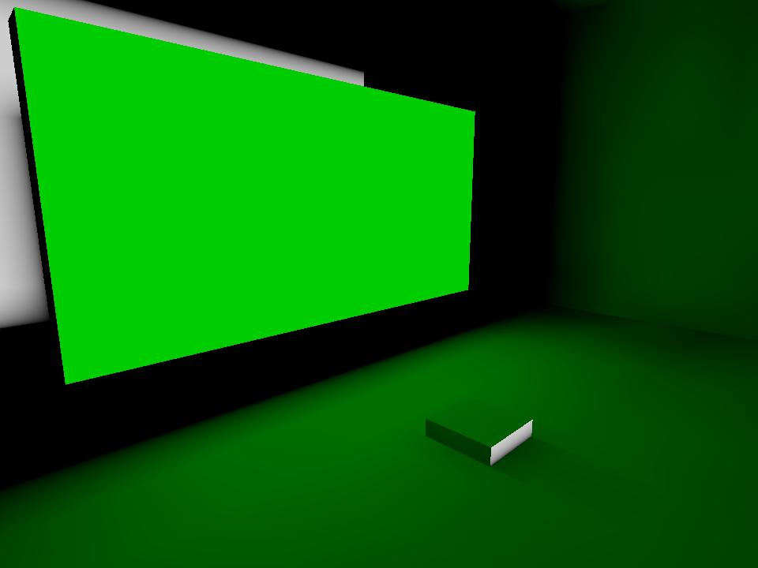

[← Manual](README.md)

# Compile and play

Build a CS:S BSP with integrated geometry, visibility, lighting and optional engine physics.
The compiler remains experimental. Check diagnostics before using a build.

## Build a playable map

1. Seal the playable area with ordinary world brushes.
2. Add a player spawn inside the sealed area.
3. Add lights, materials and any required entities.
4. Save the VMF.
5. Choose **Build → Build settings…**.
6. Choose **Build lighting → Direct LDR** or **Direct LDR + HDR**.
7. Choose **Physics bodies → CS:S engine physics** for physical collision.
8. Click **Close**, then **Compile**.
9. Open **Build details…** in the bar below the toolbar.
10. Read **Diagnostics** and repair errors.
11. Click **Play built map**.


**Run map** builds, then launches the successful result.
Game launches use `-insecure` and LAN mode (`sv_lan 1`). Steam must be running.
Game installation paths must resolve to UTF-8 paths. Unsupported paths return an explicit error.

## Controls

| Control | Location | Action |
| --- | --- | --- |
| **Build settings…** | **Build** menu | Configure the next build, including before the first build. |
| **Compile** | Toolbar | Build without launching the game. |
| **Run map** | Toolbar | Build and play. |
| **Build details…** | Build status bar | Read progress, captured settings and diagnostics. |
| **Play built map** | Build status bar | Launch the last successful compatible output. |
| **Cancel build** | Build status bar | Cancel the owned job and wait for cleanup. |
| **Stop map** | Toolbar, while the game runs | Stop the owned game process. |
| **Game log** | Toolbar | Read game output. |

Changing settings does not change a running build. Failed or cancelled builds preserve the previous published BSP.
Builds use a captured source and settings snapshot.
The compiler tracks material inputs it reads, including ordinary builds with packing
and texture shadows off. It also tracks consumed detail dictionaries, models, materials
and sprite atlases, plus surface definitions consumed by engine physics.
Changed inputs require another build before **Play built map**.
Unused runtime assets are outside this guard.

## Frame a build diagnostic

1. Click **Compile** and wait for the build to finish.
2. Open **Build details…** below the toolbar.
3. Find a diagnostic with a recorded world position.
4. Click **Frame recorded position** to move the viewport camera there.
5. Enable **Full report** to copy the complete retained report.

Framing preserves selection and map edits. Coordinates belong to that build;
they can refer to an older map state. Finish or cancel active viewport gestures
before framing.

Only the latest finished job's first 100 diagnostics are retained. You can frame
lighting receiver errors, including material-emission failures, missing-probe
cell references, entity inside-solid warnings, and point/spot source diagnostics
with valid world origins. Invalid or absent
origins, unclassified positions and model-local positions remain unavailable.
This action does not select or resolve an authored object.

## Build settings

| Setting | Use |
| --- | --- |
| **Fullbright** | Geometry checks without baked lighting. |
| **Direct LDR** | LDR lightmaps and light records. |
| **Direct LDR + HDR** | Both lighting channels and required HDR map data. |
| **Fast (conservative)** visibility | Faster, conservative visibility. |
| **Detailed (portal clipping)** visibility | More precise portal visibility. |
| **Indirect light** | Direct only, or one to four diffuse bounces. |
| **Brush smoothing angle** | Smooth ungrouped brush corners from 0° to 90°. |
| **Sampling quality** | Fast (32 directions), Balanced (128 directions), or Detailed (512 directions). |
| **Brush texture shadows** | Use supported cutout or translucent brush and terrain textures for light blocking. |
| **Colored texture shadows** | Tint baked light through admitted fractional textures; requires **Brush texture shadows** and lit mode. Default off. |
| **Bake static-prop vertex lighting** | Write supported per-vertex prop lighting. |
| **Generate reflections** | Capture and pack scene cubemaps with private CS:S clients. |
| **Pack sky assets**, **Pack liquid assets**, **Pack static prop assets** | Pack supported material and model dependencies. |

**Lighting work limit (millions)** bounds lighting work. Click **Apply work limit** after editing it.
Exceeding the allowance fails explicitly. Increase it only when the intended map and settings justify more work.
Use [build recipes](build-recipes.md) to retain settings.

## World geometry and visibility

Structural brushes divide space and seal the map. `func_detail` contributes surfaces without structural splits.
Supported hint planes, areaportals, fading portal windows and occluders control visibility.
Use [visibility clusters](visclusters.md) only where their grouping is appropriate.

The compiler removes whole internal caps between opaque solid detail brushes.
It accepts exact reversed native boundaries, or exact containment by a flat
rectangle aligned to the world axes. Each face must come from one original
brush side. Both brushes need supported drawn opaque materials on all original
faces. For containment, the larger face stays intact. Partial overlaps are not
split; this does not form a general union of detail brushes.

For a basic areaportal:

1. Put a sealing brush across an opening.
2. Use **Tie to entity… → func_areaportal**.
3. Choose **Initial State**, and name it if logic must control it.
4. Compile and inspect **Visibility areas**, **Areaportals** and diagnostics.

`func_areaportalwindow` additionally uses a rendered window brush model and distance-fade settings.
Unsupported portal shapes or bindings stop the build.

Failed BSP splits report the captured plane and volume bounds. Source candidates
are listed separately; a shared plane does not identify one brush as the cause.
Visibility-limit errors include refused work and input geometry counts.
Repeated unsupported-material warnings show affected brush/side totals and
bounded source examples.

Materials with `%compilepassbullets` compile as **GRATE** contents while retaining
their authored drawing and alpha settings. They do not seal the map. Player
collision and shots follow engine masks; CS:S bullets use grate penetration
logic. Conflicting special contents reject. Existing texture-shadow limits
still apply.

## Lighting

Point and spot lights support color, brightness, falloff and checked directions.
Use **50 percent falloff distance** and **0 percent falloff distance** for controlled attenuation.
Named lights can use supported switching and built-in patterns. Custom or unsupported appearances reject.
These point/spot styles can coexist with **Bake static-prop vertex lighting**.
The VHV base stores style 0; the game adds supported runtime direct contributions.
The editor's VHV preview stays static. Switched indirect ambient remains unsupported.
Each face supports four styles, including Normal. If this limit is exceeded,
the build error identifies the source side, sample position and light groups.
Remove unnecessary light names or reduce overlapping groups.

For spotlights, set **Pitch Yaw Roll (Y Z X)** and cone angles.
For sun, place one `light_environment` and set **Pitch**, direction, **Brightness** and **Ambient**.
Set **SunSpreadAngle** for soft sun shadows. Only sky-visible rays admit the sky contribution.


Use [material emission](material-emission.md) to bake light from supported
world/detail surfaces through **World settings… → Emission file**.
The default-off [**Exact emission visibility**](material-emission.md#exact-brush-shadows)
World control supports uniquely owned world/detail and eligible stationary
**Shadows → Yes** `func_brush` emitters with final axis-aligned faces. Shadow
casters use certified closed convex opaque brush hulls, including oblique hulls,
and actual opaque terrain triangles.
Unsupported sources, geometry or numeric bounds stop the build.
The default-off **Native direct emission** World control adds a separately
described runtime centroid approximation; static previews remain static.

### Lightmap boundary sampling

On planar brush faces, each lightmap sample covers a one-luxel square. A fully
covered square keeps its exact grid point. At a boundary, the compiler clips the
square to the face and samples the covered area's centroid. For valid
padding with no covered area, it first centers the square at the nearest face
point, then clips it.

This rule applies before origin clearance in direct and bounced lighting.
On planar faces, clearance tries the native normal first. If that direction has
no valid placement, it can check a bounded set of directions outward from the
source, based on real blocking planes. Each candidate must pass the same geometry
checks within a 0.5-unit radius. Separate blockers stay active. Invalid geometry,
unsupported arithmetic, exhausted search and resource limits remain errors; cancellation
stops the build.

### Bounced light

Choose one to four diffuse bounces under **Indirect light**.
World and terrain surfaces reflect light using their material properties.
Eligible stationary **Shadows → Yes** `func_brush` models also reflect their
baked maps into world, terrain, same/other brush models, ambient, details and
opted-in static-prop vertices. Root models and assembled children use their
compiled initial pose, including admitted opaque and enabled cutout, fractional
and colored material forms.

1. Select an eligible unnamed, unparented stationary `func_brush`.
2. Enable **Advanced properties**, set **Origin (X Y Z)** and set **Shadows** to **Yes**.
3. Choose **Direct LDR** or **Direct LDR + HDR** in **Build settings…**.
4. Choose one to four bounces under **Indirect light**. Enable **Brush texture shadows** for admitted alpha materials and **Colored texture shadows** when needed.
5. For a child model, save the child and compile its parent. For a root model, compile the current map.
6. Inspect the result through **Build details… → Baked surfaces… → Prepare → Show**.

Enable **Bake static-prop vertex lighting** for static-prop receivers.
Map and vertex receivers keep the chosen zero-to-four bounce depth. Ambient and
detail receivers retain filtered sampling of final baked maps.
Stored prop vertex colors remain style 0; supported runtime point/spot styles are separate.
Enable [**Reflect light from static props**](static-props.md#reflect-light-from-static-props)
with **Bake static-prop vertex lighting** to include eligible root-LOD static-prop
sources in the same bounce depth. The option defaults off; ambient and details
sample the final output.


Moving, parented and unrequested brush-model sources remain unavailable.
Other MDL source families remain unsupported.
More bounces increase work. Unsupported material effects report diagnostics rather than fabricated reflectance.

### Normal-map lighting

Supported normal maps alter baked lighting. Material albedo and declared reflectivity also affect transport.
Normal-map lighting uses four maps per baked face. Sun and sky visibility is shared across them at each surface sample.
The compiler evaluates a checked material subset; it does not simulate every native shader.
Missing required texture metrics and malformed material declarations fail the build.

### HDR channels

**Direct LDR + HDR** writes separate LDR and HDR lighting data.
The game must enable full HDR to display the HDR channel.
See [exposure controllers](hdr-exposure.md), [sky assets](sky.md) and [reflections](reflections.md).

### Brush texture shadows

Enable **Brush texture shadows** for supported alpha-tested or translucent
`LightmappedGeneric` materials on world/detail brushes and terrain, plus eligible
stationary brush models. Base-texture alpha affects direct and indirect lighting,
sky, ambient probes, detail/prop vertex receivers and material-emission transport.
Coverage adds across casters up to full blocking. Enable **Colored texture shadows**
to use base RGB for per-channel coverage through fractional textures; white,
clear, opaque and binary-cutout behavior stays unchanged.
Open **Build details… → Baked surfaces…**, then **Prepare** and **Show** to inspect
the compiled receiver lighting and supported texture opacity.
See [brush texture shadows](brush-texture-shadows.md) for setup and limits.
See [prop mesh shadows](prop-shadows.md) for static models.

### Model ambient lighting

Ambient probes support model illumination.

A point below terrain can be used when its upward ray meets a fully blocking
world-brush entry before the terrain. This uses the selected texture shadow
settings. Sky and brush models do not certify cover; enabled texture shadows
reject partial coverage. Terrain remains a sheet; it does not seal a map.

Placement first checks the existing centre and coarse grid. If none is accepted,
it checks two bounded shells near cell boundaries and keeps the first accepted
point. The shells add up to 448 attempts, for a maximum of 513 total. This runs
in all lit sampling modes, without **Refine ambient probes**. The extra search does not change a nonempty initial pool. Every extra
point uses the same cell, brush, prop and terrain checks.

1. Open **Build settings…** and choose **Direct LDR** or **Direct LDR + HDR**.
2. Set **Sampling quality** to **Balanced (128 directions)** or **Detailed (512 directions)**.
3. Enable **Refine ambient probes**, then compile.

Refinement evaluates up to twice as many candidate positions while keeping the
retained sample count and spacing. Balanced retains up to four probes per open
world leaf; Detailed retains up to eight. It can increase build work and does
not guarantee an improvement.

If no candidate is accepted, diagnostics identify the channel, leaf and cluster.
They count first rejections by cell bounds, world brushes, prop bounds and terrain
above. Up to eight leaf locations are shown per channel; the summary reports any
omitted locations. **Frame recorded position** goes to the cell's reference point,
not to a valid probe. The warning does not prove that every possible native grid
position is blocked.

Per-vertex static-prop lighting is a separate option; see [static props](static-props.md).

## Physics

Choose **CS:S engine physics** to generate supported world, terrain and brush-model collision.
**No physics bodies** omits those bodies explicitly.
See [physics](physics.md) for mass controls and [water](water.md) for fluid behavior.

## Brush entities and pivots

Supported brush entities retain runtime geometry and lightmaps.
Use an `origin` material brush to author a local pivot where supported.
The compiler consumes that helper instead of displaying or colliding with it.

Initial brush-model rotation uses the authored Source orientation and pivot.
Supported doors, rotating doors, platforms and removable restraints retain their checked runtime settings.
Use ordinary [connections](entities.md#connections) to drive inputs such as `StartForward`, `Stop`, `SetPosition` and `Kill`.
Unsupported model classes, parenting or initial poses fail explicitly.

## Terrain (displacements)

Supported powers 2–4 compile with baked lighting, native neighbors, LOD snapping and optional physics.
Full and exact half-edge links can connect mixed grid sizes.
Terrain sheets do not seal the map. Holes and runtime brush-model terrain remain unsupported.
Supported texture opacity uses **Brush texture shadows**; painted terrain blend
values do not control opacity or remove collision geometry.
See [terrain](terrain.md).

## Water

Horizontal structural-world water supports depth metadata, inward surfaces and optional fluid physics.
Currents and damping are map-wide physical controls.
See [water](water.md).

## Static props

Supported `prop_static` models produce static-prop records, leaf references, collision choices and ambient lighting.
Optional vertex lighting and asset packing have stricter material and model requirements.
See [static props](static-props.md).

## Cubemaps

`env_cubemap` helpers define reflection samples; records alone are not captured reflections.
Enable **Generate reflections** for packed LDR or LDR+HDR textures.
See [reflections](reflections.md) and [manual face binding](cubemap-faces.md).

## Overlays

Supported overlays bind to compiled world/detail and terrain surfaces.
The viewport shows authoring outlines; the game shows the material projection.
See [overlays](overlays.md).

## Referenced assemblies

Saved child VMFs compile through checked instance transforms.
Keep child sources available, then inspect dependency errors before building.
See [instances](instances.md) for supported entities and limitations.

## Compile regions

Use **Compile region…** for a bounded build without deleting source objects.
The region must retain complete required geometry and bindings.
See [compile regions](compile-regions.md).

## Coordinate limits

Keep compiled positions within **±16,384 units**.
The editor can retain larger coordinates, but that does not make them compilable.
Geometry, split, lightmap, visibility and lighting work budgets also apply.
Over-budget builds fail and preserve previous output.
If the compiler cannot reconstruct a crossed brush split, the build stops with an error.

## Leaks and pointfiles

A leak connects the playable interior to outside space.
Read the build diagnostic, then use **Leak path** to display the route.
For an external pointfile, open **Pointfile…**, click **Load**, then **Frame path**.
Use **Previous**, **Next** and **Go** to inspect points. **Unload path** removes the guide.

## Inspect baked output

Open **Build details…** after a lit build:

- [**Inspect baked lightmaps…**](baked-lightmaps.md) shows face samples and source contributors.
- [**Inspect baked prop vertices…**](baked-prop-vertices.md) shows prop vertex colors.
- [**Inspect compiled lights…**](compiled-lights.md) shows emitted light records.
- [**Compiled details…**](compiled-details.md) shows final detail placements.

Changed source or settings can make inspection stale. Build again before treating it as current.

## Standalone compiler

```sh
cargo run -j8 -p compiler --bin hammerr-compile -- \
  map.vmf --game /path/to/cstrike/gameinfo.txt
```

Use `--help` for available settings. CLI, editor and MCP builds use the same compiler.
