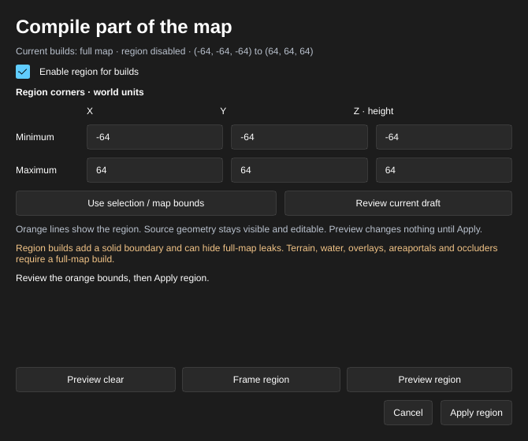
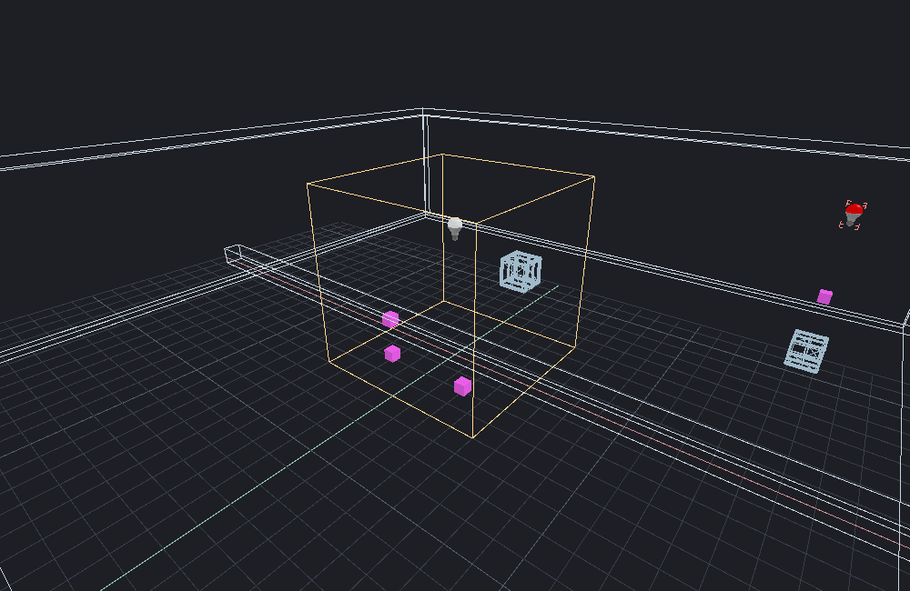

[← Manual](README.md)

# Compile regions

Build a sealed part of a brush map while keeping the full source editable.
The compiler adds six solid boundary slabs to its temporary input; it never
inserts them into your map.

## Choose a region

1. Click **Compile region…** on the toolbar. An enabled region changes this
   label to **Region build…**; invalid active metadata shows **Region error…**.
2. Enter **Minimum** and **Maximum** X, Y and **Z · height** corners, or click
   **Use selection / map bounds**. Check **Enable region for builds**.
3. Click **Preview region**. Orange lines show the bounds while all source
   geometry stays visible. **Frame region** moves the editor camera to them.
4. Review the corners, then click **Apply region**. This is one Undo step.
   **Cancel**, Escape or closing the window discards only the draft you own.
5. Click **Compile** or **Run Map**. Open **Build details…** to inspect
   **Compile scope at build start** and the inclusion warning. A running build
   keeps its original bounds if you edit the region afterward.
6. Save the VMF to retain its native cordon metadata.

**Review current draft** loads the current shared draft, including one created
by an agent. Applying or cancelling it requires explicit review; a replacement
draft cannot be cancelled by an older window token. Any map edit makes a
pending draft stale. Preview it again before applying.

## Return to full-map builds

1. Open **Region build…**, uncheck **Enable region for builds**, then click
   **Preview region** and **Apply region**. The bounds remain saved.
2. To remove the saved metadata instead, click **Preview clear**, review the
   explanation, then **Apply region**. **Cancel** keeps it.
3. Compile again with the region disabled to check full-map leaks.

## Inclusion and limits

- One axis-aligned region, at least 16 units wide on every axis. Corners must
  stay within ±16,368 units so the exterior 16-unit boundary fits Source bounds.
- Intersecting world and detail brushes stay whole. Runtime brush entities
  stay whole when their resolved pivot is inside; origin brushes take priority
  over explicit origins. Point entities use their origins. Originless global
  entities and the sun remain. Hidden objects remain excluded.
- References are retained unchanged. Targets outside the region may be absent.
  The solid boundary can hide leaks, block views and change light or sound;
  region output is for partial-map work.
- Visible terrain, overlays, areaportals, areaportal windows, occluders,
  instances and visibility clusters require full-map builds. Retained water or
  slime is also unsupported. These cases stop compilation and preserve prior
  output rather than producing an incomplete region.
- At most 16,384 source objects, 65,536 source sides and 128 sides per brush.
  Bounds, source IDs and the mounted solid nodraw material must be valid.
- Imported legacy cordons and a single enabled box under active plural cordons
  can compile. Plural or multiple records need **Preview clear** and
  **Apply region** before authoring a replacement. Clearing is undoable.
- Unapplied drafts never affect compilation. Region settings belong to the
  VMF, independently of named build recipes.
