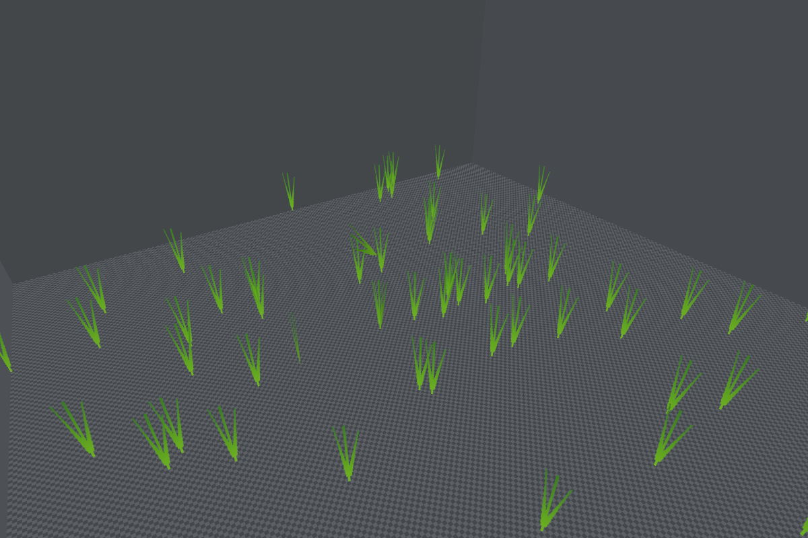
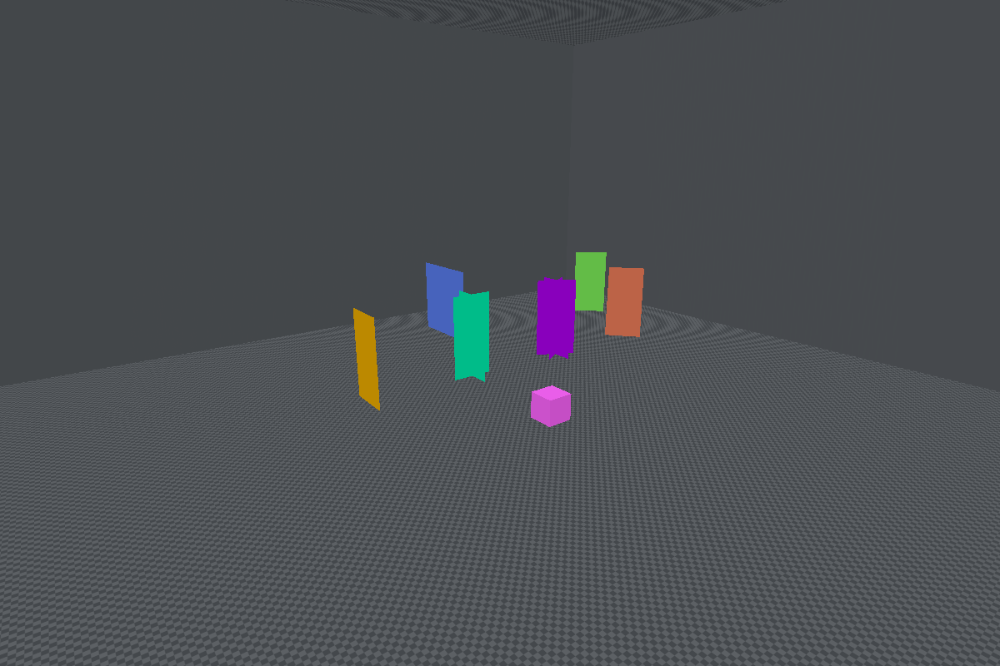
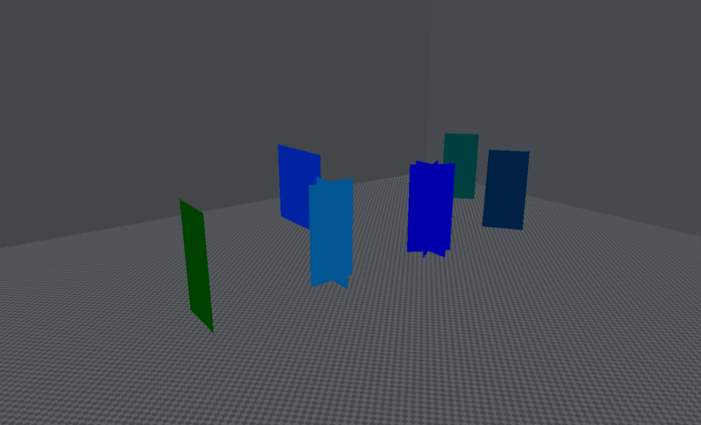

[← Manual](README.md)

# Final compiled details

Show the final models, cards and cross/tri shapes from a successful build.
The layer includes material-scattered details and uses their native BSP placements.

1. Click **Compile**.
2. Open **Build details… → Compiled details…**. You can also use **Build settings… → Compiled details…**.
3. Click **Prepare details**. Use **Cancel preparation** to stop the reader.
4. Click **Show details**. A missing asset or unsupported material stops the complete layer.
5. Set **Preview lighting → Baked LDR** to show stored static colors. Use **Editor shading** for the normal preview.
6. Use **Refresh inspection**, **Previous records** and **Next records** to inspect placements and stored lighting.
7. Use **Hide details** to keep the preparation, or **Clear details** to release it.

Full and vertical cards face the current camera. **Prepare details** and **Clear details** reset lighting to **Editor shading**.

## Preview baked styles and HDR

1. Open **Build settings…** and choose **Direct LDR** or **Direct LDR + HDR**.
2. Compile, prepare and show the details.
3. Set **Preview lighting → Baked radiance**.
4. Choose **Lighting channel** and set **Exposure (EV)**.
5. Select a **Style** and set **Style gain**. Repeat for other styles.
6. Click **Apply lighting**. A failed update keeps the previous settings.

Styles without a gain are off. Gains range from 0 to 2; exposure ranges from
−8 to +8 EV. The preview multiplies the linear material colour by stored light,
then applies exposure and Reinhard tone mapping. It keeps values above 1 until
that step. Authored-light and sky exposure controls remain separate.

A dual build stores one shared HDR base colour. **LDR** selects its LDR style
extras; it cannot recover a separate LDR base. Inspection reports the base
source, available channels, raw style records and effective linear colour.
**Prepare details** and **Clear details** reset all preview lighting settings.

## Limits

- Compile again after map, build-setting or tracked asset changes. Then prepare the new output.
- Details do not affect authored selection, picking or Undo. Native ordinals belong to one build.
- Editing tools, geometry drafts and Faces mode hide the layer. Working region filters whole native props; authored hide/show stays separate.
- Only the current session's retained BSP is eligible. Arbitrary BSP import is unavailable.
- Models use skin 0 and body 0. Materials require supported static `UnlitGeneric` textures.
- **Baked LDR** uses the native base color with static style 0 at full weight. A record with runtime light styles stops the complete mode; the previous mode stays active.
- **Baked LDR** clamps colours to an 8-bit display range. **Baked radiance** needs a lit build; HDR needs a dual-channel build. Missing selected style tables and invalid records reject.
- Static gains do not animate runtime light patterns. Dynamic lights, native exposure adaptation and exact native appearance are not simulated.
- Sway, avoidance, runtime mirroring and fading are not displayed.
- A changed model still in use requires **Reload models**, another build and preparation.
- The layer accepts at most 16,384 records, 64 model assets and 128 materials. Exceeded asset or geometry budgets fail explicitly.

Use `inspect_compiled_details` and `set_compiled_details` through MCP.
