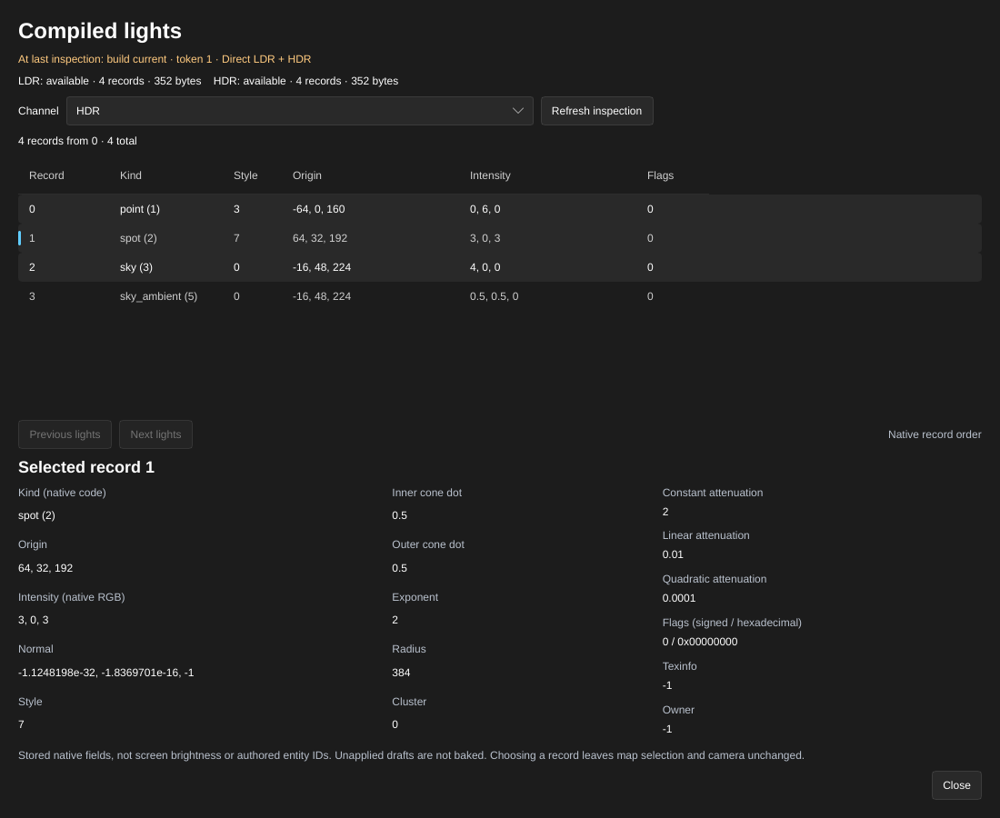

[← Manual](README.md)

# Compiled lights

Inspect the native light records stored in the last successful build. Compare
LDR and HDR records, positions, intensity, light styles and attenuation without
launching the game.

1. Open **Build settings…** and set **Build lighting** to **Direct LDR** or
   **Direct LDR + HDR**. Close the window and click **Compile**.
2. Open **Build details…** and click **Inspect compiled lights…**. The same
   inspector is available from **Build settings…** before the first build; it
   explains when no successful owned output is available.
3. Check the build status and token. Choose **Channel** as **LDR** or **HDR**.
   Each channel reports whether its table is available and how many records
   it contains.
4. Read the **Record**, **Kind**, **Style**, **Origin**, **Intensity** and
   **Flags** columns. **Previous lights** and **Next lights** move through
   pages of up to 64 records in native order.
5. Select a row to read every stored field, including normal, cone dots,
   exponent, radius, attenuation, cluster, texinfo and owner. Choosing a row
   changes neither the map selection nor the camera.
6. After changing the map, settings or tracked sources, click **Refresh
   inspection** to read intact historical output, or compile again for current
   output. **Close** or Escape closes the inspector.

Limits:

- Inspection reads only this Session's last successful owned BSP. It preserves
  source, history, selection, camera, settings and pending drafts. Unapplied
  drafts are not baked; the displayed-geometry warning specifically concerns
  geometry previews, not every kind of draft.
- Record numbers belong to one build and channel. They are not authored entity
  IDs. Changing the build invalidates retained pages and selection; refresh
  before inspecting the new output. Columns retain native record order.
- Values are the stored native fields, without intensity normalization, display
  color conversion or exposure. They do not measure screen brightness. Unknown
  kind codes, flags and signed sentinel values remain visible. **Owner**,
  **Cluster** and **Texinfo** do not establish an authored association.
- Fullbright has no baked light tables. Direct LDR has no baked HDR table. A
  valid lit table may contain zero records; this does not establish whether the
  game can activate HDR or which channel it uses. Missing channels never fall
  back to another channel.
- Intact stale output remains readable as historical data. Missing, replaced,
  corrupt or unverifiable output clears the table and details. Restoring old
  bytes alone does not restore ownership; compile again.
- Currentness covers the committed map, captured settings, content changes and
  retained source guards. It is not a complete certificate of every world
  material or texture on disk. Asset directories are checked conservatively;
  unrelated changes in a guarded directory can also mark output stale.
- The displayed status describes the last inspection. External files are checked
  again when refreshing, changing pages/channels or selecting a record; they are
  not continuously watched by the window.
- Each native table has at most 8,192 records. Reports are at most 256 KiB;
  source observation, BSP reads and decoded allocations are bounded. Both
  channels are checked before returning a page. Malformed metadata, invalid
  record sizes and nonfinite fields produce explicit errors instead of partial
  rows or invented values. No native light-selection or viewport shading is
  provided.

The shared MCP operation is `inspect_compiled_world_lights`. Start with `{}`,
then pass the returned `build.token` as `build_token` for retained page and
channel requests. See [MCP](mcp.md#compiled-light-inspection).
