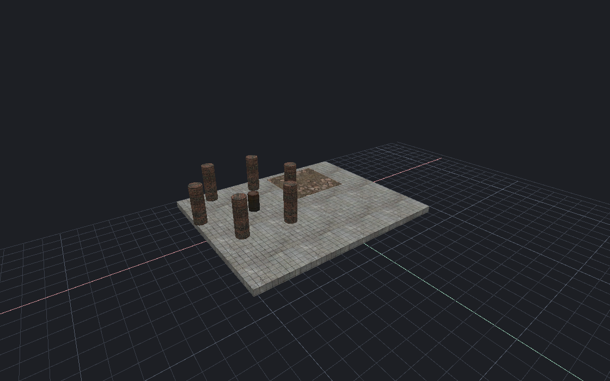
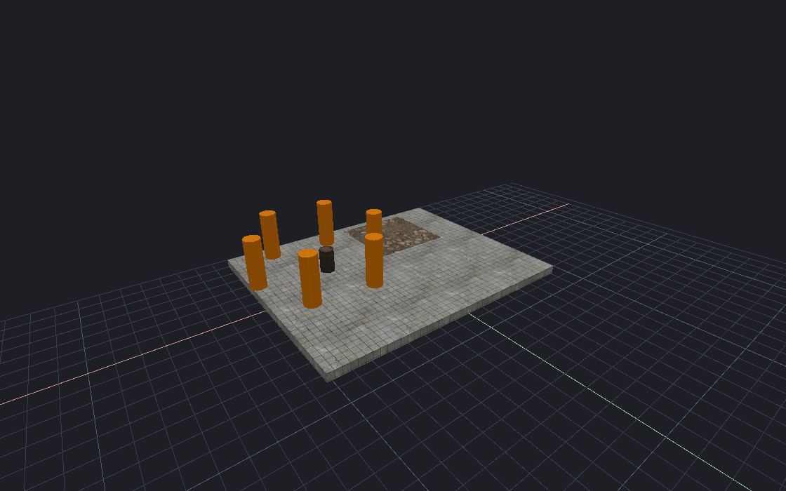

[← Manual](README.md)

# Content profiles

Save named CS:S content, entity definitions, build settings and game paths.
Apply a profile to one open document. The map and Undo history stay intact.

## Save a profile

1. Choose **File → Content profiles…**.
2. Click **Use current content**, or enter the content paths.
3. Enter a **Profile name** and the full **gameinfo.txt** path.
4. Set optional paths as needed:

   | Field | Purpose |
   | --- | --- |
   | **FGD (optional)** | Entity definitions. Empty uses discovery for the selected content. |
   | **CS:S root** | Installed game folder containing the CS:S client. Set this for a detached mod folder. |
   | **Steam root** | Steam client folder. Empty uses normal discovery. |

5. To change the captured build settings, open **Build settings…**, then click **Use current Build settings**.
6. Click **Save new**. To update a saved profile, select it and click **Replace selected**.

## Switch content

1. Select a saved profile. Review its paths and captured build settings.
2. Apply or cancel pending map edits. Stop managed games and sound previews. Wait for active builds and content work.
3. Click **Apply**. The current-content label changes after validation succeeds.

Apply loads the mounts and definitions together. It clears old content previews
and compiled-output ownership. Build again before playing the map.
A refused Apply keeps the previous content and map.

| CS:S content | Mod content |
| --- | --- |
|  |  |

## Manage profiles

- **Use current content** copies the current paths into the form.
- **Reload** reads saved profiles again after outside changes.
- **Remove** deletes the selected saved entry. It does not change applied content or delete assets.
- **Close** closes the window. It does not apply the form.

## Limits

- Keep up to 32 profiles. Names must be unique.
- Use absolute paths and a valid installed CS:S client. Steam need not be running to save or apply ordinary editing profiles.
- Optional native build features require their supported platform and runtime files.
- Profiles share one saved list. Applied content belongs to the selected document.
- Outside file changes block stale actions. Use **Reload** before trying again.
- Loading a profile does not launch a game or change map entities.

Use [Recent maps](recent-maps.md) to reopen a map with its captured context.

MCP: `get_content_profiles`, `save_content_profile`, `apply_content_profile`,
`remove_content_profile` and `reload_content_profiles`.

<!-- page-nav -->

---

[← Recent maps](recent-maps.md) · [Manual](README.md) · [History →](history.md)
