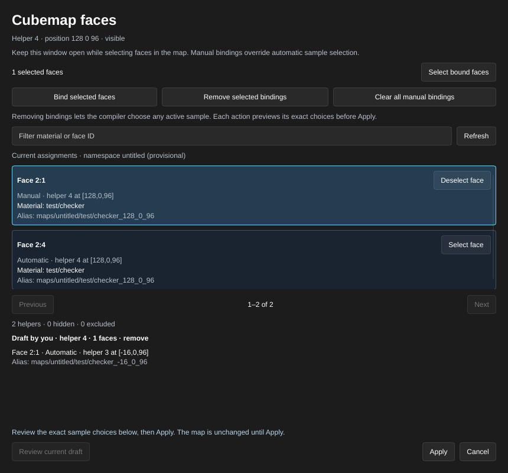

[← Manual](README.md)

# Cubemap faces

Choose which `env_cubemap` sample a reflective face uses. The inspector shows
the same manual and automatic assignments used by the compiler, including
the chosen sample position, original material and generated material alias.
Inspection and binding drafts are unavailable when the map contains a visible
instance reference: authored faces do not describe the
assembled geometry. This does not prevent [reflection generation](reflections.md)
with root-map or automatic child helpers.

1. Select one visible `env_cubemap` entity and choose **Cubemap faces…**.
2. Keep the window open and select faces in the map. **Select face** in the
   assignment list toggles a face in the shared selection. **Select bound
   faces** selects this helper's complete manual binding list.
3. Choose **Bind selected faces** to preview assigning those faces to this
   helper. Existing manual ownership by another helper must be removed first.
4. Review the draft's helper, face count and exact sample choices, then choose
   **Apply**. The change updates the standard `sides` property in one Undo step.
   **Cancel** or Escape discards only this window's owned draft.
5. Use **Remove selected bindings** to remove selected faces from this helper.
   **Clear all manual bindings** previews removal of its complete inspected
   list. Removed faces use automatic selection, which may choose another
   active helper. Review the new choices before **Apply**.
6. Choose **Refresh** to update assignments after map, material or output-name
   changes. Enter a material or face ID in **Filter material or face ID**, then
   choose **Refresh**. **Previous** and **Next** page through this helper's
   assignments.

The draft label identifies its current owner. **Review current draft** takes
ownership and issues a new token; the previous owner cannot apply or cancel
it. Changes to the map, face selection, mounted content or output namespace
make a draft stale. Preview the intended operation again before applying it.
Adding a visible instance reference keeps the current draft but makes it invalid;
its owner can still cancel it.
Hidden references are omitted from compilation and leave root-map inspection
and binding authoring available without reading their child files.

The same operations are available through `get_cubemap_bindings` and
`set_cubemap_bindings`. Inspection and previews do not capture reflections or
require reflection generation to be enabled. Build and capture settings are
described in [Generated reflections](reflections.md).

## Limits

- Automatic assignment uses source polygons, world-space brush-model pivots
  and the compiler's front-side preference. It does not test visibility or
  occlusion between a face and its sample.
- Automatic assignment supports bounded initial rotations of unparented `func_brush` models. It transforms both the source polygon center and face normal into the initial game pose, using the emitted native-float origin. The viewport still shows authored geometry.
- Nonzero rotations on other classes, parenting, ambiguous pose fields and models outside ±16,384 units reject automatic assignment with an entity/side diagnostic. Manual bindings remain explicit choices and do not need automatic pose selection. See [Initial brush-model rotation](compile-and-play.md#initial-brush-model-rotation) for pose syntax.
- Assignment has separate four-million-unit limits for pose preparation and face/sample comparisons. Exceeded limits fail explicitly; they do not select an unrotated substitute.
- Manual targets must be unique, visible authored faces that survive the
  committed compile region. Missing faces, ambiguous IDs, malformed lists,
  duplicate owners and non-emitting targets reject with a diagnostic.
  With visible instance references, existing root `sides` lists may name only
  original root-map face IDs; generated child IDs cannot satisfy missing targets.
  Child `env_cubemap` samples require absent or whitespace-only `sides` and use
  automatic assignment. See [Referenced assemblies](instances.md).
- Another authored helper's manual ownership also blocks reassignment when
  that helper is hidden or excluded by the compile region. Unhide it or
  restore its region, remove the old binding explicitly, then bind the face
  to its new helper. The compiler's active sample choices are unchanged.
- One helper can have up to 1,024 manual faces in this workflow; one preview
  accepts up to 1,024 explicit faces. MCP inspection pages contain up to 256
  assignments. The window shows 20 assignments per page.
- Assignment inspection uses the current supported reflection planner and
  material assets. It may report capture-planner limits, invalid helper
  positions or unsupported materials before a binding can be committed.
- Unnamed maps show provisional `untitled` aliases. Saving or changing the
  output basename recomputes aliases; **Refresh** shows the current names.
- Routine window updates use cached inspection rows. **Refresh**, paging,
  preview and Apply explicitly invoke the authoritative planner.
- Raw entity property editing remains available. Dedicated binding previews
  validate the resulting compiler plan before Apply.
