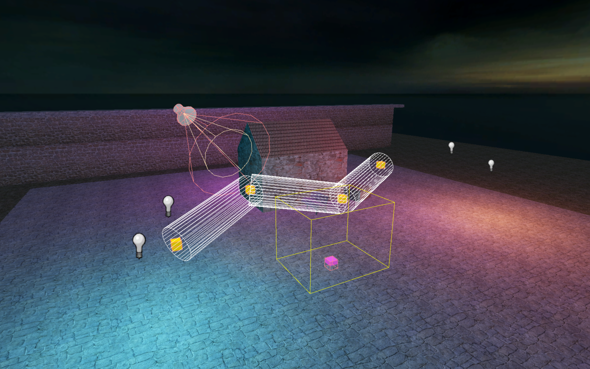
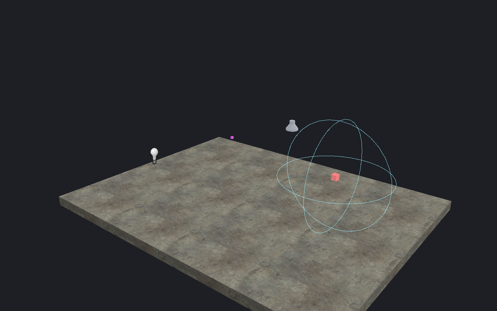
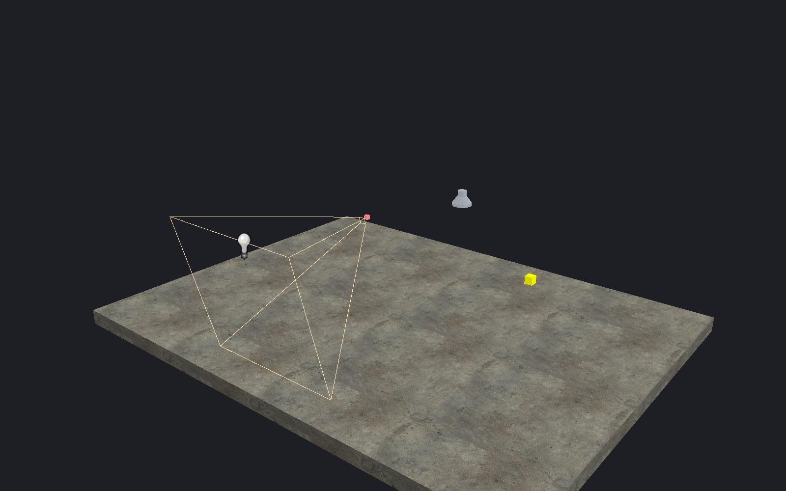
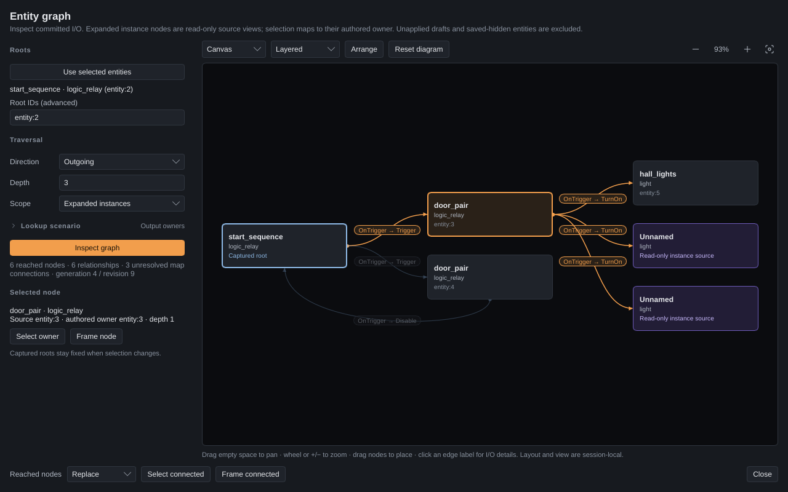

[← Manual](README.md)

# Entities and logic

Place game objects, edit their properties and connect outputs to inputs.

## Place an entity

1. Click **Entity…**.
2. Search for a class.
3. Set its position and initial properties.
4. Click **Place entity**.

For surface placement, choose **Pick surface…**, set **Offset**, and optionally enable **Align local up to surface**.
Pick the surface, inspect the bounds, then click **Apply entity**.

## Edit properties

1. Select an entity.
2. Change labeled fields in the inspector.
3. Use sliders, color pickers and asset browsers where available.
4. Use **Advanced properties** for additional raw keys.

For a batch, open **Edit selected entity properties…**.
Blank mixed fields preserve each entity's value. Click **Apply properties** to commit the draft.

### Colors

1. Open a color picker in the inspector or **Edit selected entity properties…**.
2. Choose **RGB**, **HSV** or **HSL**, then adjust the channels. **Brightness** stays separate.
3. Under **Saved colors**, choose **Palette source → User palette** for colors shared across maps, or **Map palette** for colors carried in this VMF.
4. Enter **Saved color name**, then click **Save new color**. To change a selected entry, use **Replace saved color**, **Rename saved color** or **Delete saved color**. Renaming uses the new text in **Saved color name**.
5. Select an entry and click **Use saved color** to load its exact color into the picker. Click **Apply color** to apply it, or **Cancel** to leave the entity unchanged. In a property draft, finish with **Apply properties**.
6. Save the map to persist its **Map palette**. **Undo** and **Redo** restore map palette changes independently of color/property changes. **User palette** writes persist immediately.

Cancelling a color or property draft keeps explicit palette edits. Switching **Palette source** and using saved colors preserve brightness. Each source supports 16 colors, with exact case-sensitive names of 1–48 characters and at most 128 UTF-8 bytes, without surrounding whitespace or control characters.

Use **Reload palette** after external changes to user storage. **Refresh palette** rereads the current map choices after map/history changes. Malformed or unsupported palette data stays preserved and unavailable; it is never replaced with an empty palette. Finish other drafts and viewport gestures before changing the map palette. Its own current property picker can save palette changes while retaining the pending property edits; ordinary history navigation can make those property edits stale.

## Lights and helpers

Place `light`, `light_spot` or `light_environment` for point, spot or sun lighting.
Set color, brightness, falloff and direction through entity properties.
Spot cones, resource icons and supported FGD guides show placement and orientation.
For reusable child maps, see [light colors per reference](instances.md#light-colors-per-reference).

The **Entity images**, **Sprite resources** and **Entity model guides** viewport switches control resource guides independently.
**Authored models** and **Entity helpers** control mesh and ordinary guide display.
Selection outlines, exact bounds and known error markers remain available.
See [Helpers and selection presentation](selection-presentation.md).

### Inspect property guides

1. Select an entity and enable **Overlays → Entity helpers**.
2. Enable **Advanced properties** to read the helper summary, defaulted fields and unavailable-guide reasons.
3. Edit the existing property fields, such as **Mins** and **Maxs** on `info_node_link_controller`, or **Path radius** on `path_track`.

Wire boxes use offsets from the point origin or brush bounds center and remain
world-aligned. Typed `origin`, `vecline` and `axis` guides use absolute world
coordinates. Cylinders read each radius from its resolved endpoint entity.
Declared lines and typed property guides can accompany brush and model geometry.
Brush line endpoints use bounded brush centers. Typed-coordinate markers are
fixed wire crosses; edit their existing property fields. Visual guide bounds do
not change object bounds, picking or framing.

### Inspect a property radius

Place `env_firesensor`, set **Radius**, then select it to inspect its radius guide.
Zero or negative values suppress the guide with an explanation.

### Inspect a Source projector guide

1. Place and select `env_projectedtexture`.
2. Enable **Advanced properties**.
3. Set **FOV**, **NearZ**, **FarZ** and **Pitch Yaw Roll (Y Z X)**.
4. Check **Source projector guide** in the helper summary.

The guide shows bounds, not a rendered projected light.
Supported FGD line, node-link, sphere, frustum, icon and model helpers follow their declared properties.
Line and cylinder targets use unique literal names, ignoring ASCII letter case.
Missing or ambiguous targets report errors rather than invented endpoints.
Zero-argument `studio()` and `studioprop()` use the normal authored-model
workflow and **Authored models** switch. An unset optional model stays unset.
Authored model fields, declared model properties and specialized helpers retain
precedence over literal FGD model guides. An authored-model error stays explicit;
another helper asset never replaces it.

## Load extended entity definitions

1. Create a root FGD that includes the game FGD and extensions.
2. Open **Entity… → Load FGD…**.
3. Choose the root FGD.
4. Read **Loaded FGD catalog** for material-exclusion, automatic-group and
   version declaration counts and freshness warnings. Scroll to read the
   complete status.
5. Search for the updated class.

After changing the root or included definitions, use
**File → Content refresh… → Reload content** to refresh the current content
configuration together. Use **Load FGD…** to choose a different root.
`@ExtendClass base(...)` uses the base members present at its declaration.
Earlier extensions can update those property values; later-added members and
base helper lists are not inherited. Direct extension helpers apply to the
target. Missing bases and replaced captured members report errors.
Invalid numeric flag values stop FGD loading.
**Loaded FGD catalog** reports the effective **FGD map size**; that metadata does not override compiler bounds.
FGDs without `@version`, including ordinary CS:S definitions, remain valid.
Declared versions are compared with the verified Hammer++ resource version 9
for freshness diagnostics. They do not select a different grammar or certify
compatibility with another game or editor.
Use MCP `get_entity_definitions` to inspect individual declarations, diagnostics
and source locations.

Loaded `@AutoVisGroup` entries appear in
[Working region → Categories and exclusions](working-region.md#categories-and-exclusions).
Loaded `@MaterialExclusion` directory rules are optional in the
[material browser](textures.md#use-fgd-directory-rules). Neither changes saved
map visibility or compilation. Unknown catalog directives report load errors
instead of being silently skipped.

## Brush entities

1. Select brushes.
2. Click **Tie to entity…**.
3. Choose a class, then click **Tie selected brushes to entity**.

Use **Move to world** to return eligible brush entities to the world.
For class changes, model choices, connections and names across selected sets,
see [Bulk entity workflows](bulk-entities.md).
An `origin` material brush can define a supported runtime pivot; see [compilation](compile-and-play.md#brush-entities-and-pivots).

## Connections

1. Select an entity and open **Connections…**.
2. Click **Add connection** or **Edit connection**.
3. Choose the output, target and input.
4. Set the parameter and delay.
5. Choose **Unlimited**, **Once** or **Specific count**.
6. Click **Apply connection**.

**Cancel** discards the unfinished connection.
FGD suggestions describe available names and parameters; they do not prove runtime support.

## Inspect connected logic

1. Open **Entity graph…**.
2. Select entities in the map, then click **Use selected entities**. Their captured names and classes appear above the lists; **Root IDs (advanced)** also accepts explicit IDs.
3. Choose **Direction**: **Outgoing**, **Incoming** or **Both**. Set **Depth** from 1 to 16; the default is 2. Choose **Scope → Authored** or **Expanded instances**.
4. Optionally expand **Lookup scenario** and enter an **Activator ID** or **Caller ID**, using a source ID shown in node details. A blank **Caller ID** uses each output's owner; **Unbound caller** leaves it unresolved.
5. Click **Inspect graph**.
6. In **Canvas**, choose **Layered** or **Grid**, then click **Arrange**. Drag empty space to pan, use the wheel or **+**/**−** to zoom, click **Fit graph** to show every node, and drag nodes to place them. Click a node or an edge label for details; relationships of the chosen node are highlighted. **Select owner** selects that node's authored owner; **Frame node** frames its prepared position. **Reset diagram** restores the initial layout and view.
7. In **List**, choose **Nodes**, **Relationships** or **Unresolved (whole map)**. Use **Search rows**, then **Inspect graph**, to filter the lists. **Previous page** and **Next page** display at most 64 rows.
8. Choose **Replace**, **Add**, **Remove** or **Toggle**, then click **Select connected** to act on every reached node, including roots. Search and pages do not restrict this selection. **Frame connected** frames the complete reached set while preserving selection.

Name matches reach every matching entity before classname fallback is considered. Patterns follow installed CS:S byte matching, rather than general glob syntax. Each relationship reports its lookup rule; distinct stored connections and fan-out targets remain separate. Cycles are retained. `!self` and `!caller` use the scenario caller; `!activator` needs an explicit scenario identity. Player, picker and other live-game identities remain unresolved. The scenario describes lookup without executing inputs or simulating event propagation.

**Expanded instances** uses checked [instance preparation](instances.md), including child name fixups and source provenance. Selecting an instance helper as a root includes its prepared child entities. Child nodes are read-only; selecting them selects the original root helper. Framing uses prepared transforms and refuses unresolved brush-model pivots or missing model presentation. Unsupported child content refuses expanded inspection instead of falling back to the authored graph.

Saved **Hide** entities and unapplied drafts are excluded; temporary editor exclusions do not change connectivity. Unresolved rows cover the whole admitted source scope, independently of the chosen roots. Finish geometry drafts and active viewport gestures before selection or framing. Map, scenario or referenced-source changes require **Inspect graph** again. Diagram positions and view are session-local and reset when the graph snapshot changes.

## Select by class

1. Open **Object report…**.
2. Enter a class in **Entity class contains…**, for example `light`.
3. Enable **Exact class** to exclude classes such as `light_environment`.
4. Inspect the rows, then use **Select all matches**.

For multiple exact classes, enter one full name per line in **Classes (any exact)**,
for example `light` and `light_spot` on separate lines. Any listed name can match;
**Entity class contains…** and other filters still apply. Clear the field to
remove the set. Class sets do not expand inheritance or wildcard patterns.

Class matching ignores letter case. With **Exact class** off, it matches part
of the class name.

## Rename safely

1. Open **References and rename…** for the selected entity.
2. Review incoming references and connections.
3. Enter the new name.
4. Check **What will change**.
5. Click **Apply rename**.

Exact references change in the same undo step. Ambiguous or unsupported references require explicit correction.

## World settings

Open **World settings…** to edit map-wide properties such as sky, water current and damping.
Click **Apply properties** to keep the draft, or **Cancel** to discard it.

## Limits

- The graph describes authored or prepared I/O; it does not execute inputs, predict runtime spawning or establish input support.
- Graph admission caps the chosen source scope at 8,192 entities, 32,768 stored connections and 8 MiB of inspected source text. Individual labels/connection fields cap at 4,096 bytes. Expanded inspection also uses the existing instance preparation limits. Work and storage limits can refuse smaller maps explicitly.
- A traversal reaches at most 2,048 nodes and 8,192 relationships within the chosen depth, including boundary cycles. Actions recompute the complete traversal; a page is never treated as the full selection.
- The desktop **Canvas** admits at most 512 nodes and 2,048 relationships. Larger traversals remain available through **List** and connected selection/framing; no partial canvas is drawn. Zoom ranges from 10% to 400%.
- An instance containing only world brushes supplies no entity graph roots. Expanded framing requires bounds for every requested node and may refuse when inspection and selection are available.
- Custom classes and raw properties can be retained without being supported by the compiler.
- Helper images, meshes and bounds do not establish game collision or runtime appearance.
- Guides cover checked static properties, not parenting, animation, simulation or runtime I/O.
- Declared line guides support up to 64 declarations per source and 128 displayed lines per scene.
- Wildcard helper targets, unsupported binding aliases and malformed declarations remain unavailable with explicit reasons.
- Use **Reload material assets** for changed icons, **Reload models** for changed model geometry, or **File → Content refresh… → Reload content** for mounts and FGD definitions together.
- Changed source or replaced drafts require a fresh review before applying edits.

<!-- page-nav -->

---

[← Sounds](sounds.md) · [Manual](README.md) · [Bulk entity workflows →](bulk-entities.md)
