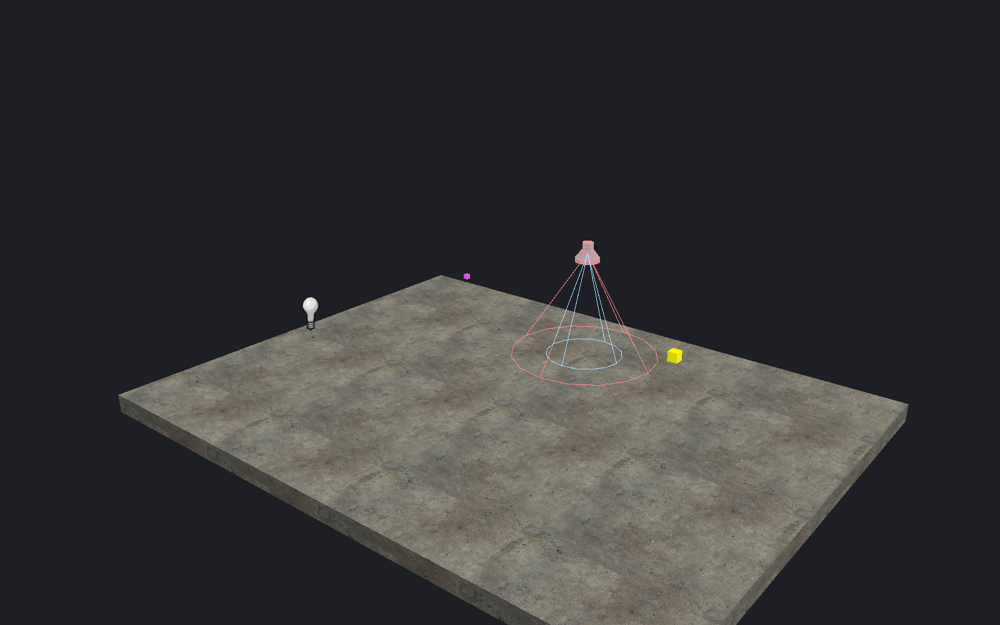
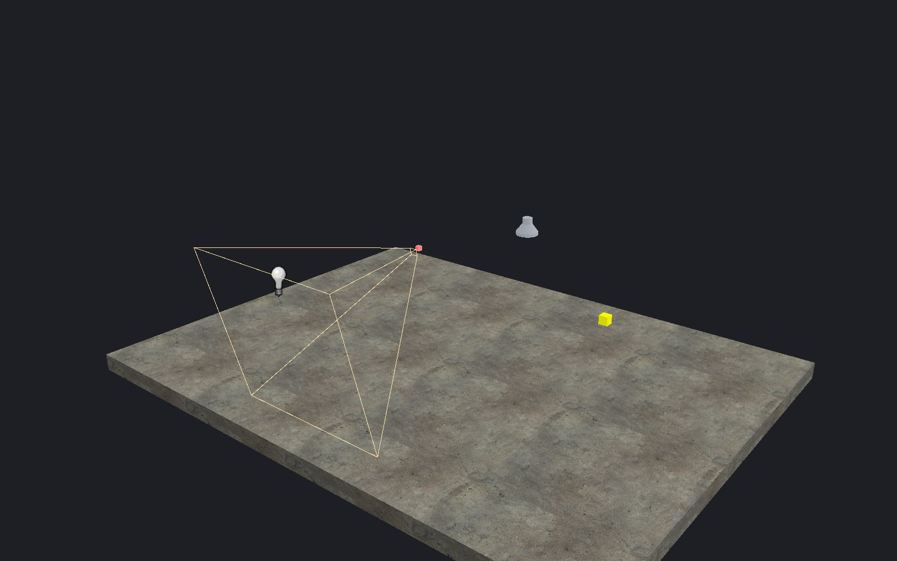

[← Manual](README.md)

# Entities and logic

Place game objects, edit their properties and connect outputs to inputs.

## Place an entity

1. Click **Entity…**.
2. Search for a class.
3. Set its position and initial properties.
4. Click **Place entity**.

For surface placement, choose **Pick surface…**, set **Offset**, and optionally enable **Align local up to surface**.
Pick the surface, inspect the bounds, then click **Apply entity**.

## Edit properties

1. Select an entity.
2. Change labeled fields in the inspector.
3. Use sliders, color pickers and asset browsers where available.
4. Use **Advanced properties** for additional raw keys.

For a batch, open **Edit selected entity properties…**.
Blank mixed fields preserve each entity's value. Click **Apply properties** to commit the draft.

### Colors

Choose **RGB**, **HSV** or **HSL** in the color picker.
Adjust channels, then click **Apply color** or **Cancel**.
In a property draft, the color is staged until **Apply properties**.

Use **Saved color name → Save new color** to retain a color.
**Use saved color**, **Replace saved color**, **Rename saved color**, **Delete saved color** and **Reload palette** manage the palette.
Palette changes persist independently of cancelling a property draft.

## Lights and helpers

Place `light`, `light_spot` or `light_environment` for point, spot or sun lighting.
Set color, brightness, falloff and direction through entity properties.
Spot cones, resource icons and supported FGD guides show placement and orientation.
For reusable child maps, see [light colors per reference](instances.md#light-colors-per-reference).

The **Entity images** and **Entity model guides** viewport switches control resource guides.
Editable helper boxes remain when resources are hidden or unavailable.

### Inspect a property radius

Place `env_firesensor`, set **Radius**, then select it to inspect its radius guide.
Zero or negative values suppress the guide with an explanation.

### Inspect a Source projector guide

1. Place and select `env_projectedtexture`.
2. Enable **Advanced properties**.
3. Set **FOV**, **NearZ**, **FarZ** and **Pitch Yaw Roll (Y Z X)**.
4. Check **Source projector guide** in the helper summary.

The guide shows bounds, not a rendered projected light.
Supported FGD line, node-link, sphere, frustum, icon and literal model helpers follow their declared properties.
Missing or ambiguous targets report errors rather than invented endpoints.

## Load extended entity definitions

1. Create a root FGD that includes the game FGD and extensions.
2. Open **Entity… → Load FGD…**.
3. Choose the root FGD.
4. Search for the updated class.

Reload the root after changing definitions.
**Loaded FGD catalog** reports the effective **FGD map size**; that metadata does not override compiler bounds.

## Brush entities

1. Select brushes.
2. Click **Tie to entity…**.
3. Choose a class, then click **Tie selected brushes to entity**.

Use **Move to world** to return eligible brushes to the world.
An `origin` material brush can define a supported runtime pivot; see [compilation](compile-and-play.md#brush-entities-and-pivots).

## Connections

1. Select an entity and open **Connections…**.
2. Click **Add connection** or **Edit connection**.
3. Choose the output, target and input.
4. Set the parameter and delay.
5. Choose **Unlimited**, **Once** or **Specific count**.
6. Click **Apply connection**.

**Cancel** discards the unfinished connection.
FGD suggestions describe available names and parameters; they do not prove runtime support.

## Inspect connected logic

1. Open **Entity graph…**.
2. Select entities in the map, then click **Use selected entities**. Their captured names and classes appear above the lists; **Root IDs (advanced)** also accepts explicit IDs.
3. Choose **Direction**: **Outgoing**, **Incoming** or **Both**. Set **Depth** from 1 to 16; the default is 2.
4. Click **Inspect graph**.
5. Choose **Nodes**, **Relationships** or **Unresolved (whole map)**. Use **Search rows**, then **Inspect graph**, to filter the lists. **Previous page** and **Next page** display at most 64 rows.
6. Choose **Replace**, **Add**, **Remove** or **Toggle**, then click **Select connected** to act on every reached node, including roots. Search and pages do not restrict this selection.
7. Click **Frame connected** to frame those nodes while preserving selection.

Exact names reach every matching entity, including intentional fan-out. Cycles appear once per stored connection/target pair. `!self` is concrete. Missing targets, malformed records, wildcard-prefix candidates and class/runtime-dependent targets remain explicit unresolved records; the graph does not guess their runtime endpoints. Unresolved rows cover the whole admitted map, independently of the chosen roots.

Saved **Hide** entities and expanded instance contents are excluded; temporary editor exclusions do not change connectivity. Unapplied drafts are excluded. Finish geometry drafts and active viewport gestures before selection or framing. A changed map requires **Inspect graph** again.

## Select by class

1. Open **Object report…**.
2. Enter a class in **Entity class contains…**, for example `light`.
3. Enable **Exact class** to exclude classes such as `light_environment`.
4. Inspect the rows, then use **Select all matches**.

Class matching ignores letter case. With **Exact class** off, it matches part
of the class name.

## Rename safely

1. Open **References and rename…** for the selected entity.
2. Review incoming references and connections.
3. Enter the new name.
4. Check **What will change**.
5. Click **Apply rename**.

Exact references change in the same undo step. Ambiguous or unsupported references require explicit correction.

## World settings

Open **World settings…** to edit map-wide properties such as sky, water current and damping.
Click **Apply properties** to keep the draft, or **Cancel** to discard it.

## Limits

- The graph is a bounded query and list view. General canvas layouts and runtime I/O simulation remain unavailable.
- Graph admission caps the root map at 8,192 entities, 32,768 stored connections and 8 MiB of inspected source text. Individual labels/connection fields cap at 4,096 bytes. Work and storage limits can refuse smaller maps explicitly.
- A traversal reaches at most 2,048 nodes and 8,192 relationships within the chosen depth. Relationships include exact links between reached nodes, including boundary cycles. Actions recompute the complete bounded traversal; a page is never treated as the full selection.
- Wildcard candidates use the existing editor's prefix matching, which does not establish engine-complete wildcard semantics. At most 16 candidate IDs are shown with the full candidate count.

- Custom classes and raw properties can be retained without being supported by the compiler.
- Helper images, meshes and bounds do not establish game collision or runtime appearance.
- Guides cover checked static properties, not parenting, animation, simulation or runtime I/O.
- Reload material assets for changed icons; reload models for changed model geometry; reload FGD for changed definitions.
- Changed source or replaced drafts require a fresh review before applying edits.
