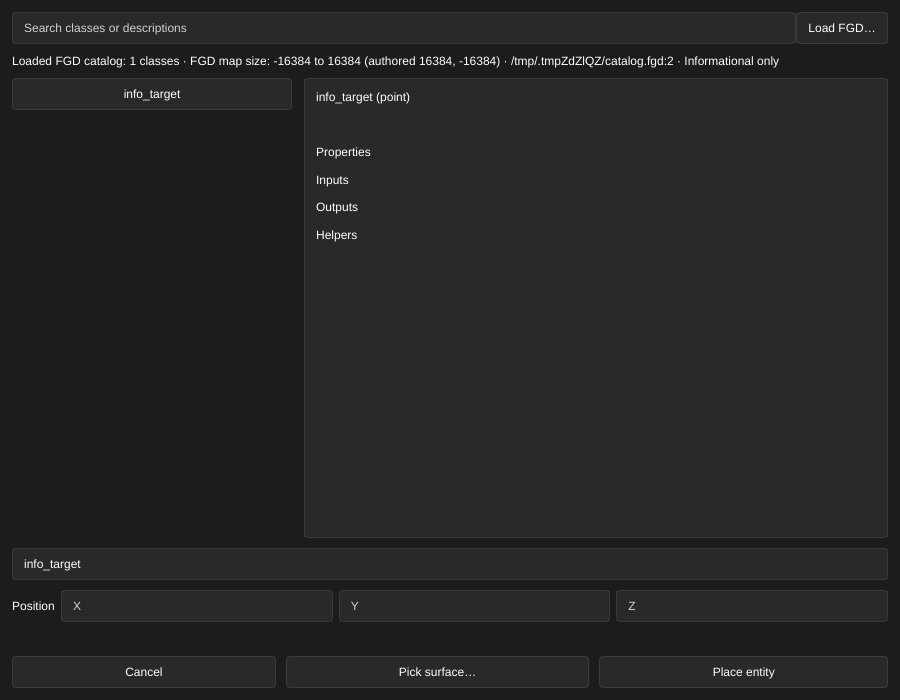
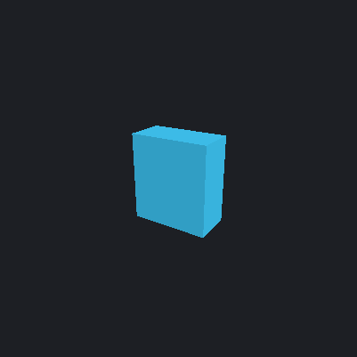
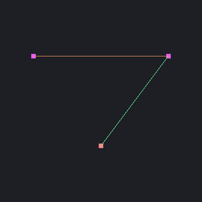
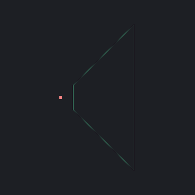

[← Manual](README.md)

# Entities and logic

## Place an entity

Click **Entity…**, search the entity classes, and place one. It appears at the camera or on the current planar workplane, following the editor's snapping.

Classes come from the Counter-Strike: Source FGD. **Load FGD…** in the class picker loads other definition files. Custom classes and unknown properties stay editable.

## Load extended entity definitions

FGD extensions can add or replace property controls, defaults, choices, spawn flags and I/O signatures for existing classes. The inspector, connection suggestions and agent class catalog use the same loaded definitions.

1. Create a root FGD that includes the game's FGD and any extension files.
2. Click **Entity…**, then **Load FGD…** and choose the root FGD.
3. Search for the class and select it to inspect its updated properties. Existing entities show the updated controls when selected.

`@ExtendClass` declarations apply after every included file has loaded, in declaration order. They retain the target's class type, description and inheritance. Unmentioned properties, choices, flags and I/O stay available; a same-name property or I/O declaration replaces the previous definition. Replacing a choices or flags property replaces its entire choice list. Extensions to base classes also reach their descendants. Distinct helpers with the same name remain separate; exact duplicates are removed.

Reloading definitions preserves existing entity values, custom keys, connections and undo history. It does not rewrite stored values to new defaults. A failed load keeps the previous catalog. Reload the root FGD to pick up later file changes.

Loading runs outside the UI thread, with one active load per Session. Closing
the editor cancels the load and waits for its owned result cleanup. A failed or
superseded load preserves the current catalog and map.

Sources must be regular files, at most 16 MiB each and 64 MiB across 256 files.
Canonical file and directory aliases remain supported. The loader also bounds
tokens, declarations, individual text fields and inherited-definition work;
exceeding a limit reports an error instead of truncating definitions.

Limits: FGD inheritance and extension targets match declaration names exactly, including case (`Light` and `light` can be separate classes). An extension whose target is absent is ignored and never creates a class. Extension descriptions are ignored. `base(...)` on `@ExtendClass` is unsupported and reports an error; extend an existing base class or define inheritance on the target class instead. Include and inheritance cycles or excessive nesting reject the load. Other extended directives and helper rendering are not implied by loading their metadata.

## Inspect FGD map size

An FGD's `@mapsize(min, max)` records its authored map-size preference. The loaded catalog retains the authored integer pair, the sorted minimum and maximum, and the declaration's source file and line.

1. Click **Entity…**, then **Load FGD…** and choose the root FGD.
2. Read **Loaded FGD catalog** below the search field. **FGD map size** shows the bounds, authored values and source location. **No effective @mapsize declaration** means no non-equal pair was loaded.
3. Reload the root FGD after changing the declaration or an included file.

Declarations follow include order. The last non-equal pair wins; equal endpoints leave the previous preference intact. Reversed endpoints are sorted for the displayed bounds. Repeated includes retain the catalog's existing rule: each source file is loaded once. Invalid syntax or values outside signed 32-bit integers reject the load and retain the previous catalog.

This metadata is informational. It does not change editor placement limits, compiler limits, engine limits or existing map coordinates. The agent can read the same report with `get_entity_definitions`; loading and searching definitions also return the metadata.

## Place on a picked surface

Preview a new point entity against a brush face, terrain sheet or supported model mesh before adding it to the map.

1. Click **Entity…**, then search for and choose a point class. Click **Pick surface…**.
2. Enter **Offset** in map units. Positive values leave a gap; negative values embed the entity. Contact uses the model mesh when available, otherwise its editor helper bounds.
3. Enable **Align local up to surface** to rotate the entity's existing up direction to the geometric surface normal. Source angles, legacy angle values and light pitch use the same orientation handling as ordinary transforms.
4. Enable **Snap along surface · grid …** to snap the contact anchor along the surface using the current grid. The two world coordinates outside the normal's dominant axis are rounded; the remaining coordinate stays on the plane. A second surface check rejects a snapped anchor outside the picked face.
5. Click **Pick surface**, then click a visible surface in the viewport. A miss keeps picking active. **Escape** or **Cancel picking** discards an owned pick.
6. Review **Origin**, **Bounds minimum**, **Bounds maximum**, the surface normal and contact offset. Cyan lines show the new entity's bounds; the yellow line marks the contact normal. Changed settings require another **Pick surface**.
7. Click **Apply entity** to create and select the entity in one Undo step. **Cancel**, **Escape** or closing the window discards the owned draft without changing the map or history.

A shared agent draft opens with **Review shared placement**. Review transfers ownership and replaces its token before human picking, Apply or cancellation. A stale shared draft can be reviewed for cancellation or another surface pick; Apply still requires a current preview. The UI and MCP use the same Session operations.

Limits:

- One entity is placed at a time. This uses contact against one hit plane; it does not settle the entity, check gameplay clearance or resolve intersections elsewhere.
- Targets follow brush, terrain, model, tool and working-region visibility. Point helper boxes are not targets. Unsupported or unavailable model sources use editor helper bounds, with a visible diagnostic when asset loading fails.
- Snapping affects the contact anchor; the final origin can be off-grid because of normal offset and support bounds. Normals come from actual geometry rather than smoothed lighting normals.
- `info_overlay` uses **Overlay…**. Contextual `infodecal` creation and brush entities are outside this workflow. Explicit-position creation remains available through **Place entity**.
- Offsets and the complete displayed bounds must remain within ±65536 units. A competing edit, map replacement, grid, selection, content or visibility change requires another preview. Old tokens cannot Apply or discard replacement geometry.
- Finish other geometry previews first. Apply or cancel entity placement before saving, compiling or playing.

## Edit properties

Select an entity to see its properties in the inspector. Common settings come first, with controls that fit each type: position and rotation fields, color pickers, brightness sliders, number fields, material previews, choice lists and spawn flags.

- **?** next to a property explains it.
- **Advanced properties** shows the raw engine keys and lets you add custom ones.
- Invalid values are refused and the map stays unchanged.
- Direction properties such as Move direction accept pitch, yaw and roll.

Every entity dialog has a Cancel button and closes with Escape.

Model entities can display mounted static meshes directly. See [Models](models.md) for **World Model**, **Skin** and **Model details…**.

### Choose RGB, HSV or HSL

1. Open a color property's picker from the inspector or **Edit selected entity properties…**.
2. Choose **RGB**, **HSV** or **HSL** under **Color model**. RGB uses whole channels from 0 to 255. HSV/HSL use **Hue (degrees)** from 0 to 360, **Saturation (%)** from 0 to 100, and **Value (%)** or **Lightness (%)** from 0 to 100. Each channel has a slider and numeric input.
3. Adjust the channels or choose one of the existing preset swatches. The swatch and RGB values stay synchronized. **Brightness** remains independent of the color model.
4. Click **Apply color**. In the inspector this makes one undoable edit. In the properties dialog it stages the color; click **Apply properties** to commit the complete draft in one Undo step. **Cancel** discards the picker's local edits.

Switching color models preserves the current color exactly, including normalized `color1` precision. Editing one RGB channel keeps untouched normalized channels; selecting a preset replaces the complete color. `color255` output rounds to the nearest byte, while `color1` retains normalized values. Invalid or nonfinite inputs are refused. Hue 360° equals 0°; conversions of gray, white and black report hue 0°. A hue chosen while saturation is zero stays available for the next saturation edit in that model. These are RGB coordinate conversions, without gamma correction or brightness changes.

### Save and reuse user colors

Keep up to 16 named colors in one user palette shared by every open map.

1. Open a color property's picker and adjust **RGB**, **HSV** or **HSL**.
2. Enter **Saved color name**, then click **Save new color**. Invalid or incomplete channel input must be corrected before saving. The name must be new; **Replace saved color** explicitly updates the color selected under **Saved colors**.
3. Choose any entry under **Saved colors** and click **Use saved color**. This replaces the picker's local color, including invalid unfinished color input. **Brightness** stays unchanged.
4. Click **Apply color** to apply or stage that color as usual. **Cancel** discards the picker's local edits. Explicit palette Save, Replace, Rename and Delete actions remain saved even when this picker or the enclosing property draft is later cancelled.
5. To rename an entry, select it under **Saved colors**, enter a distinct unused **Saved color name**, then click **Rename saved color**. Its exact color stays unchanged and the chooser follows the renamed entry after sorting. Rename also works with unfinished local color input; it preserves that input and **Brightness**.
6. Select an entry and click **Delete saved color** to remove it. **Reload palette** explicitly rereads storage without changing the current picker color. The status below the controls shows the storage path, availability and errors.

Limits:

- One user palette, at most 16 entries. Names are exact and case-sensitive, with 1–48 characters and at most 128 UTF-8 bytes, without control characters or surrounding whitespace. Every entry remains available in the **Saved colors** chooser.
- Only normalized RGB color values are stored. Normalized precision survives saving and restarting; brightness, map properties and Undo history are independent. Map-specific palettes, import/export and automatic reload are unavailable.
- The bounded `color-palette.json` file is at most 16 KiB. A missing file is an empty palette. Invalid, oversized, unreadable or nonregular storage shows **Palette unavailable** and blocks Use and writes; existing color editing remains available. Repair the file externally, then click **Reload palette**. Reset is unavailable.
- File bytes, identity and the original directory are checked before Use and writes. Outside changes require **Reload palette**. Save, Replace, Rename and Delete coordinate participating Linux writers through a nonblocking lock; programs ignoring that lock remain outside that guarantee. Storage failures require Reload before retrying. A write whose final verification failed remains reported as written but unavailable until Reload verifies storage.

## Lights and helpers

Point lights are drawn as a light bulb. Spotlights and sunlight show direction helpers, and a selected spotlight shows its cone. These helpers are editor-only: they appear in the viewport and in agent renders, but add nothing to the compiled map.

The bulb is a [CC0 model by Josh Dean / Poly Haven](https://polyhaven.com/a/lightbulb_led); see its [provenance](../crates/render/assets/lightbulb/SOURCE.txt).

FGD `size()` declarations draw point-entity boxes with the declared dimensions and origin offset. Both centered `size(width height depth)` and `size(mins, maxs)` forms are supported after includes, inheritance and extensions resolve. A class `color()` sets the generic box color. Loaded model meshes and specialized lights keep their existing geometry.

1. Click **Entity…**, then **Load FGD…** to load the definitions.
2. Place or select a point entity. The inspector shows **FGD size**, dimensions and the world-aligned editor-box policy.
3. Pick the box in any viewport, frame the selection, or use area/volume selection and **Working region…**. These operations use the same displayed bounds, including asymmetric origin offsets.
4. Reload the FGD after changing `size()` or `color()`. Existing values and Undo history stay unchanged.

Malformed or ambiguous definitions show **Invalid FGD size; generic editor marker** and the error in the inspector; the unselected marker is amber. Working-region inspection reports `invalid_fgd_size`, an explicit bounds error and unresolved bounds, retaining the marker for correction. Agents read the same structured report through `get_entity_inspector.helpers`.

Limits: These are world-aligned editor boxes in Source units, independent of `angles` and `modelscale`; they do not describe engine collision hulls. Arguments must be native integers; boxes need positive volume and local coordinates within ±65536. Class colors take precedence over the generic box's stored editor color; selection keeps its usual red highlight and **Selection outlines** behavior. Existing authored-model, light and rope previews remain independent. The report lists the loaded catalog sources; individual inherited helpers do not retain file/line provenance.

### Display a literal FGD icon

A generic point class can declare `iconsprite("editor/info_target.vmt")` to
show a mounted static image. The image faces the current viewport camera in
perspective, top, front and side views, including temporary agent render cameras.
It remains visible when the entity is unselected.

1. Click **Entity…**, then **Load FGD…** and load a definition containing one
   literal `iconsprite("material")` declaration.
2. Place or select the point entity. Read **FGD icon sprite** in the inspector's
   helper summary. A displayed image reports its dimensions, the unlit RGBA
   policy, and the winning VMT and VTF sources.
3. Change the viewport camera or projection. The image follows the live camera;
   authored entity angles do not rotate it. **Selection outlines** controls the
   original box outline independently.
4. Pick, frame or use **Working region…** with the entity. These operations keep
   using its ordinary FGD box, including asymmetric offsets; image pixels outside
   that box do not become pickable.
5. Open **Browse materials…**, then use **Reload material assets** after replacing
   an icon asset. Admission failures are
   cached too; reloading clears them before the next inspection or render.

Missing or rejected assets retain an editable box marker and an explicit error,
with an amber unselected marker. Hidden, excluded, invalid-size, model, sprite,
light and rope sources report why the image is suppressed. Suppressed images do
not trigger asset reads or claim that their material is ready. Agents read the
same report through `get_entity_inspector.helpers.icon_sprite` and receive the
same image from `render_view`.

Limits: This is an editor image, with a 32 Source-unit long axis and the texture's
aspect ratio. It uses unlit RGBA alpha compositing without fog. It does not
preview native Sprite render modes, animation, illumination or runtime
`sprite()`/`env_sprite` behavior. Only a direct `Sprite` material with explicit
`$spriteorientation vp_parallel`, centered `$spriteorigin "[0.5 0.5]"` (optional
third component zero), `$basetexture`, and optional `$no_fullbright 1` is admitted.
Other parameters, nested blocks, Patch materials and legacy `.spr` aliases are
explicitly unsupported. LDR color VTFs must have one frame, one face, depth one,
and axes no larger than 512 pixels; HDR and UV data formats are rejected.
References cap at 256 bytes before canonical prefixes/extensions, VMT reads at
64 KiB, VTF reads at 4 MiB, and the asset cache at 64 success/failure entries and
32 MiB encoded bytes per material generation. At most 256 visible images are
admitted in entity-ID order. Reloading content or materials clears the cache.
An authored finite origin within ±65536 is required. Loaded catalog source
files remain available, but inherited helper declarations do not retain their
own file/line provenance.

### Display a literal FGD model guide

A generic point class can declare one `studio("models/editor/playerstart.mdl")`
or `studioprop("models/editor/camera.mdl")` helper to display its mounted mesh.
The viewport and agent renders use the same deliberately untextured reference
mesh. This is an editor resource guide, with no shader, animated-pose or engine
collision claim.

A ready mesh replaces the filled marker so small camera and constraint guides
remain visible. Selecting the entity still outlines its ordinary FGD box.

1. Click **Entity…**, then **Load FGD…** and load the definition. Included,
   inherited and extended declarations resolve through the same catalog.
2. Place or select the point entity. Read **FGD model guide** in the inspector's
   helper summary: it names the helper and canonical model path, whether the
   mesh is displayed, and any source or admission error.
3. Edit **Rotation** using **Pitch**, **Yaw** and **Roll** to orient the guide, or move the entity.
   Transform previews move the guide without adding a stored `model` property.
4. Pick, frame, snap, place or use **Working region…** with the entity. These
   operations retain its ordinary FGD box. Mesh triangles outside that box are
   not picking or placement surfaces, and do not enlarge selection framing.
5. Click **Reload models** beneath the helper summary after replacing model
   files. Successful and failed model lookups share the existing model
   cache; FGD reload re-evaluates the declaration without changing values or
   Undo history.

Missing, malformed, blank-body or oversized assets retain the editable box and
an explicit diagnostic. Authored model fields, a declared model property,
specialized lights and ropes, and sprite/decal/overlay sources retain their
existing behavior. Hidden or region-excluded guides do not read their assets.
Agents inspect the same declaration, catalog sources, state, suppression
reason, visual bounds and `material_policy: "flat_editor"` through
`get_entity_inspector.helpers.model_guide`, and see its mesh in `render_view`.
**Model details…** continues to inspect authored model entities.

Limits: Only one exact literal `models/*.mdl` argument is supported; zero
arguments, property bindings, extra arguments and multiple studio/studioprop
declarations remain explicit unsupported cases. The guide uses LOD0 static or
reference geometry, existing Source angle conventions, authored skin/body,
unit-modelscale guards and rendercolor tint. It does not load guide VMTs or
VTFs, including during material reload. Ordinary model previews retain their
own materials. Paths cap at 256 bytes, errors at 512 bytes, and each scene at
64 eligible source evaluations, 65536 vertices and 393216 indices in entity-ID
order. The shared model cache caps at 128 entries and 256 MiB; MDL, VVD and VTX
reads cap at 64 MiB each. Origins and complete visual bounds must remain finite
within ±65536 units. Visual bounds are reported separately from object bounds.
Loaded catalog files provide declaration provenance; inherited helper
file/line locations are not retained.

### Control FGD resource visibility

The **VIEWPORT** section has two default-on controls for literal FGD resources.

1. Clear **Entity images** to replace `iconsprite` images with their ordinary
   editable FGD boxes.
2. Clear **Entity model guides** to hide literal `studio` and `studioprop` meshes.
   Their ordinary boxes remain visible and pickable.
3. Read the selected entity's helper summary for `view_disabled`. Resource
   admission is deferred while its control is off; malformed declarations still
   report their errors. Enable the control to inspect the actual asset again.
4. Use **Reload material assets** for changed icon files or **Reload models** for
   changed model files. Visibility toggles preserve cached successes and failures.

| Entity model guides on | Entity model guides off |
| --- | --- |
|  |  |

These session view settings preserve source, history, selection, spatial bounds
and pending reviews, model choices and placement tokens. Authored model entities,
lights, ropes, overlays and line/sphere/projector guides remain independent.
Agents use the same `set_view.entity_images` and `entity_model_guides` settings.
The matching `render_view` arguments are temporary; returned view metadata reports
their effective values, while the entity inspector describes the shared view.

### Inspect a property radius

FGD `sphere(property)` declarations add three world-axis guide rings around a
selected generic point entity, including brushless `@FilterClass` definitions.
Each ring uses the named property's authored numeric value, or its FGD default
when no value is stored. Multiple property radii remain separate guides. During
a transform preview, the rings follow the displayed origin.

Zero-argument `sphere()` binds the class's declared numeric `radius` property.
For `ambient_generic`, edit **Max Audible Distance**; for `env_shake`, edit
**Effect Radius**; for `env_soundscape`, edit **Radius**. The helper summary
identifies this implicit binding, and the shared report marks `implicit_property`.
Equivalent `sphere()` and `sphere(radius)` declarations share one guide, retaining
the first declaration's binding provenance. The property must still be declared
as a supported numeric type; a missing or incompatible declaration is diagnostic.

1. Click **Entity…**, choose `env_firesensor`, then **Place entity**. Its shipped
   FGD declares `sphere(fireradius)` and labels the property **Radius**.
2. Select the entity and enter a positive **Radius**, such as `128`. Read the
   inspector's helper summary and inspect the rings in any projection.
3. Change **Radius** to inspect a different distance. Zero and negative values
   draw no guide. The viewport and agent's `render_view` use the same rings.
4. Select another object, hide the entity, or exclude its ordinary box with
   **Working region…** to suppress the rings. Restore selection and visibility
   to display them again.

The shipped `filter_enemy` definition uses this same point-guide path for
**Radius** (`filter_radius`) and **Outer Radius** (`filter_outer_radius`), both
defaulting to `0`.

These are editor distance guides. They do not establish an engine influence
range, collision volume or runtime fallback for nonpositive values. They do not
enlarge the entity's box, picking target, area/volume selection, working-region
bounds, placement support or framing. **Selection outlines** can hide object
edges while these guides remain visible.

Only selected, visible generic point entities display these rings; loaded model
meshes, brush entities and specialized light helpers keep their existing
previews. Model/studio classes and entities with a model path suppress these
guides even if the asset fails to load, because fade distances can use screen
pixels. Numeric `float`, `integer` and `string` properties are supported.
Malformed, missing, duplicate or unsupported values retain their source text and
show diagnostics without substitute rings. The shared inspector report separates
intrinsic radius validity from selection/visibility suppression and reports
potential guide bounds separately from object bounds. At most sixteen distinct
sphere declarations per entity and 128 guides per frame are accepted, with 32
segments per ring. Scalar values must be finite and within ±65536; native
floating-point conversion must retain a finite, noncollapsed guide. Diagnostic
previews retain at most 256 bytes of raw value and 128 bytes of property name,
with explicit truncation flags. This radius preview does not evaluate `sprite`,
`studio`, frustum or other helper declarations. Literal icon images use the
separate admission rules above.

FGD `line(R G B, targetname, property)` draws a selected generic point entity's
origin to the point named by that property. A second `targetname, property` pair
draws between two named points instead. Repeated declarations retain their own
literal FGD colors; `rendercolor` does not recolor these editor links.

1. Place an `info_target`, then set its **Name** to `beam_end`.
2. Place an `env_laser` and set **Target of Laser** to `beam_end`.
3. Select the laser to show its origin-to-target line. Read the helper summary
   for missing, ambiguous or suppressed endpoints. Change **Target of Laser**
   through the property panel or **Advanced properties** to update the same guide.
4. For `env_beam`, set **Start Entity** and **Ending Entity**, then select the beam
   to see the line between those named origins. Transform previews move the
   displayed endpoints without committing an edit.

These links are editor guides; they do not simulate beams, parenting, attachments
or entity I/O. Only unique, exact-case literal target names are displayed.
Case-insensitive name collisions are ambiguous, and case-only matches report an
unsupported state rather than guessing native matching behavior. Wildcards,
`!tokens` and brush endpoints are unavailable. Reference values
use authored properties before labeled FGD defaults. Targets need one authored
`targetname` and one finite authored origin within ±65536 units. Missing,
duplicate, invalid and coincident endpoints add no replacement geometry.

Generic visible point sources retain the same specialized-helper exclusions as
spheres. Endpoints may be model or light points when their origins are valid.
Both source and endpoints must be visible and included in **Working region…**;
hidden or excluded duplicate names still count toward ambiguity. Lines never
change object bounds, picking, framing, placement or volume selection. The shared
inspector and `get_entity_inspector.helpers.lines` report resolution separately
from selection/visibility suppression. Limits are sixteen declarations per
entity, 128 displayed lines, 65536 lookup entities/raw name plus eligible node-ID values, and 128/256 bytes
for property/value previews. Oversized inputs are rejected before clipped text
can be resolved.

Imported node links can use `line(R G B, nodeid, property)` or its two-pair form.
The reference property must be declared `node_dest`; each endpoint must be a
point class with a declared read-only integer `nodeid` and one stored ID.

1. Open a VMF containing authored node IDs and load its FGD through **Entity…**
   → **Load FGD…**. The editor preserves the stored IDs; it does not allocate them.
2. Select an `info_node_link`. Set **Start node ID** and **End node ID** to the
   stored endpoint IDs. A unique pair draws between the authored node origins.
3. Read the helper summary for missing, ambiguous, invalid or suppressed
   endpoints. Agents receive the same states and `lookup_property: "nodeid"`
   through `get_entity_inspector.helpers.lines` and the same guide in `render_view`.
4. Move an endpoint in a transform preview to inspect the guide's new position.
   **Working region…** and authored visibility still control both endpoints.

IDs use canonical decimal integers from `0` through `2147483647`; `0` is valid.
A reference of `-1` means no association. Missing IDs never fall back to VMF
object IDs, entity order, FGD endpoint defaults or runtime node indexes.
Whitespace, signs, leading zeroes and other noncanonical IDs are unavailable;
bounded parseable numeric aliases still count toward ambiguity, even if hidden
or excluded. Duplicate node-ID keys and duplicate endpoint IDs are explicit
diagnostics. Node IDs remain read-only. This slice does not create a node graph,
validate AI connectivity or simulate ground nodes dropping to the floor.
Existing model-source exclusions still suppress the single-pair guide on
`info_node_air_hint`; the generic `info_node_link` two-pair guide is supported.

How lights, spotlights and the sun are baked, including falloff distances and sky ambient, is covered in [Compile and play](compile-and-play.md#lighting).

### Inspect an FGD frustum guide

Selected generic point entities with `frustum()` declarations show square near
and far planes as twelve edges. UI and MCP use the same displayed-document
corners, including transform previews. The helper follows the proven installed
Hammer2009 editor policy: yaw around +Z, scaled pitch around −Y, then roll
around +X. The fifth argument is a literal pitch multiplier; omitted means +1.
The shipped `env_projectedtexture` declaration uses −1, which agrees with its
independent Source projector guide.

1. Load the FGD through **Entity…** → **Load FGD…**, then select a point entity
   whose definition declares `frustum(fov,near,far,color,pitch_scale)`.
2. Enable **Advanced properties**. Edit the bound FOV, near/far, color and
   **Pitch Yaw Roll (Y Z X)** properties using their labels in that FGD. The
   first four arguments name properties; they are not literal numeric values.
3. Read **FGD frustum guide** in the helper summary. It reports the evaluated
   pitch scale, fields using FGD defaults and any error or suppression. Agents
   read the same values and exact corners in `get_entity_inspector.helpers.frustums`.
4. Use the viewport or `render_view` in top, front, side or perspective.
   Deselect, hide or exclude the ordinary point box with **Working region…**
   to suppress its guide.

The independent Source guide keeps precedence on `env_projectedtexture`. When
all eight corners and RGB match its displayed geometry, the FGD report says
`shared_with_source_projector` and the edges draw once. A different FGD guide
remains evaluated with explicit `source_projector_precedence` suppression; it
cannot bypass an unsupported Source target or camera-space branch. The Source
report's unevaluated-helper flag applies only to that independent guide.

Limits: zero to five arguments, with omitted property bindings `_fov`,
`_NearPlane`, `_FarPlane`, `_light`; no literal scalar/RGB extension. Bindings
must be distinct, use 1–79 UTF-8 bytes and avoid reserved origin/angles names.
FOV/near/far require declared float or integer properties; color requires
color255. Numeric bindings allow surrounding whitespace while inspection
retains the original text. Authored values precede labeled FGD defaults; missing values never
receive fabricated Hammer constructor defaults. Origin must be authored. Scale
and its product with raw pitch must remain finite at native precision, before
angle reduction. Nominal FOV must be 0.02–178 degrees and
0 < near < far ≤ 65536; native FOV clamp branches are rejected. The shared
finite-corner, nonzero-area and ±65536 relative-offset checks apply. Optional
fourth color intensity is retained separately, never used as opacity. Values
cap at 256 bytes, declarations at 16 per entity and displayed guides at 128;
omitted declarations and suppression are reported. Models and specialized
light/rope/sprite helpers retain precedence. Bounds, picking, selection,
placement, framing and history remain unchanged. This is an editor authoring
guide, with no projected texture, illumination, shadow, parent/runtime-state
preview or universal Hammer++ compatibility claim.

### Inspect a Source projector guide

Selected `env_projectedtexture` entities show an authored square projector guide
with eight corners and twelve edges. The viewport and agent renders use the
same displayed origin and **Pitch Yaw Roll (Y Z X)**, including transform previews.
Zero angles face +X; positive pitch points downward. This independent guide
uses Source angles without applying the FGD `frustum()` pitch scale. Its
`get_entity_inspector.helpers.source_projector` report retains that distinction;
the separate FGD frustum report evaluates the helper contract described above.

1. Load the game's FGD through **Entity…** → **Load FGD…**, then place and select
   `env_projectedtexture`.
2. Enable **Advanced properties**, then set **FOV**, **NearZ** and **FarZ**.
   **FOV** applies equally to horizontal and
   vertical projection; **NearZ** and **FarZ** measure along the forward axis.
3. Edit **Pitch Yaw Roll (Y Z X)** to orient the guide. Change **Light Color** to
   recolor its edges. The fourth component remains intensity; it does not change
   guide opacity or exposure.
4. Read **Source projector guide** in the helper summary for unavailable values
   or suppressed visibility. Select another object, hide the source or exclude
   its ordinary box with **Working region…** to suppress the guide.

Authored values precede individually labeled FGD defaults. The helper summary
lists fields using FGD defaults and notes that engine defaults may differ.
The shipped FGD uses
FOV 90, NearZ 4 and FarZ 750; these are authoring defaults, and may differ from
an engine constructor's defaults. Definition reloads update absent values
without writing entity properties or Undo history. Color edits use the shared
color picker operation and preserve the fourth component when omitted.

Limits: The guide requires loaded, compatible FGD property definitions and a
visible point source. Nonempty **target** or **Parent**, nonzero **Camera Space**
and legacy `angle` are unsupported branches and draw no replacement guide.
FOV must be strictly between 0 and 180; 0 < NearZ < FarZ ≤ 65536. Corners must
remain finite and pairwise distinct at native precision, with nonzero near/far
plane areas and each coordinate offset
within ±65536 units of the origin. Values are never clamped; malformed,
duplicate, missing and oversized values have explicit diagnostics. Value
previews cap at 256 bytes; at most 16
unevaluated helper declarations and 128 displayed projectors are reported.
Model helpers, loaded meshes and brush sources keep their existing behavior.
The guide does not change bounds, picking, selection, placement, framing or
working regions, and does not preview projected textures, illumination,
shadows, targets, parent movement or runtime enabled state.

## Brush entities

Select world brushes and click **Tie to entity…** to turn them into a brush entity, such as a door. **Move to world** turns a brush entity back into world brushes.

To set a brush entity's pivot (for doors and rotating brushes), see [brush entity pivots](compile-and-play.md#brush-entities-and-pivots). For baked initial `func_brush` orientation, see [Initial brush-model rotation](compile-and-play.md#initial-brush-model-rotation).

## Connections (inputs and outputs)

Select an entity and open **Connections…**.

- **Outgoing** lists the entity's outputs.
- **Incoming** lists connections elsewhere in the map that target this entity. You can edit them from here.

To add or change a connection:

1. Click **Add connection** or **Edit connection**.
2. Choose the output, the target and the input. Suggestions come from the map's named entities and the FGD; custom names also work.
3. Set the parameter, the delay in seconds, and how often it fires: **Unlimited**, **Once** or **Specific count**.
4. Click **Apply connection**.

Deleting a connection is undoable.

- Missing targets, undeclared inputs/outputs and parameter type mismatches show warnings.
- Invalid characters, negative delays and invalid counts block Apply.
- Incoming connections are found by exact name, prefix wildcards (`door*`) and `!self`. Other special targets are only resolved in game.
- New connections use CS:S's comma-separated format, so fields can't contain commas, quotes or control characters. Imported connections keep their original format until you edit them.

## Rename safely

Renaming an entity can break the connections and properties that refer to it by name. This tool finds those references and updates them with the name.

1. Select the entity and open **References and rename…** (or edit its **Name**).
2. Review what refers to it: incoming connections, entity-reference properties, parent links, and inputs such as `SetParent` whose parameter is a name.
3. Type the new name. **What will change** lists every update.
4. Click **Apply rename**. The name and all exact references change in one undo step.

- When several entities share a name, **Rename all … entities** renames the group. The preview lists every member, including hidden ones.
- A name that's already in use blocks Apply.
- Wildcards, special targets, ambiguous references and free text are never changed automatically. References whose meaning might change appear under **Needs your attention**. Review them, then confirm **I’ve reviewed these effects; leave these fields unchanged**.
- **Show engine details** shows the raw keys, class names and IDs.
- Scripts and connections created at runtime aren't analyzed. Check those by hand.

## World settings and editing many entities

**World settings…** edits map-wide values such as the skybox.

To edit several entities at once, select them and open **Edit selected entity properties…**:

- Properties they share are listed, and mixed values and flags are marked.
- Changing one flag or one color channel keeps each entity's other values.
- **Use default** writes the FGD default value. **Remove override** deletes the stored key. The inspector shows which values are stored and which are defaults.
- Click **Apply properties** to apply everything in one undo step.

Names are changed through **References and rename…**.

Raw VMF property keys and values cannot contain literal double quotes.
Properties reject these inputs before applying changes; backslashes are kept
literally and do not escape quotes. Context notes use their own text encoding
and can contain quotes.

During document shutdown, the Properties dialog and its Color/Material pickers
reject new reads, edits and Apply actions. Existing staged targets stay exact;
**Cancel** still closes each window and cannot discard a replacement draft.

