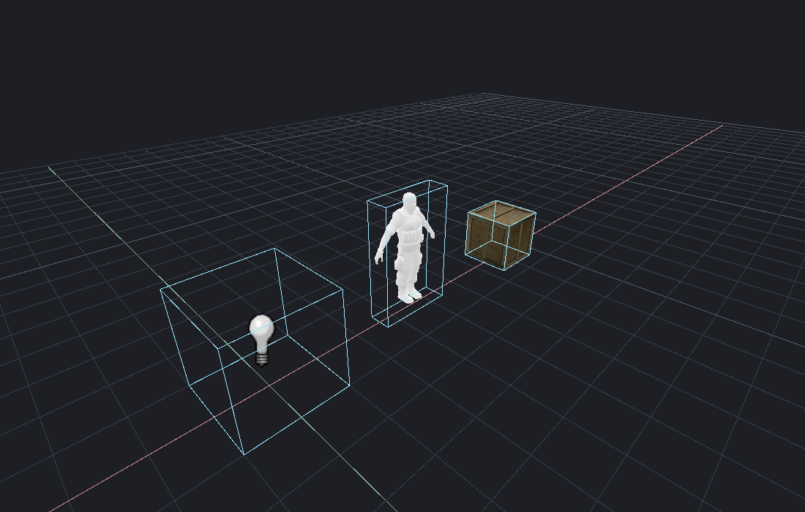

[← Manual](README.md)

# Point-entity gallery

Browse the loaded FGD point classes and inspect actual examples in the main
viewport before adding a batch to your map. Examples use the same entity
models, FGD helper geometry, icons and property defaults as ordinary placement.

## Preview and place examples

1. Open **Entity → Point-entity gallery…**, or search for
   **Point-entity gallery…** in **Ctrl+K**.
2. Search by class name or description, then choose **Search**. **Previous**
   and **Next** browse every matching class in pages of 32. Classes that need
   surface-specific authoring or an instance source show why they are unavailable.
3. Check the classes to include, or choose **Select page**. Selection stays
   across pages and searches. **Clear selection** empties it. A batch contains
   at most 32 distinct classes.
4. For a checked class with a model property, optionally enter an
   **Example model** path such as `models/props_c17/oildrum001.mdl`.
   The asset must exist in the mounted game content.
5. Set **First cell X/Y/Z**, **Columns** and **Gap**. The first cell is centered
   at X/Y and rests on Z. Further cells run along positive X, then positive Y.
   Cell dimensions fit the largest model, icon or helper box, with the chosen gap.
6. Choose **Preview selected**. The main viewport frames the arrangement.
   **REVIEWED EXAMPLES** identifies every class, row, column, origin and visual
   diagnostic. Use **Frame preview** or an example's **Frame example** button
   to inspect it again. Ordinary viewport navigation still works.
7. Review missing resources, unsupported helpers and suppressed visuals.
   Existing **Overlays** switches control entity images and FGD model guides.
   A class without an authored image or model uses its FGD box or editor marker.
8. Choose **Place reviewed examples** to create the complete batch in one
   Undo step and select its entities. **Cancel preview**, **Close** or Escape
   discards your preview. Changing settings requires **Preview selected** again.

## Shared gallery previews

An agent's gallery appears in the same viewport and review list. Choose
**Review shared gallery** to take ownership before placing, replacing or
cancelling it. Review returns a new token, so the previous owner's actions
cannot apply the replaced review. Framing a shared preview does not take
ownership.

Previews leave saved map contents, selection and Undo history unchanged.
Saving, compiling and playing require applying or cancelling the gallery first.
Map edits, selection changes, new maps, reopened documents and FGD reloads
retire the preview through the existing geometry-draft lifecycle.

## MCP

`browse_entity_gallery` returns searchable catalog pages, total matches,
placement availability, defaults and helper declarations. `get_entity_gallery`
returns the shared draft and current snapshot.

Pass that snapshot and explicit `examples`, `origin`, optional `columns` and
`gap` to `preview_entity_gallery`. Each example accepts `classname` and optional
`properties`, including a mounted model path. Inspect the resulting helper
reports and use `frame_entity_gallery` plus `render_view` to review the actual
scene. `apply_entity_gallery` and `cancel_entity_gallery` require its owned token;
`review_entity_gallery` transfers ownership with a replacement token.

## Limits

- Only loaded FGD point classes are eligible. Raw classes, brush entities,
  worldspawn, overlays, decals and instance references are not bulk examples.
  Unavailable point classes remain visible in catalog results.
- Preview batches contain 1–32 distinct classes; repeat the workflow to inspect
  the rest of the catalog. Search text is limited to 256 bytes.
- Columns range from 1 to 32; gap ranges from 16 to 4096 Source units.
  Origins and visual bounds must remain finite within ±65536 units.
  Per-class origin overrides are rejected because the arrangement owns positions.
- Placement uses FGD defaults, including ordinary gameplay properties. These
  examples are editable entities, not a playable map setup or a simulation.
- Missing or unsupported models and icons retain explicit diagnostics and editor
  helpers. They are not replaced by a different resource. Existing shared asset
  budgets, static/reference-pose and helper-support limits still apply.
- Helper spheres, lines and projectors may extend across cells. Cell fitting
  does not settle objects, resolve collisions or avoid existing map geometry.
- The gallery refuses examples outside the active working region. Move the
  gallery origin or show the relevant region before previewing.
- Tokens belong to their document and actor. Changed, closed, foreign or
  replaced previews cannot be applied. A failed replay rolls back the whole batch.
