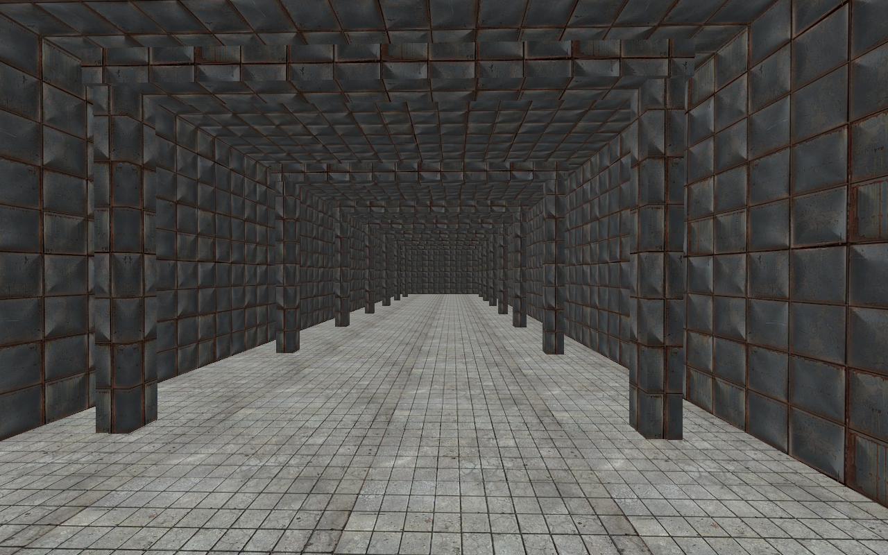
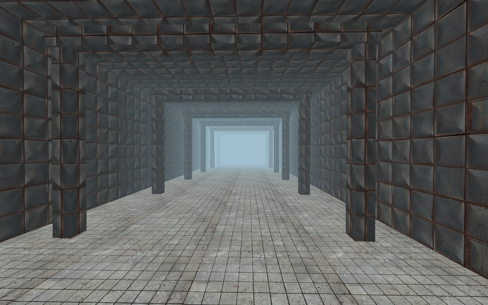

[← Manual](README.md)

# Fog preview

Inspect world fog and preview controller inputs without changing the map.

## Choose a controller

1. Use **Entity…** to place `env_fog_controller`.
2. Set `fogcolor`, `fogstart`, `fogend`, `fogmaxdensity` and `fogenable` in **Inspector**.
3. Choose **Perspective** and **Textured**.
4. Open **View → Fog preview…**. Expand **Environment** and choose **Explicit controller**.
5. Choose an **Active controller** and **LDR** under **Channel**.
6. Enable **Enable fog preview**, then click **Apply preview**.
7. Read **Current settings** and any reported issue. The window stays open.

| Fog off | Fog on |
| --- | --- |
|  |  |

Use `fogradial` for radial distance. For directional color blending, set
`fogblend`, `fogcolor2` and `fogdir`; `use_angles` uses the controller's world
orientation instead. Author `farz` for a far clip.

Use **Refresh choices** after source edits or changes from another interface.
To disable fog, clear **Enable fog preview**, then click **Apply preview**.
Source or content changes invalidate the preview. Reapply to capture a new
baseline and clear the input sequence; prepare the environment again when used.

## Use a fixed parent

1. Create an `info_target` and give it a unique `targetname` in **Inspector**.
2. Set the controller's `parentname` to that exact name and enable `use_angles`.
3. Set the controller's `angles` in world space. Refresh and apply the preview.

Named `info_target` chains can contain up to 16 parents. The initial parent
binding preserves the controller's world angles; do not add parent rotation.
Missing, ambiguous, hidden or cyclic parents refuse. Model attachments and
other parent classes are unavailable.

## Preview controller inputs

1. Apply the controller selection.
2. Expand **Controller input** and choose an **Input**.
3. Enter **Value** when the input needs one, then click **Send input**.
4. Read **Current settings** to inspect the result.

For a transition, first set a positive `foglerptime` in **Inspector**, refresh
and apply the preview. Use `SetColorLerpTo`, `SetColorSecondaryLerpTo`,
`SetStartDistLerpTo` and `SetEndDistLerpTo` to stage the intended targets.
Then send `StartFogTransition`, which takes no value.

## Play or inspect a time

1. Click **Play** to advance preview time, or **Pause** to stop playback.
2. Release the **Time** slider at a new time, or enter seconds and click **Seek**.
   Seeking keeps the input sequence.
3. Click **Reset** to clear preview inputs, return to time 0 and restore authored
   initial values. Settings and the prepared environment remain.
4. Use **Clear preview** to disable it and clear the controller, environment,
   input sequence and time.

**Close** and <kbd>Escape</kbd> pause and close the window while preserving the
applied preview. **Cancel work** stops pending preparation and playback while
retaining a current valid profile and input sequence. These controls do not
execute map connections or edit entity fields. Playback suspends while its
document tab is inactive.

## Use the map environment

1. Expand **Environment** and choose **Environment**.
2. Click **Apply preview**.
3. Click **Prepare environment** and wait for the reported result.
4. Move the camera between dry space and prepared liquid volumes. Read
   **Current settings** to see the selected controller and underwater material.

Initial selection uses the first authored root controller, or the last one
with **Master** enabled, in map order. Preparation uses the authored world
rather than temporary editor hiding or working regions. Create liquid brushes
with the existing [Water and slime](water.md) workflow.

Underwater fog uses the bottom material's values. The controller supplies the
preview's radial setting and far clip; live render-pass history is not reproduced.

## Fog controllers in a child map

Child maps keep a separate static LDR subset.

1. Open the child VMF normally and use **Entity…** to place `env_fog_controller`.
2. Set literal `fogcolor`, `fogstart`, `fogend`, `fogmaxdensity` and `fogenable` values in its properties.
3. Keep `fogblend`, `use_angles`, `foglerptime` and `spawnflags` at `0`. Leave the controller unnamed and unparented.
4. Save the child. In the parent, create or select its **Instance reference…**, then use **Instance contents… → Refresh instance contents** or compile.

Child controllers require `0 ≤ fogstart < fogend` and `fogmaxdensity` in 0–1.
They support static LDR settings. If authored, `fogradial` must be `0`,
`HDRColorScale` and `ZoomFogScale` must be `1`, and `farz` must be nonpositive.
Secondary color and direction fields remain literal; they do not enable color blending.
Runtime connections, transitions, Master priority, directed fog, fog volumes and value bindings are unsupported.

Each controller's marker origin follows every containing reference transform.
A compile region retains it only when that transformed origin is inside or on the region boundary.
Multiple controllers retain their ordinary entity order; no controller is made global or selected automatically.
Refresh counts child controllers before region filtering and reports their fog preview as unavailable.
The parent's **Fog preview…** lists only parent controllers; child icons, bounds, picking and framing are unavailable.

## Limits

- Fog color and density apply to Perspective Textured surfaces and model meshes.
  Sky, icons, helpers, selection outlines and the grid keep their colors.
- A positive `farz` clips all Perspective geometry, including helpers, in every
  surface mode. It remains active when `fogenable` is 0. Positive values must
  exceed 4 and be at most 1,000,000; nonpositive values disable this override.
- Root start/end ranges may be negative, equal or reversed. Numeric fields must
  produce finite results within the reported limits; displayed density clamps
  to 0–1. Colors use RGB bytes from 0–255. With `use_angles`, parents must be
  ordinary point `info_target` chains with spawnflags 0 or 1.
- Time is 0–3600 seconds, with at most 128 preview input events. Inputs append in
  time order; use **Reset** before adding an input earlier than the last event.
  Starting a transition with zero `foglerptime` is unavailable.
- Environment preparation supports horizontal-top structural world water and
  opaque slime. Detail/model liquids, sloped or enclosed liquids, incompatible
  overlaps and unsupported material sources report unavailable. Water needs
  an explicit `$bottommaterial`. Unqualified shader fallbacks and fog-writing
  material proxies are unavailable. Limits are 128 controllers and 256 liquid
  brushes.
- Underwater preview requires a world fog controller to establish radial
  context, even if that controller is disabled. Place and configure one before
  preparing. Water refraction and above-water height fog are not previewed.
- LDR only. HDR remains unavailable. `HDRColorScale` and `ZoomFogScale` are
  preserved foreign metadata and do not scale the root controller preview.
- Manual controller selection snaps immediately. Live player-controller switch
  blending, official-map fog rules, network delivery and game I/O scheduling
  are not simulated. `fog_volume` and `trigger_fog` are unavailable.
- Sky fog and native pixel parity are unavailable. Preview controls preserve
  map bytes, selection, camera and Undo.

<!-- page-nav -->

---

[← Authored lighting preview](lighting-preview.md) · [Manual](README.md) · [Color correction →](color-correction.md)
