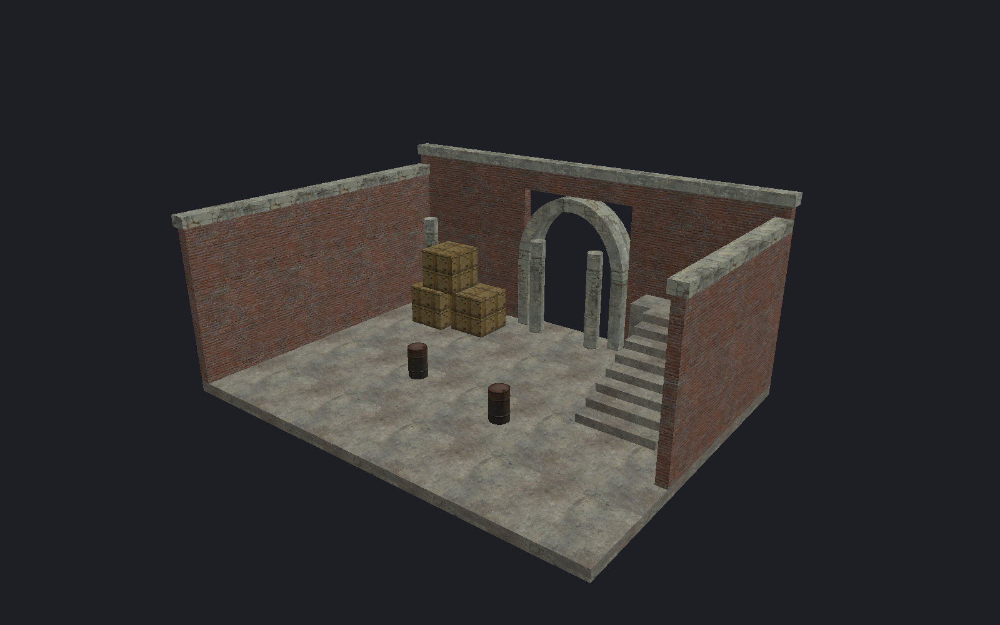
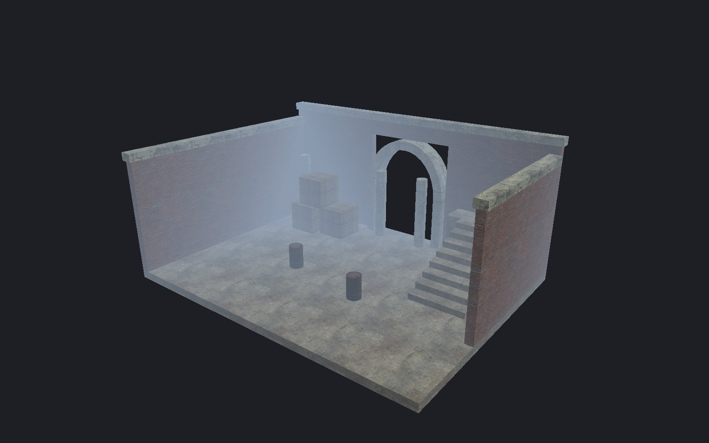

[← Manual](README.md)

# Fog preview

Inspect an authored fog controller in the editor.

1. Use **Entity…** to place `env_fog_controller`.
2. Set `fogcolor`, `fogstart`, `fogend`, `fogmaxdensity` and `fogenable` in its properties.
3. Choose **Perspective** and **Textured**.
4. Open **Fog preview…**.
5. Enable **Enable fog preview**.
6. Choose an **Active controller**.
7. Click **Apply preview**.

| Fog off | Fog on |
| --- | --- |
|  |  |

**Cancel** discards the choice. Use **Refresh choices** after changes from another interface.
To disable fog, clear **Enable fog preview**, then click **Apply preview**.

## Fog controllers in a child map

1. Open the child VMF normally and use **Entity…** to place `env_fog_controller`.
2. Set literal `fogcolor`, `fogstart`, `fogend`, `fogmaxdensity` and `fogenable` values in its properties.
3. Keep `fogblend`, `use_angles`, `foglerptime` and `spawnflags` at `0`. Leave the controller unnamed and unparented.
4. Save the child. In the parent, create or select its **Instance reference…**, then use **Instance contents… → Refresh instance contents** or compile.

Child controllers support static LDR settings. If authored, `fogradial` must be `0`,
`HDRColorScale` and `ZoomFogScale` must be `1`, and `farz` must be nonpositive.
Secondary color and direction fields remain literal; they do not enable color blending.
Runtime connections, transitions, Master priority, directed fog, fog volumes and value bindings are unsupported.

Each controller's marker origin follows every containing reference transform.
A compile region retains it only when that transformed origin is inside or on the region boundary.
Multiple controllers retain their ordinary entity order; no controller is made global or selected automatically.
Refresh counts child controllers before region filtering and reports their fog preview as unavailable.
The parent's **Fog preview…** lists only parent controllers; child icons, bounds, picking and framing are unavailable.

## Limits

- Static initial settings only; perspective Textured surfaces and model meshes receive fog.
- The preview requires an explicit, visible controller. Deleted or invalid controllers report an error.
- Start and end must satisfy `0 ≤ start < end`. Density is 0–1; RGB channels are integers from 0–255.
- Radial fog, secondary colors, far-Z clipping, volumes, transitions and nondefault HDR/zoom scales are unsupported.
- Sky, helpers, selection outlines and the grid do not receive fog.
- This is an editor approximation, not a game brightness match.
