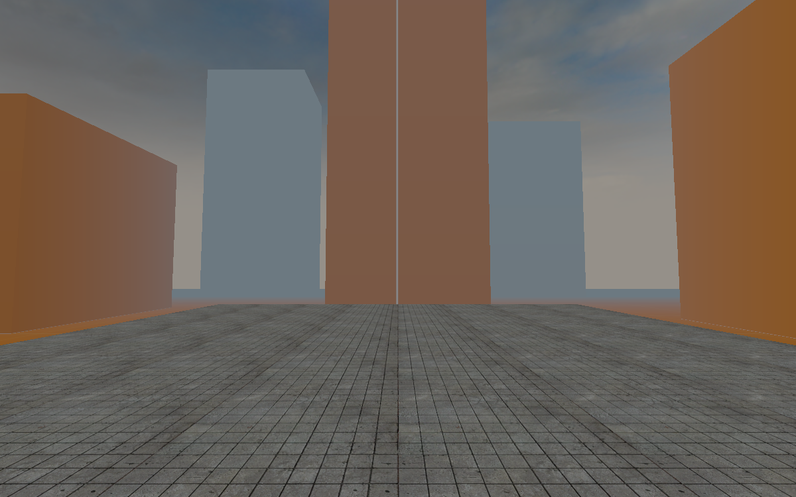
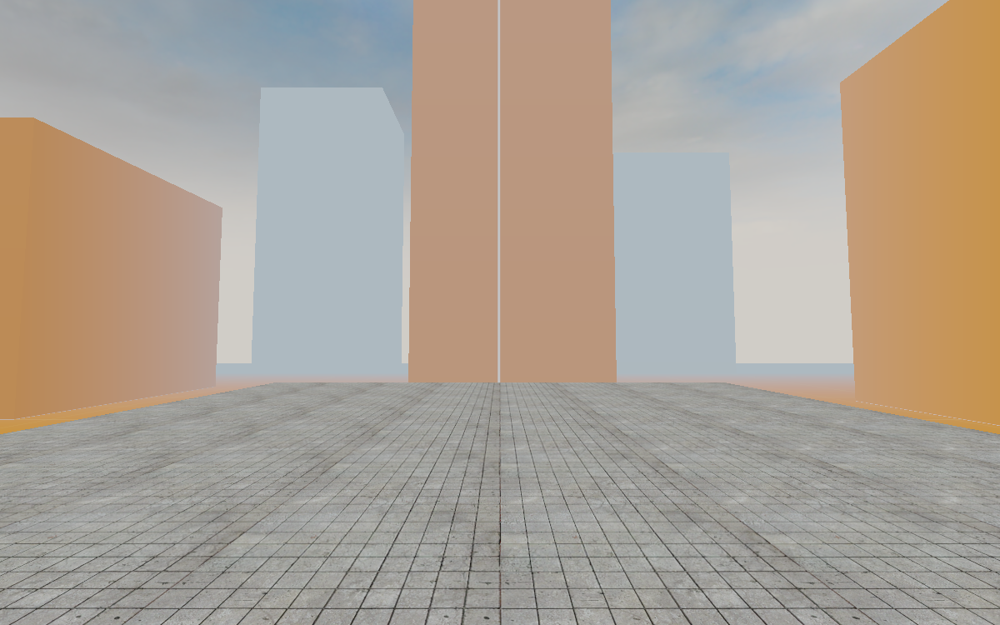
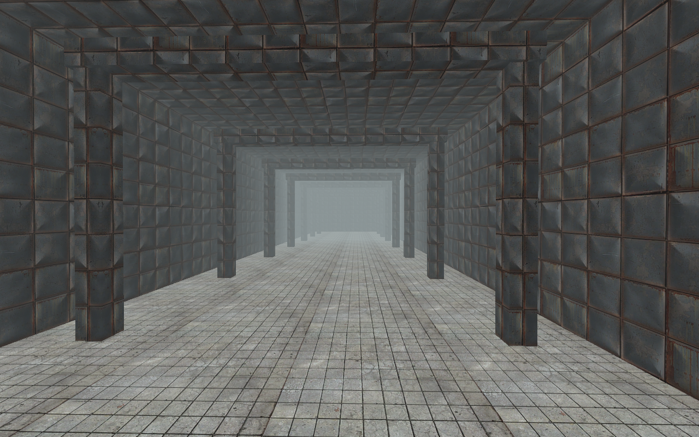
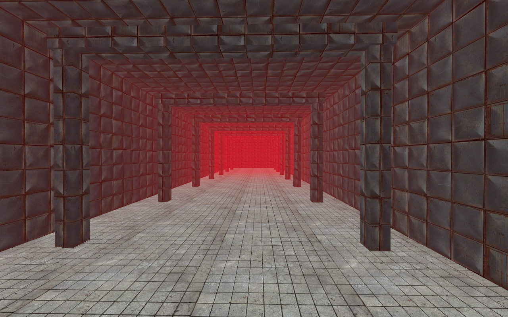
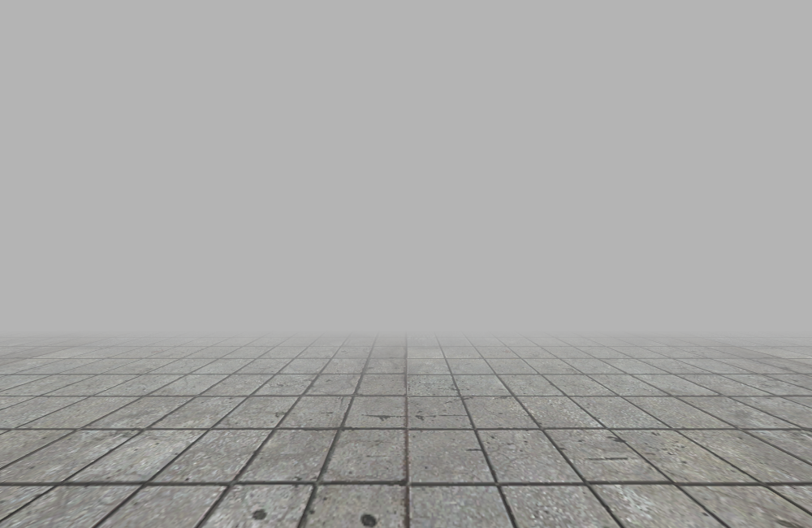
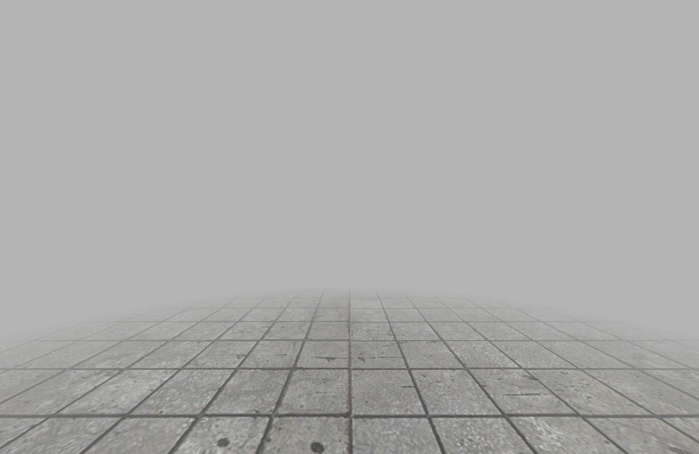

[← Manual](README.md)

# Fog preview

Inspect world fog, mix controller inputs with timed player switches and set
one manual HDR scene exposure without changing the map.
For independent static `sky_camera` fog, use [miniature fog](sky.md#preview-miniature-fog).

## Choose a controller

1. Use **Entity…** to place `env_fog_controller`.
2. Set `fogcolor`, `fogstart`, `fogend`, `fogmaxdensity` and `fogenable` in **Inspector**.
3. Choose **Perspective** and **Textured**.
4. Open **View → Fog preview…**. Expand **Environment** and choose **Explicit controller**.
5. Choose an **Initial controller** and **LDR** under **Channel**.
6. Enable **Enable fog preview**, then click **Apply preview**.
7. Read **Current settings** and any reported issue. The window stays open.

| Fog off | Fog on |
| --- | --- |
|  |  |

Use `fogradial` for radial distance. For directional color blending, set
`fogblend`, `fogcolor2` and `fogdir`; `use_angles` uses the controller's world
orientation instead. Author `farz` for a far clip.

Use **Refresh choices** after source edits or changes from another interface.
To disable fog, clear **Enable fog preview**, then click **Apply preview**.
Source or content changes invalidate the preview. Reapply to capture a new
baseline and clear the event sequence; prepare the environment again when used.

## Use HDR scene display

1. Choose **Perspective** and **Textured** in the intended pane.
2. Open **View → Fog preview…** and find **Scene display**.
3. Set **Display mode → HDR**.
4. Set **Scene exposure EV** from −8 to +8.
5. Click **Apply scene display**.
6. Read **Requested**, **Active pane**, **Exposure owner** and **Availability**.
7. To use HDR world fog, choose **Channel → HDR**, enable
   **Enable fog preview**, then click **Apply preview**.

**Scene display** works with **Enable fog preview** off. It does not enable
fog, lighting, sky or compiled layers, change their channels or clear fog events.
Select and prepare each required source through its own preview controls.

In an active HDR pane, **Scene exposure EV** controls the complete scene:
authored lighting, baked surfaces and props, compiled details, sky and fog.
Fog and translucent surfaces mix in linear color before one exposure and the
editor's per-channel Reinhard display curve. Editor helpers, icons, grid and
selection outlines are drawn afterward. Color correction is applied last.
Selection tint on surfaces and models remains scene color and receives fog
and exposure.

HDR scene display applies only to **Perspective** **Textured** panes.
Orthographic and diagnostic panes retain their component exposure settings.
In an HDR pane, those controls refer to **Scene exposure EV**; their stored
values remain available in panes that use Legacy display. Changing scene
exposure does not rewrite them.

Choose **Display mode → Legacy** and click **Apply scene display** to restore
component exposure. Enabled HDR fog requires HDR scene display. First choose
**Channel → LDR** or clear **Enable fog preview**, then click **Apply preview**
before returning to Legacy. Disabled fog can retain its HDR channel.
Clearing or disabling fog does not reset scene display.

| Scene exposure −1 EV | Scene exposure +1 EV |
| --- | --- |
|  |  |

## Choose an initial rule

1. Expand **Environment** and choose an **Initial rule**:
   **Authored values** keeps each controller's and sky camera's `fogradial`, while
   **CS:S official-map rule** initially makes them radial.
2. Click **Apply preview**.
3. Use controller inputs normally. A later `SetRadial` overrides the initial rule.

Changing the rule pauses playback and clears preview events and time, while
retaining the prepared environment. **Reset** restores the selected rule's
baseline. The choice is explicit; source filenames and private build names
do not select a rule or identify the running game map.
The rule also applies to the independent miniature profile. You can apply it
with **Enable fog preview** cleared; world controller inputs do not change sky fog.

## Use a fixed parent

1. Create an `info_target` and give it a unique `targetname` in **Inspector**.
2. Set the controller's `parentname` to that exact name and enable `use_angles`.
3. Set the controller's `angles` in world space. Refresh and apply the preview.

Named `info_target` chains can contain up to 16 parents. The initial parent
binding preserves the controller's world angles; do not add parent rotation.
Names must be unique under CS:S matching. Missing, ambiguous, hidden or cyclic parents refuse. Model attachments and
other parent classes are unavailable.

## Preview controller inputs

1. Apply the controller selection.
2. Expand **Controller input**. Choose a **Target**, then choose an **Input**.
3. Enter **Value** when the input needs one, then click **Send input**.
4. Read **Server raw** and **Delivered raw** for the target's result.
   Read **Current settings** for the visible fog.

The input **Target** is independent of **Initial controller** and the player
controller's **Target**. Send inputs to another controller without changing
the initial selection or the current player controller. An input target does
not need a `targetname`.

For a transition, first set a positive `foglerptime` in **Inspector**, refresh
and apply the preview. Use `SetColorLerpTo`, `SetColorSecondaryLerpTo`,
`SetStartDistLerpTo` and `SetEndDistLerpTo` to stage the intended targets.
Then send `StartFogTransition`, which takes no value.

## Switch player fog

1. Give each destination controller a unique literal `targetname` in **Inspector**.
   Set its `foglerptime` for the switch duration; `0` switches immediately.
2. Apply an initial controller with **Apply preview**. Prepare the environment
   if selected. Use **Reset** if you want to clear earlier preview events.
3. Expand **Player controller**, choose **Target**, then click **Switch player fog**.
4. Use **Play**, **Pause** and **Seek** to inspect the result. Choose another
   **Target** and click **Switch player fog** to interrupt an active blend.
5. Use **Controller input** to send inputs before, during or after a switch.
   The preview keeps controller inputs and player switches in one ordered sequence.
6. Under **Controller input**, compare **Server raw** and **Delivered raw** for
   its **Target**. **Controller think due at** shows a pending transition commit.
7. Under **Player controller**, read **Copied raw**, **Player sample** and
   **render evaluation**. Read **Current settings** for the final fog profile.

Only primary RGB, fog start and fog end blend. Direction, secondary color,
density, enable, radial and far clip copy from the destination's latest
delivered state. An interrupted switch starts from the last primary RGB,
start and end written by the preview. It does not first advance the old blend
to the new switch time.

An input changes its target controller's state and delivers that state
immediately. During a player blend, later controller changes do not update the
player's copy. The player keeps the copied controller transition targets while
its own blend continues. When the blend completes, the next player update can
copy those changes. A switch to another controller copies its delivered state
immediately.

Player fog updates at 50 Hz and once at each switch. Events at a scheduled
update time run first and keep their recorded order. Due controller transition
commits run before events at that time. Controller-only inputs do not add a
player update. **Seek** and inspection preserve this schedule. Input-only
preview uses continuous controller interpolation; after the first player
switch or trigger touch, the combined sequence uses the player update schedule.

The player sample time can differ from the requested preview time. The final
fog uses the copied controller's own transition at the requested time. Missing,
ambiguous or special switch names, the current player target and earlier events
refuse.

| During the blend: later controller input stays frozen | Following update: changed controller color is copied |
| --- | --- |
|  |  |

**Initial controller** selection remains an immediate manual snap. Changing that
selection, the environment selection mode or the initial rule clears all events,
resets time and pauses. Source edits also clear the sequence.

## Preview authored fog triggers

1. Use **Tie to entity…** to make a brush `trigger_multiple`.
   In **Inspector**, set `spawnflags` to `1`, keep `StartDisabled` at `0`,
   and use a nonnegative `wait`. Leave `parentname` and `filtername` empty.
2. Open **Connections…**. Add an `OnStartTouch`, `OnStartTouchAll`,
   `OnEndTouch` or `OnEndTouchAll` connection. Use `!activator` as its target,
   `SetFogController` as its input and the destination controller's unique
   literal `targetname` as its parameter. Set the delay and firing count, then
   click **Apply connection**.
3. In **Fog preview…**, enable **Enable fog preview** and apply a ready initial
   controller.
4. Expand **Trigger touches**, choose **Source**, then click **Enter**.
5. Read **Inside** or **Outside**, **Generated actions** and the pending/fired
   counts. Use **Play**, **Pause** and **Seek** to inspect delayed actions.
6. Click **Leave** to declare the player outside that trigger again.

The preview uses one alive virtual player, initially outside every trigger.
**Enter** and **Leave** declare its boundary crossings. They do not use the
camera's position or detect physics contacts. A duplicate **Enter** or a
**Leave** while outside refuses.
**Seek** reconstructs membership, counts and queued actions at the requested
time without recording touches or consuming counts again.

Enter emits `OnStartTouch` then `OnStartTouchAll`; Leave emits `OnEndTouch`
then `OnEndTouchAll`. Rows within each output run in reverse stored order.
Actions with the same logical delivery time retain their enqueue order. Due
queued actions run before an authored event at the same time; newly queued
immediate actions run before the next authored event.

Firing counts are consumed when actions enter the queue. Delayed actions remain
queued after **Leave** or later count exhaustion. An action targeting the current
player controller is a valid no-change delivery: it consumes its count and
preserves the active blend.

Every connection on a source must fit this catalog. Other outputs, filters,
parents or attachments, disabled sources, non-client flags or unsupported action
targets make the complete source unavailable. Destination names must match the
controller's actual `targetname` exactly. No unsupported rows are skipped.
`OnTrigger`, other actors, dynamic trigger changes and general game I/O are
outside this preview. Preview touches preserve map bytes, selection, camera
and Undo.

## Play or inspect a time

1. Click **Play** to advance preview time, or **Pause** to stop playback.
2. Release the **Time** slider at a new time, or enter seconds and click **Seek**.
   Seeking pauses playback and keeps the event sequence.
3. Click **Reset** to clear preview events, return to time 0 and restore the
   selected rule's initial values. Settings and the prepared environment remain.
4. Use **Clear preview** to disable it and clear the controller, environment,
   event sequence and time.

**Close** and <kbd>Escape</kbd> pause and close the window while preserving the
applied preview. **Cancel work** stops pending preparation and playback while
retaining a current valid profile and event sequence. These controls do not
execute map connections or edit entity fields. Playback suspends while its
document tab is inactive.

## Use the map environment

1. Expand **Environment** and choose **Environment**.
2. Click **Apply preview**.
3. Click **Prepare environment** and wait for the reported result.
4. Move the camera between dry space and prepared liquid volumes. Read
   **Current settings** to see the selected controller and underwater material.

Initial selection uses the first authored root controller, or the last one
with **Master** enabled, in map order. Preparation uses the authored world
rather than temporary editor hiding or working regions. Create liquid brushes
with the existing [Water and slime](water.md) workflow.

Underwater fog uses the bottom material's values. **Water radial → Controller
radial value** uses the current controller's radial setting, even when that
controller is disabled. The current controller also supplies its far clip.

## Record water radial history

1. Expand **Environment**. Choose **Environment** and
   **Water radial → Recorded pass history**. Enable **Enable fog preview**,
   then click **Apply preview**.
2. Use **Prepare environment** if the water context is not ready.
3. Choose **Setup → Reset shader state**, then click **Record setup**.
   Check that **Recorded radial** is **Axial**.
4. To capture another setup, choose **World fog** or **Sky fog**. Check the
   source shown below **Setup**, then click **Record setup**.
   Read **Recorded radial**, **Last write** and
   **Setups at this time**.
5. Use **Seek** to inspect the recorded history at another preview time.
   Move the camera into prepared water to inspect its fog with that radial state.

The history starts **Unknown**. A wet view requires a recorded shader reset or
an enabled World/Sky setup to establish the radial value. Water can use an
established value without a world controller; no world far clip is added then.

| Recorded axial setup | Recorded radial setup |
| --- | --- |
|  |  |

| **Setup** | Effect when recorded |
| --- | --- |
| **Reset shader state** | Establish axial distance. |
| **World fog** | Capture the current world/player fog's radial value when enabled. Disabled or absent world fog preserves the previous value. |
| **Sky fog** | Capture the selected sky camera fog's radial value when enabled. Disabled sky fog preserves the previous value. |

For **Sky fog**, choose **Sky camera** in **3D sky preview…**. The capture uses
that current, qualified camera; preparing its miniature display is optional.
An unavailable or stale source refuses recording. **World fog** requires
**Enable fog preview**. `fogenable` controls whether the sampled fog writes its
radial value; an enabled setup still writes when maximum density is zero.
Sky fog does not supply the world's far clip.

**Record setup** stores the source, enabled/radial values and current preview
time. Later controller inputs do not change earlier records. Equal-time records
keep their order. **Seek**, inspection, rendering and camera movement do not add
records. The history models declared fog-setup writes for the preview. Native
render-pass execution and automatic pass-order discovery remain outside it.

Changing **Water radial** and clicking **Apply preview** pauses playback and
clears all preview events and time. The prepared environment remains.
**Reset** clears the history back to **Unknown**; **Reset shader state** with
**Record setup** instead adds an axial writer. **Cancel work** preserves records.

## Fog controllers in a child map

Child maps keep a separate static LDR subset.

1. Open the child VMF normally and use **Entity…** to place `env_fog_controller`.
2. Set literal `fogcolor`, `fogstart`, `fogend`, `fogmaxdensity` and `fogenable` values in its properties.
3. Keep `fogblend`, `use_angles`, `foglerptime` and `spawnflags` at `0`. Leave the controller unnamed and unparented.
4. Save the child. In the parent, create or select its **Instance reference…**, then use **Instance contents… → Refresh instance contents** or compile.

Child controllers require `0 ≤ fogstart < fogend` and `fogmaxdensity` in 0–1.
They support static LDR settings. If authored, `fogradial` must be `0`,
`HDRColorScale` and `ZoomFogScale` must be `1`, and `farz` must be nonpositive.
Secondary color and direction fields remain literal; they do not enable color blending.
Runtime connections, transitions, Master priority, directed fog, fog volumes and value bindings are unsupported.

Each controller's marker origin follows every containing reference transform.
A compile region retains it only when that transformed origin is inside or on the region boundary.
Multiple controllers retain their ordinary entity order; no controller is made global or selected automatically.
Refresh counts child controllers before region filtering and reports their fog preview as unavailable.
The parent's **Fog preview…** lists only parent controllers; child icons, bounds, picking and framing are unavailable.

## Limits

- World fog color and density apply to Perspective Textured surfaces and model
  meshes. The 3D miniature uses its own static camera fog. Standard `Sky`
  backgrounds, icons, helpers, selection outlines and the grid do not receive fog.
- A positive `farz` clips all Perspective geometry, including helpers, in every
  surface mode. It remains active when `fogenable` is 0. Positive values must
  exceed 4 and be at most 1,000,000; nonpositive values disable this override.
- Root start/end ranges may be negative, equal or reversed. Numeric fields must
  produce finite results within the reported limits; displayed density clamps
  to 0–1. Colors use RGB bytes from 0–255. With `use_angles`, parents must be
  ordinary point `info_target` chains with spawnflags 0 or 1.
- Fog directions use native 1/32 coordinate conversion, including integer
  wrapping; for example, 16,385 becomes 1. A received zero vector mixes the
  two colors equally.
- Time is 0–3600 seconds, with at most 128 combined input, switch, touch and
  setup events, plus at most 128 generated trigger actions.
  A sequence can use at most 128 controllers. Events append in
  time order; use **Reset** before adding an event earlier than the last one.
  The controller input `StartFogTransition` requires positive `foglerptime`.
- Environment preparation supports horizontal-top structural world water and
  opaque slime. Detail/model liquids, sloped or enclosed liquids, incompatible
  overlaps and unsupported material sources report unavailable. Water needs
  an explicit `$bottommaterial`. Unqualified shader fallbacks and fog-writing
  material proxies are unavailable. Limits are 128 controllers and 256 liquid
  brushes.
- **Controller radial value** requires a world fog controller, even if disabled.
  **Recorded pass history** requires an established radial value for a wet view.
  Water refraction, above-water height fog and automatic native pass history
  are not previewed.
- Enabled **Channel → HDR** fog requires explicit HDR scene display. Selecting
  this channel does not enable it or change another preview's channel.
  `HDRColorScale` and `ZoomFogScale` remain preserved foreign metadata; they do
  not scale the root controller preview.
- Missing HDR content, excessive radiance and GPU capacity or display failures
  report an error. Requested HDR content is not replaced with LDR content.
- Manual controller selection snaps immediately. Mixed controller inputs and
  player switches use the declared preview delivery and update schedule.
  Automatic volume selection, camera/physics trigger contacts and general game
  I/O are unavailable. The schedule does not reproduce native packet delivery,
  prediction, physics or rendering rates.
  The initial rule is an explicit preview choice, not live game-map detection.
  `fog_volume` and `trigger_fog` are unavailable.
- Native exposure adaptation, runtime sky-camera history and native pixel parity
  are unavailable. HDR uses the declared manual editor display curve.
  Preview controls preserve map bytes, selection, camera and Undo.

<!-- page-nav -->

---

[← Authored lighting preview](lighting-preview.md) · [Manual](README.md) · [Color correction →](color-correction.md)
