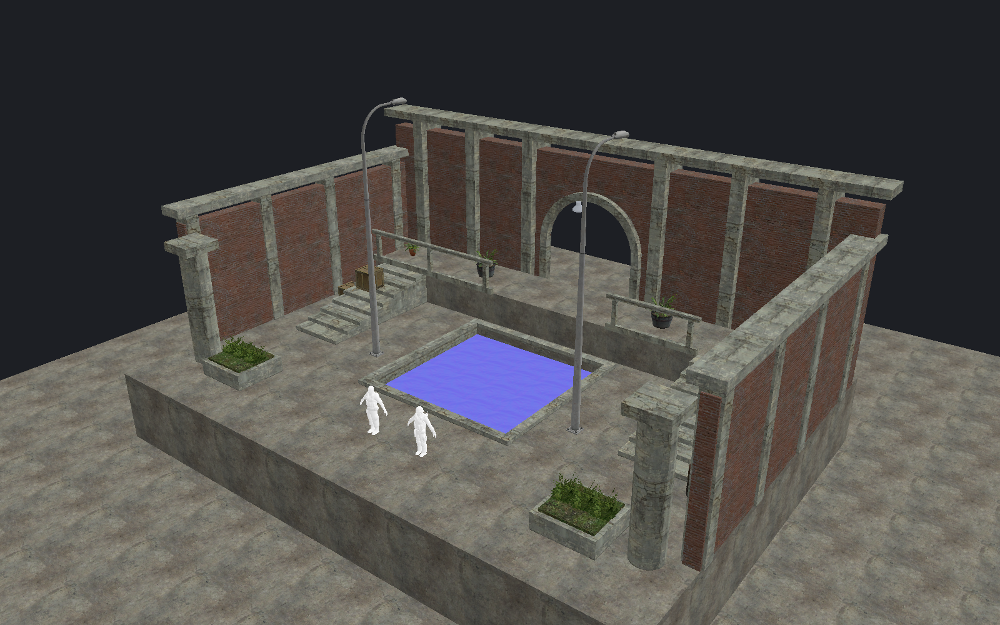

[← Manual](README.md)

# Getting started

Create, edit and compile Counter-Strike: Source maps on Linux or Windows.

## Requirements

- Rust 1.92 or later, and a C++20 compiler. On Windows, use the MSVC Rust toolchain and Visual Studio C++ Build Tools with a Windows SDK.
- Counter-Strike: Source installed through Steam.
- A compatible graphics driver for the editor and rendered views (Vulkan on Linux; Direct3D 12 or Vulkan on Windows).
- FFmpeg and ffplay for [sound previews](sounds.md).
- On Linux: Cage, grim, Bubblewrap and running Steam for [reflection capture](reflections.md).

Editing and compilation without rendered views do not need a GPU.

## Build and launch

1. Build the programs:

   ```sh
   cargo build --release -j8 -p editor -p editor-core -p compiler -p native-runtime
   ```

2. Open a map:

   ```sh
   ./target/release/editor path/to/map.vmf
   ```

   Omit the filename to start an empty map.

3. Click **Save as…** to choose a `.vmf` destination.
4. Use **Save** or **Ctrl+S** for later changes.

The editor finds the Steam game installation and SDK entity definitions automatically.
On Linux, keep `hammerr-physics` and `hammerr-native-runtime` beside the other programs.
These helpers support engine collision and reflection capture.

## Windows

1. Install Rust with the MSVC toolchain, Visual Studio C++ Build Tools and a Windows SDK.
2. Open PowerShell in the project folder and run:

   ```powershell
   .\run-windows.ps1
   .\run-windows.ps1 path\to\map.vmf
   ```

   The script builds and starts `target\debug\editor.exe`. Add `-Release` for `target\release\editor.exe`. After building, you can start the executable directly.
3. In **Build → Build settings…**, keep **Physics bodies** set to **No physics bodies** and **Generate reflections** off.
4. Connect agents through the desktop [HTTP MCP endpoint](mcp.md#connect-to-the-editor).

Steam is located through the current user's registry setting and standard installation folders. Additional Steam libraries are read from `libraryfolders.vdf`. Set `STEAM_DIR` for a custom Steam root or pass `--game` to choose content directly. The 64-bit Windows CS:S client is preferred when launching a map.

Editing, VMF saves, preferences, recovery, prefabs, instance extraction, rendered previews and BSP compilation are available. State uses `%LOCALAPPDATA%\hammerr\recovery` unless overridden. Sound previews need FFmpeg/ffplay on `PATH`.

Engine physics, native reflection capture and headless stdio MCP are unavailable on Windows. **Show silently** requires Hyprland; Windows document display requires an explicit focused-show request.



## Other content

| Option | Use |
| --- | --- |
| `--game <gameinfo.txt>` | Choose the game content search paths. |
| `--fgd <file.fgd>` | Choose entity definitions. |
| `--mcp-port <port>` | Change the default MCP port, `7377`. |
| `--no-mcp` | Disable the desktop MCP server. |
| `--headless` | Use stdio MCP without a window on Linux. |

Add custom content through the search paths in `gameinfo.txt`.
The reader supports directories and VPK archives.

## Limits

- Native reflection capture and engine physics require Linux; see the Windows notes above for platform limits.
- Invalid imports leave the current map open. Nesting is limited to 256 blocks.
- Save retains imported properties and extra blocks. It uses standard VMF formatting.
- A changed or conflicting destination blocks Save. Use **Save as…** to review the destination again.
- Failed saves retain unsaved changes. A reported write-verification error can mean the file was already written.
- Other-editor round trips are unverified.

Next: [Editor basics](basics.md), [AI agents](mcp.md) or [Compile and play](compile-and-play.md).
