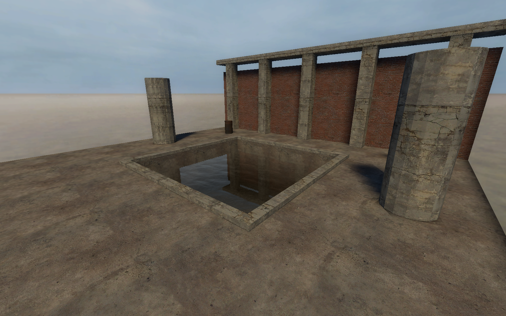
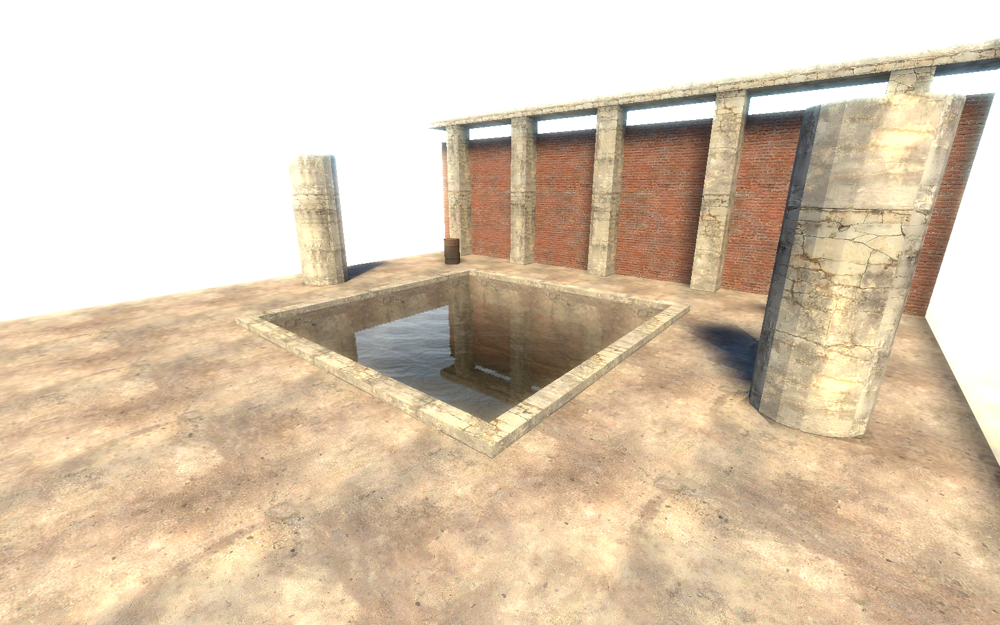

[← Manual](README.md)

# HDR exposure

Use `env_tonemap_controller` to control the game's HDR exposure.

1. Place one `env_tonemap_controller`.
2. Set its name to `map_exposure`.
3. Place `logic_auto` and open **Connections… → Add connection**.
4. Set **When this output fires** to `OnMapSpawn`.
5. Set **Send to** to `map_exposure`.
6. Set **Run this input** to `SetAutoExposureMin`.
7. Set **With parameter** to `0.375`, **Delay (seconds)** to `1`, and **Fire** to **Once**.
8. Click **Apply connection**.
9. Add the same connection for `SetAutoExposureMax`.
10. Choose **Build lighting → Direct LDR + HDR** in **Build settings…**.
11. Compile, then play with full HDR enabled in CS:S.

Equal minimum and maximum values hold a fixed exposure.
Use larger equal values to brighten the image; for example, `1.625`.

| Fixed exposure 0.375 | Fixed exposure 1.625 |
| --- | --- |
|  |  |

## Limits

- Exposure changes the displayed image, not the baked samples.
- Editor lighting previews do not simulate native exposure adaptation.
- This procedure covers one controller and positive equal bounds.
- Forced tone-map scale or disabled dynamic tone mapping can override it.
- LDR playback does not demonstrate HDR behavior.
