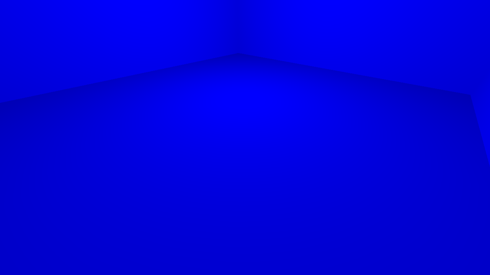

[← Manual](README.md)

# HDR exposure controllers

Use an `env_tonemap_controller` to choose the game's exposure bounds. Equal minimum and maximum values hold a fixed exposure; smaller values darken the HDR image. The controller is an ordinary entity driven by connections, so humans and agents use the same authoring operations.

## Set a fixed exposure

Start with a sealed map containing a player spawn and a light.

1. Click **Entity…**. Choose `env_tonemap_controller`, set **Position** inside the room, then click **Place entity**.
2. Select it. Under **Advanced properties**, enter `targetname` in **Property key** and `map_exposure` in **Value**, then press **Enter**. Use exactly one exposure controller for this recipe.
3. Place a `logic_auto` through **Entity… → Place entity**. Select it and open **Connections… → Add connection**.
4. Set **When this output fires** to `OnMapSpawn`, **Send to** to `map_exposure`, **Run this input** to `SetAutoExposureMin`, **With parameter** to `0.375`, **Delay (seconds)** to `1`, and **Fire** to **Once**. Click **Apply connection**. **Cancel** discards the unfinished connection.
5. Click **Add connection** again. Use the same values, changing **Run this input** to `SetAutoExposureMax`. Click **Apply connection**.
6. Open **Build settings…** and choose **Build lighting → Direct LDR + HDR**. Click **Close**, then **Compile**. Fix any build diagnostics before using **Play built map**.
7. Enable full HDR in Counter-Strike: Source before loading the map. To brighten the image, edit both connection parameters to `1.625`, save and compile again. Keep the minimum and maximum equal for fixed exposure.

The same room at fixed exposure 0.375 and 1.625:

## Limits

- Exposure changes the game image, not the baked lightmap values. The editor's authored-lighting and sky previews do not simulate native exposure adaptation.
- This recipe covers one controller and positive equal bounds. Multiple-controller selection, trigger regions, animated adaptation, blending and bloom need separate checks. There is no Master flag in this target's controller.
- Full HDR requires eligible compiled HDR data and game/hardware support. LDR playback does not demonstrate HDR exposure behavior. A forced tone-map scale or disabled dynamic tone mapping can override this workflow.
- FGD signatures describe suggested inputs; they are not engine validation. The installed legacy FGD mislabels `SetTonemapScale` as parameterless. This recipe uses its correctly declared float `SetAutoExposureMin` and `SetAutoExposureMax` inputs. External definitions are not changed automatically; see [FGD extensions](entities.md#load-extended-entity-definitions).
