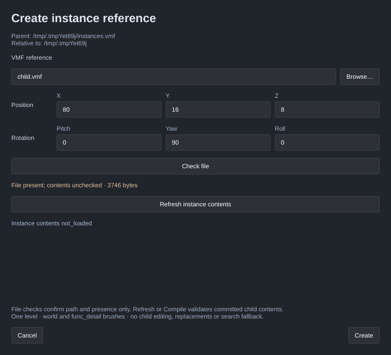

[← Manual](README.md)

# Create and edit instance references

Place a saved VMF reference with readable file, position and rotation controls.
The reference stays a root `func_instance` helper. Child brushes are read only
when you explicitly refresh the [instance contents preview](instance-contents.md)
or [compile the assembly](instances.md).

1. Save the parent map. Place the child VMF inside the parent's directory tree,
   for example `parts/arch.vmf`.
2. Click **Instance reference…** beside **Entity…**. Enter the relative path in
   **VMF reference**, or click **Browse…** and choose the file. Browse converts an
   admitted selection to its relative path; it does not copy outside files.
3. Set **Position → X / Y / Z** and **Rotation → Pitch / Yaw / Roll**. Rotation
   uses Source angles in degrees around the child's origin.
4. Optionally click **Check file**. **File present; contents unchecked** confirms
   the saved source location, relative path and bounded regular-file presence.
   It does not mean the child VMF's contents are supported.
5. Click **Create** to add and select the helper in one Undo step. **Cancel**
   discards the form without changing the map, selection or camera.
6. Select an existing helper and click **Edit instance reference…**. Change its
   path or transform, then click **Apply**. Unchanged raw properties, absent
   values, unrelated fields and editor metadata remain intact. **Undo** and
   **Redo** use the same map history as other edits.
7. Open **Instance contents…** and click **Refresh instance contents** to validate
   and resolve committed references. The authoring form offers the same explicit
   refresh action; pending form fields remain unapplied. Enable **Instance
   contents** to display a current resolved preview. A committed edit requires
   another Refresh; the checkbox never loads files automatically.

The shared form reports its owner. **Review shared form** transfers this form to
you with a new token; it preserves any stale-state error. Save, Save As, source
replacement, map edits or definition changes require cancelling and reopening.
A late Browse result cannot overwrite a replaced form or newer typing.

Limits:

- A saved parent is required for Create/Apply. Unsaved edits in that parent remain
  authoritative; its disk bytes are never substituted for the open map.
- Paths explicitly end in `.vmf` and stay inside the saved referring parent's
  tree. Child symlinks, traversal, absolute paths and self-reference aliases
  reject. No extension inference, search fallback, automatic copy or substitution
  occurs. Every nested reference also resolves from this saved root directory,
  not from its containing child's directory. A symlink parent retains the
  compiler's referring-directory semantics. Opening a child as a standalone map
  makes that child's referring directory the new root for its references.
- File checks read metadata only and admit regular files up to 4 MiB. Malformed
  child VMFs and unsupported child contents can pass presence checks, then fail
  Refresh or Compile. Those full operations support world/ordinary `func_detail`
  brushes, terrain and strictly admitted unnamed static lights/props
  through four helper levels, counting a root helper as level one,
  with global limits of 256 occurrences and 32 normalized requested paths plus
  aggregate source, geometry and dependency budgets. See [Referenced brush
  assemblies](instances.md) for the full admission limits.
- Position uses finite native-representable coordinates within ±16384. Rotation
  requires finite native-representable Pitch/Yaw/Roll. Invalid imported raw values
  remain visible for correction; values are never clamped or replaced with zero.
- Unsupported imported replacements, connections or opaque fields are preserved
  and block Apply. This form edits file/origin/angles only. Child editing,
  runtime entities and name fixups remain unavailable. A separate
  [Extract selection to instance…](instance-extraction.md) workflow exports
  supported root world/detail selections into a new child; it does not extract
  a nested hierarchy.
- Metadata guards detect replacement and common external changes; they do not
  lock files. Refresh and Compile perform their normal full validation.

MCP uses `get_instance_reference` and `set_instance_reference` with
`begin`, `update`, `check`, `file`, `review`, `apply` and `cancel` actions. Every
non-begin action requires the form token. `begin` accepts an existing helper `id`
or omits it for creation; `update` accepts only the changed authored string fields
`file`, `origin` and `angles`. `contents_validation: "not_checked"` distinguishes
authoring from the separate `set_instance_contents` Refresh operation.
