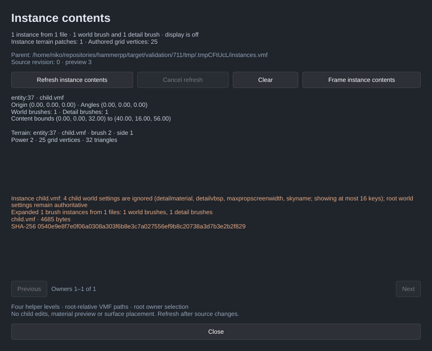
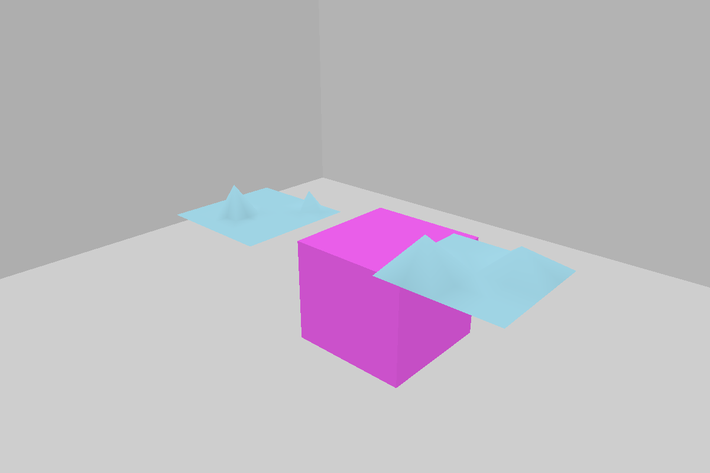
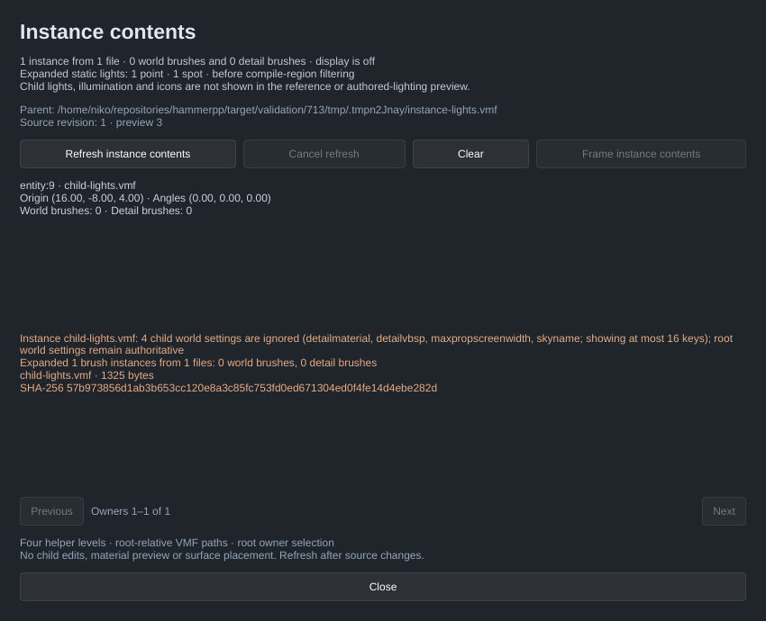

[← Manual](README.md)

# Instance contents

Inspect the world and detail geometry referenced by saved `func_instance`
helpers, including power 2–4 terrain and nested references. The flat-color
reference layer displays actual displaced terrain surfaces and composes the
helpers' Source transforms from the innermost reference outward. Selection,
content bounds and camera framing use the displayed geometry. Child files and
parent map objects remain unchanged; no terrain switch is required. Supported
unnamed static child point/spot lights are counted for compilation, with no
child-light display or illumination preview. Supported child static
props are also counted for compilation, with model preview explicitly unavailable.
Scoped child lighting-origin helpers are counted without reference geometry or
icons.
Supported child player spawns are counted without model/icon display, reference
bounds, picking or framing.
Child visibility-cluster volumes are counted for compilation without adding
reference geometry or icons.

1. Save the parent VMF. Use **Instance reference…** to create an explicit relative
   `.vmf` reference inside its directory tree; see [Instance authoring](instance-authoring.md).
2. Under **VIEWPORT**, enable **Instance contents**, then open **Instance contents…**.
3. Click **Refresh instance contents**. The inspector reports loading, ready,
   empty or failed state, owner references, transforms, world/detail counts,
   content bounds and checked dependency identities. **Expanded static lights:**
   reports point/spot counts before compile-region filtering. **Expanded static
   props:** reports child props before that filtering and explains the unavailable
   model preview. **Expanded lighting origins:** counts visible helpers,
   including unreferenced helpers, before region filtering. **Expanded player
   spawns:** counts both supported team-spawn classes before region filtering
   and explains their unavailable model/icon geometry. **Visibility helpers:**
   counts expanded child visibility volumes before region filtering and explains
   their unavailable geometry. **Cancel refresh**
   cancels the current request; **Clear** frees the resolved layer.
4. Click a displayed reference surface to select its root instance helper.
   Terrain picking follows the displaced triangles. Overlapping object cycling
   uses that same owner. **Frame instance contents** frames selected root
   instance owners, or all owners when nothing is selected. Ordinary
   frame-selection and camera focus include displayed content bounds.
5. After changing any child or descendant file, helper transform or file
   reference, click **Refresh instance contents** again. Stale contents disappear
   from rendering, picking and framing; a failed refresh keeps its error and
   shows no old layer.

Limits:

Turning the checkbox on or off displays an existing current snapshot; it never
loads child files. Refresh resolves one parent snapshot, including its unsaved
edits. All visible references and their descendants must resolve successfully
together. A missing
or unsupported descendant fails the whole layer, including repeated occurrences
of that file. Changing a grandchild makes the whole resolved layer stale.

Cancellation requests cleanup; a new refresh waits until that worker and its
result have retired. Normal exit cancels outstanding instance work and waits
for its cleanup before the final recovery snapshot.

The layer is available in ordinary **Objects** mode. Faces, components,
placement, paint, clipping, ruler endpoint picking and active geometry drafts suppress it, with a status
reason. Child geometry never becomes an editable root face or placement target.
Selection dimensions, transform pivots, measurement attachments, volume tools
and other authoring bounds continue to use real parent objects. A working region
includes a whole reference owner when its content bounds or marker intersects.

Reference surfaces use a distinct flat color, with a selected-owner tint and
outline. Root geometry occludes them by depth. **Wireframe** draws their edges
without filling the faces. Terrain draws the displaced sheet and its triangle
edges, with its brush cage faces omitted. Invalid terrain fails the whole
refresh; there is no cage fallback. The layer does not load child materials or
preview lighting, normal maps, sky, water, transparency, models or runtime
entities.

Supported [static child lights](instances.md) resolve and count but add no
icons, light picking, light bounds or illumination to this layer or the
authored-lighting preview. A light-only assembly is ready and retains
its owner/dependency identities and counts, with no reference geometry to
display, pick or frame. **Frame instance contents** is unavailable for that
snapshot. Mixed assemblies retain their ordinary brush/terrain preview.

Supported [child static props](instances.md) also resolve and count without
loading model assets. A model-only assembly can be ready with checked VMF
identities and counts; the inspector reports that its model display, bounds,
picking and framing are unavailable. A missing or invalid MDL can leave reference
resolution ready and still fail compilation. Mixed assemblies retain their
actual brush/terrain surfaces and bounds; props do not add placeholder geometry.
Refresh does not validate a selected skin family or preview child lighting flags.
It does validate the ordinary header-independent
[fade and DX options](static-props.md#visibility-options) without reading model
assets. Malformed options fail the whole refresh. A ready report certifies
neither a selected model family nor native fade/DX appearance, and it adds no
child model display or runtime-visibility preview.

Supported child lighting-origin helpers likewise retain identities and counts
without icons, reference bounds, picking or framing. A helper-only assembly can
be ready while the inspector explains that no reference geometry is available.
Mixed assemblies retain their actual brush/terrain preview. Local prop bindings
are checked for retained props during compilation; a ready reference inspection
does not prove a missing or hidden lighting helper is usable.

Supported child `info_player_terrorist` and `info_player_counterterrorist` spawns
likewise retain checked VMF identities and counts without loading player models.
A spawn-only assembly can be ready while **Frame instance contents** is
unavailable: it has no child spawn models, icons, bounds or pick surfaces.
Adding spawns to a mixed assembly does not change its brush/terrain mesh,
content bounds or face provenance. This preview does not certify native spawn
selection, team balancing or player clearance.

Supported child `func_viscluster` volumes retain source identities and counts
without becoming physical detail or reference surfaces. A visibility-only
assembly is ready with zero geometry and unavailable framing. Mixed assemblies
keep their actual brush/terrain mesh and bounds; visibility volumes add no
placeholder geometry. Refresh checks their supported source and transform
rules. Build-time leaf membership, area/liquid restrictions and the assembled
retained-helper limit are checked during compilation.

**Tool textures** does not classify this flat reference layer. Child editing,
parameter replacements and automatic live refresh remain unsupported.
[Instance authoring](instance-authoring.md) edits the root reference.

Terrain uses the same supported neighbor and density rules as compilation.
Ambiguous or mismatched shared edges remain unlinked and produce a diagnostic.
The preview cannot replace ordinary parent terrain: if expanded child contents
would change a parent patch's displaced vertices or triangle indices compared
with the parent without its instance contents, **Refresh instance contents**
fails with “Instance contents would require replacing ordinary parent terrain
LOD; compilation remains available”. A coarse child next to a finer parent
patch can require this change. Existing density transitions between parent
patches and unrelated child terrain remain allowed. Compilation can still
expand the complete scene under its own limits.

References allow four helper levels, counting each root helper as level one.
Every nested filename is relative to the saved root parent's referring directory,
not the containing child's directory. Limits include 256 helper occurrences and
32 distinct normalized requested file paths across the entire expansion, 4 MiB
per file and 32 MiB total source bytes, with bounded parsing and geometry work.
The [child terrain limits](instances.md) also apply: power 2–4 world/detail
terrain, 65,536 source-grid vertices, 262,144 expanded grid vertices and
2,097,152 grid-work units. The preview's complete terrain context, including
ordinary parent patches, is capped at 262,144 grid vertices. Preparing and
comparing the expanded and ordinary parent terrain contexts must fit a combined
64 MiB CPU budget and bounded geometry work.
Derived geometry is capped at 262,144 vertices, 786,432 indices, 524,288 edge
vertices and 262,144 pick triangles; retained CPU data is capped at 64 MiB and
GPU geometry payload at 32 MiB. Exceeding a preview limit rejects the entire
layer; ordinary parent rendering remains. Compilation can have a different
outcome under its own limits.

MCP inspection keeps `owners[].file` as the normalized root reference.
`brushes[].file` and `face_provenance[].file` identify each true leaf alongside
its original solid/side IDs. Terrain provenance rows additionally report
`terrain: true`, `power`, `vertices` and the displayed `triangles` count.
`geometry` counts describe the actual reference mesh, including any terrain
density adjustments. Repeated placements may share those leaf identities;
picks and framing still use the root helper.
Inspection's `stats.point_lights` and `stats.spot_lights` are omitted individually
when zero. Like compiler counts, they describe expansion before compile-region
filtering. `stats.static_props` follows the same count and omit-zero convention.
`stats.lighting_origins` also follows that convention and includes unreferenced
visible helpers. A light-only, model-only or lighting-helper-only ready report has `available:false`, zero geometry
counts, no face provenance and null owner content bounds.
`stats.player_spawns` uses the same pre-region and omit-zero policy.
`player_spawn_preview` reports `available:false` with the same reason shown by
the inspector. Spawn-only ready reports also have zero geometry, null owner
content bounds and no face provenance.

`stats.visclusters` counts expanded visible child visibility helpers before
region filtering and is omitted when zero. `viscluster_preview` reports
`available:false` and the inspector's unavailable-geometry reason. Visibility-only
ready reports have zero geometry, no face provenance and null owner content bounds.

MCP uses `inspect_instance_contents` and `set_instance_contents` with
`refresh`, `cancel`, `clear` or `frame`. Inspectors paginate at most 64 owners per
call. Shared `set_view.instance_contents` and temporary
`render_view.instance_contents` control display; the matching optional
`pick_at_pixel.instance_contents` selects what the temporary image shows.
Rendered metadata retains the report for the exact uploaded snapshot.
