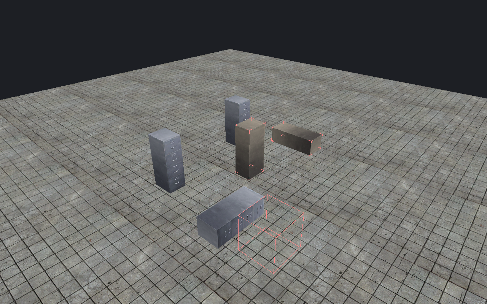

[← Manual](README.md)

# Instance contents

Inspect resolved child geometry without opening each child map.

1. Create a saved [instance reference](instance-authoring.md).
2. Open **Instance contents…**.
3. Click **Refresh instance contents**.
4. Read dependency, content and unsupported-feature diagnostics.
5. Enable **Instance contents** in **Viewport**.
6. Click **Frame instance contents** to inspect the resolved geometry.

The refresh reads committed child VMFs. It does not load model assets.
Display, picking and framing load supported static-prop assets through the normal model cache.
**Cancel refresh** stops the owned refresh. **Clear** removes the prepared reference display.

## Show static props

1. Save supported `prop_static` entities in the child.
2. Return to the parent and click **Refresh instance contents**.
3. Enable **Instance contents** in **Viewport**.
4. Click a displayed prop to select its outer containing reference.
5. Click **Frame instance contents** to include the posed model bounds.

Repeated and nested references show the same supported meshes, skins and materials as root props.
Use **Reload models** after model files change. Use **Reload material assets** after material files change.

## Limits

- Reference geometry is a checked guide, not a complete game preview.
- Supported brush, terrain and static-prop geometry can be displayed. Other child entities have separate count and availability reports.
- Props require unit scale, body 0, white tint and Normal render mode. Model support matches the root model preview.
- Child props do not receive authored-lighting preview. Animation, physics, runtime fade and DX-level behavior are not simulated.
- A model read, pose or shared geometry-budget failure hides the reference layer and reports an error. Root reference markers can remain visible.
- Hidden child content is omitted. Editor visibility filters apply to the outer reference; the working region tests its full content bounds.
- Child lights, spawns, samples and visibility helpers can compile without a corresponding reference mesh or icon.
- Overlay target geometry can appear without its projected material.
- Final brush-model pivots, posed brush geometry and local bounds are checked at compile time.
- Source edits or changed dependencies require another refresh.
- Missing or unsupported child content reports an error; stale data is not presented as current.
