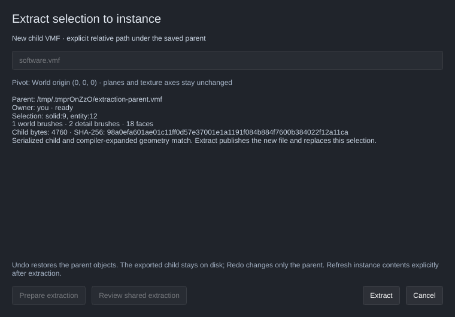

[← Manual](README.md)

# Extract a brush assembly to an instance

Export selected brushes into a new child VMF and replace them with one reference.
Preparation checks the serialized child through the same resolver used by
[compilation](instances.md) and the [contents preview](instance-contents.md).

1. Save the parent map. Create the child directory beforehand if needed.
2. In **Objects** mode, select visible world brushes and whole ordinary
   `func_detail` owners. Selected world brushes must follow retained world brushes;
   selected detail owners must follow retained visible brush entities. Point
   entities after the selected detail owners are allowed.
3. Click **Extract selection to instance…**. Enter a new explicit relative VMF
   path, for example `assemblies/platform.vmf`.
4. Click **Prepare extraction**. Review the parent path, selected root IDs,
   world/detail counts, face count, child size and SHA-256. Preparation writes a
   private staging file; the final child does not exist yet.
5. Click **Extract**. The editor publishes the new child without overwriting an
   existing file, replaces the selection with one `func_instance`, and selects it
   in one Undo step. The parent remains unsaved.
6. Open **Instance contents…**, click **Refresh instance contents**, then enable
   **Instance contents** to see the resolved child. Extraction never loads or
   enables the layer automatically. Use [Edit instance reference…](instance-authoring.md)
   to move or rotate the committed reference.
7. **Cancel** or Escape discards your matching preparation and private staging
   file. An agent-owned review closes without cancelling its work.
   **Review shared extraction** transfers a ready or failed review to a new token.
   A stale review must be cancelled and prepared again.

Cancellation releases owned staging after any active worker finishes. Normal
exit cancels extraction and waits for worker/staging cleanup before the final
recovery snapshot. Cleanup failures remain visible in the extraction report.

**Pivot: World origin (0, 0, 0)** is the only pivot. Child plane points and texture
axes, scales and shifts remain unchanged; the helper uses zero position and
rotation. Selected solid, side and detail-owner IDs remain in the child. Compiler
expansion assigns generated IDs with child provenance.

**Undo** restores the parent objects and removes the reference. The exported child
stays on disk. **Redo** changes only the parent; it does not recreate or overwrite
the child. Save the parent separately. There is no automatic child deletion or
crash-atomic save of both files.

Limits:

- Extraction currently requires Linux directory-relative staging/publication.
  Cleanup checks the owned inode before removing a private entry, including
  after directory renames; reported cleanup failures preserve replacements.
- Extract 1–64 root objects, at most 256 brushes and 2048 sides, with 128 sides per brush. The child is at
  most 4 MiB and the retained plan at most 16 MiB. Existing compiler bounds,
  parser, convexity, field and aggregate limits also apply.
- Paths explicitly end in `.vmf`, stay under the saved referring parent, and use
  existing directories. Files, directories and valid or dangling symlinks already
  at the destination reject. No extension inference, search, directory creation,
  overwrite or outside-file substitution occurs.
- Existing visible instance references reject so extraction preserves compiler
  brush and plane order. Only whole ordinary `func_detail` owners and world
  brushes are supported. Hidden selections, terrain, runtime entities, nested
  references, replacements and unsupported child fields reject.
- Selected group/layer membership, attached notes, partition intent and inbound
  overlay/cubemap/side-list bindings reject. Unknown semantic metadata rejects
  rather than being stripped. Valid unrelated metadata and objects stay in the
  parent; selected cosmetic editor fields stay in the child.
- Map edits, selection changes, Save, source replacement or definition changes
  stale preparation. Active builds, launches and editing drafts block extraction.
  Failure preserves parent/history/camera and existing BSP/LIN files. External
  file races retain the normal identity-guard and no-clobber limits.
- Child editing and automatic local-pivot conversion are unavailable. The flat-color
  contents preview remains a reference guide, with its existing material limits.

MCP shares the same operations through `get_instance_extraction` and
`set_instance_extraction`: `prepare` takes `file`, `extract` takes the owned
`token`, and `review`/`cancel` take the current token. `prepare` and `extract`
accept `background: true`; their default waits for off-lock validation. Inspection
reports readiness and explicit errors without initializing graphics. A Cancel
for the just-completed matching token reports completion and retains the child.
