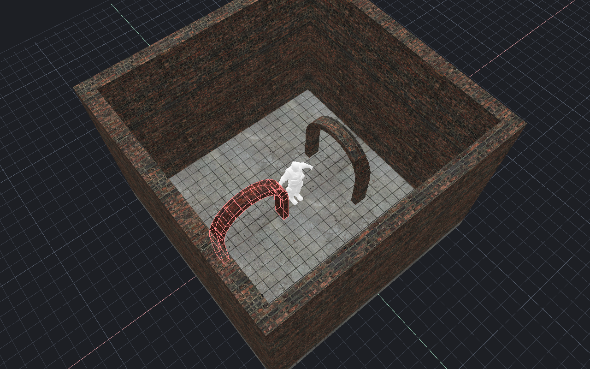

[← Manual](README.md)

# Compiled assemblies

Compile supported contents of saved child VMFs into a parent map.

1. Save the child assembly inside the parent's directory tree.
2. Create an [instance reference](instance-authoring.md).
3. Open **Instance contents…** and click **Refresh instance contents**.
4. Resolve reported path, content or dependency errors.
5. Compile the parent.
6. Inspect **Instances**, **Files**, **Nesting depth** and diagnostics in **Build details…**.

## Supported contents

| Content | Support |
| --- | --- |
| World and ordinary `func_detail` brushes | Checked transformed geometry and textures. |
| Terrain | Supported explicit grids, borders and transformed geometry. |
| Point, spot and sun lights | Checked static or supported built-in appearance settings. |
| Spotlight targets | Named static `info_target` endpoints in the same child, with Prefix names. |
| Static props | Supported models, skins, transforms and scoped lighting origins. |
| Player spawns | Supported CS:S spawn classes. |
| Stationary brush models | `func_brush` with supported pivots and initial poses; ordinary opaque `func_wall` with zero source angles. |
| Overlays | Supported unnamed projections bound to direct child world/detail or terrain faces. |
| Cubemap samples | Supported positions and direct ordinary world/detail manual bindings. |
| Visibility helpers and occluders | Checked static helper classes and supported geometry. |
| Saved atlas regions | Valid editor-only catalogs stay in child sources and are omitted from compiled assemblies. |

Compiler support does not imply a full parent viewport preview of each child entity.
Read [instance contents](instance-contents.md) for display limits.
Supported static props can show their posed meshes and selected skins in that preview.
Picking a child prop selects its outer containing reference.

## Collapse references into editable geometry

1. Select a visible reference and open **Edit instance reference…**.
2. Apply or cancel any edited reference fields first.
3. Set **Collapse scope** to **All visible references** or **Selected leading references**.
4. Click **Preview collapse references…**.
5. Inspect the materialized content and brush, terrain, prop, light, target and cubemap counts.
6. Click **Apply collapse**, or **Cancel collapse** to discard the preview.

**All visible references** is the default. It converts every visible root
reference, recursively, in one Undo step.

**Selected leading references** converts only selected complete visible root
references. **Visible root order** lists their parent entity order. The selection
must start with the first visible root reference in that order and include every
earlier visible root. Empty, mixed, hidden or later-only selections stop the
batch. No unselected reference is added to the selection or converted. Arbitrary subsets are not supported.

Unselected and hidden root references and child files stay unchanged.
**Review collapse** transfers an idle shared preview to you before Apply or
Cancel. Selection, source or dependency changes require a new preview. Cancel
and prepare again to change the scope.

Collapse supports world and ordinary `func_detail` brushes, checked terrain,
static `light`/`light_spot` assemblies with checked local `info_target`
helpers, supported `prop_static` entities, and checked `env_cubemap` samples.
Collapse uses the same four-level preparation as compilation. Child object
color and logical layout remain attached to the new objects. Each detail brush becomes an individual
`func_detail` owner. Reference markers are
removed, consuming their file, transform, name, marker color and marker layout.
Child file version/view settings remain local to the unchanged child files;
the parent's settings stay authoritative.

Light assemblies retain independent LDR/HDR values, appearances 0–11, composed
poses, whole-value bindings and scoped local spotlight targets. Targeted spots
require the compiler's named ancestor scopes. Named/switchable lights and
runtime connections remain unsupported. New light/target entities receive fresh
editor IDs; their compiled `hammerid` follows those IDs. Retained references
expand again at Compile and can receive different build-local IDs and
`hammerid` values. Other prepared entity fields, references and ordering stay
intact.

Cubemap samples keep their authored size/default fields and editor settings.
Manual `sides` bindings follow the fresh side IDs of the same reviewed direct
world/detail geometry. Automatic samples keep an absent `sides` field absent.
Terrain/runtime-model manual targets and cross-occurrence references remain
unsupported. Cubemap helpers are editable entities consumed by compilation;
they do not gain a runtime `hammerid`.

Static props keep their model, skin, collision, lighting, fade and DX settings.
Their `lightingorigin` must be empty. `info_lighting` helpers are not supported
for collapse. Source and intermediate model bounds must pass the compiler check.
Changes to a checked model file require a new preview. Model meshes, materials
and physics assets are checked at Compile. Props get fresh editor IDs and remain
compiler-handled native static props, with no runtime `hammerid`.

Other child entities, hidden child content, groups/layers, saved
atlas regions, nondefault child world settings and custom metadata require
separate preservation rules and refuse the whole batch. Reference group/layer
membership, attached notes and incoming bindings also refuse. The preview
reports fresh object IDs, separate complete expanded-to-authored ID maps for
emitted entities, cubemap helpers and static props, and bounded original
leaf-face/entity provenance.
The preview details include each face/entity's captured root-to-leaf helper
route, with IDs authored in each containing file. Repeated occurrences of the
same original face or entity remain distinct. Apply retains these routes in
its captured preview report; they describe the reviewed sources.

Use a UTF-8 path for the saved parent. Snapshot and plan storage each cap at
64 MiB. Input text and metadata cap at 8 MiB and 131,072 items; work limits can
refuse smaller maps. Captured occurrence paths and their shared provenance slots
cap at 2 MiB. Provenance response copies cap at 1 MiB; exceeded copies show an
explicit diagnostic while the complete reviewed plan and counts remain available.

## Keep saved atlas regions in a child

1. Open the child VMF and [save named atlas regions](atlas-texturing.md#save-and-reuse-named-regions).
2. Save the child, then return to the parent.
3. Open **Instance contents…** and click **Refresh instance contents**.
4. Compile the parent normally.

Each child catalog uses the same bounded version and validation as the atlas dialog.
Valid opaque catalog extensions remain editor-only. Catalogs are never copied into the parent or BSP, and their stored image/material references do not load assets for compilation.
Malformed or duplicate catalogs, unsupported versions and unknown top-level map blocks reject. Nested and repeated references follow the same rules.
Changing only a saved region or catalog extension still makes prior previews and builds stale because dependency checks retain the complete original child file.

## Include a stationary wall

1. Open the child VMF as a normal map and select its ordinary solid brushes.
2. Click **Tie to entity…**, choose `func_wall`, then click **Tie selected brushes to entity**.
3. Enable **Advanced properties**.
4. Enter `origin` under **Property key** and a finite source pivot, such as `16 8 4`, under **Value**, then press Enter.
5. Keep the render fields at their neutral defaults and **Name** and **Global Entity Name** empty.
6. Save the child, return to the parent, and compile.

The installed FGD has no origin field for `func_wall`; use the raw property or
one visible resolved origin brush in the same entity. Compilation consumes that
origin brush. Containing references can translate and rotate the whole model
with its attached textures. The emitted entity keeps its `func_wall` class and
zero source pose.

Source `angles` must be absent or one canonical three-component zero value.
Only ordinary opaque SOLID body materials are supported. Cutouts, nonneutral
render or shadow fields, brush-only controls, `_minlight`, runtime names,
parenting and connections reject. `vrad_brush_cast_shadows` must be absent or
zero; global shadow requests remain available only to eligible `func_brush`
models. Child wall geometry is unavailable in the parent reference preview.

## Rotate a stationary child brush

1. Open the child VMF as a normal map.
2. Select an eligible `func_brush`.
3. Enable **Advanced properties**.
4. Enter `angles` under **Property key**.
5. Enter pitch, yaw and roll under **Value**, then press Enter.
6. For example, enter `15 35 10`.
7. Save the child, return to the parent, and compile.

Angles must be finite and within ±360 degrees per component.
The installed FGD has no labeled rotation field for this class; use the raw property.

Compilation resolves and consumes any origin brush first.
It rotates the stationary body and attached texture coordinates before applying containing reference transforms.
The compiled body has zero entity angles; the child VMF keeps its authored values.

The foreground assembly combines initial pitch, yaw and roll with a containing reference rotation.

Moving brush models, parenting and named brush models remain unsupported.
Eligible child `func_brush` models with **Shadows → Yes** can cast [binary cutout shadows](brush-texture-shadows.md#cast-from-a-stationary-child-brush-model) when **Brush texture shadows** is enabled in a lit build. Without a global request, supported child cutouts affect only lit receivers in the same model. General translucent materials remain unsupported. Effective origins and initial poses use the same lowering described above.
The compiled entity does not retain the child's original angle value.
The parent reference preview remains unavailable for child models.

## Light colors per reference

Use one child map with different point or spot light colors in each reference.

1. Open the child VMF.
2. Select a `light` or `light_spot`, then enable **Advanced properties**.
3. Set **Property key** to `_light`.
4. Set **Value** to `$tint`, then press Enter.
5. Save the child and return to the parent.
6. Select an instance reference and enable **Advanced properties**.
7. Set **Property key** to `replace01`.
8. Set **Value** to `$tint 255 220 180 400`, then press Enter.
9. Open **Build settings…**.
10. Set **Build lighting** to **Direct LDR** or **Direct LDR + HDR**, then click **Close**.
11. Compile the parent.

For HDR, set the child's `_lightHDR` to `$hdr`.
Set the containing reference's `replace02` to `$hdr 255 240 220 600`.
Each reference can supply different values. Compilation keeps the saved child unchanged.
Use [compiled light inspection](compiled-lights.md) to check the effective LDR and HDR records.

To bind sun and sky colors, use an unnamed `light_environment` in the child:

1. Open the child, select `light_environment`, and enable **Advanced properties**.
2. Set **Property key** to `_light` and **Value** to `$sun`, then press Enter.
3. Set **Property key** to `_ambient` and **Value** to `$sky`, then press Enter.
4. Save the child and return to the parent.
5. Select its instance reference and enable **Advanced properties**.
6. Set `replace01` to `$sun 255 220 180 200` using **Property key** and **Value**.
7. Set `replace02` to `$sky 180 210 255 40` the same way.
8. Choose **Direct LDR** or **Direct LDR + HDR** in **Build settings…**, then compile.

The child's `_lightHDR` and `_ambientHDR` also accept whole-value tokens.
Bind them in separate replacement slots; a literal `-1 -1 -1 1` keeps normal HDR inheritance.
See [sun spread bindings](instance-authoring.md#bind-sun-spread) to set soft-shadow spread per reference.
Baked lighting still permits one global `light_environment` across the parent and its children.

To bind an HDR gain:

1. In the child, enable **Advanced properties**.
2. Set **Property key** to `_lightscaleHDR` and **Value** to `$gain`, then press Enter.
3. Save the child and return to the parent.
4. Select its instance reference and enable **Advanced properties**.
5. Set an unused replacement slot, such as `replace03`, to `$gain 1.5`.
6. Choose **Direct LDR + HDR** in **Build settings…**, then compile.

`_lightscaleHDR` supports point, spot and sun lights.
For sky ambient gain, use `_AmbientScaleHDR` on `light_environment` and another replacement slot.
A gain binding must contain one finite, nonnegative number. Zero is valid.
An absent gain keeps the normal value of 1. An unresolved token has no evaluated gain.

Use `replace01` through `replace10`. Root values have the form `$name literal`.
Nested helpers may use `$name $ParentName` to [forward one immediate-parent value](instance-authoring.md#forward-light-values-through-nested-references).
Names are case-insensitive, with 1–64 ASCII letters, digits or underscores; the first character cannot be a digit.
A parameter must fill the whole supported value field. Each containing reference must supply every used parameter.

Missing, duplicate or unused bindings fail. Invalid effective light values also fail, including in Fullbright builds.
An unresolved child template can be edited and saved, but cannot compile alone.
Preview excludes unresolved lamps and reports a reason; the parent still has no child-light preview.

Point and spot lights support `_light`, `_lightHDR`, `_lightscaleHDR`, `_fifty_percent_distance`, `_zero_percent_distance`, `_constant_attn`, `_linear_attn`, `_quadratic_attn`, `_distance` and `_hardfalloff`.
Spotlights also support `_inner_cone`, `_cone`, `_exponent` and signed `pitch`; see [cone and focus bindings](instance-authoring.md#bind-spotlight-cones-and-focus) and [pitch bindings](instance-authoring.md#bind-spotlight-pitch).
Sun lights support `_light`, `_lightHDR`, `_ambient`, `_ambientHDR`, `_lightscaleHDR`, `_AmbientScaleHDR` and `SunSpreadAngle`.
See [light falloff bindings](instance-authoring.md#bind-light-falloff-distances) for the distance rules.
See [legacy attenuation bindings](instance-authoring.md#bind-legacy-light-attenuation) for coefficient rules and percentage-distance precedence.
Bindings apply only to direct child lights. Other scalar fields remain literal.
Nested references bind their own direct child lights. Explicit forwarding can pass a literal through each of the supported four helper levels, including same-name passthrough.
Every hop must declare its binding. Implicit ancestor search, same-helper slot lookup, recursive or partial text replacement and parameter declarations remain unsupported.

## Names and parameters

Use **Advanced properties → Fix Up Name** and **Entity Name Fix Up → Prefix** for supported scoped names.
Lighting-origin branches require explicit prefixes at every enclosing level.
Child helper names and references must agree before expansion.
Unsupported replacements, name fixups, scripts or dynamic references fail explicitly.

## Aim a child spotlight

1. Open the child and click **Entity…**. Create `info_target` and set **Name** to `aim`.
2. Select an unnamed `light_spot`. Set **Entity to point at** to `aim` and retain valid **Pitch**, cone and light values.
3. Save the child. In every containing reference, set **Fix Up Name** explicitly and **Entity Name Fix Up** to **Prefix**.
4. Refresh **Instance contents…**, then compile the parent.

Each spotlight must reference one visible endpoint in its immediate child, with exact name spelling.
Missing, duplicate, external, coincident and colliding targets stop the build. Keep both lamp and endpoint inside a lit compile region.
The parent reports endpoint counts before region filtering. It does not preview child targets or targeting guides.
Endpoint parenting, I/O and dynamic references remain unsupported.

## Source ownership

The open parent document is authoritative. Child files are read from their checked saved paths.
Builds retain dependency identities; changed or missing children make old output stale or unavailable.
A failed expansion preserves the previous published BSP.

## Limits

- Four helper levels, 256 occurrences and 32 normalized requested paths, plus shared source and geometry budgets.
- Each reference resolves from the saved root parent's tree. Child symlinks and outside paths reject.
- Source and intermediate positions must remain within ±16384.
- General runtime entities, arbitrary parenting, dynamic scripts and unsupported initial poses remain unavailable.
- Child overlay and cubemap bindings cannot cross occurrence scopes or target unsupported owners.
- Inspect the current diagnostic for exact class and material restrictions; admission differs by compiler consumer.
