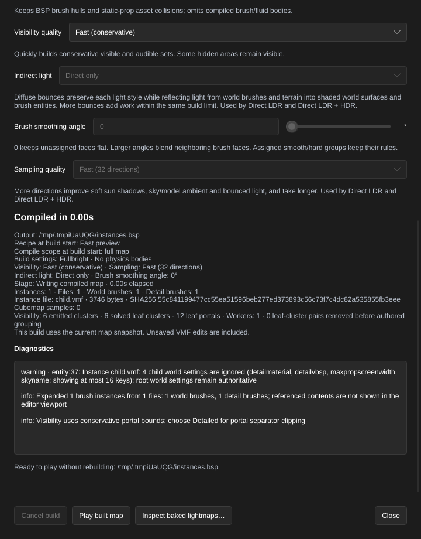

[← Manual](README.md)

# Compile referenced brush assemblies

Reuse a saved VMF's world and detail brushes at several positions and rotations.
Compilation expands the referenced geometry; the editor currently shows only the
instance helper, not its child contents.

1. Save the parent map. Save a child VMF inside the same directory tree, such as
   `parts/arch.vmf`. Keep the child's visible contents to world brushes and
   ordinary `func_detail` brushes. Its world settings do not replace the parent's.
2. In the parent, click **Entity…**. Enter `func_instance` in
   **Classname (custom classes are supported)**, set **Position**, then click
   **Place entity**. **Cancel** closes the form without placing it.
3. Select the helper and enable **Advanced properties**. Add `file` using
   **Property key** and `parts/arch.vmf` using **Value**, then press Enter.
   With the Source SDK definition loaded, the same field is **VMF Filename**.
4. Move or rotate the helper with the ordinary transform controls. Its origin
   places the child's origin. The `angles` property uses Source pitch, yaw, roll;
   brushes and attached texture coordinates rotate together. Keep replacement
   fields empty; the initial slice does not expand named runtime entities.
5. Click **Compile**. Unsaved parent edits are included. Open **Build details…**
   in the bar below the toolbar to inspect **Instances**, **Files**, world/detail
   brush counts and each relative dependency's byte count and **SHA256**.
6. Recompile after changing a child. Changed, missing or retargeted dependencies
   make the completed build stale and disable **Play built map**. Launch also
   verifies exact dependency contents before starting the game.

Limits:

- One instance level, at most 256 occurrences and 32 unique child files. Paths
  must explicitly end in `.vmf` and stay inside the saved parent's directory tree.
  Backslashes normalize to slashes; absolute paths, traversal and symlink child
  components reject. No game-content, maps-root or InstancePath search occurs.
- A symlink parent resolves children beside its referring filename. Its physical
  source and referring-directory identity remain guarded. Save an untitled
  parent first; an output BSP filename cannot establish its source directory.
- Nested instances, runtime entities, parameter helpers, replacements, terrain,
  active child compile regions and unknown semantic metadata reject. Ordinary
  hidden child objects remain excluded. Fix-up settings cannot introduce runtime
  name rewriting in this brush-only subset.
- Children are bounded to 4 MiB each, 32 MiB total, 32 syntax levels and checked
  object/side/work budgets. Resulting geometry must satisfy normal compile bounds.
  Diagnostics identify the root helper and child object rather than offering a
  generated child face as an editable parent face.
- Expansion happens before parent compile-region selection. Geometry intersecting
  the region remains eligible even when its instance marker is outside. Ordinary
  region geometry restrictions still apply. **Generate reflections** with
  instances is unavailable.
- Status and readiness use metadata/alias checks; launch verifies exact bytes.
  Metadata-preserving edits may be detected only by launch or a fresh build.
- Missing, unsupported, changed or cancelled inputs preserve the previous BSP
  and pointfile. A successful build retains its dependency identities separately
  from later failed jobs. External mutation after final verification remains a
  filesystem race; the editor does not lock referenced files.
- Referenced viewport contents, extraction, in-context editing, automatic search
  and nested/runtime-name expansion remain unavailable. Compiler calls without
  a saved source context continue to reject unresolved instances.

MCP uses the same `create_entity`, `set_entity_properties`, transforms,
`compile_map`, `start_compile` and `run_map` operations. No extra compile switch
is required. Build reports expose optional `stats.instances`; completed jobs
also report dependency freshness. `get_compile_status.launch` and
`inspect_baked_lightmaps` respect the retained build's dependencies.
