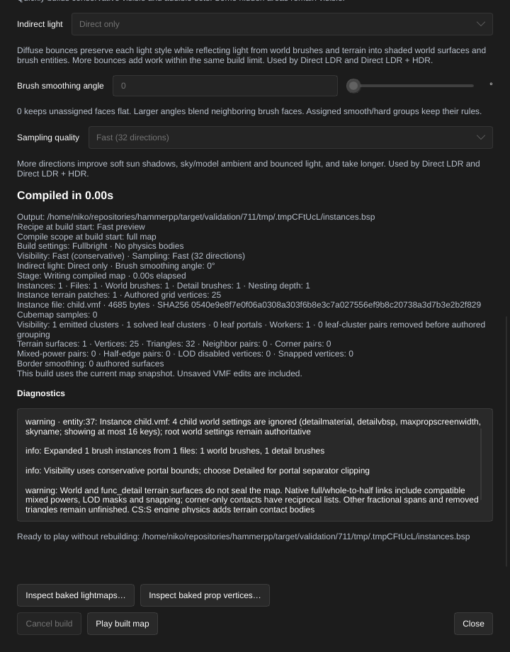

[← Manual](README.md)

# Compile referenced assemblies

Reuse saved VMFs' world and detail brushes, power 2–4 terrain, unnamed static
point/spot lights, static props, scoped lighting-origin helpers, player spawns,
visibility volumes, automatic cubemap samples and nested references at several
positions and rotations.
Compilation expands the supported contents without an extra switch. The editor
can resolve a separate, explicitly refreshed
[reference preview](instance-contents.md) with actual displaced terrain surfaces
in a flat color.
Use [Extract selection to instance…](instance-extraction.md) to create a child
from supported brushes already in the parent.

1. Save the parent map. Save a child VMF inside the same directory tree, such as
   `parts/arch.vmf`. Keep the child's visible contents to world brushes,
   ordinary `func_detail` brushes, supported static lights/props, `info_lighting`
   helpers, `info_player_terrorist` / `info_player_counterterrorist` spawns,
   `func_viscluster` volumes, automatic `env_cubemap` samples and nested
   `func_instance` references.
   World and detail brushes may carry supported power 2, 3 or 4 terrain. The
   child's world settings do not replace the parent's.
2. To add a child light, open the child and click **Entity…**, then choose `light`
   or `light_spot`. Use **Advanced properties** to check the strict static fields
   below. A spotlight needs an explicit `pitch`, such as `-90` for downward or
   `0` with the first `angles` component zero for horizontal. Save the child
   before returning to the parent. Loaded FGD defaults do not bypass these checks.
3. To add child scenery, choose `prop_static` in **Entity…** and set **World Model**
   to a supported static model. In **Advanced properties**, choose
   **Collisions → Not Solid**, **Use Bounding Box** or **Use VPhysics**.
   **Use VPhysics** is the default and requires the model's matching `.phy` asset.
   Keep scale 1, body 0, normal white rendering and names empty. Choose a valid
   **Skin**, starting at 0. The ordinary [prop lighting options](static-props.md#props-in-referenced-assemblies)
   and [visibility options](static-props.md#visibility-options) also work in
   children. Set fading and DX bounds through **Advanced properties**, then
   save the child before compiling its parent.
4. To add a child spawn, open **Entity…**, choose `info_player_terrorist` or
   `info_player_counterterrorist`, then click **Place entity**. Set **Position**
   and **Rotation** in the inspector and save the child. The class selects the
   team; no additional enabled/team properties are supported.
5. To give a child prop a native lighting origin, add `info_lighting` through
   **Entity…**. Set its **Name**, such as `sample`, and the prop's **Lighting
   Origin** to that same name. Save the child. See
   [Static props](static-props.md#native-lighting-origin) for the native point's
   effect on lighting.
6. To add a child visibility volume, create one convex brush, select it and
   click **Tie to entity…**. Choose `func_viscluster`, then click **Tie selected
   brushes to entity** and save the child. See [Visibility clusters](visclusters.md)
   for membership and region rules.
7. To add a child reflection sample, open **Entity…**, choose `env_cubemap`,
   then click **Place entity**. Set **Position** and **Advanced properties →
   Cubemap Size**. Keep **Brush faces** empty and save the child. The loaded
   **Default** size uses `cubemapsize:0`; rotate the containing reference to
   reposition samples.
8. Click **Instance reference…**. Set **VMF reference** to `parts/arch.vmf`,
   choose **Position** and **Rotation**, then click **Create**. **Cancel** leaves
   the map unchanged. For a child with lighting-origin helpers, set every
   containing reference's **Advanced properties → Fix Up Name** to an explicit
   name, such as `assembly`, and **Entity Name Fix Up → Prefix**. The resulting
   helper name is `assembly-sample`; nested prefixes join outermost first. See
   [Instance authoring](instance-authoring.md) for browsing, editing and file-check
   controls.
9. To inspect child shapes, enable **Instance contents**, open **Instance contents…**
   and click **Refresh instance contents**. Terrain uses its displaced surface
   for the flat-color view, content bounds and picking. Clicking it selects the
   root helper; the child remains read-only. **Expanded static lights:** reports
   point/spot counts, but child lights and their illumination/icons are not
   shown in this layer or the authored-lighting preview. **Expanded static props:**
   reports child prop counts. Child models are compiled but have no reference
   display, model bounds, picking or framing. **Expanded lighting origins:**
   reports helper counts; these points have no reference geometry or icons.
   **Expanded player spawns:** counts child spawns and explains that their
   models, icons, bounds, picking and framing are unavailable in this layer.
   **Visibility helpers:** counts consumed child volumes; they add no reference
   surfaces, icons, bounds, picking or framing. **Cubemap samples:** counts child
   samples, with the same unavailable display, bounds, picking and framing.
10. Move or rotate the helper with the ordinary transform controls. Its origin
   places the child's origin. The `angles` property uses Source pitch, yaw, roll;
   brushes, terrain, static props, player-spawn poses, light positions/spot
   directions, cubemap sample positions and attached texture coordinates rotate
   together. Keep replacement fields empty; named runtime
   entities are unsupported.
11. Click **Compile**. Unsaved parent edits are included. Open **Build details…**
   in the bar below the toolbar to inspect **Instances**, **Files**, **Nesting
   depth**, world/detail brush counts and each relative dependency's byte count
   and **SHA256**. **Expanded static lights:** counts all expanded point/spot
   lights before compile-region filtering, including lights outside the region.
   **Expanded static props:** uses the same expansion count before filtering;
   **Static props** counts props emitted by the selected build region.
   **Expanded lighting origins:** counts visible expanded helpers before region
   filtering, including unreferenced helpers. **Expanded player spawns:** counts
   both supported spawn classes before transformed-origin region filtering.
   **Visibility helpers:** also counts expansion before filtering; the visibility
   summary counts helpers retained by the selected build region. The instance
   **Cubemap samples:** count also describes expansion before filtering; the
   ordinary cubemap summary counts retained root and child samples together.
12. Recompile after changing any child or descendant. Changed, missing or
    retargeted dependencies make the completed build stale and disable **Play
    built map**. Launch also verifies exact dependency contents before starting
    the game. Consumed model sources also retain the original
    [static-prop source checks](static-props.md).

Limits:

- At most four helper levels, counting a root helper as level one. The complete
  expansion allows 256 visible helper occurrences and 32 distinct normalized
  requested file paths. Repeated references count as separate occurrences.
- Every path, including a reference inside a child, starts at the saved root
  parent's referring directory. If `parts/arch.vmf` references `trim.vmf`, it
  loads the root's `trim.vmf`, not `parts/trim.vmf`. Paths must explicitly end in
  `.vmf` (case-insensitive extension) and stay inside that root directory tree.
  Actual path spelling is preserved for case-sensitive lookup.
  Backslashes normalize to slashes; absolute paths, traversal and symlink child
  components reject. No game-content, maps-root or InstancePath search occurs.
- A symlink parent resolves children beside its referring filename. Its physical
  source and referring-directory identity remain guarded. Save an untitled
  parent first; an output BSP filename cannot establish its source directory.
- Ancestor cycles reject, including aliases through hard links. Repeated siblings
  and shared descendants are allowed within the global limits.
- Child `func_viscluster` volumes are consumed by the compiler. They require one
  visible convex brush, at most 64 sides, no terrain or origin materials and no
  runtime parent or nonzero entity angles. Transform the containing instance
  instead. An optional marker origin must be finite and within compile bounds;
  it does not select or move the volume. Hidden helpers and helpers with only
  hidden brushes are omitted. Unknown properties, duplicate case aliases, I/O
  and opaque blocks reject. The 16-helper admission limit covers the assembled
  root and all retained child occurrences after region selection. Child source
  and intermediate geometry still validate before regional omission and spend
  the separate instance expansion work budget.
- Other runtime entities, parameter helpers, replacements, active child compile
  regions and unknown semantic metadata reject. Ordinary hidden child objects
  remain excluded; hidden helpers never load their files.
  Name prefixing supports only the lighting-origin subset below; general
  runtime name rewriting remains unsupported.
- Child `env_cubemap` samples support automatic assignment only: `sides` must be
  absent or whitespace-only. Use canonical lowercase unique keys and an explicit
  finite `origin`. Source and every intermediate transformed point must fit
  ±16384 units, even when a later transform would return inside the bounds.
  Optional `angles` and legacy `angle` must be zero; expansion preserves their
  authored presence or absence and changes only position. Names, targets,
  parents and other reference fields must be absent or whitespace-only.
  `spawnflags`, `mindxlevel` and `maxdxlevel` must be absent or integer 0.
  Brushes, I/O, unknown properties, duplicate case aliases and opaque blocks
  reject. Hidden samples are omitted before expansion.
- Cubemap sizes use ordinary enums 0–9; an absent or blank `cubemapsize` uses 0.
  Ordinary compilation admits up to 1024 retained root and child samples.
  **Generate reflections** independently admits 1–32 samples at distinct native
  integer positions, with cube edges up to 128 pixels; size 0 uses 128 pixels.
  Size 9 can compile a sample record but its 256-pixel capture is unsupported.
  Both sample-count limits apply globally after regional filtering. Coordinates convert to Source’s 32-bit floats before truncation to integer sample positions. Source and
  intermediate child positions still validate before regional omission.
- Child player spawns support only canonical lowercase `info_player_terrorist`
  and `info_player_counterterrorist`. An explicit finite `origin` and every
  intermediate transformed point must fit ±16384 units. Optional finite
  `angles` uses Source pitch/yaw/roll and defaults to zero; legacy `angle` must
  be absent or zero. `spawnflags` must be absent or integer 0. Use canonical
  lowercase keys. Names, targets and parents must be absent or empty.
  Brushes, I/O, duplicate case aliases, opaque blocks and additional properties
  reject. No player model asset is read. Ordinary point-origin flood/leak
  diagnostics still apply; compilation does not verify native spawn selection,
  team balancing or player-hull clearance.
- Child lights support only exact lowercase `light` and `light_spot` classes,
  with an explicit finite `origin` inside Source compile bounds and valid
  brightness/attenuation data. Ordinary color, HDR, falloff and spotlight
  cone/focus fields are supported;
  both LDR and HDR definitions validate even in **Fullbright**. Child lights
  cannot contain brushes, I/O connections, unknown properties or opaque blocks.
  Repeated property names, including case aliases, reject.
- Light names, targets, parents, patterns and runtime references must be absent
  or empty; whitespace is not empty. `style`, `defaultstyle` and `spawnflags`
  must be absent or zero. Legacy `angle` must be absent or zero. Use canonical
  lowercase `classname`, `origin`, `angles` and `angle` keys when present.
- Each child `light_spot` requires canonical `pitch` from -90 to 90 degrees.
  Its ordinary `pitch:-90` default is admitted; a zero `pitch` requires the first
  `angles` component zero to avoid legacy fallback. Missing `angles` means zero
  angles. Targets and legacy `angle:-1`/`-2` shortcuts are unsupported for child lights.
  These restrictions do not change root-map spotlight behavior.
- Child `prop_static` supports unnamed, unit-scale, body 0 scenery with
  `solid` 0, 2 or 6; an omitted `solid` uses ordinary default 6. Other values,
  fractions and malformed integers reject. Use canonical lowercase keys and
  finite `origin`;
  absent `angles` means zero, and legacy `angle` must be absent or zero.
  Normal rendering requires white `rendercolor`,
  `renderamt:255`, and zero `rendermode`/`renderfx` when supplied. Names, targets
  and parents must be absent or empty. `lightingorigin` may name a helper in
  the same immediate child-file occurrence. Brushes, connections,
  duplicate case aliases, unknown properties and opaque blocks reject.
- `skin` must be a nonnegative integer; an omitted value uses 0. The retained
  model's header must contain that skin family. Reference refresh does not load
  the model or certify that the selected family exists. Region-omitted props
  do not trigger model-specific range checks.
- `ignorenormals`, `disableshadows`, `disablevertexlighting` and
  `disableselfshadowing` accept integer 0 or 1, with omitted values using 0.
  They retain ordinary prop lighting behavior. Disabling vertex lighting opts
  out only that receiver; its MDL and any required PHY must still be valid.
- Child fade and DX properties use the ordinary [visibility rules](static-props.md#visibility-options).
  `fademindist`, `fademaxdist` and `fadescale` must fit finite native floats;
  end and scale must be nonnegative. Any negative start inherits a positive
  end; end 0 emits start 0 with no authored fade interval. `screenspacefade`
  accepts integer 0/1; no start/end ordering is imposed. `mindxlevel` and
  `maxdxlevel` must fit unsigned native shorts; the minimum cannot exceed a
  nonzero maximum. Zero DX bounds use ordinary defaults. Reference refresh
  validates these fields without model reads and does not preview runtime
  visibility. Invalid fields reject even for a visible region-omitted child.
- Other neutral FGD defaults remain required: zero `body`, `spawnflags` and
  `generatelightmaps`, with `modelscale` 1. Body selections and scaling are
  unsupported for child props. The ordinary compiler
  reads the retained model's MDL header only after region selection and checks
  its model boxes at the source pose and every nested transform. Bounds must
  remain valid at intermediate poses even if the final placement returns inside.
- **Use VPhysics** needs a valid matching PHY even in **Fullbright** with
  **Physics bodies → No physics bodies**. Missing, unreadable, oversized or
  malformed required PHY assets stop publication. **Not Solid** and **Use Bounding
  Box** do not read unused PHY assets. These are the ordinary prop collision
  choices; bounding boxes and model VPhysics hulls can differ. Visibility still
  uses conservative MDL header boxes, not exact PHY-hull clipping.
- Terrain must have an effective quad base face and a valid power 2–4 grid.
  Supported deformation, alpha, smoothing, triangle-tag and native vertex-mask
  data are retained through transforms. Malformed or nonfinite rows, unsupported
  flags, triangle holes, unknown tag bits and opaque metadata reject the child;
  terrain is never replaced by its brush cage. Border smoothing must be a finite
  angle from 0 to 180 degrees.
- Terrain allows 65,536 source-grid vertices across loaded child files and
  262,144 expanded grid vertices across visible occurrences. The 2,097,152
  grid-work limit counts vertices plus triangles for source admission, each
  occurrence and every nested transform. Repeated placements spend the expanded
  and transform budgets separately.
- Children are bounded to 4 MiB each, 32 MiB total, 32 syntax levels and checked
  object/side/work budgets. Syntax depth is separate from helper nesting depth.
  Each inner-to-outer transform and the final geometry must satisfy normal
  compile bounds, even when a later transform would bring an intermediate back
  into range. Diagnostics identify the root helper and leaf child object rather
  than offering a generated child face as an editable parent face.
- Child `info_lighting` requires a canonical lowercase `classname`, finite
  `origin` and nonempty `targetname`. Optional `angles`/`angle` must be finite;
  orientation has no effect on this point. Optional names, targets, parents,
  global names and kill targets must be empty. Unknown properties, duplicate
  case aliases, brushes, connections and opaque blocks reject.
- Helper names, child lighting-origin references and each ancestor's **Fix Up
  Name** use nonempty ASCII letters, digits or underscores. The composed
  outer-inner-local name is capped at 127 bytes for this subset. Every
  name-bearing ancestor requires an explicit **Fix Up Name** and **Prefix**
  (the default style). **Postfix**, **None**, automatic names, fallback names
  and global escapes are unsupported on these branches. Unnamed assemblies
  retain their existing fix-up-style behavior.
- Child props bind only to a visible helper in their immediate source-file
  occurrence; a parent, sibling or repeated occurrence cannot supply it.
  Missing or hidden local helpers fail only when the prop survives region
  selection. Helpers outside the compile region remain available. An ordinary
  root-map prop may explicitly use the complete prefixed helper name.
  Duplicate or case-ambiguous local names and generated-name collisions,
  including collisions with visible root helpers, reject. Source and every
  intermediate helper point must remain within compile bounds.
- **Generate reflections** captures the assembled scene with visible root-map
  and automatic child `env_cubemap` helpers through the existing
  [reflection workflow](reflections.md).
  Automatic assignment includes supported transformed child faces. Existing
  manual `sides` lists may target only unique original root-map faces that
  survive compilation; a generated child ID cannot repair a missing target.
  Capture-size, quantized-position collision and excess-sample diagnostics
  identify the containing root reference, leaf file and original child helper;
  a collision identifies both implicated helpers. **Cubemap faces…** inspection
  and binding drafts are unavailable while a visible instance reference is present,
  because authored faces alone do not describe the assembled scene.
- Expansion happens before parent compile-region selection. Geometry intersecting
  the region remains eligible even when its instance marker is outside. Ordinary
  region geometry restrictions still apply; child lights, props and spawns are selected
  by transformed origin, as are child cubemap samples.
  Keep lights inside sealing boundaries: a retained light on a generated wall
  can be unavailable for baking, with an explicit diagnostic. Region-omitted
  child props do not read their model assets. Models remain external game
  assets; this does not pack them into the BSP.
- The [reference preview](instance-contents.md) has additional limits. A child
  that would change an existing parent terrain patch's displaced vertices or
  triangle indices makes the preview unavailable; compilation remains available.
  Existing density transitions between parent patches do not by themselves
  prevent preview.
- Status and readiness use metadata/alias checks; launch verifies exact bytes.
  Metadata-preserving edits may be detected only by launch or a fresh build.
- Missing, unsupported, changed or cancelled inputs preserve the previous BSP
  and pointfile. A successful build retains its dependency identities separately
  from later failed jobs. External mutation after final verification remains a
  filesystem race; the editor does not lock referenced files.
- In-context editing, automatic search and general runtime-name expansion remain
  unavailable. Compiler calls without a saved source context continue to reject
  unresolved instances.

MCP uses the same `create_entity`, `set_entity_properties`, transforms,
`compile_map`, `start_compile` and `run_map` operations. No extra compile switch
is required. Build reports expose optional `stats.instances`, with nonzero
`terrain_patches` and `terrain_vertices` for generated terrain. These vertex
counts describe the original power grids before neighbor density adjustments.
Optional `point_lights` and `spot_lights` count expanded static lights before
compile-region filtering and are omitted individually when zero. A light-only,
model-only, spawn-only or lighting-helper-only assembly can resolve ready with dependency/count
reports but has
no reference geometry to display, pick or frame. Optional `static_props` counts
expanded child props before region filtering and is also omitted when zero.
Optional `lighting_origins` counts expanded visible helpers before filtering,
including unreferenced helpers, and is omitted when zero.
Optional `player_spawns` counts both supported spawn classes before region
filtering and is omitted when zero. A spawn-only ready assembly has no child
model/icon, content bounds, picking or framing geometry.
Optional `cubemaps` counts visible expanded child samples before region filtering
and is omitted when zero. A sample-only assembly can be ready with source
identities and counts, zero geometry, null content bounds and unavailable
picking/framing; mixed assemblies keep their real brush/terrain geometry.
Reference resolution does not validate model headers; missing or unsupported
models stop compilation through the ordinary static-prop consumer.
Completed jobs also report dependency freshness. `get_compile_status.launch` and
`inspect_baked_lightmaps` respect the retained build's dependencies.

Instance origins retain the root helper, true leaf filename and original
solid/side IDs. Repeated placements can share that tuple and return multiple
baked-face matches; it is not a unique placement identifier.
