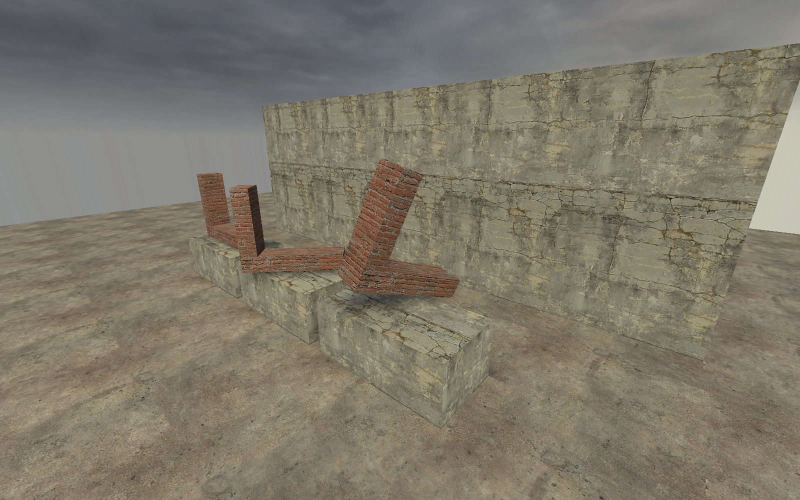
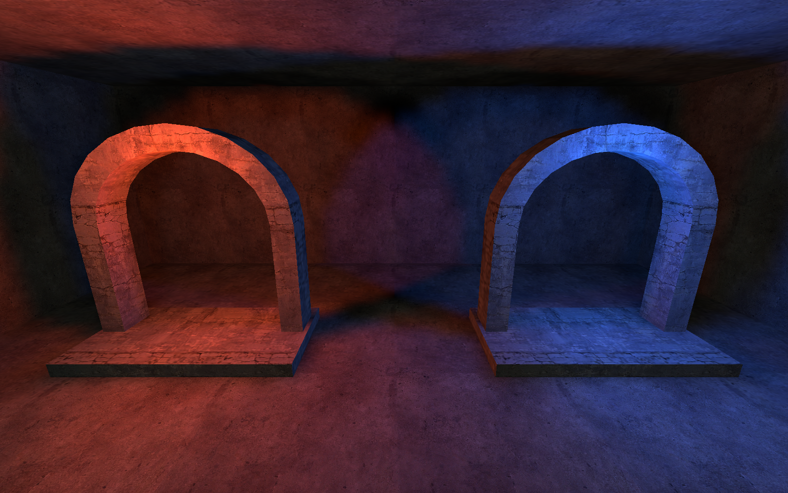

[← Manual](README.md)

# Compiled assemblies

Compile supported contents of saved child VMFs into a parent map.

1. Save the child assembly inside the parent's directory tree.
2. Create an [instance reference](instance-authoring.md).
3. Open **Instance contents…** and click **Refresh instance contents**.
4. Resolve reported path, content or dependency errors.
5. Compile the parent.
6. Inspect **Instances**, **Files**, **Nesting depth** and diagnostics in **Build details…**.

## Supported contents

| Content | Support |
| --- | --- |
| World and ordinary `func_detail` brushes | Checked transformed geometry and textures. |
| Terrain | Supported explicit grids, borders and transformed geometry. |
| Point, spot and sun lights | Checked static or supported built-in appearance settings. |
| Static props | Supported models, skins, transforms and scoped lighting origins. |
| Player spawns | Supported CS:S spawn classes. |
| Stationary brush models | `func_brush` with supported pivots and initial poses. |
| Overlays | Supported unnamed projections bound to direct child world/detail or terrain faces. |
| Cubemap samples | Supported positions and direct ordinary world/detail manual bindings. |
| Visibility helpers and occluders | Checked static helper classes and supported geometry. |

Compiler support does not imply a full parent viewport preview of each child entity.
Read [instance contents](instance-contents.md) for display limits.

## Rotate a stationary child brush

1. Open the child VMF as a normal map.
2. Select an eligible `func_brush`.
3. Enable **Advanced properties**.
4. Enter `angles` under **Property key**.
5. Enter pitch, yaw and roll under **Value**, then press Enter.
6. For example, enter `15 35 10`.
7. Save the child, return to the parent, and compile.

Angles must be finite and within ±360 degrees per component.
The installed FGD has no labeled rotation field for this class; use the raw property.

Compilation resolves and consumes any origin brush first.
It rotates the stationary body and attached texture coordinates before applying containing reference transforms.
The compiled body has zero entity angles; the child VMF keeps its authored values.

The foreground assembly combines initial pitch, yaw and roll with a containing reference rotation.

Moving brush models, parenting and named brush models remain unsupported.
The compiled entity does not retain the child's original angle value.
The parent reference preview remains unavailable for child models.

## Light colors per reference

Use one child map with different point or spot light colors in each reference.

1. Open the child VMF.
2. Select a `light` or `light_spot`, then enable **Advanced properties**.
3. Set **Property key** to `_light`.
4. Set **Value** to `$tint`, then press Enter.
5. Save the child and return to the parent.
6. Select an instance reference and enable **Advanced properties**.
7. Set **Property key** to `replace01`.
8. Set **Value** to `$tint 255 220 180 400`, then press Enter.
9. Open **Build settings…**.
10. Set **Build lighting** to **Direct LDR** or **Direct LDR + HDR**, then click **Close**.
11. Compile the parent.

For HDR, set the child's `_lightHDR` to `$hdr`.
Set the containing reference's `replace02` to `$hdr 255 240 220 600`.
Each reference can supply different values. Compilation keeps the saved child unchanged.
Use [compiled light inspection](compiled-lights.md) to check the effective LDR and HDR records.

To bind sun and sky colors, use an unnamed `light_environment` in the child:

1. Open the child, select `light_environment`, and enable **Advanced properties**.
2. Set **Property key** to `_light` and **Value** to `$sun`, then press Enter.
3. Set **Property key** to `_ambient` and **Value** to `$sky`, then press Enter.
4. Save the child and return to the parent.
5. Select its instance reference and enable **Advanced properties**.
6. Set `replace01` to `$sun 255 220 180 200` using **Property key** and **Value**.
7. Set `replace02` to `$sky 180 210 255 40` the same way.
8. Choose **Direct LDR** or **Direct LDR + HDR** in **Build settings…**, then compile.

The child's `_lightHDR` and `_ambientHDR` also accept whole-value tokens.
Bind them in separate replacement slots; a literal `-1 -1 -1 1` keeps normal HDR inheritance.
**SunSpreadAngle** remains a literal value.
Baked lighting still permits one global `light_environment` across the parent and its children.

To bind an HDR gain:

1. In the child, enable **Advanced properties**.
2. Set **Property key** to `_lightscaleHDR` and **Value** to `$gain`, then press Enter.
3. Save the child and return to the parent.
4. Select its instance reference and enable **Advanced properties**.
5. Set an unused replacement slot, such as `replace03`, to `$gain 1.5`.
6. Choose **Direct LDR + HDR** in **Build settings…**, then compile.

`_lightscaleHDR` supports point, spot and sun lights.
For sky ambient gain, use `_AmbientScaleHDR` on `light_environment` and another replacement slot.
A gain binding must contain one finite, nonnegative number. Zero is valid.
An absent gain keeps the normal value of 1. An unresolved token has no evaluated gain.

Use `replace01` through `replace10`. Each value has the form `$name literal`.
Names are case-insensitive, with 1–64 ASCII letters, digits or underscores; the first character cannot be a digit.
A parameter must fill the whole supported value field. Each containing reference must supply every used parameter.

Missing, duplicate or unused bindings fail. Invalid effective light values also fail, including in Fullbright builds.
An unresolved child template can be edited and saved, but cannot compile alone.
Preview excludes unresolved lamps and reports a reason; the parent still has no child-light preview.

Point and spot lights support `_light`, `_lightHDR` and `_lightscaleHDR`.
Sun lights also support `_ambient`, `_ambientHDR` and `_AmbientScaleHDR`.
Bindings apply only to direct child lights. Other scalar fields remain literal.
Nested references bind their own direct child lights. Ancestor forwarding, partial replacement and parameter declarations remain unsupported.

## Names and parameters

Use **Advanced properties → Fix Up Name** and **Entity Name Fix Up → Prefix** for supported scoped names.
Lighting-origin branches require explicit prefixes at every enclosing level.
Child helper names and references must agree before expansion.
Unsupported replacements, name fixups, scripts or dynamic references fail explicitly.

## Source ownership

The open parent document is authoritative. Child files are read from their checked saved paths.
Builds retain dependency identities; changed or missing children make old output stale or unavailable.
A failed expansion preserves the previous published BSP.

## Limits

- Four helper levels, 256 occurrences and 32 normalized requested paths, plus shared source and geometry budgets.
- Each reference resolves from the saved root parent's tree. Child symlinks and outside paths reject.
- Source and intermediate positions must remain within ±16384.
- General runtime entities, arbitrary parenting, dynamic scripts and unsupported initial poses remain unavailable.
- Child overlay and cubemap bindings cannot cross occurrence scopes or target unsupported owners.
- Inspect the current diagnostic for exact class and material restrictions; admission differs by compiler consumer.
