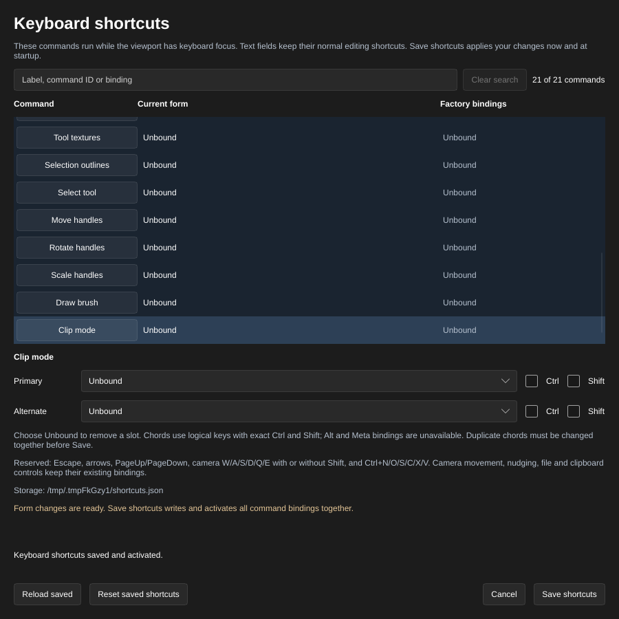

[← Manual](README.md)

# Keyboard shortcuts

Choose up to two bindings for each viewport command. Text fields keep their
normal editing keys.

| Area | Commands |
| --- | --- |
| Editing | Undo, Redo, Frame selection, Delete selection, Duplicate selection |
| Projection | Perspective, Top, Front, Side |
| Selection | Objects, Faces |
| Visibility and grid | Show grid, Snap to grid, Tool textures, Selection outlines |
| Transform tools | Select tool, Move handles, Rotate handles, Scale handles |
| Authoring modes | Draw brush, Clip mode |

Projection, selection-mode, toggle, transform-tool and authoring-mode commands start **Unbound**,
including when an older saved shortcuts file loads.

1. In **VIEWPORT**, click **Keyboard shortcuts…**.
2. Use **Search commands** to find a label, command ID or displayed binding.
   Searches ignore case; every space-separated term must match the command's
   label, ID, **Current form** binding or **Factory bindings**. For example,
   `clip_mode` finds Clip mode and `frame F8` finds a Frame binding using F8.
   Choose a result in the list. **Clear search** restores all 21 commands.
   Compare **Current form** with **Factory bindings**.
3. Set **Primary** and **Alternate** using the key dropdowns and **Ctrl** and
   **Shift** switches. Choose **Unbound** to remove a slot.
4. Resolve any duplicate or reserved binding shown below the controls. To swap
   bindings, edit both commands before saving.
5. Click **Save shortcuts** to activate the complete form now and at startup.
   Hidden rows retain their unsaved edits. Save validates and writes every
   command, including when the search has no results. Reload replaces the full
   form while keeping the current search; Cancel discards unsaved edits.
   Click the viewport before using a binding. Its **Frame** hint reflects the
   current binding.
   Projection bindings use the same per-view cameras as the viewport's projection
   controls and affect the document whose viewport received the key.
   **Objects** and **Faces** match the **Selection** dropdown: changing modes
   clears the selection and obsolete drafts or gestures. Entering Faces also
   stops clipping and brush drawing. Either command exits component editing,
   including when its selection mode is already active.
   Toggle bindings invert the corresponding setting in the receiving viewport.
   **Snap to grid** matches the **Snap** checkbox; toggling a live setting does
   not save grid or preview defaults.
   **Select tool**, **Move handles**, **Rotate handles** and **Scale handles**
   match the viewport tool dropdown. They preserve your axes, pivot, texture
   settings, angle snap and Objects/Faces mode. Changing tools cancels
   pending transforms and held paint strokes; releasing the old gesture cannot apply it. Repeating
   the active tool keeps its current transform preview.
6. **Draw brush** activates planar brush drawing. From Perspective, entering it
   selects Top without creating a brush. Draw a footprint to create the brush;
   **Select objects** leaves drawing mode. Depth, elevation, grid and material
   choices stay configured. Repeated presses keep the current drawing preview
   and camera, including a Perspective view selected while drawing is active.
   **Clip mode** activates clipping for selected brushes or brush entities. From
   Perspective, entering it selects Top. Choose a plane and click **Apply cut**
   to change geometry or **Cancel cut** to leave clipping. Repeated presses keep
   the cut preview and any current plane drag. Without an eligible selection,
   the command reports an error and keeps the current draft. Both modes use the
   ordinary tool cleanup.
7. **Reload saved** loads and activates the saved file. **Reset saved shortcuts**
   explicitly writes and activates factory values. **Cancel**, Escape or closing
   the window discards unsaved form changes; it does not undo a saved change.

Limits:

- Search accepts at most 128 UTF-8 bytes and uses literal text, without regular
  expressions or fuzzy matching. No results disables the binding editors;
  clearing the search keeps all existing edits. A search error keeps the prior
  results and the storage status. Opening the window starts with all commands.
- Keys are logical A–Z, F1–F12, Delete and Backspace, with exact Ctrl/Shift
  modifiers. Alt/Meta bindings, physical scan codes and key sequences are absent.
- Escape, arrows, PageUp/PageDown, camera W/A/S/D/Q/E with or without Shift, and
  Ctrl+N/O/S/C/X/V remain reserved. File, clipboard and camera movement
  bindings cannot be changed here. Command availability
  still follows editing context; transform handles require eligible object
  selection and the existing tool context.
- An unavailable saved file shows an error and preserves active bindings.
  Save remains disabled until Reload succeeds or you explicitly Reset.
  Outside changes require another inspection. Symlinked/nonregular targets and
  files over 16 KiB reject; malformed storage is never overwritten by ordinary
  Save. Save and Reset coordinate with other editors through a nonblocking
  lock; a busy lock preserves the file and active bindings. Reload before
  retrying. Changed directories require explicit Reload. Programs that ignore
  the lock can still race with publication. Coordinated writes require Linux;
  other platforms reject publication.
- If a write completes but verification fails, the dialog reports the completed
  write and its error. The intended saved bindings remain active; Reload to
  inspect storage before continuing.
- Bindings are local preferences. Saving them does not edit the map or Undo
  history. The factory shortcuts in [Editor basics](basics.md) remain useful
  when no saved configuration exists.
- Objects/Faces commands change only the originating document's selection mode;
  camera, map data and Undo history stay unchanged. Repeating the active mode
  keeps ordinary selections and drafts, while still exiting component editing.
- Toggle commands use the same cleanup as their checkboxes. Grid/Snap changes
  retire spatial previews and area/volume/paint gestures. Tool textures changes
  retire area/volume/paint gestures; view toggles keep the existing clip/component
  drag cleanup. Map data and Undo history stay unchanged.
- Loading an older version-1 file preserves its bytes and existing chords.
  Missing command slots stay Unbound until you configure and save them.
