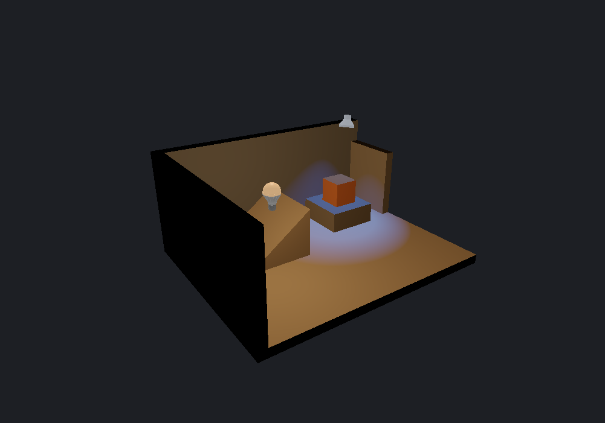

[← Manual](README.md)

# Authored lighting preview

See the diffuse effect of supported point and spot lights while editing,
without compiling. The preview is unshadowed and uses an editor exposure policy.

1. Place a **light** or **light_spot** using **Place entity** and choose its
   color, brightness and falloff. Use unnamed, constant lights for this preview.
2. Set **Viewport** to **Textured** and enable **Unshadowed authored lighting**.
3. Choose **Detail · per-fragment lighting** for local light pools and supported
   normal maps. **Fast · vertex lighting** evaluates polygon vertices and can
   miss small pools on large faces; disable **Normal map preview** to use Fast.
4. Set **Lighting exposure (EV)** between −8 and 8 and press Enter. Zero is the
   initial exposure. This changes the editor display, not compiled lighting.
5. Read the admitted/excluded light and receiver counts. Repair excluded assets
   or unsupported light settings before relying on their appearance. A scene
   with zero admitted lights shows supported receiver surfaces as black.
6. Move or edit lights to update the preview. Disable **Unshadowed authored
   lighting** to return to ordinary editor shading.

Limits:

- At most 32 visible, finite, unnamed style-0 `light`/`light_spot` entities are
  admitted. Parenting, patterns, switching, initial darkness and other light
  classes are unsupported. Exceeding the supported-light or radiance budget
  disables the whole preview with an explanation.
- Opaque flat `LightmappedGeneric` world/detail/brush-entity surfaces and
  supported single-base world/detail terrain receive lighting. Terrain uses its
  prepared sewn LOD normals, excludes declared bump/blend/detail effects, and
  reports surfaces/drawn triangles separately; see [Terrain](terrain.md#preview-authored-lighting).
  Supported opaque single-base `VertexLitGeneric` model meshes also receive
  lighting, with selected skins/bodygroups, uniform scale, rotated normals and
  tint; see [Models](models.md#preview-authored-lighting). One unsupported
  selected material excludes the entire model, with separate instance/part/drawn-
  triangle counts. Sprites, helpers, tools, missing images, translucent/alpha-
  tested materials and unsupported effects keep their ordinary display.
- There are no shadows, sunlight, ambient light, bounce or animation. Lights
  shine through blockers. The preview does not establish native game brightness
  or tone-map parity; compile to inspect the final lighting.
- Display uses linear base color and diffuse contribution, exposure and
  per-channel Reinhard compression, followed by the viewport's sRGB conversion.
  Detail composes with supported normal maps. Fast and normal-map preview cannot
  be enabled together.
- Changed material assets require **Reload material assets**. Preview controls
  preserve map data, camera, selection, history and owned editing reviews.
  These settings are session-local and are not saved by Preview defaults.
