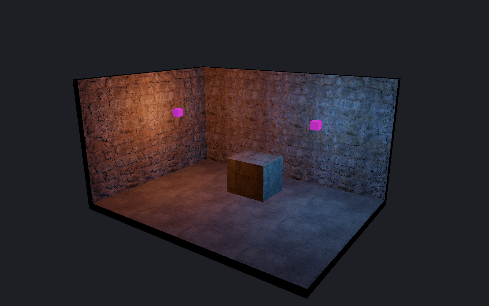
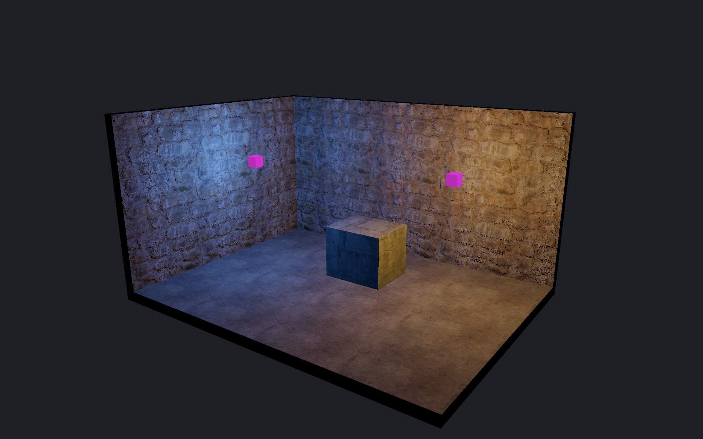

[← Manual](README.md)

# Authored lighting preview

Compare LDR and HDR point, spot and sun lighting before a build.

1. Use **Place entity** to add `light`, `light_spot` or `light_environment`.
2. Set the light color, brightness and direction.
3. Choose **Textured** in the viewport header.
4. Enable **Unshadowed authored lighting**.
5. Select **Lighting channel → LDR** or **HDR**. The default is **LDR**.
6. Enable **Include sky ambient** to add constant, unoccluded ambient light from the eligible sun.
7. Select **Detail · per-fragment lighting** for small light pools and normal maps.
8. Set **Lighting exposure (EV)** from −8 to 8.
9. Check which lights and surfaces are included or excluded.

| LDR | HDR |
| --- | --- |
|  |  |

**Fast · vertex lighting** evaluates vertices. It can miss light pools between vertices.
HDR uses the compiler's `_lightHDR`, `_ambientHDR`, `_lightscaleHDR` and `_AmbientScaleHDR` rules.
Absent HDR colors and supported negative-RGB sentinels inherit the compiler's corresponding values; HDR gains still apply.
The selected channel remains visible when the preview is off.

**Lighting exposure (EV)** scales linear lighting before the editor's Reinhard tone map.
**Sky channel** and **HDR sky exposure (EV)** control the sky image separately.
These preview settings are temporary and do not edit the map or saved preview defaults.
Use **Reload material assets** after changing materials.

## Limits

- No baked material emission, shadows, bounce, styles, animation or sky visibility test. Lights can shine through walls.
- Malformed requested HDR fields exclude that light with its entity ID and reason; they do not select LDR. Literal ambient fields are ignored when **Include sky ambient** is off.
- Unresolved light-value parameters exclude that light in either channel, including HDR and ambient tokens when **Include sky ambient** is off. Other valid lamps remain available.
- At most 32 visible, unnamed, constant lights, including one sun.
- Parenting, switching, patterns and initially dark lights are unsupported.
- Supported opaque brush faces, single-base terrain and authored model meshes receive either channel.
- Blend, transparent, alpha-tested and unsupported material effects remain unavailable.
- Excluded receivers keep their ordinary display and report a reason.
- Exceeding the light or radiance budget disables the preview with an error.
- No native exposure adaptation or brightness and tone-map match. Compile to inspect game lighting.

See [normal maps](normal-maps.md), [models](models.md#preview-authored-lighting) and [terrain](terrain.md#preview-authored-lighting).
