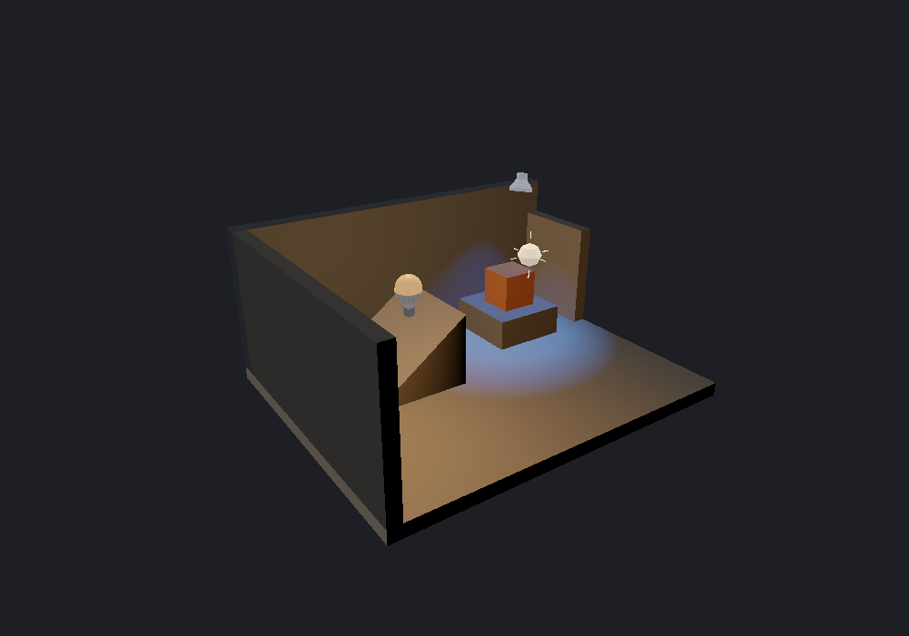

[← Manual](README.md)

# Authored lighting preview

See the diffuse effect of supported point, spot and direct sun lights while editing,
without compiling. The preview is unshadowed and uses an editor exposure policy.

1. Place a **light**, **light_spot** or **light_environment** using **Place entity**.
   Choose its color and brightness, point/spot falloff or sun direction. Use
   unnamed, constant lights and at most one visible sun for this preview.
2. Set **Viewport** to **Textured** and enable **Unshadowed authored lighting**.
3. Choose **Detail · per-fragment lighting** for local light pools and supported
   normal maps. **Fast · vertex lighting** evaluates polygon vertices and can
   miss small pools on large faces; disable **Normal map preview** to use Fast.
4. Set **Lighting exposure (EV)** between −8 and 8 and press Enter. Zero is the
   initial exposure. This changes the editor display, not compiled lighting.
5. Optionally enable **Include LDR sky ambient**. It defaults off and adds the
   eligible sun's LDR ambient equally to every supported receiver, without
   checking sky visibility or blockers.
6. Read the admitted/excluded light and receiver counts. Repair excluded assets
   or unsupported light settings before relying on their appearance. A scene
   with zero admitted lights shows supported receiver surfaces as black.
7. Move or edit lights to update the preview. Disable **Unshadowed authored
   lighting** to return to ordinary editor shading.

Limits:

- At most 32 visible, finite, unnamed style-0 lights are admitted, including at
  most one `light_environment` alongside `light`/`light_spot`. Every conflicting
  visible sun is excluded with its own diagnostic; hiding the extra sources
  restores the remaining eligible sun. Parenting, patterns, switching, initial darkness and other light
  classes are unsupported. Exceeding the supported-light or radiance budget
  disables the whole preview with an explanation.
- Sun uses the compiler's LDR color, brightness and direction convention,
  including target direction. An absent origin defaults to zero; a present
  origin must contain three finite coordinates inside Source compile bounds. Its
  contribution depends on the receiver normal, without point attenuation.
  Moving an angle-directed sun does not change its illumination. Sources use
  the current render document and visible working region, including pending
  previews; a sun outside that region is excluded, unlike a compiler cordon.
- Opaque flat `LightmappedGeneric` world/detail/brush-entity surfaces and
  supported single-base world/detail terrain receive lighting. Terrain uses its
  prepared sewn LOD normals, excludes declared bump/blend/detail effects, and
  reports surfaces/drawn triangles separately; see [Terrain](terrain.md#preview-authored-lighting).
  Supported opaque single-base `VertexLitGeneric` model meshes also receive
  lighting, with selected skins/bodygroups, uniform scale, rotated normals and
  tint; see [Models](models.md#preview-authored-lighting). One unsupported
  selected material excludes the entire model, with separate instance/part/drawn-
  triangle counts. Sprites, helpers, tools, missing images, translucent/alpha-
  tested materials and unsupported effects keep their ordinary display.
- **Include LDR sky ambient** uses the compiler's `_ambient` color/brightness.
  Missing or empty `_ambient` uses half the direct sun intensity. Ambient adds a
  constant contribution regardless of receiver normal and shares the sun's
  existing light slot and per-channel radiance budget. Malformed requested
  ambient excludes the entire sun with a diagnostic; when disabled, ambient
  fields remain ignored. It is an unoccluded editor preview, not ambient visibility.
- There are no shadows, bounce or animation. Sun ignores
  HDR light/ambient overrides and `SunSpreadAngle` illumination;
  spread remains range-checked but does not create penumbrae. There is no sky
  visibility test: lights shine through blockers and sun needs no sky surface.
  Sky-camera miniatures retain their separate fixed shading.
  The preview does not establish native game brightness
  or tone-map parity; compile to inspect the final lighting.
- Display uses linear base color and diffuse contribution, exposure and
  per-channel Reinhard compression, followed by the viewport's sRGB conversion.
  Detail composes with supported normal maps. Fast and normal-map preview cannot
  be enabled together.
- Changed material assets require **Reload material assets**. Preview controls
  preserve map data, camera, selection, history and owned editing reviews.
  These settings are session-local and are not saved by Preview defaults.
