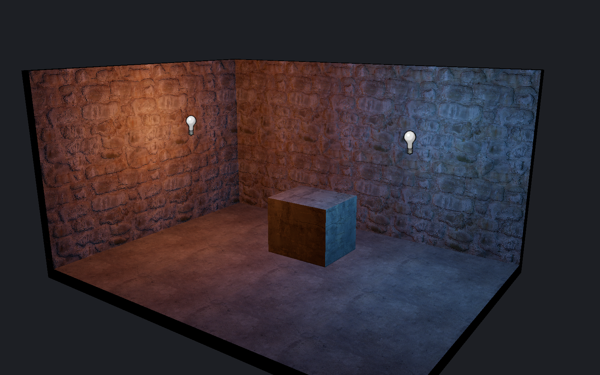

[← Manual](README.md)

# Authored lighting preview

Inspect point, spot and sun lighting before a build.

1. Use **Place entity** to add `light`, `light_spot` or `light_environment`.
2. Set the light color, brightness and direction.
3. Choose **Textured** in **Viewport**.
4. Enable **Unshadowed authored lighting**.
5. Select **Detail · per-fragment lighting** for small light pools and normal maps.
6. Set **Lighting exposure (EV)** from −8 to 8.
7. Check which lights and surfaces are included or excluded.

**Fast · vertex lighting** evaluates vertices. It can miss light pools between vertices.
**Include LDR sky ambient** adds constant, unoccluded ambient light from the eligible sun.
Use **Reload material assets** after changing materials.

## Limits

- No shadows, bounce, animation or sky visibility test. Lights can shine through walls.
- Unresolved point/spot or sun/sky color parameters exclude that light with a reason. This includes HDR and ambient tokens even when **Include LDR sky ambient** is off. Other valid lamps remain available.
- At most 32 visible, unnamed, constant lights, including one sun.
- Parenting, switching, patterns and initially dark lights are unsupported.
- Supported opaque brush faces, single-base terrain and model meshes receive light.
- Blend, transparent, alpha-tested and unsupported material effects remain unavailable.
- Excluded receivers keep their ordinary display and report a reason.
- Exceeding the light or radiance budget disables the preview with an error.
- Exposure and ambient controls change the editor display only. Compile to inspect game lighting.

See [normal maps](normal-maps.md), [models](models.md#preview-authored-lighting) and [terrain](terrain.md#preview-authored-lighting).
